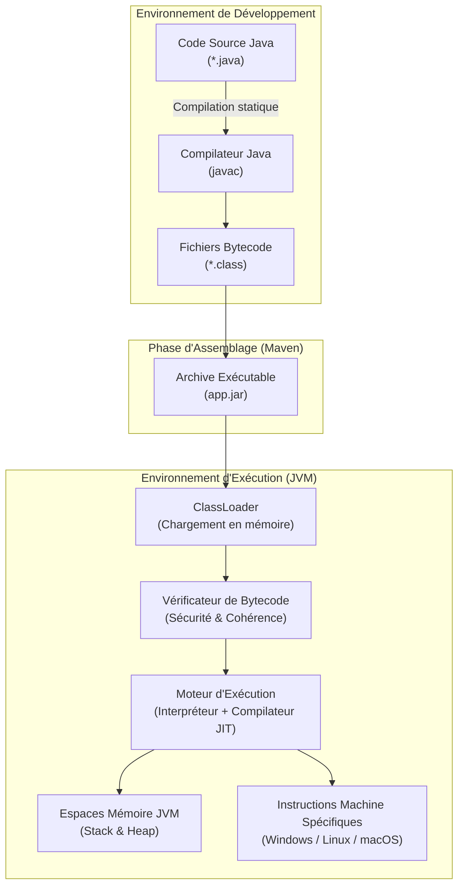

# Architecture JVM, Compilation Bytecode et Artefact JAR

## 1. Introduction & Contexte Métier

Bienvenue dans ce cycle d'ingénierie logicielle avancée en Java. Lorsque vous concevez un système de gestion académique ou bancaire destiné à tourner 24h/24 en production — tel que notre projet de référence **`com.ism : Gestion-etudiants-notes-java`** —, vous ne pouvez pas vous contenter d'écrire du code qui compile "par magie" sur votre machine de développement. Un ingénieur logiciel accompli se doit de comprendre le comportement intime du moteur d'exécution sous-jacent.

Trop de développeurs débutants considèrent Java comme un simple langage interprété ou, à l'inverse, comme un langage compilé natif comme le C++. Cette méconnaissance conduit à de graves désillusions lors du passage en production : crashs liés à la saturation de la mémoire vive (*OutOfMemoryError*), lenteurs imprévues au démarrage, dépendances introuvables (*ClassNotFoundException*), ou artefacts de déploiement corrompus.

Comme le martèle le Professeur **Baila Wane** lors des cours magistraux à l'ISM Dakar : 
> *"En entreprise, on ne livre jamais un ensemble de fichiers `.java` en vrac sur un serveur ! On produit un livrable immuable, testé, autonome et versionné : une archive JAR ou WAR, prête à être exécutée par la machine virtuelle sans la moindre modification de code."*

Dans ce chapitre, nous allons déconstruire l'écosystème Java : du fichier source `.java` jusqu'à l'exécution optimisée en mémoire par la JVM, en passant par le standard industriel de construction de projet : **Apache Maven**.

---

## 2. Architecture & Fondations Conceptuelles

> ℹ️ **Distinction Essentielle : Compilateur javac vs Moteur d'exécution java (JVM)**
> Une confusion fréquente chez les développeurs débutants consiste à assimiler le compilateur à la machine virtuelle.
> - **`javac`** (*Java Compiler*) : analyse statiquement vos fichiers source `.java` et produit le bytecode universel `.class`.
> - **`java`** : lance la machine virtuelle (JVM) qui charge, interprète et optimise l'exécution de ce bytecode sur le processeur hôte.
> En environnement professionnel, les versions livrables sont scellées par des **Tags Git immuables** (ex: `v1.0.0`) pour garantir une traçabilité sans faille.

### 2.1 Le paradigme "Write Once, Run Anywhere" (WORA)

Historiquement, le langage C/C++ compile le code source directement en instructions machine binaires spécifiques à un processeur (x86, ARM) et à un système d'exploitation donné (Windows PE, Linux ELF). Si vous compilez sous Windows x64, votre exécutable est incapable de tourner sur un serveur Linux.

Java résout cette problématique en introduisant une couche d'abstraction : la **Java Virtual Machine (JVM)**. Le compilateur `javac` ne génère pas de binaire machine direct, mais un format intermédiaire universel appelé **Bytecode** (fichiers `.class`).



### 2.2 Anatomie interne de la JVM

La machine virtuelle Java comprend trois sous-systèmes fondamentaux :

1. **Le ClassLoader Subsystem** :
   - *Loading* : Recherche et charge les fichiers `.class` en mémoire (Bootstrap ClassLoader, Extension/Platform ClassLoader, Application ClassLoader).
   - *Linking* : Vérifie que le bytecode respecte les règles de sécurité, alloue la mémoire pour les variables statiques, et résout les références symboliques.
   - *Initialization* : Exécute les blocs d'initialisation statiques (`static { ... }`).

2. **Les Espaces Mémoire d'Exécution (Runtime Data Areas)** :
   - **Heap (Le Tas)** : Espace partagé entre tous les threads où sont instanciés tous les objets (`new Etudiant()`, `new Note()`). Le Garbage Collector (GC) supervise cette zone pour désallouer automatiquement la mémoire des objets qui ne sont plus référencés.
   - **Stack (La Pile des Threads)** : Chaque thread dispose de sa propre pile. Elle stocke les blocs de méthodes (*stack frames*), les variables locales de types primitifs (`int`, `double`) et les pointeurs de référence vers les objets situés dans le Heap.
   - **Method Area / Metaspace** : Stocke la structure des classes, les métadonnées, le pool de constantes et les variables statiques.

3. **Le Moteur d'Exécution (Execution Engine)** :
   - **Interpréteur** : Lit et exécute le bytecode instruction par instruction au démarrage.
   - **Compilateur JIT (Just-In-Time)** : Détecte les portions de code fréquemment appelées ("hotspots") et les compile directement en langage machine natif pour des performances optimales.
   - **Garbage Collector (GC)** : Nettoie en arrière-plan la mémoire Heap sans intervention manuelle du développeur (contrairement au `free()` ou `delete` du C++).

### 2.3 Distinction JDK vs JRE vs JVM

Pour éviter toute confusion dans vos environnements de travail :

| Composant | Description | Utilité |
| :--- | :--- | :--- |
| **JVM** (Java Virtual Machine) | La machine virtuelle abstraite qui interprète le bytecode et gère la mémoire. | Moteur d'exécution pur. |
| **JRE** (Java Runtime Environment) | Contient la JVM + les bibliothèques standard de l'API Java (Core Libs : `java.lang`, `java.util`, etc.). | Suffisant pour faire tourner une application sur un poste client. |
| **JDK** (Java Development Kit) | Contient le JRE + les outils de développement (`javac`, `jar`, `javadoc`, débogueur `jdb`). | Indispensable pour l'ingénieur logiciel qui conçoit et compile le code. |

---

## 3. Implémentation Pratique & Code de Référence

### 3.1 Structure standard d'un projet Maven

Apache Maven standardise l'arborescence des applications Java d'entreprise. Dans notre projet de référence `com.ism`, le code respecte scrupuleusement le standard *Maven Standard Directory Layout* :

```text
gestion-etudiants-notes-java/
├── pom.xml                               # Fichier maître de configuration Maven
├── src/
│   ├── main/
│   │   ├── java/                         # Code source de production
│   │   │   └── com/
│   │   │       └── ism/
│   │   │           ├── domain/           # Entités métier pures
│   │   │           ├── dto/              # Objets de transfert de données
│   │   │           ├── repository/       # Contrats et persistance mémoire
│   │   │           ├── service/          # Traitements métier
│   │   │           ├── factory/          # Fabriques d'instanciation
│   │   │           └── Main.java         # Point d'entrée exécutable
│   │   └── resources/                    # Fichiers de configuration (properties, yaml, sql)
│   └── test/
│       └── java/                         # Tests unitaires et d'intégration
└── target/                               # Dossier généré contenant les .class et le JAR final
```

### 3.2 Configuration du `pom.xml` pour un JAR Exécutable

Le fichier `pom.xml` (*Project Object Model*) déclare les coordonnées uniques du projet, les dépendances externes (comme Lombok) et les plugins de construction.

Voici la configuration exacte recommandée par le Professeur Baila Wane pour compiler sous Java 17/21 et produire un artefact JAR exécutable :

```xml
<?xml version="1.0" encoding="UTF-8"?>
<project xmlns="http://maven.apache.org/POM/4.0.0"
         xmlns:xsi="http://www.w3.org/2001/XMLSchema-instance"
         xsi:schemaLocation="http://maven.apache.org/POM/4.0.0 
         http://maven.apache.org/xsd/maven-4.0.0.xsd">
    <modelVersion>4.0.0</modelVersion>

    <!-- Coordonnées Maven uniques du projet -->
    <groupId>com.ism</groupId>
    <artifactId>gestion-etudiants-notes-java</artifactId>
    <version>1.0.0-SNAPSHOT</version>
    <packaging>jar</packaging>

    <name>Gestion Etudiants et Notes Java</name>
    <description>Application d'architecture métier pour la gestion académique ISM</description>

    <properties>
        <maven.compiler.source>17</maven.compiler.source>
        <maven.compiler.target>17</maven.compiler.target>
        <project.build.sourceEncoding>UTF-8</project.build.sourceEncoding>
        <lombok.version>1.18.30</lombok.version>
    </properties>

    <dependencies>
        <!-- Lombok pour la réduction du code boilerplate (Getters/Setters/Builders) -->
        <dependency>
            <groupId>org.projectlombok</groupId>
            <artifactId>lombok</artifactId>
            <version>${lombok.version}</version>
            <scope>provided</scope>
        </dependency>
    </dependencies>

    <build>
        <plugins>
            <!-- Plugin de compilation Java -->
            <plugin>
                <groupId>org.apache.maven.plugins</groupId>
                <artifactId>maven-compiler-plugin</artifactId>
                <version>3.11.0</version>
                <configuration>
                    <source>${maven.compiler.source}</source>
                    <target>${maven.compiler.target}</target>
                    <annotationProcessorPaths>
                        <path>
                            <groupId>org.projectlombok</groupId>
                            <artifactId>lombok</artifactId>
                            <version>${lombok.version}</version>
                        </path>
                    </annotationProcessorPaths>
                </configuration>
            </plugin>

            <!-- Plugin d'assemblage du JAR exécutable avec déclaration du Main-Class -->
            <plugin>
                <groupId>org.apache.maven.plugins</groupId>
                <artifactId>maven-jar-plugin</artifactId>
                <version>3.3.0</version>
                <configuration>
                    <archive>
                        <manifest>
                            <addClasspath>true</addClasspath>
                            <mainClass>com.ism.Main</mainClass>
                        </manifest>
                    </archive>
                </configuration>
            </plugin>
        </plugins>
    </build>
</project>
```

### 3.3 Cycle de vie Maven et commandes en ligne de commande

Maven organise le travail autour de phases standards du cycle de vie (*Build Lifecycle*) :

```bash
# 1. Nettoyer le répertoire cible target/
mvn clean

# 2. Compiler les classes de production (.java -> .class dans target/classes)
mvn compile

# 3. Exécuter la suite de tests unitaires
mvn test

# 4. Assembler l'archive JAR finale dans target/
mvn package

# 5. Installer l'artefact dans le dépôt local de votre machine (~/.m2/repository)
mvn install
```

Pour exécuter votre application compilée directement depuis n'importe quel terminal ou serveur :
```bash
# Lancement direct du JAR autonome
java -jar target/gestion-etudiants-notes-java-1.0.0-SNAPSHOT.jar
```

### 3.4 Gestion du Cache Local Maven (`~/.m2`) et Résilience Réseau

Une problématique fréquemment rencontrée en environnement de cours ou en entreprise concerne le téléchargement des dépendances :
- Lorsque vous ajoutez une dépendance dans `pom.xml` (par exemple Lombok ou un driver SGBD), Maven interroge d'abord le **dépôt local** situé dans votre répertoire utilisateur : `~/.m2/repository` (sous Windows : `C:\Users\<Utilisateur>\.m2\repository`).
- Si l'artefact y est déjà présent, Maven l'utilise immédiatement sans solliciter le réseau.
- Si l'artefact est absent, Maven contacte le dépôt distant **Maven Central**.

> 💡 **Résolution d'incident réseau en salle de travaux pratiques :**
> Si votre connexion internet faiblit ou est bloquée par un proxy d'entreprise, IntelliJ IDEA ou VS Code affiche une dépendance soulignée en rouge dans le `pom.xml`.
> La parade d'ingénieur consiste à copier le dossier de la dépendance depuis la machine d'un collègue disposant déjà de la bibliothèque dans son `~/.m2/repository` vers votre propre `.m2`. Dès que les fichiers `.jar` et `.pom` sont déposés dans le bon chemin arborescent, Maven valide instantanément la dépendance sans téléchargement !

### 3.5 Distribution d'Interfaces Partagées sous Forme de JAR Commun (*Projet Contrat*)

Dans les architectures d'entreprise modulaires (ou projets multi-modules), nous appliquons le principe d'isolation du code source :
- Nous créons un sous-projet dédié aux **interfaces et DTOs communs** (souvent baptisé `common-contracts` ou `projet-commande`).
- Ce module est compilé en un fichier JAR autonome via `mvn clean package`.
- Ce JAR est ensuite distribué aux équipes de développement (ou déposé sur un serveur Nexus/Artifactory interne).
- Les développeurs des couches clientes lient ce JAR à leur `pom.xml` : ils ont accès aux signatures de méthodes et aux contrats sans jamais avoir accès au code source interne des algorithmes métier ou des connecteurs de base de données.

---

## 4. Bonnes Pratiques, Pièges & Débogage

> ℹ️ **L'importance des coordonnées Maven :**
> - `groupId` : correspond généralement au nom de domaine inversé de votre organisation (ex: `com.ism`, `sn.woy`). Il garantit l'unicité globale de votre package.
> - `artifactId` : identifie le module ou projet spécifique (ex: `gestion-etudiants-notes-java`).
> - `version` : suit la convention SemVer (ex: `1.0.0-SNAPSHOT` pour une version en développement, `1.0.0` pour une version de production).

> ⚠️ **Le piège classique de la variable JAVA_HOME sous Windows :**
> Si la commande `mvn -version` ou `javac -version` renvoie une erreur ou une version obsolète (comme Java 8 alors que vous utilisez Java 17), vérifiez scrupuleusement vos variables d'environnement système. `JAVA_HOME` doit pointer vers la racine du JDK (ex: `C:\Program Files\Java\jdk-17`) et le répertoire `%JAVA_HOME%\bin` doit être présent en tête de la variable système `Path`.

> 💡 **Pourquoi Lombok est en scope `provided` ?**
> La bibliothèque Lombok génère du bytecode lors de la phase de compilation (via annotation processing). Une fois les `.class` générés avec les accesseurs et constructeurs créés, la dépendance Lombok n'est plus nécessaire à l'exécution dans la JVM ! Le scope `<scope>provided</scope>` allège donc considérablement l'archive finale.

---

## 5. Synthèse & Auto-Évaluation

### Tableau Récapitulatif

| Étape | Outil / Sous-système | Entrée | Sortie | Rôle principal |
| :--- | :--- | :--- | :--- | :--- |
| **Écriture** | IDE (VS Code / IntelliJ) | Développeur | Fichiers `.java` | Modélisation du domaine métier en code source. |
| **Compilation** | `javac` (JDK) | Fichiers `.java` | Fichiers `.class` | Validation syntaxique et production de bytecode universel. |
| **Packaging** | Maven (`maven-jar-plugin`) | Fichiers `.class` | Fichier `.jar` | Regroupement des classes et du manifeste dans une archive zip standardisée. |
| **Exécution** | JVM (`java -jar`) | Fichier `.jar` | Instructions CPU | Chargement en mémoire, compilation JIT et exécution sur le système hôte. |

### Questionnaire d'Auto-Évaluation (QCM)

1. **Quel composant de la JVM est spécifiquement responsable de la compilation du bytecode en instructions machine natives à la volée pendant l'exécution ?**
   - A) Le Garbage Collector
   - B) Le ClassLoader
   - C) Le Compilateur JIT (Just-In-Time)
   - D) Le vérificateur de bytecode
   *Réponse attendue : C. Le JIT identifie les blocs de code intensifs et les transforme en code machine natif pour accélérer l'exécution.*

2. **Où sont alloués les objets créés avec l'opérateur `new` (par exemple `new Etudiant()`) en mémoire JVM ?**
   - A) Dans la Stack (pile) du thread courant
   - B) Dans le Heap (tas) partagé
   - C) Dans les registres du processeur
   - D) Directement sur le disque dur
   *Réponse attendue : B. Tous les objets résident dans le Heap. Seule la référence (l'adresse mémoire) est stockée dans la Stack.*

3. **Quelle balise du `pom.xml` permet d'indiquer à la JVM quelle classe contient la méthode `public static void main(String[] args)` à lancer lors d'un `java -jar` ?**
   - A) `<source>`
   - B) `<annotationProcessorPaths>`
   - C) `<mainClass>` à l'intérieur de la configuration de `<maven-jar-plugin>`
   - D) `<artifactId>`
   *Réponse attendue : C.*

### Exercice Pratique & DevLog

```markdown
[DevLog - Entrée 01]
- Sujet : Initialisation de l'environnement de build et compilation Maven
- Action : Créez manuellement un dossier `gestion-academique`, placez-y un fichier `pom.xml` conforme à celui vu dans cette leçon.
- Défi : Écrivez une classe minimale `com.ism.Main` qui affiche `[SYSTEM] BrainX Core Engine Initialized v1.0.0`. Lancez `mvn clean package` puis démarrez votre application avec `java -jar target/...`. Notez dans votre DevLog la différence de taille entre les fichiers sources et le fichier JAR obtenu.
```
