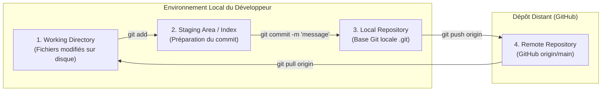
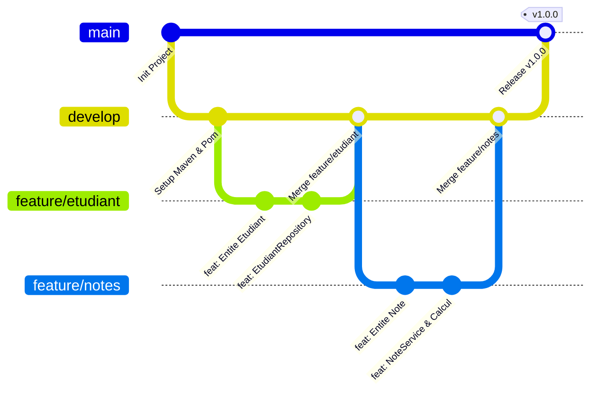

# Git, GitHub et Cycle de Branches GitFlow en Équipe

## 1. Introduction & Contexte Métier

Dans l'industrie du logiciel moderne, aucun projet d'envergure n'est développé en solitaire sans système de contrôle de version. Imaginez une équipe de 5 ingénieurs logiciels travaillant simultanément sur le module de gestion des étudiants, la notation semestrielle et le calcul des moyennes. Si chacun modifie le même fichier sur un serveur partagé ou par transfert d'archives `.zip`, le projet s'effondre en quelques jours sous le poids des conflits de code insolubles et des régressions catastrophiques.

Le contrôle de versions distribué avec **Git** et l'hébergement collaboratif sur **GitHub** ne sont pas de simples "outils de sauvegarde". Ils constituent l'infrastructure critique garantissant :
1. La traçabilité intégrale de chaque ligne de code (qui a modifié quoi, quand, et pourquoi).
2. L'isolation stricte des nouvelles fonctionnalités grâce au mécanisme de branches.
3. La validation collégiale par les pairs (*Pull Request* / *Code Review*) avant toute intégration.
4. Le retour en arrière instantané (*rollback*) en cas de régression en production.

Dans notre projet de référence `com.ism`, le code source est hébergé sur le dépôt distant officiel :
`https://github.com/DianaFerradini/Gestion-etudiants-notes-java`

Comme l'explique le Professeur **Baila Wane** :
> *"Un bon développeur ne pousse JAMAIS directement sur la branche principale `main` ! La branche `main` représente la vérité sacrée de la production. Tout développement passe par une branche de fonctionnalité dédiée, par exemple `features/notes`, testée et validée avant fusion."*

---

## 2. Architecture & Fondations Conceptuelles

### 2.1 Les trois états et zones de travail Git

Git fonctionne selon un modèle à 3 états locaux avant toute synchronisation avec le serveur distant (GitHub) :



1. **Working Directory (Répertoire de travail)** : C'est le miroir physique des fichiers sur votre disque dur. Vous y créez, modifiez ou supprimez des classes Java.
2. **Staging Area (Zone de transit / Index)** : C'est le sas de préparation. Vous y sélectionnez avec précision les modifications atomiques que vous voulez regrouper dans votre prochain commit via `git add`.
3. **Local Repository (Dépôt local)** : C'est la base de données historique Git (dossier caché `.git`). Le commit scelle un instantané (*snapshot*) cryptographiquement sécurisé (somme SHA-1).
4. **Remote Repository (Dépôt distant)** : L'instance centrale hébergée sur GitHub (`origin`) permettant la collaboration d'équipe.

### 2.2 La stratégie de branches GitFlow

Pour organiser le travail sans risque de casse, nous appliquons une variante industrielle de **GitFlow** :



Les rôles des branches sont strictement définis :
- **`main`** : Contient uniquement du code en production, stable et certifié. Chaque version y est marquée d'un tag immuable (`v1.0.0`, `v1.1.0`).
- **`develop`** : Branche d'intégration continue des fonctionnalités validées. C'est le reflet de la prochaine version en cours d'élaboration.
- **`feature/<nom-fonctionnalite>`** : Branches éphémères créées à partir de `develop` pour développer une histoire utilisateur précise (ex: `features/notes`, `feature/etudiants`). Une fois le travail terminé et testé, elle est fusionnée dans `develop`.
- **`hotfix/<nom-anomalie>`** : Branche d'urgence créée directement depuis `main` pour corriger un bug critique en production, puis réinjectée dans `main` et `develop`.

---

## 3. Implémentation Pratique & Commandes de Référence

### 3.1 Initialisation et configuration du dépôt

Lors du démarrage sur un nouveau poste, l'ingénieur configure son identité et clone le projet :

```bash
# Configuration globale de l'auteur
git config --global user.name "Prenom Nom"
git config --global user.email "etudiant@ism.sn"

# Clonage du projet de référence sur la branche features/notes
git clone -b features/notes https://github.com/DianaFerradini/Gestion-etudiants-notes-java.git

# Entrer dans le répertoire de travail
cd Gestion-etudiants-notes-java
```

### 3.2 Cycle de travail complet sur une fonctionnalité et Discipline de Commits

Voici la séquence pas à pas appliquée pour développer la gestion des notes dans `com.ism` :

```bash
# 1. Se positionner sur develop et récupérer l'état le plus récent
git checkout develop
git pull origin develop

# 2. Créer une nouvelle branche de fonctionnalité isolée
git checkout -b feature/notes

# 3. Réaliser les développements par petits incréments fonctionnels
# Règle de Baila Wane : Effectuer des commits fréquents à chaque étape validée !
# Exemple 1 : Commit de la couche Entité
git add src/main/java/com/ism/domain/Note.java
git commit -m "feat(domain): creation de l'entite Note avec annotations Lombok et AbstractEntity"

# Exemple 2 : Commit de la couche Repository
git add src/main/java/com/ism/repository/NoteRepository.java
git add src/main/java/com/ism/repository/memory/NoteRepositoryMemory.java
git commit -m "feat(repository): contrat NoteRepository et implementation en memoire vive"

# Exemple 3 : Commit de la couche Service et calculs
git add src/main/java/com/ism/service/NoteService.java
git add src/main/java/com/ism/service/NoteServiceImpl.java
git commit -m "feat(service): implementation de NoteServiceImpl avec validation et injection de dependance"

# 4. Pousser la branche de fonctionnalité sur GitHub
git push -u origin feature/notes

# 5. Fusionner proprement dans develop avec préservation de l'historique
git checkout develop
git pull origin develop
git merge --no-ff feature/notes -m "Merge feature/notes into develop : finalisation du module de notation"
```

> 💡 **Pourquoi des commits fréquents plutôt qu'un "gros commit de fin de journée" ?**
> Comme l'enseigne Baila Wane en cours : si vous réalisez 4 heures de travail sans committer et que vous introduisez une erreur subtile impossible à déboguer, vous perdez tout votre code pour revenir en arrière. En commitant chaque étape fonctionnelle (Entité, puis Repository, puis Service), vous conservez des points de restauration sûrs grâce à `git checkout <commit_hash>` ou `git revert`.

### 3.3 Versionnement Sémantique (SemVer) et Marquage par Tags Git

Dans le projet de référence, nous appliquons la norme industrielle **Semantic Versioning (`MAJOR.MINOR.PATCH`)** combinée aux tags Git :

1. **Phase de prototypage (`0.x.x`)** :
   - Les versions débutant par `0.` (ex: `v0.1.0`, `v0.3.0`, `v0.7.0`) signalent un projet en cours d'élaboration, **non déployable en production**. L'API et les structures de données peuvent encore évoluer radicalement.
2. **Première version livrable (`1.0.0`)** :
   - Dès que le cœur métier est stabilisé (gestion des étudiants, attribution des notes, calculs de moyenne, persistance mémoire et DTOs hermétiques), nous scellons la version officielle livrable par le tag :
   ```bash
   git tag -a v1.0.0 -m "Release v1.0.0 : Premiere version livrable avec architecture en couches complete"
   git push origin v1.0.0
   ```
3. **Incrémentation des versions** :
   - **Patch (`1.0.1`, `1.0.2`)** : Réservé exclusivement aux corrections d'anomalies (bugfixes) sans ajout de fonctionnalités.
   - **Minor (`1.1.0`)** : Ajout d'une nouvelle fonctionnalité rétro-compatible (ex: export PDF du relevé de notes).
   - **Major (`2.0.0`)** : Changement d'architecture majeur rompant la compatibilité descendante (ex: passage à une API REST ou réécriture des modèles).

> ⚠️ **La règle d'or du tag avant migration :**
> Avant d'entamer une migration technique à haut risque — par exemple remplacer le stockage `DatabaseMemory` par une base relationnelle via JDBC —, posez impérativement un tag Git (ex: `v1.0.1`). Si la migration JDBC s'avère complexe, vous pourrez instantanément redéployer la version stable précédente sans le moindre doute.

### 3.4 Le fichier critique `.gitignore`

Il est formellement interdit de committer des artefacts générés ou des fichiers propres à votre IDE. Voici le fichier `.gitignore` obligatoire à la racine de votre projet Java Maven :

```gitignore
# Artefacts de compilation Maven
target/
*.class

# Fichiers de configuration IDE JetBrains IntelliJ IDEA
.idea/
*.iml
*.iws
out/

# Fichiers de configuration Eclipse
.project
.classpath
.settings/

# Fichiers de configuration Visual Studio Code
.vscode/

# Logs système et fichiers temporaires
*.log
.DS_Store
Thumbs.db

# Fichiers d'environnement contenant des secrets
.env
```

---

## 4. Bonnes Pratiques, Pièges & Débogage

> ℹ️ **La règle d'or des messages de commit (Conventional Commits) :**
> Adoptez le standard de l'industrie pour vos messages de commit :
> - `feat: ...` : Ajout d'une nouvelle fonctionnalité métier.
> - `fix: ...` : Correction d'une anomalie logicielle (bug).
> - `refactor: ...` : Refactorisation de code sans modification fonctionnelle.
> - `test: ...` : Ajout ou correction de tests unitaires.
> - `docs: ...` : Modification de la documentation ou du README.

> ⚠️ **Attention aux conflits de fusion (Merge Conflicts) :**
> Un conflit survient lorsque deux développeurs modifient la même ligne dans le même fichier sur deux branches différentes. Git interrompt la fusion et insère des balises de conflit (`<<<<<<< HEAD`, `=======`, `>>>>>>>`). Ne paniquez pas : ouvrez le fichier dans votre IDE, analysez les deux versions en accord avec vos pairs, conservez le code valide, puis terminez avec `git add <fichier>` et `git commit`.

> 💡 **Pourquoi l'option `--no-ff` (No Fast-Forward) est-elle recommandée par Baila Wane ?**
> Lorsque vous fusionnez une branche feature dans `develop` :
> `git merge --no-ff feature/notes`
> Git force la création d'un commit de fusion explicite. Cela permet de préserver l'historique visuel du groupe de commits appartenant à cette fonctionnalité dans les outils d'audit graphique.

---

## 5. Synthèse & Auto-Évaluation

### Tableau des Commandes Clés Git

| Commande | Action | Bonne pratique associée |
| :--- | :--- | :--- |
| `git status` | Affiche l'état des fichiers (modifiés, indexés, non suivis). | À exécuter avant et après chaque action Git. |
| `git diff` | Montre les modifications ligne par ligne dans le code. | Vérifier scrupuleusement ses modifications avant de faire `git add`. |
| `git checkout -b <nom>` | Crée une nouvelle branche et bascule dessus. | Nommer la branche d'après la tâche (ex: `feature/authentification`). |
| `git pull --rebase` | Récupère les commits distants et rejoue vos modifications locales au-dessus. | Évite les commits de fusion inutiles lors des synchronisations quotidiennes. |
| `git log --oneline --graph` | Affiche l'arbre historique des commits de manière compacte. | Utile pour visualiser les embranchements de l'équipe. |

### Questionnaire d'Auto-Évaluation (QCM)

1. **Quelle commande permet de basculer sur la branche `develop` tout en récupérant ses dernières modifications distantes ?**
   - A) `git push origin develop`
   - B) `git checkout develop && git pull origin develop`
   - C) `git commit -m "update develop"`
   - D) `git branch -d develop`
   *Réponse attendue : B.*

2. **Quel dossier généré par la compilation Maven doit impérativement figurer dans le `.gitignore` ?**
   - A) `src/main/java`
   - B) `target/`
   - C) `src/test/java`
   - D) `pom.xml`
   *Réponse attendue : B. `target/` contient les binaires générés et ne doit jamais être versionné.*

3. **Dans la stratégie GitFlow, d'où doit idéalement partir une branche `feature/calcul-moyenne` ?**
   - A) De `main`
   - B) De `develop`
   - C) De n'importe quelle branche hotfix
   - D) D'un commit anonyme
   *Réponse attendue : B.*

### Exercice Pratique & DevLog

```markdown
[DevLog - Entrée 02]
- Sujet : Mise en place du workflow GitFlow sur le dépôt de travail
- Action : Initialisez un dépôt Git local dans votre projet Java (`git init`), créez votre branche `develop` (`git checkout -b develop`), puis créez une branche `feature/etudiant-modele`.
- Défi : Ajoutez un fichier `.gitignore` complet. Effectuez un commit atomique de configuration, puis simulez la fusion de votre fonctionnalité dans `develop` avec l'option `--no-ff`. Visualisez le résultat dans votre terminal avec `git log --graph --oneline`.
```
