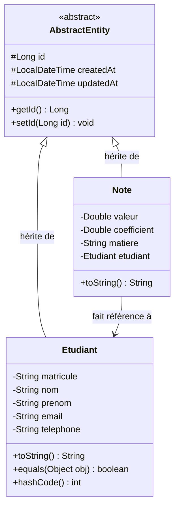

# Classes, Objets, États, Comportements et Polymorphisme

## 1. Introduction & Contexte Métier

Dans le développement d'applications de gestion d'entreprise, la modélisation du domaine métier constitue le cœur battant du système. Si vos entités sont mal conçues, perméables aux états incohérents ou dépourvues de contrats clairs, l'ensemble de l'architecture logicielle s'effondrera au moindre changement de spécification.

Prenez le cas de notre système académique **`com.ism`**. Un étudiant n'est pas une simple collection de chaînes de caractères éparpillées dans des variables locales. C'est une entité dotée d'une **identité pérenne** (un identifiant unique et un matricule), d'un **état interne** (nom, prénom, adresse e-mail, téléphone) et de **règles d'intégrité strictes** (une note doit être comprise entre 0 et 20, un étudiant ne peut pas posséder un matricule vide).

Comme l'enseigne le Professeur **Baila Wane** :
> *"Un objet, c'est l'union sacrée d'un état (ses attributs privés) et d'un comportement (ses méthodes publiques). L'encapsulation n'est pas une option esthétique : c'est le blindage qui empêche le monde extérieur de corrompre la mémoire et la logique de vos entités !"*

Dans ce chapitre, nous allons poser les fondations de notre domaine métier en explorant l'encapsulation, la classe de base réutilisable `AbstractEntity`, le contrat fondamental `equals` & `hashCode`, et la puissance du polymorphisme dynamique.

---

## 2. Architecture & Fondations Conceptuelles

### 2.1 Les Piliers de l'Objet : État, Comportement et Identité

Tout objet Java se caractérise par trois éléments fondamentaux :
1. **L'Identité** : L'adresse mémoire unique de l'objet dans le Heap (comparée par `==`), ou son identifiant métier unique (comparé par `equals()`).
2. **L'État** : Les valeurs instantanées portées par ses champs d'instance (`fields`). Deux étudiants distincts peuvent avoir le même nom, mais des états et identités différents.
3. **Le Comportement** : L'ensemble des méthodes applicables à l'objet, définissant ce qu'il peut faire ou subir.



### 2.2 L'Encapsulation et la protection des invariants

L'encapsulation consiste à interdire tout accès direct aux attributs d'une classe depuis l'extérieur. Les champs sont déclarés `private` (ou `protected` pour l'héritage maîtrisé), et l'accès se fait exclusivement via :
- Des **accesseurs (Getters)** : permettent la lecture contrôlée de l'état.
- Des **mutateurs (Setters)** : permettent la modification en validant les invariants métier avant d'affecter la variable.

Pour éliminer le code répétitif (*boilerplate*) sans sacrifier l'encapsulation, nous utilisons la bibliothèque officielle **Project Lombok** (`@Getter`, `@Setter`, `@Builder`, `@ToString`).

### 2.3 Le contrat `equals()` et `hashCode()`

En Java, l'opérateur `==` compare strictement les adresses mémoires (références de pointeurs dans la Stack). Ainsi, deux objets `Etudiant` distincts possédant pourtant exactement le même matricule et le même ID seront jugés différents par `==`.

Pour comparer l'égalité logique métier, nous devons redéfinir la méthode `equals(Object o)` issue de `java.lang.Object`.
> ⚠️ **Règle absolue du contrat Java :**
> Si deux objets sont égaux selon `equals()`, ils **DOIVENT** obligatoirement renvoyer le même `hashCode()`. Si vous oubliez cette règle, vos entités deviendront invisibles ou dupliquées lorsqu'elles seront stockées dans des collections de type `HashSet` ou `HashMap` !

### 2.4 Statique vs Instance : Mémoire et Incompatibilité avec l'Héritage

L'un des enseignements cardinaux dispensés par le Professeur Baila Wane porte sur la frontière étanche entre ce qui relève de la **classe (statique)** et ce qui relève de **l'objet (instance)** :

| Dimension | Membre Statique (`static`) | Membre d'Instance |
| :--- | :--- | :--- |
| **Zone Mémoire** | Metaspace (zone partagée commune à toute la JVM). | Heap (tas dynamique alloué par objet). |
| **Partage** | Une seule case mémoire partagée entre tous les objets. | Chaque objet possède sa propre copie indépendante. |
| **Polymorphisme** | **IMPOSSIBLE**. Pas de liaison tardive, pas d'@Override. | **Natif**. Liaison dynamique selon le type réel à l'exécution. |
| **Usage Légitime** | Constantes immuables (`final static`), configuration globale. | Données et algorithmes métier, entités, repositories. |

> 📘 **Pourquoi le `static` est banni des algorithmes métier ?**
> Une méthode statique a un comportement figé et scellé dès la compilation. Dès lors que vous déclarez une logique métier en `static`, vous interdisez le polymorphisme, vous empêchez l'injection de dépendances, et vous rendez vos composants impossibles à tester avec des doublures (Mocks).
> Le mot-clé `final static` est réservé aux constantes universelles immuables (ex: `public static final int NOTE_MAX = 20;`).

---

## 3. Implémentation Pratique & Code de Référence

Examinons le code réel extrait de notre projet de référence `com.ism.domain`.

### 3.1 La classe générique abstraite `AbstractEntity` et Traçabilité d'Audit

Toute entité de notre système partage des métadonnées de cycle de vie et de traçabilité. Plutôt que de dupliquer `id`, `createdAt`, `updatedAt`, `createdBy` et `updatedBy` dans chaque classe, nous factorisons ce comportement dans une classe mère abstraite :

```java
package com.ism.domain;

import lombok.Getter;
import lombok.Setter;

import java.io.Serializable;
import java.time.LocalDateTime;

/**
 * Classe mère abstraite fournissant l'identité et les dates d'audit
 * pour toutes les entités du domaine métier ISM.
 *
 * @author Baila Wane
 */
@Getter
@Setter
public abstract class AbstractEntity implements Serializable {

    protected Long id;
    
    // createdAt est immuable : horodaté à la création, jamais réécrit
    protected final LocalDateTime createdAt;
    protected LocalDateTime updatedAt;
    
    // Audit d'ingénierie : traçabilité de l'opérateur en production
    protected String createdBy;
    protected String updatedBy;

    public AbstractEntity() {
        this.createdAt = LocalDateTime.now();
        this.updatedAt = LocalDateTime.now();
        this.createdBy = "SYSTEM";
        this.updatedBy = "SYSTEM";
    }

    public AbstractEntity(Long id) {
        this();
        this.id = id;
    }
}
```

> ⚠️ **Pourquoi l'annotation Lombok `@Builder` ne peut pas être placée sur `AbstractEntity` ?**
> Une classe marquée `abstract` ne peut jamais être instanciée directement (`new AbstractEntity()` est interdit). Le patron Builder généré par Lombok exigeant d'instancier la classe cible, placer `@Builder` sur une classe abstraite génère une erreur de compilation !
> **Règle absolue :** `@Builder` doit toujours être placé sur les sous-classes concrètes instanciables (`Etudiant`, `Note`, `Salle`, `Produit`).

### 3.2 L'entité métier `Etudiant`

Conformément à l'architecture de notre domaine `com.ism.domain.Etudiant`, l'étudiant est identifié par son matricule unique, ses coordonnées civiles et sa classe académique. Il hérite de `AbstractEntity` pour la gestion de sa clé primaire `Long id` et de ses métadonnées d'audit :

```java
package com.ism.domain;

import lombok.*;

import java.util.Objects;

/**
 * Entité représentant un étudiant inscrit au sein du système académique.
 * Hérite des propriétés d'audit et d'identité de AbstractEntity.
 *
 * @author Baila Wane
 */
@Getter
@Setter
@ToString(callSuper = true)
@NoArgsConstructor
@AllArgsConstructor
@Builder
public class Etudiant extends AbstractEntity {

    private String matricule;
    private String nom;
    private String prenom;
    private String email;
    private String telephone;
    private String classe; // Ex: "L3 GLRS", "Master 1 ISI"

    // Constructeur complet avec ID hérité
    public Etudiant(Long id, String matricule, String nom, String prenom, String email, String telephone, String classe) {
        super(id);
        this.matricule = matricule;
        this.nom = nom;
        this.prenom = prenom;
        this.email = email;
        this.telephone = telephone;
        this.classe = classe;
    }

    /**
     * Méthode utilitaire renvoyant le nom complet formaté.
     */
    public String getNomComplet() {
        return (prenom != null ? prenom : "") + " " + (nom != null ? nom.toUpperCase() : "");
    }

    /**
     * Deux étudiants sont égaux si et seulement si leur matricule unique est identique.
     */
    @Override
    public boolean equals(Object o) {
        if (this == o) return true;
        if (o == null || getClass() != o.getClass()) return false;
        Etudiant etudiant = (Etudiant) o;
        return Objects.equals(matricule, etudiant.matricule);
    }

    @Override
    public int hashCode() {
        return Objects.hash(matricule);
    }
}
```

> 💡 **Perspective d'Évolution en Entreprise :**
> L'utilisation conjointe des annotations Lombok `@Getter`, `@Setter`, `@Builder` et `@ToString(callSuper = true)` permet de conserver un modèle d'une concision exemplaire tout en garantissant l'encapsulation stricte et la traçabilité des attributs hérités de `AbstractEntity`.

### 3.3 L'entité métier `Note`

L'entité `Note` encapsule le résultat académique obtenu par un étudiant pour une matière donnée :

```java
package com.ism.domain;

import lombok.*;

/**
 * Entité représentant une note attribuée à un étudiant.
 */
@Getter
@Setter
@ToString(callSuper = true)
@NoArgsConstructor
@AllArgsConstructor
@Builder
public class Note extends AbstractEntity {

    private Double valeur;
    private Double coefficient;
    private String matiere;
    private Etudiant etudiant;

    public Note(Long id, Double valeur, Double coefficient, String matiere, Etudiant etudiant) {
        super(id);
        this.valeur = valeur;
        this.coefficient = coefficient;
        this.matiere = matiere;
        this.etudiant = etudiant;
    }
}
```

### 3.4 Démonstration du Polymorphisme Dynamique

Le polymorphisme naît automatiquement dès qu'il y a relation d'héritage ou implémentation d'interface. Il permet de substituer un objet d'une classe fille à une classe mère sans modifier le code client.

Comme l'explique le Professeur Baila Wane à travers une analogie frappante :
> *"Dans une application de dessin vectoriel, un développeur non formé écrira trois méthodes distinctes : `addCarre(Carre c)`, `addRectangle(Rectangle r)`, `addTriangle(Triangle t)`. Dès qu'il doit ajouter 20 nouvelles formes géométriques, il doit créer 20 nouvelles méthodes ! Avec le polymorphisme, nous définissons une classe ou interface mère `Figure`, et une unique méthode générique `add(Figure f)`. Que vous passiez un carré, un cercle ou un losange, la méthode `add` reste inchangée ! C'est cela, la véritable économie de code et la flexibilité logicielle."*

Dans notre architecture académique, le polymorphisme permet de manipuler des objets dérivés à travers la référence de leur type parent (`AbstractEntity`), la JVM se chargeant d'invoquer la méthode appropriée à l'exécution (*liaison tardive / dynamic dispatch*) :

```java
public class PolymorphismDemo {
    public static void main(String[] args) {
        // Déclaration via le type générique abstrait
        Etudiant e1 = new Etudiant(1L, "ETU-2026-001", "Diop", "Awa", "awa.diop@ism.sn", "771002030", "L3 GLRS");
        AbstractEntity n1 = new Note(10L, 17.5, 3.0, "Architecture Logicielle Java", e1);

        // Appel polymorphique : la JVM résout dynamiquement le toString() propre à chaque classe
        afficherEntite(e1);
        afficherEntite(n1);
    }

    public static void afficherEntite(AbstractEntity entity) {
        System.out.println("[AUDIT LOG] Type d'entité : " + entity.getClass().getSimpleName());
        System.out.println("[AUDIT LOG] Détails : " + entity.toString());
    }
}
```

---

## 4. Bonnes Pratiques, Pièges & Débogage

> ℹ️ **Pourquoi privilégier le Builder Pattern ?**
> Lorsque les entités possèdent de nombreux champs optionnels, multiplier les constructeurs surchargés (*Telescoping Constructor Antipattern*) rend le code illisible et source d'erreurs (inversion de deux paramètres de type `String` comme l'email et le téléphone). L'annotation `@Builder` de Lombok permet une instanciation expressive et sécurisée :
> ```java
> Etudiant etu = Etudiant.builder()
>     .matricule("ETU-001")
>     .nom("Diallo")
>     .prenom("Moussa")
>     .build();
> ```

> ⚠️ **Le piège de la boucle infinie dans `@ToString` :**
> Si `Etudiant` contient une liste de `Note` et que chaque `Note` contient une référence vers son `Etudiant`, un appel à `toString()` déclenchera une récursion infinie conduisant inévitablement à un crash mémoire `java.lang.StackOverflowError` ! Utilisez `@ToString.Exclude` sur la relation inverse pour briser le cycle.

> 💡 **Pourquoi `AbstractEntity` ne peut pas être instanciée ?**
> Le mot-clé `abstract` interdit formellement `new AbstractEntity()`. C'est une garantie conceptuelle : un concept "abstrait" n'a pas d'existence physique dans le monde réel ; seuls des étudiants ou des notes concrets peuvent être enregistrés.

---

## 5. Synthèse & Auto-Évaluation

### Tableau Comparatif des Concepts

| Concept | Définition | Impact en mémoire / Exécution | Exemple de code |
| :--- | :--- | :--- | :--- |
| **Classe** | Moule ou plan de fabrication définissant attributs et méthodes. | Chargée une seule fois dans le Metaspace par le ClassLoader. | `public class Etudiant { ... }` |
| **Objet / Instance** | Réalisation concrète en mémoire créée via `new`. | Alloué dynamiquement dans le Heap. Nettoyé par le GC. | `Etudiant e = new Etudiant();` |
| **Encapsulation** | Masquage des détails internes et contrôle des accès. | Les champs privés ne sont accessibles que via les accesseurs. | `private String email;` |
| **Polymorphisme** | Capacité d'un objet à prendre plusieurs formes. | Résolution dynamique de méthode au moment de l'exécution. | `AbstractEntity e = new Etudiant();` |

### Questionnaire d'Auto-Évaluation (QCM)

1. **Que se passe-t-il si vous tentez d'exécuter l'instruction `AbstractEntity entity = new AbstractEntity();` ?**
   - A) L'objet est instancié avec des valeurs nulles.
   - B) Le code refuse de compiler car une classe abstraite ne peut pas être directement instanciée.
   - C) Une exception `NullPointerException` est levée au runtime.
   - D) La JVM alloue l'objet dans la Stack.
   *Réponse attendue : B.*

2. **Quelle méthode de `java.lang.Object` devez-vous obligatoirement redéfinir pour que deux étudiants ayant le même matricule soient reconnus comme identiques par une `HashSet` ?**
   - A) `toString()` uniquement
   - B) `clone()` et `finalize()`
   - C) Conjointement `equals(Object o)` et `hashCode()`
   - D) `compareTo()`
   *Réponse attendue : C.*

3. **Quelle annotation Lombok génère automatiquement le constructeur fluide permettant d'écrire `Etudiant.builder().nom("Faye").build()` ?**
   - A) `@Data`
   - B) `@Builder`
   - C) `@AllArgsConstructor`
   - D) `@Value`
   *Réponse attendue : B.*

### Exercice Pratique & DevLog

```markdown
[DevLog - Entrée 03]
- Sujet : Modélisation des entités métier et contrat d'égalité
- Action : Implémentez la hiérarchie `AbstractEntity`, `Etudiant` et `Note` dans votre package `com.ism.domain`.
- Défi : Créez deux instances distinctes d'`Etudiant` ayant exactement le même matricule `"ISM-999"`, mais deux noms différents. Placez ces deux étudiants dans un `HashSet<Etudiant>`. Vérifiez la taille du set avec `set.size()`. Si la taille est 1, votre contrat `equals/hashCode` est validé !
```
