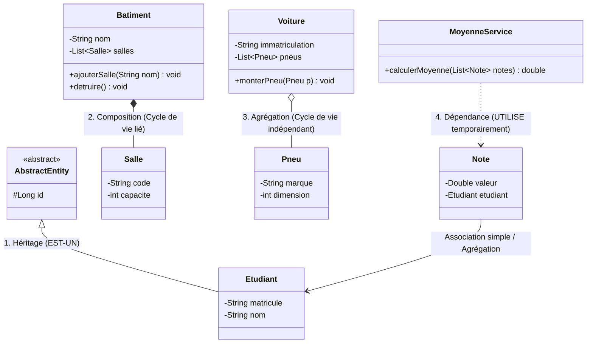

# Typologie des Relations Objet : Héritage, Composition, Agrégation et Dépendance

## 1. Introduction & Contexte Métier

Dans la modélisation objet d'un système d'information, la façon dont les classes sont reliées entre elles détermine directement la robustesse, la flexibilité et la maintenabilité du logiciel. L'une des erreurs les plus fréquentes chez les développeurs consiste à abuser de l'héritage ("l'héritadite aiguë") pour de simples besoins de partage de code, créant ainsi un couplage rigide et toxique qui paralyse toute évolution future.

Lors de ses conférences et sessions pratiques, le Professeur **Baila Wane** insiste avec force sur la distinction des relations :
> *"Prenez une voiture et ses pneus : si la voiture est envoyée à la casse, les pneus peuvent être démontés et montés sur une autre voiture. C'est une **agrégation** : leurs cycles de vie sont indépendants ! En revanche, prenez un bâtiment et ses salles de classe : si le bâtiment est rasé au bulldozer, les salles de classe cessent physiquement d'exister. C'est une **composition** : leurs cycles de vie sont indissociables ! Confondre ces deux relations dans votre code, c'est programmer des fuites de mémoire ou des suppressions accidentelles en cascade !"*

Dans ce chapitre, nous allons formaliser les quatre grandes relations de la programmation orientée objet en Java :
1. **L'Héritage** (Relation *"EST-UN"* / *is-a*).
2. **L'Agrégation** (Relation *"A-UN"* faible / *has-a*, cycle de vie indépendant).
3. **La Composition** (Relation *"A-UN"* forte / *part-of*, cycle de vie lié).
4. **La Dépendance** (Relation *"UTILISE"* / *uses-a*, relation éphémère).

---

## 2. Architecture & Fondations Conceptuelles

> 💡 **Règle Mnémotechnique : Exclusivité et Cycle de Vie**
> Pour ne jamais hésiter entre Héritage, Agrégation et Composition lors de la modélisation :
> - **Héritage** (Relation *EST-UN*) : spécialisation structurelle stricte (`Etudiant` est une `AbstractEntity`).
> - **Composition** (Relation *A-UN Fort*) : **exclusivité vitale absolue**. Le Bâtiment détient exclusivement ses Salles. Si le bâtiment est détruit, ses salles disparaissent physiquement avec lui.
> - **Agrégation** (Relation *A-UN Faible*) : **usage sans exclusivité vitale**. La Voiture utilise des Pneus pour rouler, mais les pneus existent par eux-mêmes : ils peuvent être démontés et réutilisés sur un autre véhicule.

### 2.1 Schéma comparatif global des relations



### 2.2 Analyse Détaillée des 4 Relations

#### 1. L'Héritage (`extends`) : Relation "EST-UN"
- **Sémantique** : La classe fille hérite de la structure et des comportements de la classe mère. Elle est une spécialisation du concept parent.
- **Exemple** : Un `Etudiant` **est une** `AbstractEntity`.
- **Règle d'or** : N'utilisez l'héritage que s'il respecte le principe de substitution de Liskov (LSP) : partout où une classe mère est attendue, la classe fille doit pouvoir être utilisée sans altérer la cohérence du système.

#### 2. La Composition (Symbole losange plein `◆`) : Relation "A-UN" Fort
- **Sémantique** : L'objet composite est responsable de la création, de la détention et de la destruction de ses parties. Le composant n'a aucun sens ni aucune existence en dehors du composite.
- **Cycle de vie** : **Strictement lié**. Si l'objet parent meurt, les objets enfants meurent avec lui.
- **Exemple** : Un `Batiment` et ses `Salles` (ou une `Commande` et ses `LignesDeCommande`).

#### 3. L'Agrégation (Symbole losange vide `◇`) : Relation "A-UN" Faible
- **Sémantique** : L'objet conteneur regroupe des composants qui existent par eux-mêmes. Le composant peut appartenir successivement à différents conteneurs ou exister seul.
- **Cycle de vie** : **Indépendant**. La destruction du conteneur ne détruit pas les composants agrégés.
- **Exemple** : Une `Voiture` et ses `Pneus` (ou une `Classe` et ses `Etudiants`).

#### 4. La Dépendance (Flèche pointillée `-->`) : Relation "UTILISE"
- **Sémantique** : Une classe a besoin temporairement d'une autre classe pour accomplir une opération précise, généralement comme paramètre d'une méthode ou variable locale. Elle ne conserve aucune référence permanente vers elle sous forme d'attribut d'instance.
- **Exemple** : `MoyenneService` qui reçoit une `List<Note>` dans sa méthode `calculerMoyenne(List<Note> notes)`.

---

## 3. Implémentation Pratique & Code de Référence

### 3.1 Implémentation d'une Composition stricte (Bâtiment & Salles)

Dans une vraie composition, le parent instancie lui-même ses enfants. Les enfants ne sont pas injectés depuis l'extérieur :

```java
package com.ism.modelisation;

import java.util.ArrayList;
import java.util.Collections;
import java.util.List;

/**
 * Exemple de COMPOSITION :
 * La Salle n'a pas d'existence sans son Bâtiment.
 */
public class Batiment {

    private String nom;
    private final List<Salle> salles;

    public Batiment(String nom) {
        this.nom = nom;
        this.salles = new ArrayList<>();
    }

    /**
     * C'est le bâtiment qui crée directement ses propres salles.
     */
    public void creerEtAjouterSalle(String code, int capacite) {
        Salle nouvelleSalle = new Salle(code, capacite);
        this.salles.add(nouvelleSalle);
    }

    /**
     * Retourne une vue non-modifiable pour protéger la collection interne.
     */
    public List<Salle> getSalles() {
        return Collections.unmodifiableList(salles);
    }

    /**
     * Si le bâtiment est détruit, ses salles sont nettoyées de la mémoire.
     */
    public void demolir() {
        System.out.println("[DESTRUCTION] Le bâtiment " + nom + " est démoli.");
        this.salles.clear(); // Les salles perdent leurs références et seront collectées par le GC
    }

    // Classe interne ou associée intimement
    public static class Salle {
        private String code;
        private int capacite;

        private Salle(String code, int capacite) {
            this.code = code;
            this.capacite = capacite;
        }

        public String getCode() { return code; }
        public int getCapacite() { return capacite; }
    }
}
```

### 3.2 Implémentation d'une Agrégation (Voiture & Pneus)

Dans une agrégation, les objets existent préalablement et sont fournis au conteneur via un mutateur ou un constructeur :

```java
package com.ism.modelisation;

import java.util.ArrayList;
import java.util.List;

/**
 * Exemple d'AGRÉGATION :
 * Les pneus existent avant la voiture et peuvent lui survivre.
 */
public class Voiture {

    private String matricule;
    private List<Pneu> pneus;

    public Voiture(String matricule) {
        this.matricule = matricule;
        this.pneus = new ArrayList<>();
    }

    // Le pneu est injecté depuis l'extérieur
    public void ajouterPneu(Pneu pneu) {
        if (pneus.size() < 4) {
            this.pneus.add(pneu);
        } else {
            throw new IllegalStateException("La voiture possède déjà 4 pneus !");
        }
    }

    // Si la voiture part à la casse, on démonte les pneus
    public List<Pneu> demonterPneus() {
        List<Pneu> pneusRecuperes = new ArrayList<>(this.pneus);
        this.pneus.clear();
        return pneusRecuperes; // Les pneus continuent d'exister en mémoire !
    }
}

public class Pneu {
    private String marque;
    private int dimension;

    public Pneu(String marque, int dimension) {
        this.marque = marque;
        this.dimension = dimension;
    }
}
```

### 3.3 Implémentation d'une Dépendance éphémère

Dans `com.ism.service`, la classe `MoyenneServiceImpl` calcule la moyenne sans stocker d'étudiants ni de notes dans son état interne :

```java
package com.ism.service;

import com.ism.domain.Note;
import java.util.List;

/**
 * Exemple de DÉPENDANCE :
 * MoyenneServiceImpl UTILISE Note comme argument éphémère.
 */
public class MoyenneServiceImpl implements MoyenneService {

    @Override
    public double calculerMoyenne(List<Note> notes) {
        if (notes == null || notes.isEmpty()) {
            return 0.0;
        }

        double sommePoints = 0.0;
        double sommeCoefficients = 0.0;

        for (Note n : notes) {
            sommePoints += (n.getValeur() * n.getCoefficient());
            sommeCoefficients += n.getCoefficient();
        }

        return sommeCoefficients == 0.0 ? 0.0 : sommePoints / sommeCoefficients;
    }
}
```

---

## 4. Bonnes Pratiques, Pièges & Débogage

> ℹ️ **Privilégiez la composition à l'héritage ("Favor Composition over Inheritance") :**
> C'est l'un des principes les plus célèbres du livre du Gang of Four (GoF). L'héritage viole souvent l'encapsulation car la classe fille dépend intimement de l'implémentation de la classe mère. La composition offre une flexibilité totale : vous pouvez changer le comportement à l'exécution en injectant une implémentation différente.

> ⚠️ **Le piège de la fuite de références internes :**
> Lorsque vous retournez une collection d'objets depuis une classe composite (`public List<Salle> getSalles() { return this.salles; }`), le code client extérieur peut appeler `getSalles().clear()`, vidant votre collection à votre insu ! Retournez systématiquement une copie défensive (`new ArrayList<>(this.salles)`) ou une vue non modifiable (`Collections.unmodifiableList(this.salles)`).

> 💡 **Comment reconnaître une Dépendance au premier coup d'œil ?**
> Si la classe A ne possède aucun attribut de type B, mais qu'une méthode de A possède un paramètre de type B ou instancie localement un objet de type B, il s'agit d'une dépendance simple. C'est le couplage le plus faible et le plus vertueux.

---

## 5. Synthèse & Auto-Évaluation

### Matrice Décisionnelle des Relations

| Relation | Couplage | Symbole UML | Cycle de vie | Mot-clé Java |
| :--- | :--- | :--- | :--- | :--- |
| **Héritage** | Très fort | Flèche fermée vide `──▷` | Identique (objet unique) | `extends` / `implements` |
| **Composition** | Fort | Losange plein `◆──` | Strictement lié | Instanciation interne (`new`) |
| **Agrégation** | Modéré | Losange vide `◇──` | Indépendant | Attribut d'instance injecté |
| **Dépendance** | Faible | Flèche pointillée `..>` | Éphémère (durée d'une méthode) | Paramètre ou variable locale |

### Questionnaire d'Auto-Évaluation (QCM)

1. **Dans l'analogie Bâtiment / Salles versus Voiture / Pneus enseignée par Baila Wane, quelle relation illustre la paire Voiture / Pneus ?**
   - A) Une Composition
   - B) Une Agrégation
   - C) Un Héritage
   - D) Une Dépendance circulaire
   *Réponse attendue : B. Les pneus ont un cycle de vie indépendant de la voiture.*

2. **Quel principe de design logiciel recommande d'éviter l'arborescence d'héritage profonde au profit de l'assemblage d'objets ?**
   - A) Don't Repeat Yourself
   - B) Favor Composition over Inheritance
   - C) You Aren't Gonna Need It
   - D) Convention over Configuration
   *Réponse attendue : B.*

3. **Quelle instruction permet de protéger une collection interne contre les modifications directes par des tiers ?**
   - A) `return this.liste;`
   - B) `return Collections.unmodifiableList(this.liste);`
   - C) `this.liste = null;`
   - D) `return Collections.emptyList();`
   *Réponse attendue : B.*

### Exercice Pratique & DevLog

```markdown
[DevLog - Entrée 04]
- Sujet : Implémentation comparative Agrégation vs Composition
- Action : Créez une classe `Filiere` et une classe `Etudiant`. Implémentez la relation d'Agrégation (un étudiant est inscrit dans une filière, mais si la filière est fermée, l'étudiant reste présent dans le système).
- Défi : Implémentez ensuite une relation de Composition entre `DossierScolaire` et `HistoriqueInscription`. Prouvez par un test que la destruction du dossier scolaire entraîne la purge immédiate de son historique.
```
