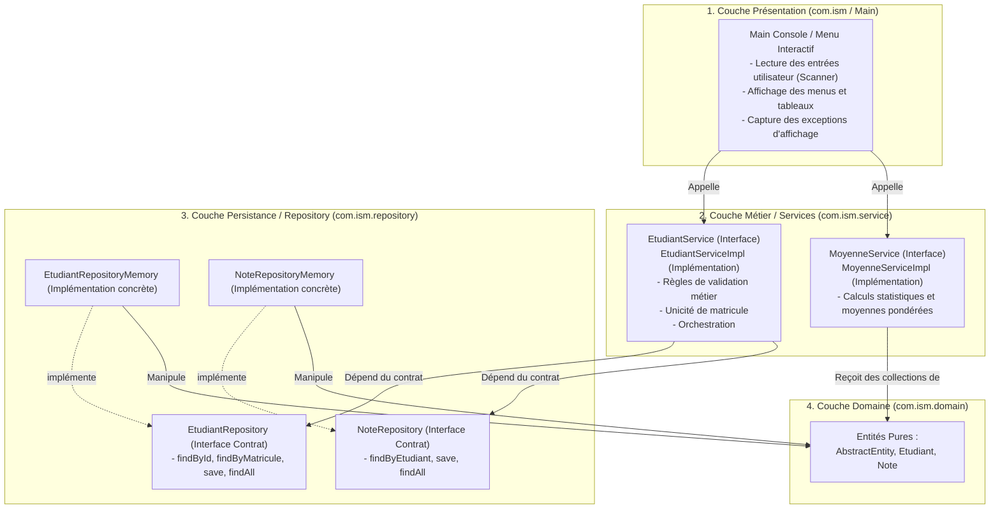

# Architecture en Couches et Contrats d'Interface Repository

## 1. Introduction & Contexte Métier

Dans une application logicielle mal conçue, on observe fréquemment ce que l'industrie qualifie de *"Code Spaghetti"* : une classe de vue console ou contrôleur Web qui exécute directement des requêtes SQL, instancie des entités en dur, effectue des calculs de remise financière et affiche les résultats à l'écran. Une telle conception monolithique est impossible à tester de manière isolée, impossible à maintenir, et vouée à la réécriture complète dès que l'on souhaite remplacer le terminal console par une interface Web ou migrer d'une base de données mémoire vers PostgreSQL.

Pour éviter ce désastre, le standard absolu de l'ingénierie logicielle repose sur l'**Architecture en Couches (N-Tier Architecture)**. Chaque couche possède une mission unique, bien délimitée, et communique avec la couche inférieure uniquement à travers des **contrats d'interfaces**.

Comme le souligne le Professeur **Baila Wane** :
> *"Une interface en Java n'est pas une simple liste de méthodes : c'est un contrat juridique ! La couche Métier (Service) passe contrat avec la couche Persistance (Repository) : 'Donne-moi un étudiant par son matricule, peu m'importe que tu ailles le chercher dans une liste en mémoire vive, dans un fichier JSON, ou dans une base Oracle sur un cluster distant !' Si vous brisez ce contrat en liant vos services à des classes concrètes, vous perdez toute agilité architecturale."*

---

## 2. Architecture & Fondations Conceptuelles

### 2.1 Le Modèle N-Tiers de notre application `com.ism`

Le flux de traitement respecte un sens de dépendance descendant strict :



### 2.2 Les Principes Cardinaux de l'Architecture en Couches

1. **Isolation des responsabilités** : La couche Présentation ne contient aucun calcul métier ni requête de données. La couche Service ne sait pas si l'appel provient d'un terminal texte, d'un contrôleur REST Spring Boot, ou d'une application mobile Android.
2. **Programmation par interface (*Program to an interface, not an implementation*)** : Les composants dépendent d'abstractions (`EtudiantRepository`), jamais de classes concrètes (`EtudiantRepositoryMemory`).
3. **Le Patron Repository (Éric Evans - Domain-Driven Design)** : Le Repository émule une collection d'objets en mémoire. Il isole totalement le domaine métier des détails techniques de stockage (SQL, NoSQL, In-Memory).

---

## 3. Implémentation Pratique & Code de Référence

### 3.1 Le Contrat Générique de Base `BaseRepository<T>`

Pour standardiser les opérations CRUD (*Create, Read, Update, Delete*) communes à toutes nos entités, nous concevons une interface générique paramétrée par le type d'entité `T` :

```java
package com.ism.repository;

import com.ism.domain.AbstractEntity;
import java.util.List;
import java.util.Optional;

/**
 * Contrat d'accès aux données générique pour les entités du domaine.
 *
 * @param <T> Type de l'entité dérivant de AbstractEntity
 */
public interface BaseRepository<T extends AbstractEntity> {

    T save(T entity);

    Optional<T> findById(Long id);

    List<T> findAll();

    boolean deleteById(Long id);
}
```

### 3.2 Le Contrat Réel du Dépôt : `EtudiantRepository`

Dans notre architecture métier `com.ism.repository`, l'interface `EtudiantRepository` hérite du contrat générique `BaseRepository<Etudiant>` et y ajoute les méthodes de recherche propres aux besoins métier de l'étudiant :

```java
package com.ism.repository;

import com.ism.domain.Etudiant;
import java.util.Optional;

/**
 * Contrat de persistance pour l'entité Etudiant.
 * Hérite des opérations CRUD universelles de BaseRepository.
 *
 * @author Baila Wane
 */
public interface EtudiantRepository extends BaseRepository<Etudiant> {

    /**
     * Recherche un étudiant par son matricule unique (ex: "ETU-2026-001").
     *
     * @param matricule Le matricule de l'étudiant
     * @return un Optional contenant l'étudiant s'il existe, Optional.empty() sinon
     */
    Optional<Etudiant> findByMatricule(String matricule);

    /**
     * Vérifie si un matricule est déjà attribué dans le système.
     */
    boolean existsByMatricule(String matricule);
}
```

> 📘 **Nomenclature des Méthodes : Style SQL vs Abstraction DDD / Spring Data**
> Certains développeurs débutants utilisent des verbes SQL natifs comme `insert()`, `update()` et `selectAll()`. Dans l'ingénierie d'entreprise moderne (Domain-Driven Design, Spring Data JPA), nous préférons les termes `save(entity)` et `findAll()`. Le repository émule ainsi une collection d'objets en mémoire vive : le client demande simplement à « sauvegarder » l'entité, sans se préoccuper de savoir si le moteur sous-jacent exécute un `INSERT` ou un `UPDATE` SQL !

### 3.3 L'Implémentation Mémoire `EtudiantRepositoryMemory`

Dans notre projet de référence `com.ism`, la première implémentation technique s'appuie sur une structure de stockage mémoire (`DatabaseMemory`) simulant la base de données :

```java
package com.ism.repository.memory;

import com.ism.domain.Etudiant;
import com.ism.repository.EtudiantRepository;

import java.time.LocalDateTime;
import java.util.ArrayList;
import java.util.Collections;
import java.util.List;
import java.util.Optional;

/**
 * Implémentation en mémoire vive du Repository Étudiant.
 */
public class EtudiantRepositoryMemory implements EtudiantRepository {

    private final DatabaseMemory databaseMemory;
    private long sequenceId = 1L;

    public EtudiantRepositoryMemory(DatabaseMemory databaseMemory) {
        this.databaseMemory = databaseMemory;
    }

    @Override
    public Etudiant save(Etudiant entity) {
        if (entity == null) {
            throw new IllegalArgumentException("L'entité étudiant ne peut pas être nulle.");
        }

        if (entity.getId() == null) {
            // Création : auto-génération d'un ID séquentiel
            entity.setId(sequenceId++);
            entity.setCreatedAt(LocalDateTime.now());
            entity.setUpdatedAt(LocalDateTime.now());
            databaseMemory.getEtudiants().add(entity);
        } else {
            // Mise à jour de l'existant
            entity.setUpdatedAt(LocalDateTime.now());
            for (int i = 0; i < databaseMemory.getEtudiants().size(); i++) {
                if (databaseMemory.getEtudiants().get(i).getId().equals(entity.getId())) {
                    databaseMemory.getEtudiants().set(i, entity);
                    break;
                }
            }
        }
        return entity;
    }

    @Override
    public Optional<Etudiant> findById(Long id) {
        if (id == null) return Optional.empty();
        return databaseMemory.getEtudiants().stream()
                .filter(e -> id.equals(e.getId()))
                .findFirst();
    }

    @Override
    public Optional<Etudiant> findByMatricule(String matricule) {
        if (matricule == null || matricule.trim().isEmpty()) return Optional.empty();
        return databaseMemory.getEtudiants().stream()
                .filter(e -> matricule.equalsIgnoreCase(e.getMatricule()))
                .findFirst();
    }

    @Override
    public boolean existsByMatricule(String matricule) {
        return findByMatricule(matricule).isPresent();
    }

    @Override
    public List<Etudiant> findAll() {
        return Collections.unmodifiableList(new ArrayList<>(databaseMemory.getEtudiants()));
    }

    @Override
    public boolean deleteById(Long id) {
        return databaseMemory.getEtudiants().removeIf(e -> id.equals(e.getId()));
    }
}
```

### 3.4 Le Piège Démonstratif des Repositories Multiples et la Solution `DatabaseMemory`

Lors de la séance de cours pratique, le Professeur Baila Wane met régulièrement en scène un bogue d'architecture déroutant pour les étudiants débutants :
1. Un premier composant instancie son propre repository : `EtudiantRepository repoAjout = new EtudiantRepositoryMemory();` et y enregistre 3 étudiants.
2. Un second composant (la vue console d'affichage) instancie à son tour : `EtudiantRepository repoLecture = new EtudiantRepositoryMemory();` et appelle `findAll()`.
3. **Résultat :** La console affiche *"Aucun étudiant trouvé"* ! Les étudiants semblent s'être volatilisés !

> ⚠️ **Analyse de la cause racine :**
> Sans centralisation de la persistance, chaque `new EtudiantRepositoryMemory()` alloue sa propre `ArrayList<Etudiant>` distincte dans la mémoire Heap. L'insertion s'effectue dans la liste A, et la recherche lit dans la liste B !
> 
> **La solution d'architecture imposée :**
> 1. Extraire la détention des données hors du repository pour la confier à une classe dédiée : `DatabaseMemory`.
> 2. Verrouiller `DatabaseMemory` sous forme de **Singleton** (`getInstance()`), garantissant qu'une seule et unique instance physique existe dans toute la machine virtuelle.
> 3. Encapsuler les collections internes sous forme de listes protégées : `private final List<Etudiant> etudiants = new ArrayList<>();` accessibles via `getEtudiants()`. Le mot-clé `final` empêche toute réassignation accidentelle de la référence en mémoire.
> 4. Centraliser l'auto-incrémentation des clés primaires dans `DatabaseMemory` (`nextEtudiantId()`), de manière à ce qu'aucune instanciation de repository ne réinitialise les compteurs d'identifiants.

---

## 4. Bonnes Pratiques, Pièges & Débogage

> ℹ️ **Pourquoi retourner `Optional<T>` au lieu de `null` ?**
> Retourner `null` lorsqu'un enregistrement n'est pas trouvé est la cause n°1 des désastreux `NullPointerException` (qualifié de "billion-dollar mistake" par son créateur Tony Hoare). En retournant `Optional<Etudiant>`, le contrat force explicitement l'appelant à gérer l'absence d'étudiant via `.isPresent()`, `.orElseThrow()` ou `.map()`.

> ⚠️ **L'erreur courante d'instanciation directe du Repository dans le Service :**
> Ne faites jamais dans votre service :
> ```java
> private EtudiantRepository repo = new EtudiantRepositoryMemory(...); // MAUVAISE PRATIQUE !
> ```
> Vous couplerez irrémédiablement le service à la classe mémoire. Si demain vous passez à `EtudiantRepositoryJdbc`, vous devrez réécrire le service. Passez toujours par une injection par constructeur :
> ```java
> public EtudiantServiceImpl(EtudiantRepository etudiantRepository) {
>     this.etudiantRepository = etudiantRepository;
> }
> ```

> 💡 **Le Repository gère la collection, pas la logique métier :**
> Un repository ne doit jamais valider si la moyenne d'un étudiant lui donne droit à une mention ou lever une alerte disciplinaire. Il se contente de stocker, rechercher et restituer des données.

---

## 5. Synthèse & Auto-Évaluation

### Matrice des Responsabilités par Couche

| Couche | Rôle | Entrées | Sorties | Classes d'exemple |
| :--- | :--- | :--- | :--- | :--- |
| **Présentation** | Interaction utilisateur, menus, affichage | Frappes clavier / Requêtes HTTP | Texte console / Réponse JSON | `Main`, `MenuConsole` |
| **Service** | Logique métier, validations, calculs | DTO / Données brutes | DTO / Objets de synthèse | `EtudiantServiceImpl`, `MoyenneServiceImpl` |
| **Repository** | Abstraction de persistance et accès aux données | Entités du Domaine | `Optional<T>`, `List<T>` | `EtudiantRepository`, `NoteRepositoryMemory` |
| **Domaine** | Modélisation des objets du métier réel | Attributs d'état | Objets métier immuables | `Etudiant`, `Note`, `AbstractEntity` |

### Questionnaire d'Auto-Évaluation (QCM)

1. **Dans une architecture en couches propre, de quoi la couche `Service` doit-elle dépendre pour accéder aux données ?**
   - A) Directement du pilote JDBC MySQL
   - B) De l'interface `EtudiantRepository`
   - C) De la classe console `Main`
   - D) D'un tableau statique global
   *Réponse attendue : B. Le service dépend de l'interface abstraite du Repository.*

2. **Quel conteneur Java moderne permet d'exprimer explicitement qu'une recherche en base peut ne renvoyer aucun résultat, évitant ainsi les NullPointerExceptions ?**
   - A) `java.lang.NullObject`
   - B) `java.util.Optional<T>`
   - C) `java.util.Vector<T>`
   - D) `java.lang.Exception`
   *Réponse attendue : B.*

3. **Quelle méthode de `EtudiantRepository` renvoie un booléen indiquant si un étudiant possède déjà un matricule donné ?**
   - A) `save()`
   - B) `existsByMatricule(String matricule)`
   - C) `deleteById(Long id)`
   - D) `findAll()`
   *Réponse attendue : B.*

### Exercice Pratique & DevLog

```markdown
[DevLog - Entrée 05]
- Sujet : Implémentation du pattern Repository en mémoire
- Action : Créez l'interface générique `BaseRepository<T>` et l'interface `NoteRepository`.
- Défi : Implémentez la classe `NoteRepositoryMemory` en utilisant une `List<Note>` interne. Écrivez une méthode `List<Note> findByEtudiantMatricule(String matricule)` qui filtre et renvoie toutes les notes d'un étudiant donné. Testez son bon fonctionnement en ajoutant 3 notes pour un même étudiant.
```
