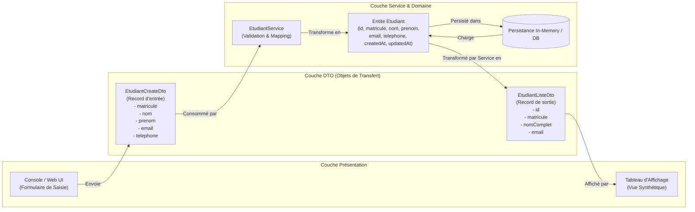

# Data Transfer Objects (DTO), Java Records et Frontière entre Couches

## 1. Introduction & Contexte Métier

Dans les architectures logicielles naïves, les développeurs font circuler les entités de base de données (`Etudiant`, `Note`) directement jusqu'aux vues écrans ou aux API REST publiques. Cette pratique, séduisante par sa rapidité apparente, est une faille architecturale majeure connue sous le nom de **fuite de domaine** (*Domain Model Leakage*).

Considérez les risques majeurs dans notre application académique :
1. **Vulnérabilité de Sur-Assignation (*Over-Posting / Mass Assignment*)** : Si la vue envoie directement un objet `Etudiant`, un utilisateur malveillant peut forger une requête contenant un champ confidentiel ou modifier arbitrairement son identifiant système (`id = 9999`) ou ses dates d'audit (`createdAt`).
2. **Couplage toxique de l'interface utilisateur au schéma de données** : Si vous renommez une colonne en base ou changez le type d'un champ d'entité, vos interfaces écrans se brisent instantanément.
3. **Poids inutile des données transitées** : Pour afficher un simple tableau récapitulatif des étudiants dans un menu console ou Web, vous n'avez pas besoin de charger l'historique complet d'audit, ni le mot de passe, ni l'adresse complète.

La solution universelle recommandée par le Professeur **Baila Wane** est l'introduction du patron **Data Transfer Object (DTO)** combiné à l'innovation moderne de **Java 16+ : les Records**.

> *"L'entité vit et respire à l'intérieur du domaine métier avec ses règles de cohérence. Le DTO, lui, n'est qu'un passeport de données neutre, sans logique, taillé sur mesure pour franchir la frontière entre l'utilisateur et le système !"*

---

## 2. Architecture & Fondations Conceptuelles

### 2.1 Le rôle tampon du DTO entre la Présentation et le Domaine



### 2.2 Les deux familles de DTOs

Dans notre système, nous distinguons deux catégories de DTOs :
1. **Les DTOs de Commande / Création (*Request DTOs*)** : ex. `EtudiantCreateDto`, `NoteCreateDto`. Ils contiennent uniquement les informations requises pour exécuter une action utilisateur. Ils ne possèdent pas d'identifiant technique `id` généré par le système.
2. **Les DTOs de Restitution / Lecture (*Response / View DTOs*)** : ex. `EtudiantListeDto`, `NoteListeDto`. Ils agrègent et formatent les données spécifiquement pour l'affichage (ex: fusion du prénom et du nom en `nomComplet`, formatage de la moyenne).

### 2.3 Révolution des Java Records (Java 16+)

Avant Java 14/16, créer un DTO nécessitait d'écrire 60 lignes de code répétitif : attributs `final`, constructeur complet, accesseurs `get...()`, `equals()`, `hashCode()` et `toString()`.

Les **Records** transforment cette corvée en une déclaration concise d'une seule ligne :
```java
// Un Record Java génère automatiquement immutabilité, constructeur, getters, equals, hashCode et toString !
public record EtudiantCreateDto(String matricule, String nom, String prenom, String email, String telephone) {}
```
Propriétés fondamentales des Records :
- **Immutabilité stricte** : Tous les champs sont `private final`. Une fois créé, le record ne peut plus être altéré, éliminant tout effet de bord indésirable.
- **Accesseurs directs** : La méthode d'accès porte le nom du champ (ex: `dto.nom()` et non `dto.getNom()`).
- **Constructeur canonique et compact** : Possibilité d'intercepter la création pour valider les données en amont.

---

## 3. Implémentation Pratique & Code de Référence

Examinons les records réels extraits du package `com.ism.dto`.

### 3.1 Conception des DTOs Métier dans `com.ism.dto`

Examinons les records et classes de transfert réels extraits du package `com.ism.dto` :

#### 1. `EtudiantCreateDto` (Données de saisie utilisateur)
Dans sa forme initiale, le DTO de création est une classe immuable finale :
```java
package com.ism.dto;

import lombok.AllArgsConstructor;

/**
 * DTO de création d'étudiant.
 */
@AllArgsConstructor 
public final class EtudiantCreateDto {
    public final String nomComplet;
    public final String matricule;
    public final String classe;    
}
```
*Note moderne :* En Java 16+, cette classe s'exprime de façon équivalente et ultra-concise par un record :
```java
public record EtudiantCreateDto(String nomComplet, String matricule, String classe) {}
```

#### 2. `EtudiantListeDto` : La Puissance du DTO Composite
Observez la structure remarquable du DTO composite `EtudiantListeDto` :
```java
package com.ism.dto;

import java.util.List;

/**
 * DTO Composite projetant l'étudiant avec la liste de ses notes et sa moyenne calculée.
 */
public record EtudiantListeDto(
    String matricule, 
    String nomComplet, 
    List<NoteListeDto> notes, 
    double moyenne
) {}
```

#### 3. `NoteListeDto` et `NoteCreateDto`
```java
package com.ism.dto;

public record NoteListeDto(double valeur, String matiere) {}

public record NoteCreateDto(double valeur, String matiere, com.ism.domain.Etudiant etudiant) {}
```

> 💡 **La Puissance du DTO Composite :**
> **Pourquoi `EtudiantListeDto` est-il un modèle d'école ?**
> Plutôt que de forcer la vue console ou un client Web à faire trois requêtes distinctes (une pour l'étudiant, une pour ses notes, une pour calculer la moyenne), `EtudiantListeDto` rassemble en un seul transfert l'ensemble des données requises pour afficher le bulletin ! C'est l'essence même du patron DTO.

#### 1. `EtudiantCreateDto` (Données de saisie utilisateur)
Ce record intègre un constructeur compact pour vérifier que les champs obligatoires ne sont pas vides :

```java
package com.ism.dto;

/**
 * DTO de création d'un étudiant.
 * Utilise la concision et l'immutabilité d'un record Java.
 */
public record EtudiantCreateDto(
        String matricule,
        String nom,
        String prenom,
        String email,
        String telephone
) {
    // Constructeur compact de validation
    public EtudiantCreateDto {
        if (matricule == null || matricule.trim().isEmpty()) {
            throw new IllegalArgumentException("Le matricule est obligatoire.");
        }
        if (nom == null || nom.trim().isEmpty()) {
            throw new IllegalArgumentException("Le nom de l'étudiant est obligatoire.");
        }
        if (prenom == null || prenom.trim().isEmpty()) {
            throw new IllegalArgumentException("Le prénom de l'étudiant est obligatoire.");
        }
    }
}
```

#### 2. `EtudiantListeDto` (Données formatées pour l'affichage)

```java
package com.ism.dto;

/**
 * DTO optimisé pour l'affichage de la liste des étudiants.
 */
public record EtudiantListeDto(
        Long id,
        String matricule,
        String nomComplet,
        String email,
        String telephone
) {}
```

### 3.2 Les DTOs pour la gestion des Notes

#### 1. `NoteCreateDto` (Attribution d'une note)

```java
package com.ism.dto;

/**
 * DTO pour la création et l'attribution d'une note à un étudiant.
 */
public record NoteCreateDto(
        Double valeur,
        Double coefficient,
        String matiere,
        String etudiantMatricule
) {
    public NoteCreateDto {
        if (valeur == null || valeur < 0.0 || valeur > 20.0) {
            throw new IllegalArgumentException("La note doit être obligatoirement comprise entre 0 et 20.");
        }
        if (coefficient == null || coefficient <= 0.0) {
            throw new IllegalArgumentException("Le coefficient doit être un nombre strictement positif.");
        }
        if (matiere == null || matiere.trim().isEmpty()) {
            throw new IllegalArgumentException("La matière est obligatoire.");
        }
        if (etudiantMatricule == null || etudiantMatricule.trim().isEmpty()) {
            throw new IllegalArgumentException("Le matricule de l'étudiant destinataire est requis.");
        }
    }
}
```

#### 2. `NoteListeDto` (Affichage du relevé de notes)

```java
package com.ism.dto;

/**
 * DTO représentant une ligne de note dans le bulletin de l'étudiant.
 */
public record NoteListeDto(
        Long id,
        String matiere,
        Double valeur,
        Double coefficient,
        String etudiantNomComplet
) {}
```

### 3.3 Logique de Mapping (Conversion Entité <-> DTO)

Le service assure la traduction bidirectionnelle entre l'univers du Domaine et l'univers du DTO :

```java
package com.ism.service;

import com.ism.domain.Etudiant;
import com.ism.dto.EtudiantCreateDto;
import com.ism.dto.EtudiantListeDto;

public final class EtudiantMapper {

    private EtudiantMapper() {
        // Constructeur privé pour empêcher l'instanciation d'une classe utilitaire
    }

    /**
     * Convertit un DTO de création en entité métier Etudiant.
     */
    public static Etudiant toEntity(EtudiantCreateDto dto) {
        return Etudiant.builder()
                .matricule(dto.matricule())
                .nom(dto.nom())
                .prenom(dto.prenom())
                .email(dto.email())
                .telephone(dto.telephone())
                .build();
    }

    /**
     * Convertit une entité métier Etudiant en DTO d'affichage.
     */
    public static EtudiantListeDto toListeDto(Etudiant entity) {
        String nomComplet = entity.getPrenom() + " " + entity.getNom().toUpperCase();
        return new EtudiantListeDto(
                entity.getId(),
                entity.getMatricule(),
                nomComplet,
                entity.getEmail(),
                entity.getTelephone()
        );
    }
}
```

---

## 4. Bonnes Pratiques, Pièges & Débogage

> ℹ️ **Pourquoi les records sont-ils préférables aux classes JavaBeans traditionnelles pour les DTOs ?**
> Les records garantissent par nature l'immutabilité : aucun thread ne peut modifier subrepticement l'état d'un DTO pendant son transit. De plus, leur syntaxe compacte évite les centaines de lignes de getters/setters superflus.

> ⚠️ **Attention à la sérialisation des Records :**
> Les records Java sont nativement sérialisables (`Serializable`). Cependant, si vous les convertissez en JSON (via Jackson ou Gson), veillez à ce que vos parseurs supportent Java 16+ pour lire correctement les composants du record sans passer par les préfixes `get`.

> 💡 **Ne mettez jamais de logique métier complexe dans un DTO :**
> Un DTO peut valider le format de ses données (ex: format email ou valeur comprise entre 0 et 20 dans son constructeur compact), mais il ne doit JAMAIS interroger la base de données ou effectuer un calcul de rentabilité financière. Cette responsabilité incombe exclusivement à la couche Service.

---

## 5. Synthèse & Auto-Évaluation

### Tableau Comparatif Entité vs DTO (Record)

| Critère | Entité Métier (`Etudiant`) | DTO Record (`EtudiantCreateDto`) |
| :--- | :--- | :--- |
| **Couche cible** | Domaine & Persistance | Présentation & Échanges inter-couches |
| **Mutabilité** | Généralement mutable (modifications d'état) | Strictement immutable (`final`) |
| **Identifiant** | Possède une identité technique (`id`, `createdAt`) | Ne contient que les données nécessaires au transport |
| **Règles d'intégrité** | Invariants métier complexes et cohérence globale | Validation de format et de présence des champs |
| **Syntaxe Java** | `public class Etudiant extends AbstractEntity` | `public record EtudiantCreateDto(...)` |

### Questionnaire d'Auto-Évaluation (QCM)

1. **Quel risque de sécurité majeur est écarté en utilisant un DTO de création plutôt qu'une entité directement liée à la base de données ?**
   - A) L'attaque par injection SQL
   - B) L'attaque par sur-assignation de champs masqués (Over-Posting)
   - C) L'épuisement de la pile (StackOverflow)
   - D) Le blocage de mémoire dans le Metaspace
   *Réponse attendue : B.*

2. **Quelle est la syntaxe correcte pour accéder au champ `matricule` d'un record nommé `dto` ?**
   - A) `dto.getMatricule()`
   - B) `dto.matricule()`
   - C) `dto.matricule`
   - D) `dto->matricule`
   *Réponse attendue : B. Les records utilisent le nom direct du champ comme accesseur.*

3. **Quelle classe est chargée de transformer les DTOs en entités et vice-versa ?**
   - A) Le Repository
   - B) Le ClassLoader
   - C) Le Mapper (ou le Service)
   - D) Le Garbage Collector
   *Réponse attendue : C.*

### Exercice Pratique & DevLog

```markdown
[DevLog - Entrée 06]
- Sujet : Implémentation des DTOs avec les Java Records
- Action : Créez le package `com.ism.dto` et implémentez les records `EtudiantCreateDto` et `EtudiantListeDto`.
- Défi : Ajoutez un constructeur compact dans `EtudiantCreateDto` qui rejette toute adresse email ne contenant pas le caractère `'@'`. Écrivez une classe de test qui tente d'instancier un DTO invalide et vérifie qu'une `IllegalArgumentException` est bien déclenchée.
```
