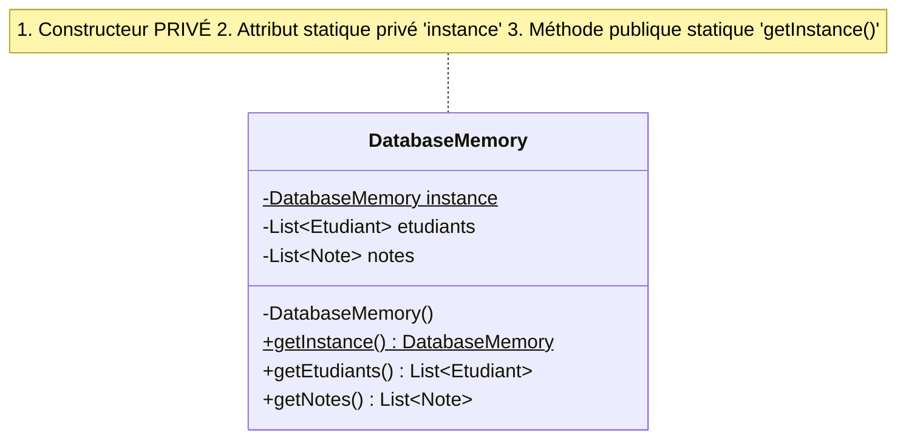
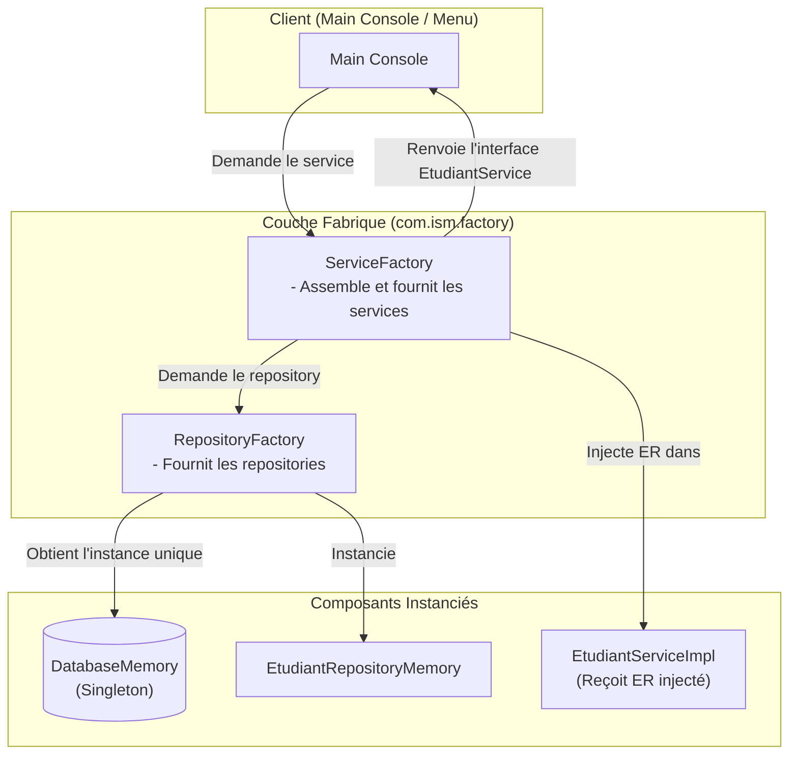

# Design Patterns Créationnels : Singleton, Factory et Façade

## 1. Introduction & Contexte Métier

Dans toute application d'envergure industrielle, instancier directement les objets métier avec l'opérateur `new` disséminé à travers tout le code est une pratique hautement risquée. Si 25 classes différentes appellent directement `new EtudiantRepositoryMemory()`, le jour où vous décidez d'introduire un pool de connexions SQL ou de passer à MongoDB, vous devez modifier et recompiler 25 fichiers différents. C'est l'archétype du **couplage fort**.

Pour résoudre cette fragilité structurelle, le génie logiciel moderne s'appuie sur le catalogue des **Design Patterns (Patrons de Conception)** formalisé par le *Gang of Four (GoF)*. 

Dans notre projet d'école de référence **`com.ism`**, deux problèmes majeurs d'instanciation se posent :
1. **Comment garantir qu'il n'existe qu'une seule et unique instance de la base de données mémoire (`DatabaseMemory`)** dans toute l'application, afin que tous les services partagent le même état cohérent sans risque de duplication ?
2. **Comment fabriquer et assembler nos repositories et nos services de manière centralisée**, sans que la couche de présentation ne connaisse le détail de leurs dépendances ?

Comme l'explique avec passion le Professeur **Baila Wane** :
> *"Un Design Pattern n'est pas un morceau de code à copier-coller bêtement : c'est une solution éprouvée à un problème récurrent de conception. Utiliser un Singleton pour une ressource partagée ou une Factory pour créer vos composants, c'est ce qui sépare le bricoleur du véritable architecte logiciel !"*

---

## 2. Architecture & Fondations Conceptuelles

### 2.1 Le Patron Singleton (Instance Unique Contrôlée)

Le **Singleton** a un objectif unique : s'assurer qu'une classe ne possède qu'une seule instance en mémoire vive et fournir un point d'accès global à cette instance.



**Composants obligatoires du Singleton :**
1. **Constructeur `private`** : Interdit formellement l'utilisation de `new DatabaseMemory()` depuis l'extérieur.
2. **Attribut statique privé** : Mémorise l'instance unique dans le Metaspace.
3. **Méthode d'accès statique publique (`getInstance()`)** : Instancie l'objet lors du premier appel (*Lazy Loading*) ou au chargement de la classe (*Eager Loading*), puis renvoie systématiquement cette même référence.

### 2.2 Le Patron Factory (Fabrique Centralisée)

La **Factory (Fabrique)** est un patron créationnel qui délègue l'acte d'instanciation d'objets à un composant spécialisé, masquant ainsi au client les détails de construction et les dépendances requises.



---

## 3. Implémentation Pratique & Code de Référence

### 3.1 Implémentation Réelle du Singleton : `DatabaseMemory`

Dans notre projet `com.ism.repository.memory`, la base de données simulant les tables d'étudiants et de notes est un Singleton rigoureusement thread-safe :

```java
package com.ism.repository.memory;

import com.ism.domain.Etudiant;
import com.ism.domain.Note;

import java.util.ArrayList;
import java.util.List;

/**
 * Base de données en mémoire simulant le stockage relationnel.
 * Implémentée selon le Design Pattern Singleton.
 *
 * @author Baila Wane
 */
public class DatabaseMemory {

    // 1. Instance unique déclarée static et volatile pour garantir la visibilité inter-threads
    private static volatile DatabaseMemory instance;

    // Collections internes simulant les tables relationnelles
    private final List<Etudiant> etudiants;
    private final List<Note> notes;

    // 2. Constructeur strictement PRIVÉ pour bloquer 'new'
    private DatabaseMemory() {
        this.etudiants = new ArrayList<>();
        this.notes = new ArrayList<>();
        initialiserJeuEssai();
    }

    // 3. Point d'accès global avec verrouillage à double vérification (Double-Checked Locking)
    public static DatabaseMemory getInstance() {
        if (instance == null) {
            synchronized (DatabaseMemory.class) {
                if (instance == null) {
                    instance = new DatabaseMemory();
                }
            }
        }
        return instance;
    }

    public List<Etudiant> getEtudiants() {
        return etudiants;
    }

    public List<Note> getNotes() {
        return notes;
    }

    private void initialiserJeuEssai() {
        // Pré-chargement de données académiques pour les tests
        Etudiant e1 = new Etudiant(1L, "ETU-001", "Wane", "Amadou", "amadou.wane@ism.sn", "771002030");
        Etudiant e2 = new Etudiant(2L, "ETU-002", "Sow", "Fatou", "fatou.sow@ism.sn", "774005060");
        etudiants.add(e1);
        etudiants.add(e2);
    }
}
```

### 3.2 Implémentation de la Fabrique de Persistance : `RepositoryFactory`

Dans `com.ism.factory`, `RepositoryFactory` centralise l'instanciation des repositories en leur fournissant l'instance de `DatabaseMemory` :

```java
package com.ism.factory;

import com.ism.repository.EtudiantRepository;
import com.ism.repository.NoteRepository;
import com.ism.repository.memory.DatabaseMemory;
import com.ism.repository.memory.EtudiantRepositoryMemory;
import com.ism.repository.memory.NoteRepositoryMemory;

/**
 * Fabrique responsable de la création des instances de Repository.
 */
public final class RepositoryFactory {

    private static EtudiantRepository etudiantRepository;
    private static NoteRepository noteRepository;

    private RepositoryFactory() {}

    public static EtudiantRepository getEtudiantRepository() {
        if (etudiantRepository == null) {
            DatabaseMemory db = DatabaseMemory.getInstance();
            etudiantRepository = new EtudiantRepositoryMemory(db);
        }
        return etudiantRepository;
    }

    public static NoteRepository getNoteRepository() {
        if (noteRepository == null) {
            DatabaseMemory db = DatabaseMemory.getInstance();
            noteRepository = new NoteRepositoryMemory(db);
        }
        return noteRepository;
    }
}
```

### 3.3 Implémentation de la Fabrique Métier : `ServiceFactory`

La `ServiceFactory` assemble l'application en injectant les dépendances nécessaires dans chaque service :

```java
package com.ism.factory;

import com.ism.service.*;

/**
 * Fabrique d'orchestration responsable de l'assemblage des Services.
 */
public final class ServiceFactory {

    private static EtudiantService etudiantService;
    private static NoteService noteService;
    private static MoyenneService moyenneService;

    private ServiceFactory() {}

    public static MoyenneService getMoyenneService() {
        if (moyenneService == null) {
            moyenneService = new MoyenneServiceImpl();
        }
        return moyenneService;
    }

    public static NoteService getNoteService() {
        if (noteService == null) {
            noteService = new NoteServiceImpl(
                    RepositoryFactory.getNoteRepository(),
                    RepositoryFactory.getEtudiantRepository()
            );
        }
        return noteService;
    }

    public static EtudiantService getEtudiantService() {
        if (etudiantService == null) {
            etudiantService = new EtudiantServiceImpl(
                    RepositoryFactory.getEtudiantRepository(),
                    RepositoryFactory.getNoteRepository(),
                    getMoyenneService()
            );
        }
        return etudiantService;
    }
}
```

### 3.4 Le Patron Façade dans l'application

Le patron **Façade** offre une interface unifiée simplifiée devant un ensemble complexe d'interfaces d'un sous-système. 

Dans notre projet, `EtudiantService` agit comme une véritable **Façade Métier** pour le client de présentation `Main` :
Pour inscrire un étudiant et calculer sa situation, l'interface console n'a pas besoin de manipuler séparément `DatabaseMemory`, `EtudiantRepository`, `NoteRepository` et `MoyenneService`. Elle appelle une seule méthode de façade :
```java
// Le client console bénéficie d'une Façade limpide :
EtudiantService service = ServiceFactory.getEtudiantService();
EtudiantListeDto resultat = service.inscrireEtudiant(dto);
```

---

## 4. Bonnes Pratiques, Pièges & Débogage

> ℹ️ **Pourquoi le mot-clé `volatile` est-il crucial dans le Double-Checked Locking du Singleton ?**
> Sans `volatile`, l'optimisation matérielle du processeur et la réorganisation des instructions (*instruction reordering*) par la JVM peuvent rendre visible l'instance à un second thread avant même que le constructeur n'ait terminé d'initialiser les attributs de l'objet, provoquant un crash furtif et aléatoire.

> ⚠️ **Attention à la dérive du Singleton en "Variable Globale Déguisée" :**
> Le Singleton est un patron puissant, mais son abus conduit à des dépendances masquées et complique les tests unitaires. N'appliquez le Singleton qu'aux objets véritablement partagés (moteur de base de données, gestionnaire de configuration).

> 💡 **Le couplage zéro offert par la Factory :**
> Grâce à `ServiceFactory.getEtudiantService()`, la classe cliente `Main` manipule exclusivement l'interface `EtudiantService`. Elle ne connaît même pas l'existence de la classe concrète `EtudiantServiceImpl` !

---

## 5. Synthèse & Auto-Évaluation

### Matrice Comparatif des Patrons Créationnels

| Patron | Objectif | Mécanisme clé | Bénéfice architectural |
| :--- | :--- | :--- | :--- |
| **Singleton** | Garantir 1 seule instance en mémoire | Constructeur privé + `getInstance()` | Cohérence de l'état partagé (ex: `DatabaseMemory`) |
| **Factory** | Découpler la création des objets de leur utilisation | Méthodes de fabrication statiques ou dédiées | Échange aisé des implémentations et assemblage centralisé |
| **Façade** | Simplifier l'accès à un sous-système complexe | Point d'entrée de haut niveau unifié | Réduction drastique du couplage entre couches |

### Questionnaire d'Auto-Évaluation (QCM)

1. **Pourquoi le constructeur d'une classe implémentant le patron Singleton doit-il obligatoirement être déclaré avec la visibilité `private` ?**
   - A) Pour accélérer l'exécution du Garbage Collector
   - B) Pour empêcher l'instanciation directe via l'opérateur `new` depuis d'autres classes
   - C) Pour obliger la classe à hériter de `AbstractEntity`
   - D) Pour rendre les attributs de la classe immuables
   *Réponse attendue : B.*

2. **Quelle fabrique dans notre architecture est chargée d'injecter `EtudiantRepository` et `MoyenneService` dans `EtudiantServiceImpl` ?**
   - A) `RepositoryFactory`
   - B) `DatabaseMemory`
   - C) `ServiceFactory`
   - D) `ClassLoader`
   *Réponse attendue : C.*

3. **Quelle est la responsabilité première du patron Façade ?**
   - A) Cloner des objets à l'exécution
   - B) Fournir une interface simple et unifiée masquant la complexité d'un sous-système
   - C) Limiter l'accès aux bases de données relationnelles
   - D) Remplacer tous les getters et setters par des records
   *Réponse attendue : B.*

### Exercice Pratique & DevLog

```markdown
[DevLog - Entrée 07]
- Sujet : Implémentation des patrons Singleton et Factory
- Action : Implémentez la classe `DatabaseMemory` sous forme de Singleton thread-safe dans le package `com.ism.repository.memory`.
- Défi : Écrivez un test multithreadé lançant 10 threads simultanés qui appellent tous `DatabaseMemory.getInstance()`. Vérifiez par assertion que l'adresse de l'instance (`System.identityHashCode(instance)`) est strictement identique pour les 10 threads.
```
