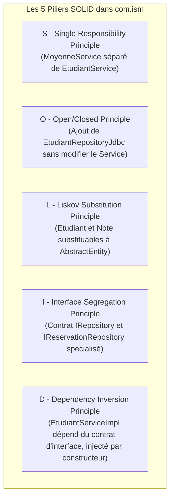
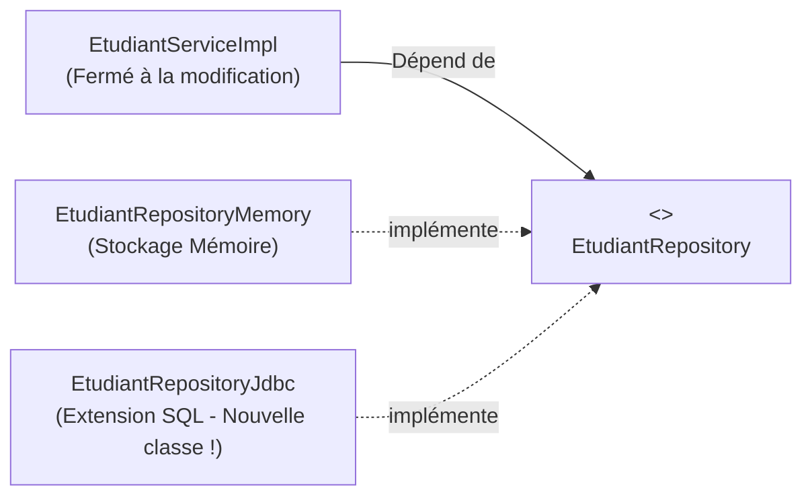

# Les Cinq Principes SOLID Appliqués au Code Réel

## 1. Introduction & Contexte Métier

Les principes **SOLID** constituent la bible incontournable de tout ingénieur logiciel senior. Théorisés par Robert C. Martin ("Uncle Bob"), ces cinq principes de conception orientée objet permettent de construire des systèmes robustes, évolutifs, faciles à tester et immunisés contre la "pourriture logicielle" (*Code Rot*).

Trop souvent, les étudiants et développeurs juniors apprennent les acronymes SOLID de manière purement théorique, sans être capables de les appliquer lorsqu'ils écrivent une seule ligne de Java.

Dans ce cours magistral, le Professeur **Baila Wane** brise cette barrière théorique :
> *"Ne récitez pas du SOLID pour faire briller vos CV ! Montrez-moi dans votre code où se trouve la responsabilité unique. Montrez-moi comment vous séparez le calcul d'une moyenne de la gestion du cycle de vie d'un étudiant. Montrez-moi comment vous injectez vos interfaces au lieu de coller du `static` partout ! Le mot-clé `static` sur des méthodes métier est le poison n°1 qui assassine le polymorphisme et piétine les principes SOLID !"*

Analysons chacun des 5 principes à travers le prisme du code source concret de **`com.ism : Gestion-etudiants-notes-java`**.

---

## 2. Architecture & Fondations Conceptuelles

### 2.1 Couplage Fort vs Couplage Faible : L'Analogie Réelle Wave vs OrangeMoney

Avant d'aborder les 5 principes SOLID, il est impératif de comprendre le combat fondamental du génie logiciel : **la lutte contre le couplage fort**.

Le Professeur Baila Wane illustre ce défi par une démonstration concrète tirée des paiements électroniques :
- **Couplage Fort (Rigide & Fragile)** :
  ```java
  // Dans votre classe de service :
  WavePayment wp = new WavePayment();
  wp.pay(50000);
  ```
  La classe métier sait explicitement qu'elle utilise `WavePayment`. Si demain l'établissement décide de basculer vers OrangeMoney ou FreeMoney, ou si l'API de Wave modifie ses signatures, toute la classe métier est brisée et doit être réécrite et retestée !
- **Couplage Faible (Souple & Extensible)** :
  ```java
  // On définit une abstraction commune :
  public interface IPayment {
      void pay(double montant);
  }

  // La classe de service manipule l'interface, injectée depuis l'extérieur :
  public class InscriptionService {
      private final IPayment payment;
      public InscriptionService(IPayment payment) { this.payment = payment; }
      public void valider(double montant) { payment.pay(montant); }
  }
  ```
  Grâce à ce découplage, nous pouvons remplacer instantanément `new Wave()` par `new OrangeMoney()` sans modifier une seule ligne du service métier !

### 2.2 Synthèse Visuelle des Principes SOLID



---

## 3. Démonstration Pratique des 5 Principes

### 3.1 S - Single Responsibility Principle (Principe de Responsabilité Unique)

> **Définition formelle :** *"Une classe ne doit avoir qu'une seule et unique raison de changer."*

#### Violation classique :
Créer une classe fourre-tout `EtudiantService` qui gère à la fois :
- L'inscription et la mise à jour des coordonnées de l'étudiant.
- L'envoi de mails de notification.
- L'impression PDF des relevés de notes.
- Le calcul algorithmique des moyennes pondérées.
Si la formule de calcul de la moyenne change (ex: prise en compte d'un coefficient éliminatoire), nous sommes obligés de modifier la classe qui gère les coordonnées de l'étudiant !

#### Solution adoptée dans `com.ism` :
Nous extrayons l'algorithme de calcul dans un service dédié : **`MoyenneService`** !

```java
package com.ism.service;

import com.ism.domain.Note;
import java.util.List;

/**
 * SRP : Ce service n'a qu'UNE SEULE responsabilité :
 * calculer la moyenne d'une collection de notes.
 */
public interface MoyenneService {
    double calculerMoyenne(List<Note> notes);
}
```

Comme le démontre le professeur **Baila Wane** :
> *"Le service étudiant s'occupe de la gestion des étudiants (`addEtudiant`, `findAll`). Pourquoi lui donner la responsabilité de calculer la moyenne ? Si demain la formule de notation change (prise en compte de coefficients, note éliminatoire), c'est uniquement `MoyenneServiceImpl` qui changera !"*

La classe `EtudiantServiceImpl` délègue le calcul à `MoyenneService` au lieu de le faire elle-même. Si l'algorithme mathématique évolue, seul `MoyenneServiceImpl` est modifié.

---

### 3.2 O - Open/Closed Principle (Principe Ouvert / Fermé)

> **Définition formelle :** *"Une entité logicielle (classe, module, fonction) doit être ouverte à l'extension, mais fermée à la modification."*

#### Application dans `com.ism` :
Nous voulons pouvoir changer notre mécanisme de persistance (passer d'un stockage mémoire à une base de données PostgreSQL ou MySQL) **sans modifier une seule ligne de code dans la classe métier `EtudiantServiceImpl`**.

Grâce au contrat d'interface `EtudiantRepository` :
- `EtudiantServiceImpl` est **fermé à la modification** : son code reste immuable.
- Le système est **ouvert à l'extension** : il suffit d'écrire une nouvelle classe `EtudiantRepositoryJdbc implements EtudiantRepository` et de l'injecter via la `RepositoryFactory` !



---

### 3.3 L - Liskov Substitution Principle (Principe de Substitution de Liskov)

> **Définition formelle :** *"Les sous-types doivent pouvoir remplacer leurs types de base sans altérer la correction du programme."*

Formulé par Barbara Liskov, ce principe interdit aux classes filles de violer les contrats ou de restreindre les attentes établies par la classe mère.

#### Application dans `com.ism` :
`Etudiant` et `Note` héritent tous deux de `AbstractEntity`.
La classe `AbstractEntity` garantit la présence d'un identifiant `Long id` et de dates d'audit `createdAt` et `updatedAt`.
Partout où une fonction du système attend une `AbstractEntity` (par exemple un système générique de journalisation ou d'indexation d'audit), nous pouvons lui passer une instance d'`Etudiant` ou de `Note` sans que le code ne crash ni ne produise d'état corrompu.

---

### 3.4 I - Interface Segregation Principle (Principe de Ségrégation des Interfaces)

> **Définition formelle :** *"Aucun client ne doit être contraint de dépendre de méthodes qu'il n'utilise pas."*

#### Cas Pratique Démonstratif : Le Projet de Réservation de Salles
Le Professeur Baila Wane pose le problème à travers le système de gestion des salles universitaires :
Supposons que nous définissions une interface générique `IRepository<T>` :
```java
public interface IRepository<T> {
    T save(T entity);
    List<T> findAll();
}
```
Si un développeur ajoute imprudemment une méthode de recherche par date dans cette interface commune :
`List<T> findByDate(LocalDate date);`
Que se passe-t-il pour `SalleRepository` qui implémente `IRepository<Salle>` ?
Une salle n'a pas de date (elle a un code et une capacité) ! `SalleRepository` est pourtant contrainte d'implémenter `findByDate()` avec un `return null;` ou de lever une exception, ou de devenir une classe abstraite. C'est une violation flagrante de l'ISP !

#### La Solution d'Ingénierie : La Spécialisation d'Interfaces
Nous fragmentons le contrat en petites interfaces hautement cohérentes :
```java
// 1. Contrat générique de base (uniquement le CRUD universel)
public interface IRepository<T> {
    T save(T entity);
    List<T> findAll();
}

// 2. Interface spécialisée étendant le contrat de base pour la réservation
public interface IReservationRepository extends IRepository<Reservation> {
    List<Reservation> findByDate(LocalDate date);
}

// 3. Implémentations ciblées
public class SalleRepositoryMemory implements IRepository<Salle> {
    // Ne redéfinit que save() et findAll() : aucune méthode parasite !
}

public class ReservationRepositoryMemory implements IReservationRepository {
    // Redéfinit save(), findAll() ET findByDate()
}
```

---

### 3.5 D - Dependency Inversion Principle (Principe d'Inversion des Dépendances)

> **Définition formelle :**
> 1. *"Les modules de haut niveau ne doivent pas dépendre des modules de bas niveau. Tous deux doivent dépendre d'abstractions."*
> 2. *"Les abstractions ne doivent pas dépendre des détails. Les détails doivent dépendre des abstractions."*

#### Application concrète dans `EtudiantServiceImpl` :

Observez le constructeur de notre classe de service dans `com.ism.service` :

```java
package com.ism.service;

import com.ism.repository.EtudiantRepository;
import com.ism.repository.NoteRepository;

public class EtudiantServiceImpl implements EtudiantService {

    // 1. Dépendance UNIQUEMENT vers des abstractions (Interfaces)
    private final EtudiantRepository etudiantRepository;
    private final NoteRepository noteRepository;
    private final MoyenneService moyenneService;

    // 2. Injection par le constructeur (Constructor Dependency Injection)
    public EtudiantServiceImpl(EtudiantRepository etudiantRepository,
                               NoteRepository noteRepository,
                               MoyenneService moyenneService) {
        this.etudiantRepository = etudiantRepository;
        this.noteRepository = noteRepository;
        this.moyenneService = moyenneService;
    }

    // ...
}
```

`EtudiantServiceImpl` (module de haut niveau contenant les règles métier de l'ISM) ne fait aucun `new EtudiantRepositoryMemory()`. Il ne sait même pas comment les données sont sauvegardées physiquement. C'est l'inversion de dépendance totale !

---

### 3.6 Pattern Strategy : Élimination des Cascades `if / else` dans les Règles Métier

Dans toute application d'entreprise, coder de longues chaînes de `if / else` pour gérer des variantes d'algorithmes métier est un anti-patron destructeur :
```java
// ANTI-PATRON : Toute nouvelle catégorie oblige à modifier cette méthode (casse OCP !)
if (typeClient.equals("ETUDIANT")) {
    remise = montant * 0.10;
} else if (typeClient.equals("PROFESSEUR")) {
    remise = montant * 0.20;
} else if (typeClient.equals("PARTENAIRE")) {
    remise = montant * 0.15;
}
```

> 💡 **La Règle de Baila Wane : Remplacer les embranchements par des Stratégies Polymorphiques**
> 1. Définir une interface commune de stratégie :
> ```java
> public interface RemiseStrategy {
>     double calculerRemise(double montant);
> }
> ```
> 2. Créer une classe d'implémentation par variante (`RemiseEtudiant`, `RemiseProfesseur`, `RemisePartenaire`).
> 3. La classe consommatrice reçoit l'interface `RemiseStrategy` : l'algorithme devient fermé à la modification et ouvert à l'ajout de n'importe quel nouveau profil commercial !
> *Cette approche s'applique également au calcul de surface (`SurfaceCarre`, `SurfaceRectangle`) et à la tarification d'inscription (`InscriptionL1`, `InscriptionBoursier`).*

---

## 4. Pourquoi Proscrire le `static` sur les Méthodes Métier ?

L'un des enseignements les plus retentissants du Professeur **Baila Wane** concerne l'interdiction des méthodes statiques dans la couche métier :

> ⚠️ **Le réquisitoire contre les méthodes métier `static` :**
> 1. **Destruction du Polymorphisme** : En Java, une méthode statique est liée à la compilation (*static binding / early binding*). Elle ne peut être ni surchargée dynamiquement (`@Override`), ni substituée à l'exécution.
> 2. **Impossibilité de Tester unitairement (Mocking impossible)** : Si votre service appelle `EtudiantDao.save(e)` de manière statique, vous ne pouvez pas injecter un mock lors de vos tests avec Mockito ou JUnit pour simuler la base. Vos tests deviennent dépendants de l'environnement réel et lents.
> 3. **Violation directe de DIP et OCP** : L'appel direct `ClasseConcrete.methodeStatique()` couple à jamais l'appelant à cette implémentation précise.
> 
> *La seule utilisation légitime de `static` est réservée aux constantes immuables (`public static final`) et aux fonctions utilitaires pures sans état (ex: `Math.max()`, `EtudiantMapper.toEntity()`).*

---

## 5. Synthèse & Auto-Évaluation

### Résumé des 5 Piliers SOLID

| Lettre | Principe | Question clé à se poser | Conséquence dans le code |
| :--- | :--- | :--- | :--- |
| **S** | Single Responsibility | Cette classe a-t-elle plus d'une raison de changer ? | Séparer les calculs (`MoyenneService`) de la gestion d'étudiants. |
| **O** | Open / Closed | Puis-je ajouter une nouvelle fonctionnalité sans retoucher l'existant ? | Coder par rapport à des interfaces (`EtudiantRepository`). |
| **L** | Liskov Substitution | Puis-je substituer la classe fille à la classe mère sans effet pervers ? | Respecter le contrat de `AbstractEntity`. |
| **I** | Interface Segregation | Les clients sont-ils forcés d'implémenter des méthodes inutiles ? | Découper en interfaces ciblées (`EtudiantRepo`, `NoteRepo`). |
| **D** | Dependency Inversion | Mes classes de haut niveau dépendent-elles d'implémentations concrètes ? | Injecter les interfaces via les constructeurs. |

### Questionnaire d'Auto-Évaluation (QCM)

1. **Quel principe SOLID est directement violé si vous ajoutez la logique d'envoi de SMS et le calcul de la TVA dans votre classe `EtudiantRepository` ?**
   - A) Liskov Substitution Principle
   - B) Single Responsibility Principle (SRP)
   - C) Open/Closed Principle
   - D) Dependency Inversion Principle
   *Réponse attendue : B.*

2. **Comment `EtudiantServiceImpl` applique-t-il le principe d'Inversion des Dépendances (DIP) ?**
   - A) En utilisant l'héritage multiple
   - B) En recevant ses interfaces de repository par injection dans son constructeur
   - C) En déclarant toutes ses méthodes en `static`
   - D) En créant ses objets avec `new EtudiantRepositoryMemory()`
   *Réponse attendue : B.*

3. **Pourquoi l'utilisation de méthodes métier `public static` est-elle formellement déconseillée dans une architecture d'entreprise ?**
   - A) Parce que Java ne supporte plus les méthodes statiques
   - B) Parce qu'elle empêche le mocking dans les tests unitaires et détruit le polymorphisme
   - C) Parce que la mémoire Heap sature immédiatement
   - D) Parce que cela empêche l'utilisation de Maven
   *Réponse attendue : B.*

### Exercice Pratique & DevLog

```markdown
[DevLog - Entrée 08]
- Sujet : Audit SOLID et refactorisation d'un service
- Action : Analysez votre classe `EtudiantServiceImpl`. Vérifiez qu'aucun appel à `new ...Repository()` n'y figure.
- Défi : Implémentez un faux repository de test (`EtudiantRepositoryMock`) qui stocke les étudiants dans une simple `Map` locale. Injectez ce faux repository dans `EtudiantServiceImpl` pour démontrer que le service fonctionne à 100% sans la moindre modification de son code source (validation d'OCP et DIP).
```
