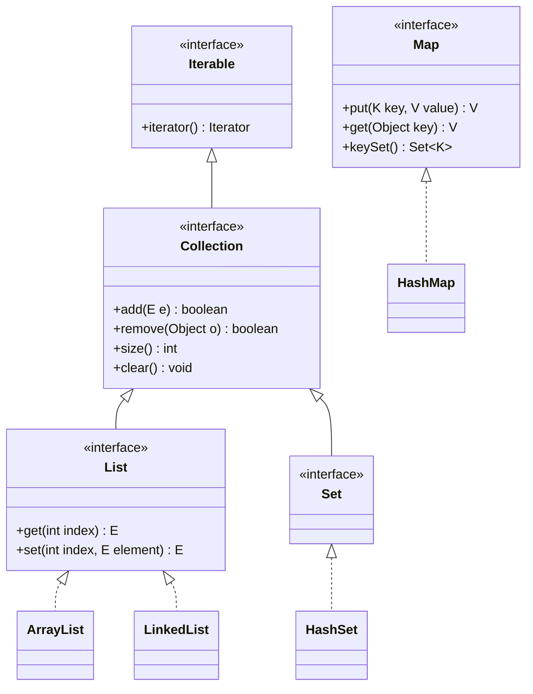

# Framework Collections, List, Map et Traitement Sécurisé avec Optional

## 1. Introduction & Contexte Métier

Dans une application d'entreprise, les données ne sont presque jamais manipulées de manière isolée : nous traitons des promotions d'étudiants, des historiques de relevés de notes, des listes de cours magistraux et des répertoires d'adresses. L'utilisation maladroite des structures de données en mémoire peut rapidement transformer une application fluide en un cauchemar de latence ou entraîner des fuites mémoires dramatiques.

Considérez par exemple notre base en mémoire `DatabaseMemory` : si nous utilisons une simple liste chaînée non indexée pour rechercher un étudiant parmi 50 000 inscrits, chaque recherche oblige la JVM à parcourir séquentiellement des dizaines de milliers de pointeurs. Pire encore : si une méthode de recherche renvoie `null` lorsqu'un étudiant n'est pas trouvé et que l'appelant tente d'accéder à son nom sans vérification préalable, l'application s'arrête net avec le redoutable **`NullPointerException` (NPE)**.

Comme le formule le Professeur **Baila Wane** lors des séances de travaux dirigés :
> *"Un ingénieur logiciel digne de ce nom ne choisit pas `ArrayList` ou `HashMap` au hasard ou par habitude ! Chaque structure possède un coût algorithmique précis en temps (Big-O) et en espace mémoire. Et pour ce qui est de `null` : le retour de `null` pour exprimer l'absence d'un résultat est une bombe à retardement. En Java moderne, nous désarmons cette bombe grâce au conteneur `Optional` !"*

---

## 2. Architecture & Fondations Conceptuelles

### 2.1 Hiérarchie du Java Collections Framework (JCF)

Le Java Collections Framework est structuré autour de deux hiérarchies d'interfaces distinctes dans le package `java.util` :



1. **`List<E>`** : Collection ordonnée avec accès positionnel par indice entier. Accepte les doublons.
   - **`ArrayList`** : Implémentée sur la base d'un tableau dynamique contigu en mémoire. Accès en lecture instantané par index en temps constant **O(1)**. En revanche, l'insertion ou la suppression au milieu du tableau nécessite de décaler les éléments consécutifs (**O(n)**).
   - **`LinkedList`** : Liste doublement chaînée où chaque élément est un nœud contenant la donnée et deux pointeurs (vers le précédent et le suivant). Insertion/suppression rapide en tête/queue (**O(1)**), mais recherche séquentielle lente (**O(n)**) et surcoût mémoire important lié aux pointeurs.
2. **`Set<E>`** : Collection mathématique d'éléments uniques interdisant formellement les doublons.
   - **`HashSet`** : S'appuie sur une table de hachage interne (`HashMap`). Unicité et recherche garanties en temps quasi-constant **O(1)** grâce aux méthodes `hashCode()` et `equals()`.
3. **`Map<K, V>`** : Structure associative associant une clé unique `K` à une valeur `V`.
   - **`HashMap`** : Calcule le hash de la clé pour déterminer la case (*bucket*) de stockage. Idéal pour indexer les étudiants par leur matricule unique.

---

### 2.2 L'Anatomie du Conteneur `Optional<T>`

Introduit en Java 8, `java.util.Optional<T>` est un conteneur monadique qui encapsule une référence pouvant être soit présente (*non-nulle*), soit absente (*vide*).

```mermaid
flowchart TD
    OPT["Optional&lt;Etudiant&gt;"]
    PRES["Valeur Présente
(Contient une instance d'Etudiant)"]
    EMPTY["Valeur Absente
(Optional.empty())"]

    OPT -->|Si trouvé| PRES
    OPT -->|Si non trouvé| EMPTY

    PRES -->|opt.ifPresent(e -> ...)| ACTION["Exécuter une action métier sûre"]
    PRES -->|opt.get()| VAL["Récupérer l'objet"]
    EMPTY -->|opt.orElseThrow(...)| EXC["Déclencher une exception métier claire
(EntityNotFoundException)"]
    EMPTY -->|opt.orElse(defaultEtudiant)| DEF["Fournir une valeur par défaut"]
```

---

## 3. Implémentation Pratique & Code de Référence

### 3.1 Utilisation Avancée de `Map` pour l'Indexation Rapide

Dans un service académique haute performance, nous pouvons indexer les étudiants par matricule pour un accès direct O(1) :

```java
package com.ism.repository.memory;

import com.ism.domain.Etudiant;
import java.util.*;

public class FastEtudiantCache {

    // Indexation matricule -> Etudiant
    private final Map<String, Etudiant> cacheParMatricule = new HashMap<>();

    public void indexerEtudiant(Etudiant etudiant) {
        if (etudiant != null && etudiant.getMatricule() != null) {
            cacheParMatricule.put(etudiant.getMatricule().toUpperCase(), etudiant);
        }
    }

    public Optional<Etudiant> chercherParMatricule(String matricule) {
        if (matricule == null) return Optional.empty();
        // getOrDefault ou wrap dans Optional
        return Optional.ofNullable(cacheParMatricule.get(matricule.toUpperCase()));
    }
}
```

### 3.2 Éradication du `NullPointerException` avec `Optional`

Examinons comment le service `EtudiantServiceImpl` utilise la richesse fonctionnelle d'`Optional` sans jamais écrire un seul `if (e == null)` :

```java
package com.ism.service;

import com.ism.domain.Etudiant;
import com.ism.dto.EtudiantListeDto;
import com.ism.repository.EtudiantRepository;

import java.util.NoSuchElementException;

public class EtudiantQueryService {

    private final EtudiantRepository etudiantRepository;

    public EtudiantQueryService(EtudiantRepository etudiantRepository) {
        this.etudiantRepository = etudiantRepository;
    }

    /**
     * Recherche et transformation directe sans risque de NPE.
     */
    public EtudiantListeDto obtenirEtudiantDto(String matricule) {
        return etudiantRepository.findByMatricule(matricule)
                // 1. Transformation fluide si l'étudiant est présent
                .map(e -> new EtudiantListeDto(
                        e.getId(),
                        e.getMatricule(),
                        e.getPrenom() + " " + e.getNom().toUpperCase(),
                        e.getEmail(),
                        e.getTelephone()
                ))
                // 2. Déclenchement d'une exception explicite si absent
                .orElseThrow(() -> new NoSuchElementException("Aucun étudiant trouvé avec le matricule : " + matricule));
    }

    /**
     * Exécution conditionnelle sécurisée.
     */
    public void notifierEtudiant(String matricule) {
        etudiantRepository.findByMatricule(matricule).ifPresent(etudiant -> {
            System.out.println("[NOTIFICATION] Envoi d'un SMS à " + etudiant.getPrenom() + " au " + etudiant.getTelephone());
        });
    }
}
```

---

## 4. Bonnes Pratiques, Pièges & Débogage

> ℹ️ **Règle d'or de l'utilisation d'`Optional` :**
> - **OUI** : Utilisez `Optional<T>` comme type de retour des méthodes de recherche (`findBy...`).
> - **NON** : N'utilisez JAMAIS `Optional` comme paramètre de méthode (ex: `void faireChose(Optional<String> param)` est un antipattern).
> - **NON** : Ne stockez pas d'`Optional` comme champ d'une classe (`field`), car `Optional` n'est pas conçu pour être sérialisé.

> ⚠️ **Le piège du `.get()` aveugle sur un `Optional` :**
> Écrire `opt.get()` sans avoir vérifié au préalable avec `opt.isPresent()` reproduit exactement le même problème que le `NullPointerException` : si la valeur est absente, la JVM lève un `java.util.NoSuchElementException` ! Privilégiez toujours `.orElseThrow()`, `.orElse()` ou `.ifPresent()`.

> 💡 **Le dimensionnement initial de l'`ArrayList` :**
> Par défaut, une `ArrayList` est initialisée avec une capacité de 10 éléments. Si vous prévoyez d'y stocker 10 000 étudiants, elle subira de multiples réallocations de tableau et copies internes coûteuses. Si la volumétrie est connue à l'avance, spécifiez-la dès la construction : `new ArrayList<>(10000)`.

---

## 5. Synthèse & Auto-Évaluation

### Tableau Comparatif des Structures de Données

| Structure | Ordre garanti ? | Doublons autorisés ? | Temps d'accès / Recherche | Cas d'usage type |
| :--- | :--- | :--- | :--- | :--- |
| **`ArrayList`** | Oui (index 0..n) | Oui | O(1) par index, O(n) par valeur | Liste complète des étudiants pour affichage paginé. |
| **`LinkedList`** | Oui (séquentiel) | Oui | O(1) début/fin, O(n) par index | File d'attente d'inscriptions (Queue/Deque). |
| **`HashSet`** | Non | **Non** | O(1) si bon `hashCode` | Ensemble des emails uniques enregistrés. |
| **`HashMap`** | Non | Clés uniques, valeurs dupliquées | O(1) par clé | Dictionnaire d'accès rapide par matricule. |

### Questionnaire d'Auto-Évaluation (QCM)

1. **Quelle est la complexité algorithmique en temps pour rechercher un étudiant par son matricule dans une `HashMap` correctement équilibrée ?**
   - A) O(log n)
   - B) O(n²)
   - C) O(1) en moyenne
   - D) O(n)
   *Réponse attendue : C. La table de hachage offre un accès direct quasi-instantané en O(1).*

2. **Quelle méthode de la classe `Optional` permet de fournir une valeur de repli alternative si l'objet enveloppé est absent ?**
   - A) `opt.fallback()`
   - B) `opt.orElse(valeurParDefaut)`
   - C) `opt.default()`
   - D) `opt.empty()`
   *Réponse attendue : B.*

3. **Pourquoi est-il fortement déconseillé de passer un `Optional` en paramètre d'une méthode ?**
   - A) La JVM refuse de compiler le code
   - B) Cela force l'appelant à emballer ses arguments et permet de passer accidentellement `null` comme valeur de l'Optional lui-même
   - C) Cela double la consommation de CPU du JIT
   - D) C'est interdit par la spécification Maven
   *Réponse attendue : B.*

### Exercice Pratique & DevLog

```markdown
[DevLog - Entrée 09]
- Sujet : Optimisation de recherche avec Map et sécurisation par Optional
- Action : Implémentez un cache d'étudiants `Map<String, Etudiant>` dans la classe `DatabaseMemory`.
- Défi : Écrivez une méthode `Optional<Etudiant> findByMatriculeOptimise(String matricule)`. Si l'étudiant est absent du cache, cherchez-le dans la liste principale, insérez-le dans la Map s'il est trouvé, puis renvoyez l'Optional. Mesurez le temps d'exécution sur 10 000 requêtes.
```
