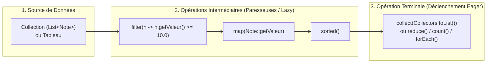

# Streams API, Expressions Lambdas et Traitement Fonctionnel

## 1. Introduction & Contexte Métier

Avant l'avènement de Java 8, le traitement de collections de données en Java relevait d'une programmation impérative verbeuse et sujette aux erreurs : pour filtrer les notes supérieures à 10, calculer la moyenne générale d'un étudiant et trier les majors de promotion, le développeur devait écrire des boucles imbriquées `for (...)`, instancier des accumulateurs temporaires et gérer des compteurs manuels. Ce style de code masquait l'intention métier derrière une forêt de variables de contrôle.

Avec l'introduction de la **Streams API** et des **Expressions Lambdas**, Java a accompli sa révolution fonctionnelle. Au lieu d'expliquer à la machine *comment* itérer physiquement élément par élément (approche impérative), vous déclarez *ce que* vous souhaitez obtenir comme résultat à travers un pipeline de transformations élégant et optimisé.

Dans notre projet académique **`com.ism`**, cette approche est fondamentale :
- Calculer instantanément la moyenne générale pondérée d'un étudiant.
- Regrouper l'ensemble des notes par matière (*groupingBy*).
- Identifier en une seule ligne le major de la promotion ou filtrer les étudiants admis.

Le Professeur **Baila Wane** insiste particulièrement sur cette transition d'esprit :
> *"Un Stream n'est pas une structure de données ! Il ne stocke aucun élément en mémoire. C'est un tuyau d'arrosage où circule un flux de données. Vous appliquez des filtres et des buses de transformation, et vous récoltez le résultat final à la sortie du tuyau avec un Collector !"*

---

## 2. Architecture & Fondations Conceptuelles

### 2.1 Anatomie d'un Pipeline Stream

Tout traitement par Stream est structuré en trois étapes successives :



1. **La Source** : Fournit le flux initial d'éléments (`collection.stream()`, `Arrays.stream()`, `Stream.of(...)`).
2. **Les Opérations Intermédiaires (*Intermediate Operations*)** :
   - Elles renvoient systématiquement un nouveau `Stream`.
   - **Évaluation Paresseuse (*Lazy Evaluation*)** : Aucune donnée n'est traitée tant que l'opération terminale n'est pas appelée ! Elles configurent le plan d'exécution sans itérer prématurément.
   - Méthodes courantes : `filter()`, `map()`, `sorted()`, `distinct()`, `limit()`, `skip()`, `peek()`.
3. **L'Opération Terminale (*Terminal Operation*)** :
   - Déclenche réellement le parcours du flux et la production du résultat final (valeur scalaire, booléen, ou nouvelle collection).
   - Une fois l'opération terminale exécutée, **le Stream est consommé et fermé** ; il ne peut plus jamais être réutilisé.
   - Méthodes courantes : `collect()`, `reduce()`, `count()`, `anyMatch()`, `findFirst()`, `forEach()`.

---

### 2.2 Les 4 Interfaces Fonctionnelles Clés du package `java.util.function`

Une expression lambda est une implémentation anonyme et concise d'une **Interface Fonctionnelle** (interface ne possédant qu'une seule méthode abstraite, annotée `@FunctionalInterface`) :

| Interface | Signature de la méthode | Rôle | Exemple d'utilisation dans Stream |
| :--- | :--- | :--- | :--- |
| **`Predicate<T>`** | `boolean test(T t)` | Teste une condition logique | `stream.filter(n -> n.getValeur() >= 10.0)` |
| **`Function<T, R>`** | `R apply(T t)` | Transforme un objet T en R | `stream.map(Etudiant::getNom)` |
| **`Consumer<T>`** | `void accept(T t)` | Consomme un objet avec effet de bord | `stream.forEach(System.out::println)` |
| **`Supplier<T>`** | `T get()` | Fournit un nouvel objet sans entrée | `Optional.orElseGet(() -> new Etudiant())` |

---

## 3. Implémentation Pratique & Code de Référence

### 3.1 Calcul de Moyenne Pondérée avec l'API Stream

Voici l'implémentation de calcul de moyenne académique utilisant les Streams dans `MoyenneServiceImpl` :

```java
package com.ism.service;

import com.ism.domain.Note;
import java.util.List;

public class MoyenneStreamCalculator {

    /**
     * Calcule la moyenne pondérée selon les coefficients de chaque note.
     */
    public static double calculerMoyennePonderee(List<Note> notes) {
        if (notes == null || notes.isEmpty()) {
            return 0.0;
        }

        // 1. Somme des coefficients
        double totalCoefficients = notes.stream()
                .mapToDouble(Note::getCoefficient)
                .sum();

        if (totalCoefficients == 0.0) {
            return 0.0;
        }

        // 2. Somme des points (valeur * coefficient)
        double totalPoints = notes.stream()
                .mapToDouble(n -> n.getValeur() * n.getCoefficient())
                .sum();

        return totalPoints / totalCoefficients;
    }
}
```

### 3.2 Regroupement Avancé avec `Collectors.groupingBy`

Dans les systèmes de scolarité, nous devons souvent regrouper les notes par matière pour générer le bulletin thématique :

```java
package com.ism.service;

import com.ism.domain.Note;
import java.util.*;
import java.util.stream.Collectors;

public class StatistiquesAcademiquesService {

    /**
     * Regroupe les notes par matière.
     * Renvoie une Map où la clé est le nom de la matière et la valeur la liste des notes obtenues.
     */
    public Map<String, List<Note>> regrouperNotesParMatiere(List<Note> notes) {
        return notes.stream()
                .collect(Collectors.groupingBy(Note::getMatiere));
    }

    /**
     * Calcule la moyenne obtenue dans chaque matière grâce aux collecteurs imbriqués.
     */
    public Map<String, Double> calculerMoyenneParMatiere(List<Note> notes) {
        return notes.stream()
                .collect(Collectors.groupingBy(
                        Note::getMatiere,
                        Collectors.averagingDouble(Note::getValeur)
                ));
    }
}
```

### 3.3 Tri et Recherche du Major de Promotion

Pour classer les étudiants ou trouver le major avec `Comparator` :

```java
package com.ism.service;

import com.ism.domain.Etudiant;
import com.ism.domain.Note;
import java.util.*;

public class PalmaresPromotionService {

    private final MoyenneService moyenneService;

    public PalmaresPromotionService(MoyenneService moyenneService) {
        this.moyenneService = moyenneService;
    }

    public record EtudiantResultat(Etudiant etudiant, double moyenne) {}

    /**
     * Classe les étudiants par moyenne décroissante.
     */
    public List<EtudiantResultat> etablirClassement(List<Etudiant> etudiants, Map<Etudiant, List<Note>> notesParEtudiant) {
        return etudiants.stream()
                .map(e -> {
                    List<Note> notes = notesParEtudiant.getOrDefault(e, Collections.emptyList());
                    double moy = moyenneService.calculerMoyenne(notes);
                    return new EtudiantResultat(e, moy);
                })
                .sorted(Comparator.comparingDouble(EtudiantResultat::moyenne).reversed())
                .toList(); // Java 16+ Stream.toList()
    }
}
```

---

## 4. Bonnes Pratiques, Pièges & Débogage

> ℹ️ **Références de méthodes (`Class::method`) vs Lambdas :**
> Lorsque votre lambda ne fait que transférer un argument directement à une méthode existante, préférez la référence de méthode pour la clarté du code :
> - `e -> e.getMatricule()` devient `Etudiant::getMatricule`
> - `x -> System.out.println(x)` devient `System.out::println`

> ⚠️ **Le piège mortel de la réutilisation d'un Stream fermé :**
> Un Stream ne peut être consommé qu'une **seule fois** ! Le code suivant provoquera immédiatement un crash `IllegalStateException: stream has already been operated upon or closed` :
> ```java
> Stream<Note> s = notes.stream().filter(n -> n.getValeur() >= 10);
> long count = s.count(); // Opération terminale 1 : le stream est fermé !
> List<Note> liste = s.collect(Collectors.toList()); // CRASH immédiat !
> ```

> 💡 **Attention aux effets de bord dans les Streams :**
> Évitez de modifier l'état extérieur dans un `.map()` ou un `.filter()` (ex: ajouter des éléments à une liste externe). Les pipelines Stream doivent être composés de fonctions pures pour garantir leur déterminisme et permettre, si besoin, le parallélisme via `.parallelStream()`.

---

## 5. Synthèse & Auto-Évaluation

### Résumé des Principales Opérations Stream

| Catégorie | Méthode | Rôle | Type d'opération |
| :--- | :--- | :--- | :--- |
| **Filtrage** | `filter(Predicate<T>)` | Ne conserve que les éléments vérifiant la condition | Intermédiaire (Lazy) |
| **Transformation** | `map(Function<T, R>)` | Convertit chaque élément T en un nouvel élément R | Intermédiaire (Lazy) |
| **Tri** | `sorted(Comparator<T>)` | Ordonne les éléments selon un comparateur | Intermédiaire (Lazy) |
| **Collecte** | `collect(Collector)` | Rassemble les éléments dans une liste, set ou map | **Terminale** (Eager) |
| **Agrégation** | `sum()`, `average()`, `count()` | Calcule une métrique statistique | **Terminale** (Eager) |
| **Vérification** | `anyMatch()`, `allMatch()` | Vérifie si au moins un / tous les éléments valident le test | **Terminale** (Court-circuit) |

### Questionnaire d'Auto-Évaluation (QCM)

1. **Quand les opérations intermédiaires comme `filter()` et `map()` sont-elles physiquement exécutées sur les données ?**
   - A) Dès qu'elles sont écrites dans le code
   - B) Uniquement lorsqu'une opération terminale (ex: `collect()`) est appelée sur le Stream
   - C) À la compilation par `javac`
   - D) Pendant la phase de garbage collection
   *Réponse attendue : B. C'est le principe de l'évaluation paresseuse (Lazy Evaluation).*

2. **Quelle instruction permet de regrouper une liste d'objets `Note` par matière sous la forme d'une `Map<String, List<Note>>` ?**
   - A) `notes.stream().toMap(Note::getMatiere)`
   - B) `notes.stream().collect(Collectors.groupingBy(Note::getMatiere))`
   - C) `notes.stream().reduce(Note::getMatiere)`
   - D) `notes.stream().filter(Note::getMatiere)`
   *Réponse attendue : B.*

3. **Quelle exception est levée si vous tentez d'exécuter une seconde opération terminale sur un Stream déjà consommé ?**
   - A) `NullPointerException`
   - B) `IllegalStateException`
   - C) `IndexOutOfBoundsException`
   - D) `ClassCastException`
   *Réponse attendue : B.*

### Exercice Pratique & DevLog

```markdown
[DevLog - Entrée 10]
- Sujet : Traitement analytique avec les Streams Java
- Action : Implémentez la classe `StatistiquesAcademiquesService` dans le package `com.ism.service`.
- Défi : Écrivez un pipeline Stream qui prend en entrée une liste complète de notes d'une promotion et renvoie :
  1. La note maximale enregistrée.
  2. La note minimale enregistrée.
  3. Le taux de réussite (pourcentage de notes supérieures ou égales à 10/20).
  Affichez ces 3 métriques dans votre terminal de test.
```
