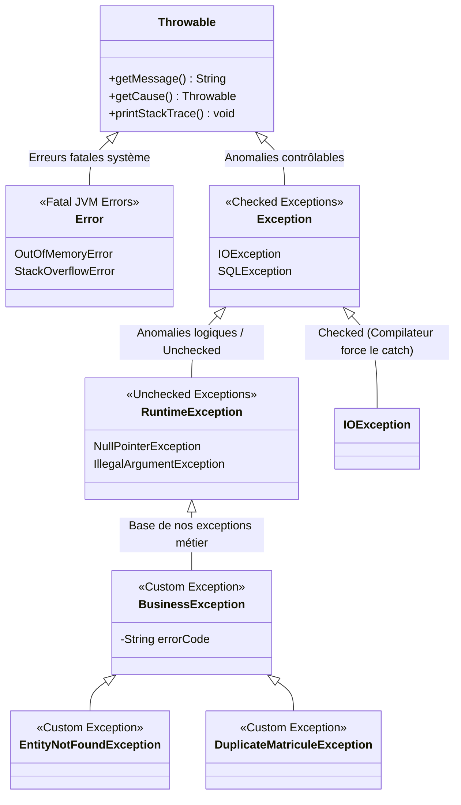
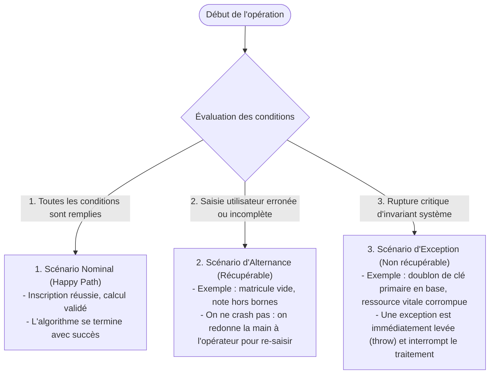

# Typologie des Exceptions, Checked vs Unchecked et Exceptions Métier

## 1. Introduction & Contexte Métier

Dans un environnement de production d'entreprise, une application ne doit jamais afficher une trace de pile brute (*stack trace*) à un utilisateur final ni s'arrêter brutalement au premier imprévu. Qu'un utilisateur saisisse une note de 25/20, qu'un étudiant tente de s'inscrire avec un matricule déjà utilisé, ou qu'une ressource disque soit momentanément inaccessible, le logiciel doit réagir de manière prévisible, sécurisée et intelligible.

Trop souvent, les développeurs débutants traitent les erreurs de deux manières désastreuses :
1. **L'avalement silencieux d'exceptions (*Swallowing Exceptions*)** : Écrire un bloc `catch (Exception e) {}` vide. Le bug continue de corrompre les données en silence sans qu'aucun développeur ne soit alerté.
2. **L'utilisation exclusive d'exceptions génériques** : Jeter un `throw new RuntimeException("Erreur !")` indistinctement pour un matricule introuvable, une panne réseau ou un mauvais mot de passe.

Dans ce cours magistral, le Professeur **Baila Wane** rappelle la règle fondamentale :
> *"Une exception n'est pas une punition : c'est un canal de communication structuré pour signaler qu'un contrat métier n'a pas pu être honoré. Vos exceptions doivent avoir du sens pour le métier ! Créez vos propres exceptions métier : `EntityNotFoundException`, `DuplicateMatriculeException`, `InvalidGradeException`. C'est ainsi que vous construirez une application industrielle tolérante aux pannes !"*

---

## 2. Architecture & Fondations Conceptuelles

### 2.1 La Hiérarchie des Erreurs dans la JVM

Toutes les anomalies logicielles en Java dérivent de la classe fondamentale `java.lang.Throwable` :



### 2.2 Checked vs Unchecked Exceptions : Le Débat Architectural

1. **Checked Exceptions (Exceptions Contrôlées - héritent de `Exception`)** :
   - Le compilateur Java `javac` **force** le développeur à gérer explicitement l'exception, soit par un bloc `try-catch`, soit en propageant la signature `throws MonException`.
   - Conçues à l'origine pour les erreurs externes indépendantes du code (ex: fichier introuvable sur le disque `FileNotFoundException`, panne réseau `SQLException`).
   - *Inconvénient moderne* : Elles polluent les signatures de méthodes et s'intègrent très mal avec les Streams et la programmation fonctionnelle.
2. **Unchecked Exceptions (Exceptions Non Contrôlées - héritent de `RuntimeException`)** :
   - Le compilateur n'impose aucun `try-catch` obligatoire.
   - Conçues pour les erreurs de programmation (ex: `NullPointerException`, `IndexOutOfBoundsException`) ou les violations de préconditions métier.
   - C'est aujourd'hui le **standard architectural moderne** adopté par Spring, Hibernate et l'ingénierie Java moderne pour concevoir les exceptions métier.

### 2.3 Les Trois Scénarios d'un Algorithme selon Baila Wane

Dans l'analyse et la modélisation rigoureuse de tout cas d'usage, le Professeur Baila Wane distingue formellement **trois scénarios d'exécution** :



1. **Le Scénario Nominal** : Le flux idéal où les entrées sont saines et où la transaction s'exécute parfaitement.
2. **Le Scénario d'Alternance** : Une anomalie de premier niveau (formatage de date incorrect, saisie d'un caractère au lieu d'un nombre). Ce scénario doit être intercepté localement par les validateurs pour inviter l'utilisateur à rectifier sa saisie sans lever de lourdes exceptions.
3. **Le Scénario d'Exception** : Un événement grave violant les règles fondamentales du domaine. Le service doit impérativement interrompre son exécution par un `throw new BusinessException(...)` afin de prévenir toute corruption de la base de données.

---

## 3. Implémentation Pratique & Code de Référence

### 3.1 Découplage des Messages et Support Multilingue : `EnumError`

L'une des erreurs courantes consiste à coder en dur (*hardcoder*) des messages d'erreur textuels au milieu des méthodes du service métier (`throw new Exception("Le produit existe déjà")`).
Cette mauvaise pratique empêche toute traduction de l'application (internationalisation / i18n) et rend le code fragile.

Baila Wane préconise de centraliser les erreurs dans une énumération typée :

```java
package com.ism.enums;

/**
 * Énumération centralisant les codes et messages d'erreur applicatifs.
 * Permet la séparation stricte entre la logique de traitement et les libellés affichés.
 */
public enum EnumError {
    SUCCES(200, "Opération réalisée avec succès."),
    CHAMP_OBLIGATOIRE(101, "Ce champ est obligatoire et ne peut pas être vide."),
    FORMAT_NUMERIQUE_INVALIDE(102, "Le format numérique saisi est invalide."),
    MATRICULE_EXISTANT(103, "Un étudiant possédant ce matricule existe déjà dans le système."),
    NOTE_HORS_PLAGE(104, "La note doit obligatoirement être comprise entre 0 et 20."),
    RESSOURCE_INTROUVABLE(404, "La ressource demandée est introuvable.");

    private final int code;
    private final String messageFr;

    EnumError(int code, String messageFr) {
        this.code = code;
        this.messageFr = messageFr;
    }

    public int getCode() {
        return code;
    }

    public String getMessage() {
        return messageFr;
    }

    /**
     * Méthode d'extraction adaptée au support multi-langue (i18n).
     */
    public static String getMessageByCode(int code, String langue) {
        for (EnumError err : values()) {
            if (err.getCode() == code) {
                if ("EN".equalsIgnoreCase(langue)) {
                    // Possibilité d'aiguiller vers un dictionnaire anglais
                    return err.name().replace('_', ' ');
                }
                return err.getMessage();
            }
        }
        return "Erreur inconnue.";
    }
}
```

### 3.2 La Racine Commune des Exceptions Métier : `BusinessException`

Nous créons une racine commune pour toutes les anomalies de notre application dans le package `com.ism.exception`, intimement liée à notre `EnumError` :

```java
package com.ism.exception;

import com.ism.enums.EnumError;

/**
 * Exception racine pour toutes les erreurs métier du système ISM.
 */
public class BusinessException extends RuntimeException {

    private final EnumError error;

    public BusinessException(EnumError error) {
        super(error.getMessage());
        this.error = error;
    }

    public BusinessException(EnumError error, String details) {
        super(error.getMessage() + " [Détails: " + details + "]");
        this.error = error;
    }

    public BusinessException(EnumError error, Throwable cause) {
        super(error.getMessage(), cause);
        this.error = error;
    }

    public EnumError getError() {
        return error;
    }

    public int getErrorCode() {
        return error.getCode();
    }
}
```

### 3.3 Exceptions Métier Spécifiques

#### 1. `EntityNotFoundException` (Entité introuvable)

```java
package com.ism.exception;

public class EntityNotFoundException extends BusinessException {

    public EntityNotFoundException(String entityName, Object identifier) {
        super("NOT_FOUND", String.format("L'entité [%s] avec l'identifiant [%s] n'a pas été trouvée.", entityName, identifier));
    }
}
```

#### 2. `DuplicateMatriculeException` (Conflit d'unicité)

```java
package com.ism.exception;

public class DuplicateMatriculeException extends BusinessException {

    public DuplicateMatriculeException(String matricule) {
        super("DUPLICATE_MATRICULE", String.format("Un étudiant avec le matricule [%s] est déjà enregistré dans le système.", matricule));
    }
}
```

#### 3. `InvalidGradeException` (Validation de note invalide)

```java
package com.ism.exception;

public class InvalidGradeException extends BusinessException {

    public InvalidGradeException(double valeur) {
        super("INVALID_GRADE", String.format("La note [%.2f] est invalide. Elle doit être strictement comprise entre 0 et 20.", valeur));
    }
}
```

### 3.3 Utilisation dans la Couche Service

Observez comment le service métier valide et déclenche les exceptions appropriées :

```java
package com.ism.service;

import com.ism.domain.Etudiant;
import com.ism.dto.EtudiantCreateDto;
import com.ism.dto.EtudiantListeDto;
import com.ism.exception.DuplicateMatriculeException;
import com.ism.repository.EtudiantRepository;

public class EtudiantServiceWithExceptions {

    private final EtudiantRepository etudiantRepository;

    public EtudiantServiceWithExceptions(EtudiantRepository etudiantRepository) {
        this.etudiantRepository = etudiantRepository;
    }

    public EtudiantListeDto enregistrer(EtudiantCreateDto dto) {
        // 1. Validation de la règle d'unicité métier
        if (etudiantRepository.existsByMatricule(dto.matricule())) {
            throw new DuplicateMatriculeException(dto.matricule());
        }

        // 2. Persistance normale
        Etudiant etudiant = EtudiantMapper.toEntity(dto);
        Etudiant saved = etudiantRepository.save(etudiant);
        return EtudiantMapper.toListeDto(saved);
    }
}
```

---

## 4. Bonnes Pratiques, Pièges & Débogage

> ℹ️ **Le chaînage d'exceptions (*Exception Chaining*) :**
> Lorsque vous interceptez une exception technique de bas niveau (ex: une `SQLException`) pour la transformer en exception métier lisible (`BusinessException`), transmettez toujours l'exception d'origine en argument `cause` dans `super(message, cause)`. Cela préserve l'arbre d'appels pour le diagnostic dans les logs sans polluer l'interface utilisateur.

> ⚠️ **L'antipattern du catch silencieux :**
> ```java
> try {
>     etudiantService.inscrire(dto);
> } catch (Exception e) {
>     // CATASTROPHE : Aucune trace, aucune action !
> }
> ```
> Un bloc catch doit systématiquement soit consigner l'erreur dans un fichier de log avec son niveau d'importance (`log.error(...)`), soit convertir l'anomalie en message clair pour l'utilisateur.

> 💡 **Pourquoi hériter de `RuntimeException` pour les exceptions métier ?**
> Faire hériter les exceptions métier de `RuntimeException` évite de polluer toutes les signatures des interfaces (`throws BusinessException`). La couche de présentation peut ainsi intercepter globalement ces exceptions dans un gestionnaire centralisé ou dans la boucle principale.

---

## 5. Synthèse & Auto-Évaluation

### Tableau Comparatif des Types d'Exceptions

| Type | Classe parente | Obligation de gestion `javac` | Usage recommandé |
| :--- | :--- | :--- | :--- |
| **Error** | `Throwable` | Non | Défaillances matérielles ou mémoire de la JVM (ne jamais tenter de catcher). |
| **Checked** | `Exception` | **Oui** (bloque la compilation) | Pannes d'infrastructures physiques externes réparables (I/O, réseau). |
| **Unchecked** | `RuntimeException` | Non | Règles métier violées, préconditions invalides, bugs logiques. |
| **Métier** | `BusinessException` | Non (recommandé) | Scénarios métier spécifiques au domaine ISM. |

### Questionnaire d'Auto-Évaluation (QCM)

1. **Parmi ces exceptions, laquelle est une exception de type "Checked" obligeant le développeur à écrire un bloc `try-catch` ou un `throws` ?**
   - A) `NullPointerException`
   - B) `IllegalArgumentException`
   - C) `java.io.IOException`
   - D) `IndexOutOfBoundsException`
   *Réponse attendue : C. `IOException` hérite directement de `Exception` sans dériver de `RuntimeException`.*

2. **Quelle est la classe mère recommandée pour concevoir des exceptions métier modernes et découplées ?**
   - A) `java.lang.Error`
   - B) `java.lang.RuntimeException`
   - C) `java.lang.Thread`
   - D) `java.lang.Object`
   *Réponse attendue : B.*

3. **Quelle pratique permet de conserver l'historique complet d'une erreur technique sous-jacente lors de sa conversion en exception métier ?**
   - A) Le chaînage d'exceptions en passant la cause au constructeur parent (`super(message, cause)`)
   - B) L'effacement du stack trace
   - C) La fermeture immédiate de la JVM avec `System.exit(1)`
   - D) L'écriture dans un fichier `.gitignore`
   *Réponse attendue : A.*

### Exercice Pratique & DevLog

```markdown
[DevLog - Entrée 11]
- Sujet : Hiérarchie d'exceptions et gestion robuste des erreurs
- Action : Créez le package `com.ism.exception` et implémentez `BusinessException`, `EntityNotFoundException` et `DuplicateMatriculeException`.
- Défi : Modifiez votre `EtudiantServiceImpl` pour qu'il lève `DuplicateMatriculeException` si le matricule existe déjà. Écrivez un test simulant l'inscription successive de deux étudiants ayant le même matricule et vérifiez que l'exception est bien levée avec le code d'erreur `DUPLICATE_MATRICULE`.
```
