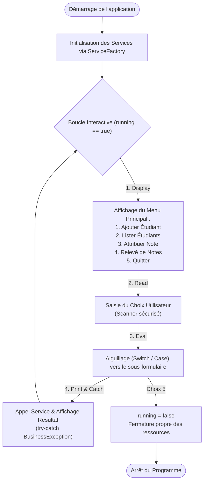

# Interface Utilisateur Console et Validation Robuste des Saisies

## 1. Introduction & Contexte Métier

Bien que les interfaces Web modernes et les API REST dominent les déploiements en nuage, l'application console en mode texte demeure un outil fondamental dans la boîte à outils de l'ingénieur logiciel. Elle sert de banc d'essai interactif pour tester l'architecture métier, d'outil d'administration système (CLI - *Command-Line Interface*), et de passerelle d'automatisation pour les scripts d'exploitation.

Cependant, programmer une interface console robuste est un exercice redoutable pour les développeurs inexpérimentés. Face à un utilisateur qui tape une lettre au lieu d'un chiffre, qui appuie frénétiquement sur la touche Entrée ou qui saisit une chaîne vide, une mauvaise gestion des entrées clavier avec la classe `java.util.Scanner` conduit inévitablement à :
1. Des blocages infinis ou des sauts de formulaire inexplicables (le fameux piège du résidu `\n` dans le buffer).
2. Des crashs immédiats par `java.util.InputMismatchException` ou `NumberFormatException`.
3. Une contamination de la couche console par des responsabilités métier indues.

Dans notre projet de référence **`com.ism`**, le fichier `Main.java` démontre comment concevoir une boucle interactive propre, découplée des services, et entièrement blindée contre les erreurs de manipulation.

Comme le démontre le Professeur **Baila Wane** :
> *"Votre interface console ne doit être qu'un traducteur ! Elle lit du texte brut saisi par l'opérateur, valide son format minimal, construit un DTO et le passe à la couche Service. Si le service lève une exception, la console attrape l'exception, affiche un message d'avertissement élégant en rouge, et réaffiche le menu sans JAMAIS crasher !"*

---

## 2. Architecture & Fondations Conceptuelles

### 2.1 Le Cycle de la Boucle Événementielle Console (*REPL*)

L'application console s'articule autour d'une boucle interactive de type **REPL** (*Read - Eval - Print - Loop*) :



### 2.2 Le Piège Classique du `Scanner.nextInt()` et sa Solution

La classe `Scanner` de Java présente un comportement déroutant pour les néophytes :
- Lorsque vous appelez `scanner.nextInt()` et tapez `1` suivi de la touche Entrée, `nextInt()` consomme le chiffre `1`, **mais laisse le caractère de saut de ligne `\n` dans le tampon d'entrée (buffer)** !
- Si votre instruction suivante appelle `scanner.nextLine()` pour lire le nom de famille de l'étudiant, `nextLine()` rencontre immédiatement le `\n` restant et renvoie instantanément une chaîne vide, donnant l'impression visuelle que le programme a sauté la question !

> ⚠️ **La règle absolue enseignée par Baila Wane :**
> **Ne mélangez jamais `nextInt()` ou `nextDouble()` avec `nextLine()` !**
> Lisez TOUJOURS la ligne entière sous forme de chaîne de caractères avec `scanner.nextLine().trim()`, puis effectuez la conversion vous-même avec `Integer.parseInt(...)` ou `Double.parseDouble(...)` au sein d'un bloc de contrôle.

---

## 3. Implémentation Pratique & Code de Référence

### 3.1 Utilitaire de Saisie Sécurisée `ConsoleScanner`

Pour encapsuler la lecture clavier et réitérer la demande jusqu'à ce que l'utilisateur saisisse une valeur valide :

```java
package com.ism.util;

import java.util.Scanner;

public final class ConsoleScanner {

    private static final Scanner scanner = new Scanner(System.in);

    private ConsoleScanner() {}

    /**
     * Lit une chaîne obligatoire non vide.
     */
    public static String lireChaineNonVide(String prompt) {
        String saisie;
        do {
            System.out.print(prompt + " : ");
            saisie = scanner.nextLine().trim();
            if (saisie.isEmpty()) {
                System.out.println(" ⚠️ Cette valeur ne peut pas être vide. Veuillez réessayer.");
            }
        } while (saisie.isEmpty());
        return saisie;
    }

    /**
     * Lit un entier avec contrôle de validité numérique et de plage.
     */
    public static int lireEntier(String prompt, int min, int max) {
        while (true) {
            System.out.print(prompt + " (" + min + "-" + max + ") : ");
            String saisie = scanner.nextLine().trim();
            try {
                int valeur = Integer.parseInt(saisie);
                if (valeur >= min && valeur <= max) {
                    return valeur;
                }
                System.out.println(" ⚠️ Veuillez entrer un entier compris entre " + min + " et " + max + ".");
            } catch (NumberFormatException e) {
                System.out.println(" ⚠️ Saisie invalide : veuillez entrer un nombre entier valide.");
            }
        }
    }

    /**
     * Lit un nombre décimal pour la saisie d'une note.
     */
    public static double lireDouble(String prompt, double min, double max) {
        while (true) {
            System.out.print(prompt + " (" + min + "-" + max + ") : ");
            String saisie = scanner.nextLine().trim().replace(',', '.');
            try {
                double valeur = Double.parseDouble(saisie);
                if (valeur >= min && valeur <= max) {
                    return valeur;
                }
                System.out.println(" ⚠️ La valeur doit être comprise entre " + min + " et " + max + ".");
            } catch (NumberFormatException e) {
                System.out.println(" ⚠️ Format décimal invalide. Exemple attendu : 14.5");
            }
        }
    }
}
```

### 3.2 La Boucle Principale de `com.ism.Main`

Examinons l'orchestration réelle dans la classe `Main` de notre projet :

```java
package com.ism;

import com.ism.dto.EtudiantCreateDto;
import com.ism.dto.EtudiantListeDto;
import com.ism.dto.NoteCreateDto;
import com.ism.dto.NoteListeDto;
import com.ism.exception.BusinessException;
import com.ism.factory.ServiceFactory;
import com.ism.service.EtudiantService;
import com.ism.service.NoteService;
import com.ism.util.ConsoleScanner;

import java.util.List;

public class Main {

    public static void main(String[] args) {
        EtudiantService etudiantService = ServiceFactory.getEtudiantService();
        NoteService noteService = ServiceFactory.getNoteService();

        boolean running = true;
        System.out.println("==================================================");
        System.out.println("     BRAINX - GESTION ACADÉMIQUE ISM (CONSOLE)    ");
        System.out.println("==================================================");

        while (running) {
            afficherMenu();
            int choix = ConsoleScanner.lireEntier("Votre choix", 1, 5);

            try {
                switch (choix) {
                    case 1 -> ajouterEtudiant(etudiantService);
                    case 2 -> listerEtudiants(etudiantService);
                    case 3 -> attribuerNote(noteService);
                    case 4 -> afficherBulletin(etudiantService, noteService);
                    case 5 -> {
                        System.out.println("
[SYSTÈME] Fermeture de l'application. Au revoir !");
                        running = false;
                    }
                }
            } catch (BusinessException e) {
                // Interception ciblée des anomalies métier sans crasher le programme
                System.out.println("
❌ [ERREUR MÉTIER] Code: " + e.getErrorCode() + " | " + e.getMessage());
            } catch (Exception e) {
                // Interception de sécurité pour imprévus
                System.out.println("
❌ [ERREUR INATTENDUE] Une anomalie système est survenue : " + e.getMessage());
            }
            System.out.println();
        }
    }

    private static void afficherMenu() {
        System.out.println("--------------------------------------------------");
        System.out.println("1. Inscrire un nouvel étudiant");
        System.out.println("2. Consulter la liste des étudiants");
        System.out.println("3. Attribuer une note à un étudiant");
        System.out.println("4. Consulter le relevé de notes d'un étudiant");
        System.out.println("5. Quitter");
        System.out.println("--------------------------------------------------");
    }

    private static void ajouterEtudiant(EtudiantService service) {
        System.out.println("
--- INSCRIPTION D'UN ÉTUDIANT ---");
        String matricule = ConsoleScanner.lireChaineNonVide("Matricule");
        String nom = ConsoleScanner.lireChaineNonVide("Nom");
        String prenom = ConsoleScanner.lireChaineNonVide("Prénom");
        String email = ConsoleScanner.lireChaineNonVide("Email");
        String tel = ConsoleScanner.lireChaineNonVide("Téléphone");

        EtudiantCreateDto dto = new EtudiantCreateDto(matricule, nom, prenom, email, tel);
        EtudiantListeDto enregistre = service.inscrireEtudiant(dto);

        System.out.println("✅ Étudiant inscrit avec succès ! ID attribué : " + enregistre.id());
    }

    private static void listerEtudiants(EtudiantService service) {
        System.out.println("
--- PROMOTION DES ÉTUDIANTS INSCRITS ---");
        List<EtudiantListeDto> liste = service.listerTous();
        if (liste.isEmpty()) {
            System.out.println("ℹ️ Aucun étudiant enregistré pour le moment.");
            return;
        }

        System.out.printf("%-5s | %-15s | %-25s | %-25s
", "ID", "MATRICULE", "NOM COMPLET", "EMAIL");
        System.out.println("-----------------------------------------------------------------------------");
        for (EtudiantListeDto e : liste) {
            System.out.printf("%-5d | %-15s | %-25s | %-25s
", e.id(), e.matricule(), e.nomComplet(), e.email());
        }
    }

    private static void attribuerNote(NoteService service) {
        System.out.println("
--- ATTRIBUTION DE NOTE ---");
        String matricule = ConsoleScanner.lireChaineNonVide("Matricule de l'étudiant");
        String matiere = ConsoleScanner.lireChaineNonVide("Matière");
        double valeur = ConsoleScanner.lireDouble("Note obtenue", 0.0, 20.0);
        double coeff = ConsoleScanner.lireDouble("Coefficient", 1.0, 10.0);

        NoteCreateDto dto = new NoteCreateDto(valeur, coeff, matiere, matricule);
        service.ajouterNote(dto);
        System.out.println("✅ Note enregistrée avec succès pour l'étudiant " + matricule + " !");
    }

    private static void afficherBulletin(EtudiantService etudiantService, NoteService noteService) {
        System.out.println("
--- BULLETIN DE NOTES ---");
        String matricule = ConsoleScanner.lireChaineNonVide("Matricule de l'étudiant");
        EtudiantListeDto etudiant = etudiantService.trouverParMatricule(matricule);
        List<NoteListeDto> notes = noteService.listerNotesParEtudiant(matricule);

        System.out.println("
Étudiant : " + etudiant.nomComplet() + " (" + etudiant.matricule() + ")");
        System.out.println("--------------------------------------------------");
        if (notes.isEmpty()) {
            System.out.println("ℹ️ Aucune note attribuée pour cet étudiant.");
            return;
        }

        for (NoteListeDto n : notes) {
            System.out.printf("- %-20s : %5.2f / 20 (Coeff: %.1f)
", n.matiere(), n.valeur(), n.coefficient());
        }
        double moyenne = etudiantService.calculerMoyenneEtudiant(matricule);
        System.out.println("--------------------------------------------------");
        System.out.printf("MOYENNE GÉNÉRALE PONDÉRÉE : %.2f / 20
", moyenne);
        System.out.println("DÉCISION DU JURY : " + (moyenne >= 10.0 ? "ADMIS ✅" : "AJOURNÉ ❌"));
    }
}
```

---

## 4. Bonnes Pratiques, Pièges & Débogage

> ⚠️ **Revue de Code : Deux Pièges Majeurs en Interface Console**
> Lors de la conception d'un terminal interactif, deux erreurs classiques doivent être évitées :
> 1. **L'inversion de prompt** : afficher par mégarde une invite erronée (par exemple demander *"Matricule : "* alors que le programme attend le nom d'une matière suite à une copie hâtive de ligne), ce qui désoriente l'utilisateur.
> 2. **L'instabilité de `System.console()` sous les environnements IDE** : `System.console()` renvoie `null` lorsqu'il est exécuté dans la console intégrée d'un IDE comme IntelliJ IDEA, Eclipse ou VS Code. Appeler une méthode dessus déclenche un crash `NullPointerException`. C'est pourquoi l'ingénieur privilégie un `Scanner(System.in)` encapsulé et sécurisé comme notre `ConsoleScanner` !


> ℹ️ **Le remplacement de la virgule par le point :**
> Selon les paramètres régionaux (*Locale*) de la machine de l'étudiant, la saisie d'un décimal attend soit une virgule (France/Sénégal `14,5`), soit un point (USA `14.5`). Utiliser `saisie.replace(',', '.')` avant `Double.parseDouble()` rend votre code universel et immunisé contre les différences d'OS.

> ⚠️ **Ne jamais fermer `System.in` prématurément :**
> Si vous appelez `scanner.close()` à l'intérieur d'une méthode secondaire, la JVM ferme définitivement le flux standard d'entrée système `System.in`. Tout appel ultérieur à `new Scanner(System.in)` déclenchera immédiatement une `IllegalStateException: Scanner closed`. Ne fermez le scanner qu'à la terminaison complète du programme dans le `main`.

> 💡 **La séparation étanche Vue - Métier :**
> Remarquez que la classe `Main` n'effectue aucun calcul de moyenne, ne modifie pas les listes en direct et n'instancie aucun objet de persistance. Elle délègue tout aux services via les DTOs.

---

## 5. Synthèse & Auto-Évaluation

### Règles d'Or de l'Interface Console

| Règle | Raison technique | Solution appliquée |
| :--- | :--- | :--- |
| **Toujours lire en `nextLine()`** | Évite le résidu de `\n` laissé par `nextInt()` dans le buffer. | `ConsoleScanner.lireChaineNonVide()` |
| **Parser manuellement les nombres** | Intercepte les fautes de frappe sans crasher l'application. | `Integer.parseInt(saisie)` avec `try-catch` |
| **Nettoyer les espaces superflus** | Évite les faux rejets sur `" 1"` ou `"ETU-001 "`. | `.trim()` systématique sur les entrées |
| **Catcher `BusinessException`** | Offre un retour explicite à l'utilisateur sans trace brute. | Gestion centralisée dans le `switch/case` |

### Questionnaire d'Auto-Évaluation (QCM)

1. **Quel problème technique survient lorsqu'on appelle `scanner.nextLine()` immédiatement après un `scanner.nextInt()` ?**
   - A) Une exception `OutOfMemoryError`
   - B) Le `nextLine()` consomme le saut de ligne résiduel restant dans le buffer et renvoie une chaîne vide
   - C) La mémoire Heap est corrompue
   - D) Le terminal se ferme instantanément
   *Réponse attendue : B.*

2. **Quelle méthode de chaîne de caractères permet de supprimer les espaces inutiles au début et à la fin de la saisie utilisateur ?**
   - A) `stripWhitespace()`
   - B) `clean()`
   - C) `trim()`
   - D) `flush()`
   *Réponse attendue : C.*

3. **Quelle couche de l'application est chargée d'attraper les `BusinessException` pour afficher un message d'erreur lisible à l'opérateur ?**
   - A) La couche Repository
   - B) La couche Domaine
   - C) La couche Présentation (`Main` / Console)
   - D) La base de données
   *Réponse attendue : C.*

### Exercice Pratique & DevLog

```markdown
[DevLog - Entrée 12]
- Sujet : Implémentation du menu console interactif sécurisé
- Action : Créez la classe `ConsoleScanner` et assemblez la classe `com.ism.Main`.
- Défi : Lancez l'application en console. Tentez volontairement de saisir des lettres lorsque le menu demande un choix de 1 à 5, puis entrez une note de 30/20. Vérifiez que l'application réagit avec élégance en affichant les messages d'avertissement et vous redemande une saisie sans jamais crasher.
```
