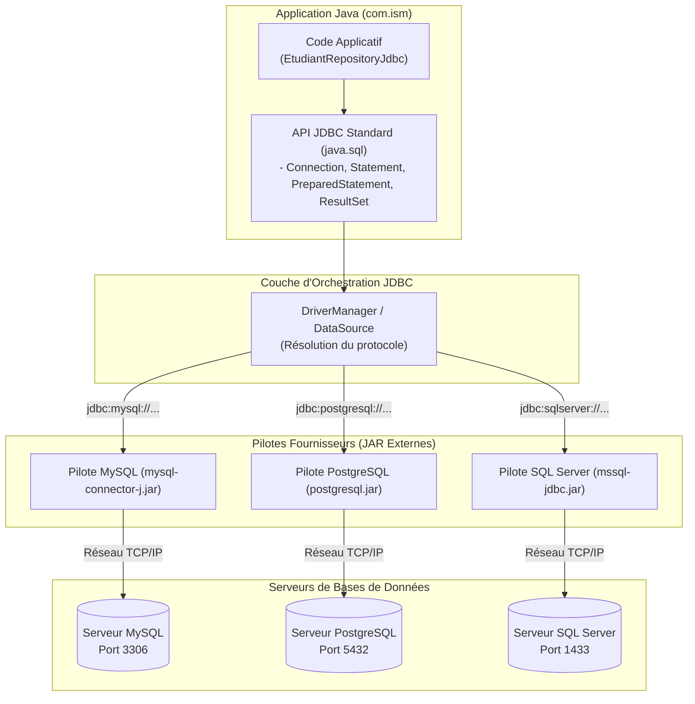

# Architecture JDBC, Pilote et Gestion de Connexions Sécurisées

## 1. Introduction & Contexte Métier

Jusqu'à présent, notre système académique **`com.ism`** s'appuyait sur un stockage en mémoire vive (`DatabaseMemory`). Bien que pratique et ultra-rapide pour valider nos règles de gestion en phase de développement ou de test, ce mode de stockage présente une limitation rédhibitoire pour l'entreprise : **la volatilité absolue des données**. Dès que le serveur redémarre ou que le processus Java s'arrête, l'ensemble des étudiants inscrits et leurs relevés de notes sont irrémédiablement perdus !

Dans les systèmes d'information réels, la persistance pérenne est confiée à un Système de Gestion de Bases de Données Relationnelles (SGBDR) tel que MySQL, PostgreSQL ou Microsoft SQL Server.

Pour dialoguer avec ces moteurs de bases de données sans lier notre code à un éditeur particulier, Java propose un standard industriel incontournable depuis sa création : **JDBC (Java Database Connectivity)**.

Comme le martèle le Professeur **Baila Wane** :
> *"JDBC est la colonne vertébrale de l'accès aux données en Java ! Même les frameworks modernes comme Hibernate ou Spring Data JPA ne font que générer du code JDBC sous le capot. Un bon architecte logiciel doit comprendre comment ouvrir une connexion, comment le pilote JDBC traduit les appels en paquets réseau TCP/IP, et surtout, comment fermer hermétiquement ses ressources avec `try-with-resources` pour éviter la saturation du serveur de base de données !"*

---

## 2. Architecture & Fondations Conceptuelles

### 2.1 L'Écosystème Architectural de JDBC

JDBC repose sur le patron de conception **Bridge (Pont)** : il sépare l'API standard abstraite utilisée par le développeur (`java.sql`) des implémentations physiques fournies par les éditeurs de bases de données (les pilotes ou *Drivers*) :



### 2.2 Anatomie d'une URL de Connexion JDBC

La chaîne de connexion JDBC suit une structure normalisée permettant au `DriverManager` d'identifier le bon pilote :
```text
jdbc:<sous-protocole>://<hôte>:<port>/<nom_base>?<parametres>
```
Exemples :
- **MySQL** : `jdbc:mysql://localhost:3306/ism_academique?useSSL=false&serverTimezone=UTC`
- **PostgreSQL** : `jdbc:postgresql://localhost:5432/ism_academique`
- **SQL Server** : `jdbc:sqlserver://localhost:1433;databaseName=ism_academique;encrypt=true;trustServerCertificate=true`

### 2.3 Le Risque Majeur : La Fuite de Connexions (*Connection Leak*)

Une connexion JDBC mobilise un socket réseau TCP ouvert, un thread dédié sur le serveur SGBD et des buffers de mémoire. Les serveurs de bases de données ont une limite maximale de connexions simultanées (souvent 100 à 150 par défaut).
Si vos méthodes Java ouvrent une connexion sans la fermer (par exemple si une exception survient au milieu du traitement), le pool de connexions s'épuise en quelques minutes : le serveur refuse toute nouvelle connexion et l'application s'arrête net avec une redoutable erreur :
`SQLException: Too many connections` ou `Connection refused`.

---

## 3. Implémentation Pratique & Code de Référence

### 3.1 Dépendance Maven pour le Driver SGBD

Pour connecter notre application à une base de données MySQL dans `pom.xml` :

```xml
<dependency>
    <groupId>com.mysql</groupId>
    <artifactId>mysql-connector-j</artifactId>
    <version>8.3.0</version>
</dependency>
```

### 3.2 Fabrique de Connexion Centralisée : `DatabaseConnectionFactory`

Nous créons un gestionnaire de configuration pour externaliser les identifiants et centraliser l'obtention des connexions :

```java
package com.ism.repository.jdbc;

import java.sql.Connection;
import java.sql.DriverManager;
import java.sql.SQLException;

/**
 * Fabrique de connexions JDBC pour le système ISM.
 *
 * @author Baila Wane
 */
public final class DatabaseConnectionFactory {

    private static final String URL = "jdbc:mysql://localhost:3306/ism_academique?useSSL=false&allowPublicKeyRetrieval=true&serverTimezone=UTC";
    private static final String USER = "root";
    private static final String PASSWORD = "password";

    private DatabaseConnectionFactory() {}

    /**
     * Ouvre et renvoie une nouvelle connexion physique vers la base de données.
     *
     * @return Connection JDBC
     * @throws SQLException si la connexion échoue (SGBD injoignable, mauvais identifiants)
     */
    public static Connection getConnection() throws SQLException {
        return DriverManager.getConnection(URL, USER, PASSWORD);
    }
}
```

### 3.3 Fermeture Déterministe avec `try-with-resources`

Introduit en Java 7, le mécanisme `try-with-resources` garantit la fermeture automatique de toute ressource implémentant l'interface `java.lang.AutoCloseable` (ce qui est le cas de `Connection`, `Statement` et `ResultSet`), **même en cas d'exception non interceptée** :

```java
package com.ism.repository.jdbc;

import java.sql.Connection;
import java.sql.SQLException;

public class TestConnexionDemo {

    public static void main(String[] args) {
        System.out.println("[DIAGNOSTIC] Tentative de connexion au serveur de base de données...");

        // La connexion sera IMPÉRATIVEMENT fermée à la sortie du bloc try, quoi qu'il arrive !
        try (Connection conn = DatabaseConnectionFactory.getConnection()) {
            if (conn != null && !conn.isClosed()) {
                System.out.println("✅ [SUCCÈS] Connexion établie avec succès vers : " 
                        + conn.getMetaData().getDatabaseProductName() + " v" 
                        + conn.getMetaData().getDatabaseProductVersion());
            }
        } catch (SQLException e) {
            System.err.println("❌ [ÉCHEC CRITIQUE] Impossible de se connecter à la base : " + e.getMessage());
            System.err.println("Code d'erreur SQL : " + e.getErrorCode());
            System.err.println("État SQL : " + e.getSQLState());
        }
    }
}
```

---

## 4. Bonnes Pratiques, Pièges & Débogage

> ℹ️ **L'abandon de `Class.forName("com.mysql.cj.jdbc.Driver")` :**
> Dans les versions historiques de Java (Java 5 et antérieures), il était obligatoire de charger explicitement la classe du pilote en mémoire via `Class.forName(...)`. Depuis JDBC 4.0 (Java 6+), le mécanisme de découverte de services de la JVM (*ServiceLoader SPI*) détecte automatiquement le fichier `META-INF/services/java.sql.Driver` présent dans le JAR du driver. L'appel explicite est donc totalement obsolète.

> ⚠️ **Ne conservez jamais une `Connection` ouverte en tant que variable d'instance statique permanente :**
> Une connexion réseau peut expirer (*timeout* TCP) ou être fermée par le serveur de base de données si elle reste inactive. Ouvrez une connexion pour la durée de votre transaction, puis refermez-la immédiatement (ou utilisez un pool de connexions comme HikariCP en environnement serveur).

> 💡 **Externalisez vos paramètres dans un fichier `application.properties` :**
> Ne codez jamais les URL, login et mot de passe en dur dans votre code source de production ! Utilisez la classe `java.util.Properties` pour charger la configuration depuis `src/main/resources/application.properties`.

---

## 5. Synthèse & Auto-Évaluation

### Tableau Récapitulatif des Interfaces JDBC Principales

| Interface | Package | Rôle | Doit être fermée ? |
| :--- | :--- | :--- | :--- |
| **`DriverManager`** | `java.sql` | Sélectionne le bon pilote et instancie la connexion | Non (classe utilitaire) |
| **`Connection`** | `java.sql` | Représente la session réseau physique avec la base | **OUI** (AutoCloseable) |
| **`Statement`** | `java.sql` | Envoie des requêtes SQL statiques non paramétrées | **OUI** (AutoCloseable) |
| **`PreparedStatement`** | `java.sql` | Précompile et exécute des requêtes paramétrées sécurisées | **OUI** (AutoCloseable) |
| **`ResultSet`** | `java.sql` | Curseur sur les lignes renvoyées par une requête `SELECT` | **OUI** (AutoCloseable) |

### Questionnaire d'Auto-Évaluation (QCM)

1. **Quel mécanisme du langage Java garantit la fermeture automatique et sécurisée d'une connexion JDBC même si une exception survient au milieu du traitement ?**
   - A) Le Garbage Collector
   - B) Le bloc `try-with-resources`
   - C) La commande Maven `mvn clean`
   - D) Le compilateur JIT
   *Réponse attendue : B.*

2. **Quelle est la conséquence directe dans une application d'entreprise si vous oubliez de fermer vos connexions JDBC après chaque opération ?**
   - A) Le fichier `pom.xml` est écrasé
   - B) Une saturation rapide du pool de connexions (`Too many connections`), provoquant le refus de service pour tous les utilisateurs
   - C) Une erreur de syntaxe à la compilation
   - D) Une augmentation de la vitesse d'exécution
   *Réponse attendue : B.*

3. **Quelle interface représente la session de dialogue active avec le serveur de base de données ?**
   - A) `java.sql.ResultSet`
   - B) `java.sql.Connection`
   - C) `java.sql.Driver`
   - D) `java.lang.AutoCloseable`
   *Réponse attendue : B.*

### Exercice Pratique & DevLog

```markdown
[DevLog - Entrée 13]
- Sujet : Établissement et sécurisation d'une connexion JDBC
- Action : Créez une base de données de test locale (MySQL ou SQL Server) nommée `ism_academique`.
- Défi : Implémentez la classe `DatabaseConnectionFactory` et écrivez une classe de test affichant le nom du SGBD et la liste des tables existantes. Vérifiez que votre code utilise scrupuleusement la syntaxe `try-with-resources`.
```
