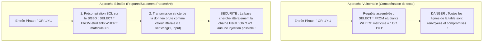

# Opérations CRUD, PreparedStatement, Transactions et Sécurisation SQL

## 1. Introduction & Contexte Métier

L'interaction entre une application Java et une base de données relationnelle est l'un des vecteurs les plus critiques de vulnérabilité et de perte de données. Une écriture maladroite de vos requêtes SQL expose votre organisation à deux périls mortels :
1. **L'attaque par Injection SQL** : En concaténant naïvement des variables de chaînes de caractères au sein de requêtes SQL (`"WHERE matricule = '" + matricule + "'"`), un pirate peut détourner la logique de la requête pour voler l'intégralité de la base de données ou supprimer la table des notes académiques.
2. **La corruption par incohérence transactionnelle** : Lors de l'attribution d'une note ou de l'inscription conjointe d'un étudiant et de son paiement de scolarité, si la première insertion réussit mais que la seconde échoue (panne réseau, contrainte de clé étrangère violée), votre système se retrouve dans un état incohérent non intègre.

Pour neutraliser définitivement ces périls, le Professeur **Baila Wane** énonce deux commandements d'airain :
> *"Le mot `Statement` avec concaténation de texte est proscrit de tout code professionnel : vous devez employer EXCLUSIVEMENT `PreparedStatement` avec des paramètres nommés `?` ! Et pour toute opération multi-tables, vous désactivez l'autocommit : vous pilotez votre transaction avec `commit()` et `rollback()` pour garantir les propriétés ACID !"*

Dans ce chapitre, nous allons concevoir l'implémentation complète `EtudiantRepositoryJdbc` qui s'enfiche à la perfection dans notre architecture sans modifier une seule ligne du service métier !

---

## 2. Architecture & Fondations Conceptuelles

### 2.1 Anatomie d'une Attaque par Injection SQL vs Protection PreparedStatement



### 2.2 Les Propriétés ACID des Transactions

Toute modification en base doit respecter les quatre propriétés ACID :
- **Atomicité (*Atomicity*)** : "Tout ou rien". L'ensemble des opérations du lot réussit, ou aucune n'est conservée.
- **Cohérence (*Consistency*)** : Les données respectent toutes les contraintes d'intégrité (clés étrangères, unicité).
- **Isolation (*Isolation*)** : Deux transactions concurrentes ne voient pas leurs modifications intermédiaires non validées (*Dirty Read*).
- **Durabilité (*Durability*)** : Une fois la transaction validée par `commit()`, les modifications sont inscrites de manière permanente sur le disque dur.

En JDBC, nous prenons le contrôle des transactions via :
```java
conn.setAutoCommit(false); // 1. Début de la transaction manuelle
// ... exécution des opérations CRUD ...
conn.commit();              // 2. Validation définitive si tout est OK
// ... en cas d'erreur :
conn.rollback();            // 3. Annulation intégrale des modifications
```

---

## 3. Implémentation Pratique & Code de Référence

### 3.1 Script DDL SQL de la Table `etudiants`

```sql
CREATE TABLE IF NOT EXISTS etudiants (
    id BIGINT AUTO_INCREMENT PRIMARY KEY,
    matricule VARCHAR(50) NOT NULL UNIQUE,
    nom VARCHAR(100) NOT NULL,
    prenom VARCHAR(100) NOT NULL,
    email VARCHAR(150) NOT NULL,
    telephone VARCHAR(30),
    created_at TIMESTAMP DEFAULT CURRENT_TIMESTAMP,
    updated_at TIMESTAMP DEFAULT CURRENT_TIMESTAMP ON UPDATE CURRENT_TIMESTAMP
);
```

### 3.2 L'Implémentation Industrielle : `EtudiantRepositoryJdbc`

Observez comment cette classe implémente scrupuleusement le même contrat `EtudiantRepository` que notre implémentation mémoire précédente :

```java
package com.ism.repository.jdbc;

import com.ism.domain.Etudiant;
import com.ism.repository.EtudiantRepository;

import java.sql.*;
import java.time.LocalDateTime;
import java.util.ArrayList;
import java.util.List;
import java.util.Optional;

/**
 * Implémentation JDBC relationnelle robuste pour EtudiantRepository.
 *
 * @author Baila Wane
 */
public class EtudiantRepositoryJdbc implements EtudiantRepository {

    @Override
    public Etudiant save(Etudiant entity) {
        if (entity == null) {
            throw new IllegalArgumentException("L'étudiant ne peut pas être null.");
        }

        if (entity.getId() == null) {
            // INSERT
            String sql = "INSERT INTO etudiants (matricule, nom, prenom, email, telephone, created_at, updated_at) "
                       + "VALUES (?, ?, ?, ?, ?, ?, ?)";

            try (Connection conn = DatabaseConnectionFactory.getConnection();
                 PreparedStatement ps = conn.prepareStatement(sql, Statement.RETURN_GENERATED_KEYS)) {

                ps.setString(1, entity.getMatricule());
                ps.setString(2, entity.getNom());
                ps.setString(3, entity.getPrenom());
                ps.setString(4, entity.getEmail());
                ps.setString(5, entity.getTelephone());
                ps.setTimestamp(6, Timestamp.valueOf(LocalDateTime.now()));
                ps.setTimestamp(7, Timestamp.valueOf(LocalDateTime.now()));

                int rowsAffected = ps.executeUpdate();
                if (rowsAffected > 0) {
                    try (ResultSet rs = ps.getGeneratedKeys()) {
                        if (rs.next()) {
                            entity.setId(rs.getLong(1));
                        }
                    }
                }
                return entity;

            } catch (SQLException e) {
                throw new RuntimeException("Erreur SQL lors de l'insertion de l'étudiant : " + e.getMessage(), e);
            }
        } else {
            // UPDATE
            String sql = "UPDATE etudiants SET nom = ?, prenom = ?, email = ?, telephone = ?, updated_at = ? "
                       + "WHERE id = ?";

            try (Connection conn = DatabaseConnectionFactory.getConnection();
                 PreparedStatement ps = conn.prepareStatement(sql)) {

                ps.setString(1, entity.getNom());
                ps.setString(2, entity.getPrenom());
                ps.setString(3, entity.getEmail());
                ps.setString(4, entity.getTelephone());
                ps.setTimestamp(5, Timestamp.valueOf(LocalDateTime.now()));
                ps.setLong(6, entity.getId());

                ps.executeUpdate();
                return entity;

            } catch (SQLException e) {
                throw new RuntimeException("Erreur SQL lors de la mise à jour de l'étudiant : " + e.getMessage(), e);
            }
        }
    }

    @Override
    public Optional<Etudiant> findById(Long id) {
        if (id == null) return Optional.empty();
        String sql = "SELECT * FROM etudiants WHERE id = ?";

        try (Connection conn = DatabaseConnectionFactory.getConnection();
                 PreparedStatement ps = conn.prepareStatement(sql)) {

            ps.setLong(1, id);
            try (ResultSet rs = ps.executeQuery()) {
                if (rs.next()) {
                    return Optional.of(mapResultSetToEtudiant(rs));
                }
            }
        } catch (SQLException e) {
            throw new RuntimeException("Erreur lors de la recherche par ID : " + e.getMessage(), e);
        }
        return Optional.empty();
    }

    @Override
    public Optional<Etudiant> findByMatricule(String matricule) {
        if (matricule == null) return Optional.empty();
        String sql = "SELECT * FROM etudiants WHERE matricule = ?";

        try (Connection conn = DatabaseConnectionFactory.getConnection();
             PreparedStatement ps = conn.prepareStatement(sql)) {

            ps.setString(1, matricule.trim());
            try (ResultSet rs = ps.executeQuery()) {
                if (rs.next()) {
                    return Optional.of(mapResultSetToEtudiant(rs));
                }
            }
        } catch (SQLException e) {
            throw new RuntimeException("Erreur lors de la recherche par matricule : " + e.getMessage(), e);
        }
        return Optional.empty();
    }

    @Override
    public boolean existsByMatricule(String matricule) {
        if (matricule == null) return false;
        String sql = "SELECT 1 FROM etudiants WHERE matricule = ? LIMIT 1";

        try (Connection conn = DatabaseConnectionFactory.getConnection();
             PreparedStatement ps = conn.prepareStatement(sql)) {

            ps.setString(1, matricule.trim());
            try (ResultSet rs = ps.executeQuery()) {
                return rs.next();
            }
        } catch (SQLException e) {
            throw new RuntimeException("Erreur lors de la vérification du matricule : " + e.getMessage(), e);
        }
    }

    @Override
    public List<Etudiant> findAll() {
        List<Etudiant> liste = new ArrayList<>();
        String sql = "SELECT * FROM etudiants ORDER BY id ASC";

        try (Connection conn = DatabaseConnectionFactory.getConnection();
             PreparedStatement ps = conn.prepareStatement(sql);
             ResultSet rs = ps.executeQuery()) {

            while (rs.next()) {
                liste.add(mapResultSetToEtudiant(rs));
            }
        } catch (SQLException e) {
            throw new RuntimeException("Erreur lors du chargement de tous les étudiants : " + e.getMessage(), e);
        }
        return liste;
    }

    @Override
    public boolean deleteById(Long id) {
        if (id == null) return false;
        String sql = "DELETE FROM etudiants WHERE id = ?";

        try (Connection conn = DatabaseConnectionFactory.getConnection();
             PreparedStatement ps = conn.prepareStatement(sql)) {

            ps.setLong(1, id);
            return ps.executeUpdate() > 0;
        } catch (SQLException e) {
            throw new RuntimeException("Erreur lors de la suppression de l'étudiant : " + e.getMessage(), e);
        }
    }

    // Méthode d'extraction et de mapping ResultSet -> Entité
    private Etudiant mapResultSetToEtudiant(ResultSet rs) throws SQLException {
        Timestamp createdTs = rs.getTimestamp("created_at");
        Timestamp updatedTs = rs.getTimestamp("updated_at");

        Etudiant etudiant = new Etudiant(
                rs.getLong("id"),
                rs.getString("matricule"),
                rs.getString("nom"),
                rs.getString("prenom"),
                rs.getString("email"),
                rs.getString("telephone")
        );
        if (createdTs != null) etudiant.setCreatedAt(createdTs.toLocalDateTime());
        if (updatedTs != null) etudiant.setUpdatedAt(updatedTs.toLocalDateTime());

        return etudiant;
    }
}
```

### 3.4 La Magie du Principe OCP & de la Factory

Regardez ce qui se passe dans notre application pour basculer de la persistance mémoire à la persistance SQL :
Dans `RepositoryFactory`, nous modifions une seule ligne :
```java
public static EtudiantRepository getEtudiantRepository() {
    if (etudiantRepository == null) {
        // Bascule transparente vers la base SQL :
        etudiantRepository = new EtudiantRepositoryJdbc();
    }
    return etudiantRepository;
}
```
**Résultat spectaculaire :** `EtudiantServiceImpl`, `NoteServiceImpl`, `MoyenneServiceImpl` et `Main.java` continuent de tourner exactement de la même manière, sans changer une seule virgule de leur code ! C'est la consécration de l'architecture découplée !

---

## 4. Bonnes Pratiques, Pièges & Débogage

> ℹ️ **Récupération des clés auto-incrémentées :**
> Lors d'un `INSERT`, n'exécutez jamais une seconde requête manuelle du type `SELECT MAX(id)` pour connaître l'identifiant généré (c'est une faille de concurrence majeure sous fort trafic). Spécifiez `Statement.RETURN_GENERATED_KEYS` lors de la création du `PreparedStatement`, puis récupérez l'ID généré immédiatement via `ps.getGeneratedKeys()`.

> ⚠️ **Attention aux indices 1-based de JDBC :**
> En Java, les tableaux et les listes commencent à l'indice 0 (`list.get(0)`). En revanche, **les paramètres JDBC et les colonnes de `ResultSet` commencent à l'indice 1** (`ps.setString(1, ...)`, `rs.getString(1)`) ! Un indice `0` déclenchera systématiquement une `SQLException: Parameter index out of range`.

> 💡 **Le piège du commit oublié :**
> Si vous activez le mode transactionnel avec `conn.setAutoCommit(false)` et que vous omettez d'appeler `conn.commit()`, le serveur de base de données libère le verrouillage en annulant (*rollback*) silencieusement toutes vos modifications à la fermeture de la connexion !

---

## 5. Synthèse & Auto-Évaluation

### Matrice Décisionnelle JDBC

| Opération SQL | Méthode PreparedStatement | Type de retour | Exemple typique |
| :--- | :--- | :--- | :--- |
| **`SELECT`** | `ps.executeQuery()` | `ResultSet` | `SELECT * FROM etudiants WHERE id = ?` |
| **`INSERT`** | `ps.executeUpdate()` | `int` (nb lignes créées) | `INSERT INTO etudiants (...) VALUES (...)` |
| **`UPDATE`** | `ps.executeUpdate()` | `int` (nb lignes modifiées) | `UPDATE etudiants SET nom = ? WHERE id = ?` |
| **`DELETE`** | `ps.executeUpdate()` | `int` (nb lignes supprimées) | `DELETE FROM etudiants WHERE id = ?` |

### Questionnaire d'Auto-Évaluation (QCM)

1. **Pourquoi l'utilisation de `PreparedStatement` empêche-t-elle formellement les injections SQL ?**
   - A) Parce qu'elle crypte la base de données en AES-256
   - B) Parce que le serveur SGBD compile l'arbre syntaxique de la requête avant que les valeurs des paramètres ne lui soient transmises en tant que données littérales pures
   - C) Parce qu'elle supprime tous les apostrophes du texte
   - D) Parce qu'elle oblige le développeur à utiliser Maven
   *Réponse attendue : B.*

2. **À quel indice commence le premier paramètre `?` dans une requête `PreparedStatement` ?**
   - A) 0
   - B) 1
   - C) -1
   - D) N'importe quel nombre positif
   *Réponse attendue : B. L'API JDBC est basée sur des indices commençant à 1.*

3. **Quelle méthode de l'interface `Connection` permet de valider définitivement toutes les modifications d'une transaction manuelle ?**
   - A) `conn.save()`
   - B) `conn.commit()`
   - C) `conn.flush()`
   - D) `conn.close()`
   *Réponse attendue : B.*

### Exercice Pratique & DevLog

```markdown
[DevLog - Entrée 14]
- Sujet : Implémentation du repository JDBC et protection SQL
- Action : Implémentez la classe `EtudiantRepositoryJdbc` dans le package `com.ism.repository.jdbc`.
- Défi : Écrivez un test d'injection SQL : tentez d'insérer un étudiant dont le matricule contient la chaîne `"'; DROP TABLE etudiants; --"`. Vérifiez que l'étudiant est stocké en toute sécurité avec cette chaîne textuelle sans que la table ne soit altérée.
```
