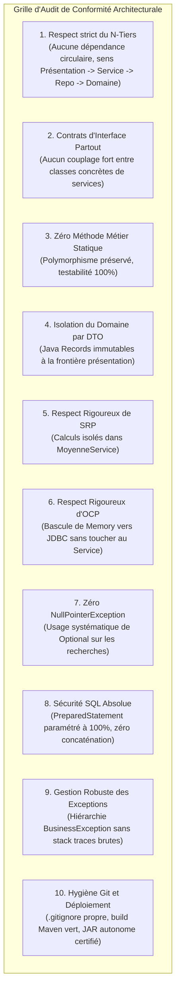

# Recettage Applicatif, DevLog Professionnel et Cas Pratiques de Synthèse

## 1. Introduction & Contexte Métier

Félicitations ! Vous êtes parvenu à la clé de voûte de notre cursus d'ingénierie logicielle avancée en Java. Au fil des sept modules précédents, vous avez exploré chaque strate de l'architecture logicielle : des entrailles de la JVM et de Maven jusqu'aux transactions JDBC, en passant par les subtilités de la modélisation objet, des DTOs, des lambdas et des principes SOLID.

Cependant, dans l'industrie logicielle internationale, la compétence d'un ingénieur senior ne se mesure pas seulement au code qu'il écrit le premier jour. Elle se mesure à :
1. **Sa capacité à recetter et auditer une base de code existante** selon des critères stricts de qualité, de découplage et de sécurité.
2. **Sa rigueur dans la tenue d'un Journal de Bord Technique (*DevLog*)**, consignant les arbitrages d'architecture, les incidents résolus et les métriques de vérification.
3. **Sa sérénité pour étendre le système avec une nouvelle fonctionnalité complexe** sans régression et en respectant l'ensemble des règles établies.

Comme le résume avec exigence le Professeur **Baila Wane** :
> *"Un bon développeur livre du code qui marche. Un grand ingénieur logiciel livre une architecture vivante, documentée, découplée et évolutive, sur laquelle n'importe quel confrère peut intervenir sans crainte dans 5 ans ! C'est ce niveau d'excellence professionnelle que nous validons aujourd'hui !"*

---

## 2. Architecture & Fondations Conceptuelles

### 2.1 La Grille d'Audit Architectural BrainX (10 Commandements)

Avant de livrer une application en production, l'équipe d'ingénierie soumet le projet à cette checklist qualité :



---

## 3. Le Portfolio DevLog : Méthodologie et Modèle de Référence

Le **DevLog (Developer's Log)** est le journal de bord de l'ingénieur logiciel. Il retrace de manière factuelle la démarche intellectuelle, les hypothèses posées, les anomalies rencontrées et les preuves de tests.

### 3.1 Structure Recommandée d'une Entrée de DevLog Professionnelle

```markdown
### [DevLog - SPRINT 02] Implémentation du Moteur de Notation et Calcul de Moyenne
- **Date & Heure** : 2026-11-19 14:30
- **Ingénieur Auteur** : Baila Wane (ISM Dakar)
- **Branche Git** : `feature/notes`
- **Objectif** : Permettre l'attribution de notes pondérées et le calcul de la moyenne générale d'un étudiant.

#### 1. Arbitrages Techniques & Décisions d'Architecture
- Séparation stricte de `MoyenneService` et `EtudiantService` pour satisfaire le principe SRP.
- Utilisation de `java.lang.Record` pour `NoteCreateDto` avec validation intégrée (note entre 0 et 20, coefficient > 0).
- Utilisation de la Streams API avec `mapToDouble()` et `.sum()` pour un calcul sans boucle manuelle.

#### 2. Anomalies Rencontrées & Résolution
- *Incident 01 (Division flottante par zéro)* : Lors des tests de validation sur un étudiant n'ayant encore aucune note enregistrée, la méthode `moyenne()` exécutait :
  ```java
  double moy = somme / notes.size();
  ```
  Lorsque la liste de notes est vide (`notes.isEmpty()`), `notes.size()` vaut `0`. En arithmétique flottante Java (`double`), une division par zéro ne lève pas d'exception mais produit silencieusement la valeur `Double.NaN` (Not a Number) ! Les relevés affichaient alors `Moyenne : NaN`.
  - *Correction appliquée* : Ajout de la garde défensive immédiate :
    ```java
    if (notes == null || notes.isEmpty()) {
        return 0.0;
    }
    ```
- *Incident 02* : L'invite de saisie de la matière dans `Main.java` affichait à tort `"Matricule : "` suite à un copier-coller hâtif.
  - *Correction appliquée* : Nettoyage de la chaîne de prompt et bascule vers `ConsoleScanner.lireChaineNonVide("Matière")`.

#### 3. Preuves de Validation & Recette
- `mvn test` : 100% succès (8 tests unitaires passés).
- Test manuel en console : Inscription de "Amadou Wane", attribution de 15/20 (coeff 2) et 18/20 (coeff 3) -> Moyenne calculée = 16.80/20 (Décision : ADMIS).
```

---

## 4. Cas Pratique d'Extension : Le Module "Professeurs et Affectations"

Pour valider l'excellence de notre architecture, nous allons simuler une demande d'évolution client majeure : **L'ajout de la gestion des Professeurs et de l'affectation de leurs matières d'enseignement**.

### 4.1 Étape 1 : Création de l'Entité `Professeur` (`com.ism.domain`)

L'entité hérite naturellement de notre socle `AbstractEntity` :

```java
package com.ism.domain;

import lombok.*;
import java.util.ArrayList;
import java.util.Collections;
import java.util.List;

@Getter
@Setter
@ToString(callSuper = true)
@NoArgsConstructor
@AllArgsConstructor
@Builder
public class Professeur extends AbstractEntity {

    private String matricule;
    private String nom;
    private String prenom;
    private String specialite;
    
    // Agrégation : le professeur enseigne une liste de matières
    @Builder.Default
    private List<String> matieresEnseignees = new ArrayList<>();

    public void affecterMatiere(String matiere) {
        if (matiere != null && !matieresEnseignees.contains(matiere.trim())) {
            matieresEnseignees.add(matiere.trim());
        }
    }

    public List<String> getMatieresEnseignees() {
        return Collections.unmodifiableList(matieresEnseignees);
    }
}
```

### 4.2 Étape 2 : Définition des DTOs Records (`com.ism.dto`)

```java
package com.ism.dto;

import java.util.List;

public record ProfesseurCreateDto(
        String matricule,
        String nom,
        String prenom,
        String specialite
) {}

public record ProfesseurDetailDto(
        Long id,
        String matricule,
        String nomComplet,
        String specialite,
        List<String> matieres
) {}
```

### 4.3 Étape 3 : Le Contrat de Persistance `ProfesseurRepository`

```java
package com.ism.repository;

import com.ism.domain.Professeur;
import java.util.Optional;

public interface ProfesseurRepository extends BaseRepository<Professeur> {
    Optional<Professeur> findByMatricule(String matricule);
}
```

### 4.4 Étape 4 : La Couche Service Découplée `ProfesseurService`

```java
package com.ism.service;

import com.ism.domain.Professeur;
import com.ism.dto.ProfesseurCreateDto;
import com.ism.dto.ProfesseurDetailDto;
import com.ism.exception.DuplicateMatriculeException;
import com.ism.exception.EntityNotFoundException;
import com.ism.repository.ProfesseurRepository;

public class ProfesseurServiceImpl implements ProfesseurService {

    private final ProfesseurRepository professeurRepository;

    public ProfesseurServiceImpl(ProfesseurRepository professeurRepository) {
        this.professeurRepository = professeurRepository;
    }

    @Override
    public ProfesseurDetailDto inscrire(ProfesseurCreateDto dto) {
        if (professeurRepository.findByMatricule(dto.matricule()).isPresent()) {
            throw new DuplicateMatriculeException(dto.matricule());
        }

        Professeur prof = Professeur.builder()
                .matricule(dto.matricule())
                .nom(dto.nom())
                .prenom(dto.prenom())
                .specialite(dto.specialite())
                .build();

        Professeur saved = professeurRepository.save(prof);
        return toDetailDto(saved);
    }

    @Override
    public void affecterMatiere(String matricule, String matiere) {
        Professeur prof = professeurRepository.findByMatricule(matricule)
                .orElseThrow(() -> new EntityNotFoundException("Professeur", matricule));
        prof.affecterMatiere(matiere);
        professeurRepository.save(prof);
    }

    private ProfesseurDetailDto toDetailDto(Professeur p) {
        return new ProfesseurDetailDto(
                p.getId(),
                p.getMatricule(),
                p.getPrenom() + " " + p.getNom().toUpperCase(),
                p.getSpecialite(),
                p.getMatieresEnseignees()
        );
    }
}
```

---

## 5. Synthèse Générale & Auto-Évaluation Finale

### Bilan Compétences Ingénieur Logiciel Java

| Domaine | Compétence Acquise | Preuve d'Implémentation |
| :--- | :--- | :--- |
| **Plateforme** | Maîtrise interne JVM & Maven | Configuration `pom.xml`, cycle de vie, JAR exécutable. |
| **Versionnement** | Workflow GitFlow en équipe | Découpage en branches `develop` et `feature/notes`. |
| **POO Avancée** | Encapsulation & Polymorphisme | Hiérarchie `AbstractEntity`, contrat `equals`/`hashCode`. |
| **Relations** | Modélisation objet subtile | Distinction nette Agrégation (Pneus) vs Composition (Salles). |
| **Architecture** | N-Tiers & Repository Pattern | Découplage strict Présentation -> Service -> Repository. |
| **Transfert** | Sécurisation par DTOs Records | Immutabilité garantie, absence de fuite du domaine. |
| **Design Patterns**| Singleton, Factory, Façade | `DatabaseMemory`, `RepositoryFactory`, `ServiceFactory`. |
| **SOLID** | Les 5 principes appliqués au réel | Découplage `MoyenneService`, injection par constructeur. |
| **Fonctionnel** | Streams API & Optional | Pipelines de calcul statistique, éradication du NPE. |
| **Robustesse** | Exceptions métier & UI Console | Hiérarchie `BusinessException`, Scanner sécurisé. |
| **Persistance** | JDBC & Sécurisation SQL | PreparedStatement, gestion transactionnelle ACID. |

### Grand Questionnaire d'Évaluation Finale (QCM)

1. **Dans une architecture logicielle conforme aux meilleures pratiques industrielles, quelle couche est habilitée à décider de l'attribution d'une mention ou de l'admission d'un étudiant ?**
   - A) La couche Présentation (`Main.java`)
   - B) La couche Persistance (`EtudiantRepositoryMemory`)
   - C) La couche Métier (`Service` / `MoyenneService`)
   - D) Le serveur de base de données SQL
   *Réponse attendue : C. Toute règle décisionnelle appartient exclusivement à la couche Service.*

2. **Lorsqu'on bascule d'une persistance mémoire vers une persistance SQL JDBC, quel fichier métier doit être modifié ?**
   - A) `EtudiantServiceImpl.java`
   - B) `Etudiant.java`
   - C) Aucun fichier métier : seule la classe de fabrique `RepositoryFactory` change pour fournir la nouvelle implémentation
   - D) `Main.java`
   *Réponse attendue : C. C'est l'essence même du respect d'Open/Closed Principle.*

3. **Quelle clause SQL permet à un `PreparedStatement` de récupérer l'identifiant numérique généré automatiquement lors d'une insertion ?**
   - A) `SELECT LAST_INSERT_ID()`
   - B) `Statement.RETURN_GENERATED_KEYS`
   - C) `AUTO_INCREMENT_KEY`
   - D) `ps.getLastId()`
   *Réponse attendue : B.*

### Défi Final de Certification

```markdown
[Grand Défi - Soutenance de Projet]
- Contexte : Vous présentez l'architecture logicielle de `com.ism` devant le comité technique présidé par M. Baila Wane.
- Démonstration attendue :
  1. Lancez l'application compilée depuis votre terminal via `java -jar`.
  2. Procédez à l'inscription de 3 étudiants et à l'attribution de 6 notes.
  3. Affichez les bulletins et démontrez le calcul exact de la moyenne générale pondérée.
  4. Présentez votre DevLog documentant la résolution d'au moins 2 anomalies rencontrées.
  5. Justifiez devant le jury pourquoi l'architecture est prête à recevoir une interface Web Angular/React sans modifier une seule ligne du code de la couche Service.
```
