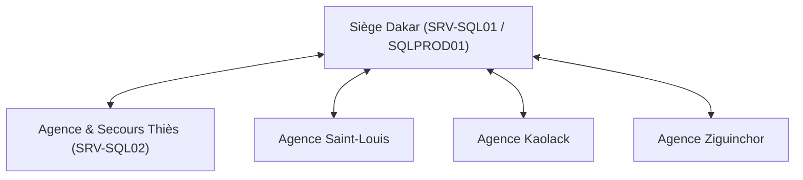
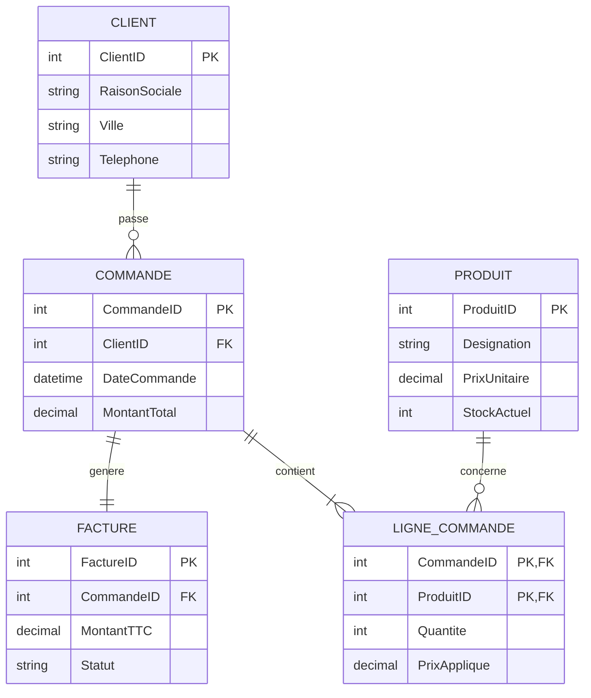

# 1. Fil Conducteur Métier : L'Entreprise SENEGAL DISTRIBUTION SA (SDS)

Tout au long de notre cursus d'ingénierie et d'administration sous **Microsoft SQL Server**, nos apprentissages ne reposeront pas sur des exemples abstraits ou des cas d'école artificiels. Nous piloterons l'infrastructure et les données d'un groupe commercial d'envergure nationale : **SENEGAL DISTRIBUTION SA (SDS)**.

### Le Contexte Opérationnel de SDS
SENEGAL DISTRIBUTION SA est le leader de la distribution de matériel informatique, de consommables et d'équipements de bureau au Sénégal. L'entreprise approvisionne des milliers de revendeurs, de supermarchés partenaires et de particuliers à travers son siège central de **Dakar** et ses représentations régionales stratégiques :
- **Thiès** (Hub logistique et site de secours informatique) ;
- **Saint-Louis** (Agence Nord et partenariats universitaires) ;
- **Kaolack** (Bassin arachidier et centre de fret) ;
- **Ziguinchor** (Comptoir commercial de Casamance).



### Le Rôle du DBA et de l'Ingénieur de Données
En tant qu'administrateur de bases de données (DBA) et architecte de données pour SDS, votre mission couvre l'intégralité du cycle de vie de la base de données de production **`SDS_Ventes`** :
1. **Concevoir et modéliser** le schéma relationnel pour supprimer toute incohérence métier.
2. **Dimensionner et paramétrer** l'instance SQL Server de classe entreprise (`SQLPROD01`).
3. **Implémenter une sécurité sans faille** conforme aux exigences de la Commission de Protection des Données Personnelles du Sénégal (**CDP**).
4. **Garantir la haute disponibilité et la résilience** en assurant un Plan de Reprise d'Activité (PRA) avec un RPO de 15 minutes et un RTO inférieur à 1 heure.

---

# 2. Les Fondements du Modèle Relationnel

### 2.1 La Révolution d'Edgar F. Codd (1970)
Avant 1970, les systèmes de gestion de fichiers et les bases de données hiérarchiques (modèle IMS) ou en réseau (modèle CODASYL) liaient intimement la structure logique des données à leur stockage physique sur bandes magnétiques ou tambours. Toute modification d'un index ou du format physique d'un fichier obligeait à réécrire l'ensemble des programmes applicatifs.

En 1970, le mathématicien et chercheur d'IBM **Edgar Frank Codd** publie son article fondateur : *« A Relational Model of Data for Large Shared Data Banks »*. Il y propose de modéliser les informations sous forme de relations mathématiques (tables), composées de n-uplets (lignes/tuples) et d'attributs (colonnes).

### 2.2 Les Principes Cardinaux du Modèle Relationnel
- **Indépendance Données-Traitements** : L'accès aux informations se fait de façon déclarative via un langage de haut niveau (SQL) sans que l'utilisateur ou le développeur n'ait à spécifier le chemin d'accès algorithmique (parcours d'arbres, pointeurs disques).
- **Non-ordonnancement des lignes et des colonnes** : Dans une table relationnelle, l'ordre des lignes et des colonnes n'a aucune signification sémantique. Deux tables contenant les mêmes lignes dans un ordre différent sont rigoureusement équivalentes.
- **Unicité des lignes (Clé Primaire)** : Chaque ligne d'une relation doit être identifiable de façon univoque grâce à un identifiant unique (*Primary Key*).
- **Atomicité des valeurs** : Chaque case (intersection ligne/colonne) ne peut contenir qu'une seule valeur scalaire, indivisible.

### 2.3 Comparatif des Charges : OLTP vs OLAP
Microsoft SQL Server est un moteur polyvalent capable de traiter deux profils de charge radicalement opposés :

| Caractéristique | OLTP (*On-Line Transaction Processing*) | OLAP (*On-Line Analytical Processing*) |
| :--- | :--- | :--- |
| **Objectif métier** | Gestion des opérations quotidiennes (saisie de commandes, facturation, inventaire). | Prise de décision, analyse de rentabilité, Business Intelligence (BI). |
| **Nature des requêtes** | Requêtes simples, très fréquentes, hautement concurrentes (`INSERT`, `UPDATE`, `SELECT` unitaire). | Requêtes complexes, lourdes, scannant des millions de lignes avec de multiples agrégations (`GROUP BY`, `SUM`, `AVG`). |
| **Volumétrie modifiée** | Quelques lignes à la fois par transaction (accès ciblé par index). | Lecture de tables massives (centaines de gigaoctets ou téraoctets). |
| **Exigence de latence** | Milliseconde (temps réel indispensable aux guichets de vente). | Secondes à minutes (temps de calcul de tableaux de bord). |
| **Modélisation type** | Hautement normalisée (3FN) pour éliminer les anomalies d'écriture. | Dénormalisée en schéma en étoile ou en flocon (*Star Schema* / Data Warehouse). |
| **Exemple SDS** | La base transactionnelle **`SDS_Ventes`** sur `SQLPROD01`. | L'entrepôt de données décisionnel **`SDS_DataWarehouse`**. |

---

# 3. L'Architecture ANSI/SPARC à Trois Niveaux

Proposée en 1975 par le comité ANSI/X3/SPARC, cette architecture standardise la séparation des niveaux d'abstraction dans un Système de Gestion de Bases de Données Relationnelles (SGBDR) :

```
+-------------------------------------------------------------+
| NIVEAU EXTERNE (Vues Utilisateurs & Applications)           |
|  - Vue Comptable (Factures + Échéances)                     |
|  - Vue Commerciale (Clients + Commandes en cours)           |
|  - Vue Direction (Chiffre d'affaires agrégé)                |
+-------------------------------------------------------------+
                               |
                   (Indépendance Logique)
                               v
+-------------------------------------------------------------+
| NIVEAU CONCEPTUEL (Schéma Logique Global)                   |
|  - Modèle Entité-Association normalisé en 3FN               |
|  - Tables : Clients, Commandes, Factures, Produits          |
|  - Règles d'intégrité et contraintes d'entreprise           |
+-------------------------------------------------------------+
                               |
                  (Indépendance Physique)
                               v
+-------------------------------------------------------------+
| NIVEAU INTERNE / PHYSIQUE (Moteur de Stockage SQL Server)   |
|  - Fichiers MDF, NDF, LDF et Filegroups                     |
|  - Pages de données de 8 Ko et Extents de 64 Ko             |
|  - Index B-Tree (Clustered & Non-Clustered)                 |
+-------------------------------------------------------------+
```

### 3.1 Les Deux Formes d'Indépendance
1. **Indépendance Logique** : La capacité de modifier le schéma conceptuel (ajouter une table, scinder un attribut) sans impacter les vues externes des utilisateurs qui ne consomment pas ces attributs modifiés.
2. **Indépendance Physique** : La capacité de réorganiser le stockage physique (déplacer un fichier `.ndf` sur un disque SSD NVMe, ajouter un index non-clusterisé, reconstruire un groupe de fichiers) sans modifier d'un seul iota le schéma conceptuel ni les requêtes T-SQL des applications clientes.

---

# 4. Le Modèle Entité-Association (MCD)

La modélisation conceptuelle de données (MCD) est l'étape reine d'un projet informatique : elle capture la réalité du métier avant toute écriture de script SQL.

### 4.1 Les Quatre Piliers du MCD
1. **L'Entité (ou Individu)** : Représentation abstraite d'un objet matériel ou immatériel du monde réel doté d'une existence propre (ex: `Client`, `Commande`, `Produit`, `Facture`).
2. **L'Attribut (ou Propriété)** : Information élémentaire décrivant une entité (ex: `RaisonSociale`, `Telephone`, `DateCommande`, `PrixUnitaire`).
3. **L'Identifiant (Clé Primaire Conceptuelle)** : Attribut privilégié dont la valeur est unique pour chaque occurrence de l'entité (ex: `ClientID`, `NumeroCommande`).
4. **L'Association (ou Relation)** : Lien sémantique unissant deux ou plusieurs entités (ex: un Client *Passe* une Commande ; une Commande *Fait l'objet de* une Facture).

### 4.2 Les Cardinalités
La cardinalité caractérise le nombre minimum et maximum de fois qu'une occurrence d'une entité peut participer à une association donnée :
- `(0,1)` : Au maximum une fois, éventuellement aucune.
- `(1,1)` : Exactement une fois, obligatoirement.
- `(0,n)` : Zéro, une ou plusieurs fois (sans limite supérieure).
- `(1,n)` : Au moins une fois, potentiellement plusieurs fois.



---

# 5. Règles de Transformation du MCD au Modèle Physique (MPD)

Pour implémenter ce modèle sous Microsoft SQL Server, nous appliquons les règles formelles de passage du conceptuel au relationnel :

### Règle 1 : Transformation des Entités
Chaque entité du MCD devient une **Table** SQL Server. Chaque attribut de l'entité devient une **Colonne** de la table. L'identifiant de l'entité devient la **Clé Primaire** (`PRIMARY KEY`).

### Règle 2 : Association binaire du type (0,n) — (1,1) ou (0,1) — (1,n)
La table située du côté de la cardinalité `(1,1)` reçoit la clé primaire de l'autre table sous la forme d'une **Clé Étrangère** (`FOREIGN KEY`).
- *Cas SDS* : Un `Client` passe `(0,n)` `Commandes` ; une `Commande` est passée par `(1,1)` `Client`. La table `Commandes` accueille la clé étrangère `ClientID REFERENCES Clients(ClientID)`.

### Règle 3 : Association binaire du type (0,n) — (0,n) ou (1,n) — (1,n)
L'association devient une **Table de Liaison** indépendante. Sa clé primaire est généralement composée des clés primaires des deux tables associées.
- *Cas SDS* : Une `Commande` contient `(1,n)` `Produits` ; un `Produit` figure dans `(0,n)` `Commandes`. L'association devient la table `LignesCommande`, dont la clé primaire composite est `(CommandeID, ProduitID)`.

### Règle 4 : Association binaire du type (1,1) — (0,1) ou (1,1) — (1,1)
La clé de l'une des tables est migrée dans l'autre table en tant que clé étrangère avec une contrainte d'unicité (`UNIQUE`), garantissant la relation un-à-un.
- *Cas SDS* : Une `Commande` génère `(0,1)` `Facture` ; une `Facture` correspond à `(1,1)` `Commande`. La table `Factures` accueille `CommandeID UNIQUE REFERENCES Commandes(CommandeID)`.

---

# 6. Implémentation T-SQL de Référence (Schémas SDS)

Voici la transcription T-SQL rigoureuse de notre modèle pour l'instance `SQLPROD01` :

```sql
USE master;
GO

-- Création de la base de données centrale
IF DB_ID('SDS_Ventes') IS NOT NULL
BEGIN
    ALTER DATABASE SDS_Ventes SET SINGLE_USER WITH ROLLBACK IMMEDIATE;
    DROP DATABASE SDS_Ventes;
END;
GO

CREATE DATABASE SDS_Ventes;
GO

USE SDS_Ventes;
GO

-- Création des schémas fonctionnels étanches
CREATE SCHEMA Ventes;
GO
CREATE SCHEMA Finance;
GO

-- 1. Table des Clients (Dakar, Thiès, Régions)
CREATE TABLE Ventes.Clients (
    ClientID INT IDENTITY(1,1) NOT NULL,
    RaisonSociale NVARCHAR(100) NOT NULL,
    Ville NVARCHAR(50) NOT NULL,
    Telephone VARCHAR(20) NULL,
    CONSTRAINT PK_Clients PRIMARY KEY CLUSTERED (ClientID)
);
GO

-- 2. Table des Produits du catalogue
CREATE TABLE Ventes.Produits (
    ProduitID INT IDENTITY(1,1) NOT NULL,
    Reference VARCHAR(30) NOT NULL,
    Designation NVARCHAR(120) NOT NULL,
    PrixUnitaire DECIMAL(14, 2) NOT NULL,
    StockDisponible INT NOT NULL CONSTRAINT DF_Produits_Stock DEFAULT 0,
    CONSTRAINT PK_Produits PRIMARY KEY CLUSTERED (ProduitID),
    CONSTRAINT UQ_Produits_Reference UNIQUE (Reference),
    CONSTRAINT CK_Produits_Prix CHECK (PrixUnitaire >= 0)
);
GO

-- 3. Table des Commandes commerciales
CREATE TABLE Ventes.Commandes (
    CommandeID INT IDENTITY(1,1) NOT NULL,
    ClientID INT NOT NULL,
    DateCommande DATETIME2(0) NOT NULL CONSTRAINT DF_Commandes_Date DEFAULT SYSDATETIME(),
    MontantTotalFCFA DECIMAL(14, 0) NOT NULL CONSTRAINT DF_Commandes_Montant DEFAULT 0,
    Statut NVARCHAR(20) NOT NULL CONSTRAINT DF_Commandes_Statut DEFAULT N'EN_ATTENTE',
    CONSTRAINT PK_Commandes PRIMARY KEY CLUSTERED (CommandeID),
    CONSTRAINT FK_Commandes_Clients FOREIGN KEY (ClientID) 
        REFERENCES Ventes.Clients(ClientID)
);
GO

-- 4. Table des Factures (Schéma Finance sous contrôle CDP)
CREATE TABLE Finance.Factures (
    FactureID INT IDENTITY(1,1) NOT NULL,
    CommandeID INT NOT NULL,
    MontantTTC DECIMAL(14, 0) NOT NULL,
    DateEmission DATETIME2(0) NOT NULL CONSTRAINT DF_Factures_Date DEFAULT SYSDATETIME(),
    Statut NVARCHAR(15) NOT NULL CONSTRAINT DF_Factures_Statut DEFAULT N'EMISE',
    CONSTRAINT PK_Factures PRIMARY KEY CLUSTERED (FactureID),
    CONSTRAINT UQ_Factures_Commande UNIQUE (CommandeID),
    CONSTRAINT FK_Factures_Commandes FOREIGN KEY (CommandeID) 
        REFERENCES Ventes.Commandes(CommandeID)
);
GO
```

> 📘 **[Complément d'architecture & Bonnes pratiques]**
> L'utilisation systématique des schémas (`Ventes`, `Finance`, `RH`) sous SQL Server permet d'isoler logiquement les tables sans multiplier les bases de données. Comme nous le verrons dans les modules de sécurité, cela simplifie considérablement la gestion des habilitations en accordant des droits globaux au niveau du schéma (`GRANT SELECT ON SCHEMA::Finance TO RoleComptable`).

---

# 7. Exercices d'Auto-Évaluation et Questions de Synthèse

### Questions Théoriques
1. **Quelle est la différence fondamentale entre l'indépendance logique et l'indépendance physique des données ?**
2. **Pourquoi une table transactionnelle OLTP doit-elle éviter la dénormalisation poussée ?**
3. **Dans quel cas précis une association entre deux entités génère-t-elle une table de liaison physique ?**

### Exercice d'Application
Une nouvelle agence de SDS souhaite enregistrer les transporteurs qui livrent les commandes. Chaque commande est acheminée par au maximum un transporteur, et un transporteur peut livrer plusieurs commandes au cours de la semaine.
- Déterminez les cardinalités de l'association *Acheminer* entre `Commande` et `Transporteur`.
- Écrivez l'instruction T-SQL permettant de créer la table `Ventes.Transporteurs` et de mettre à jour `Ventes.Commandes` avec la contrainte de clé étrangère correspondante.
