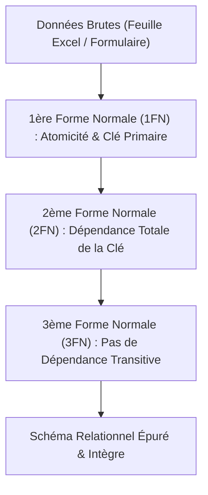

# 1. Pourquoi Normaliser ? Le Péril des Anomalies

Dans un Système d'Information d'entreprise comme celui de **SENEGAL DISTRIBUTION SA (SDS)**, une table mal conçue mélangeant plusieurs concepts métier distincts conduit immanquablement à de la redondance excessive et à des corruptions logiques fatales.

### Exemple d'une Table « Non Normalisée »
Considérons la table brute suivante issue d'une feuille de calcul Excel historique utilisée avant l'informatisation de l'agence de Thiès :

| NumCommande | DateCde | ClientNom | ClientVille | ProduitRef | ProduitNom | Qte | PrixUnit |
| :--- | :--- | :--- | :--- | :--- | :--- | :--- | :--- |
| **C1001** | 2026-10-01 | Boutique Fall | Thiès | P-SRV-01 | Serveur Rack 2U | 2 | 1 500 000 |
| **C1001** | 2026-10-01 | Boutique Fall | Thiès | P-RAM-32 | Barrette 32 Go | 4 | 85 000 |
| **C1002** | 2026-10-02 | Supérette Diop | Saint-Louis | P-RAM-32 | Barrette 32 Go | 1 | 85 000 |

Cette conception monolithique génère trois pathologies graves :

### 1.1 L'Anomalie de Redondance et d'Incohérence (*Update Anomaly*)
Si la `Boutique Fall` déménage de `Thiès` à `Dakar`, il faut mettre à jour des dizaines, voire des centaines de lignes de commandes passées. Si une seule ligne n'est pas modifiée en raison d'une panne réseau ou d'un `UPDATE` mal ciblé, la base de données se retrouve en état schizophrène : le client habite simultanément à Thiès et à Dakar.

### 1.2 L'Anomalie d'Insertion (*Insertion Anomaly*)
Il est impossible d'enregistrer un nouveau client tant qu'il n'a pas passé sa première commande, car la clé primaire `NumCommande` serait nulle. De même, impossible d'enregistrer un nouveau produit en catalogue s'il n'a pas encore été vendu.

### 1.3 L'Anomalie de Suppression (*Deletion Anomaly*)
Si la commande `C1002` est annulée et supprimée de la base, nous perdons irrémédiablement l'existence de la `Supérette Diop` et de ses coordonnées si c'était son unique achat !

---

# 2. Les Dépendances Fonctionnelles (DF)

La normalisation s'appuie sur la théorie des **Dépendances Fonctionnelles**.
Une dépendance fonctionnelle existe entre un groupe d'attributs $X$ (source) et un groupe d'attributs $Y$ (cible), notée :
$$X \rightarrow Y$$
Ce qui signifie : **« La connaissance d'une valeur de $X$ détermine de manière univoque une seule valeur de $Y$ »**.

### Exemples dans le domaine SDS
- `ClientID` $\rightarrow$ `RaisonSociale, Ville, Telephone` (Un numéro de client identifie exactement une entreprise).
- `ProduitID` $\rightarrow$ `Reference, Designation, PrixUnitaire` (Un identifiant produit fixe son prix de base).
- `(CommandeID, ProduitID)` $\rightarrow$ `Quantite, RemiseAccordee` (Il faut connaître à la fois la commande ET le produit pour connaître la quantité commandée sur cette ligne).

---

# 3. La Démarche de Normalisation en Trois Étapes



### 3.1 La Première Forme Normale (1FN)
> **Règle formelle :** Une relation est en 1FN si et seulement si tous ses attributs contiennent des **valeurs atomiques** (indivisibles) et qu'il existe une **clé primaire** clairement identifiée (aucun groupe répétitif).

- **Contre-exemple (Viol de la 1FN)** :
  Une colonne `Telephones` contenant `'338201010, 775001122'` viole la 1FN. Elle empêche d'indexer correctement les numéros, de filtrer un indicatif ou d'effectuer des jointures fiables.
- **Correction** : Séparer en une table dédiée `ClientTelephones` liée par `ClientID`, ou créer des colonnes séparées `TelFixe` et `TelMobile` selon les règles métier.

### 3.2 La Deuxième Forme Normale (2FN)
> **Règle formelle :** Une relation est en 2FN si elle est déjà en 1FN et si tout attribut non-clé dépend **pleinement et entièrement** de la totalité de la clé primaire (et non d'une sous-partie de la clé).

Cette règle ne concerne que les tables dont la clé primaire est **composite** (composée de plusieurs colonnes) :
- **Contre-exemple (Viol de la 2FN)** :
  Considérons la table `LigneCommande(CommandeID, ProduitID, DesignationProduit, Quantite)`.
  La clé primaire est `(CommandeID, ProduitID)`.
  L'attribut `Quantite` dépend bien de la clé complète. En revanche, `DesignationProduit` ne dépend que de `ProduitID`, qui n'est qu'une fraction de la clé primaire !
- **Correction** : Extraire `DesignationProduit` dans la table `Produits(ProduitID, DesignationProduit)`.

### 3.3 La Troisième Forme Normale (3FN)
> **Règle formelle :** Une relation est en 3FN si elle est déjà en 2FN et si aucun attribut non-clé ne dépend d'un autre attribut non-clé (absence de dépendance fonctionnelle transitive).
> Autrement dit : **« Tout attribut doit dépendre de la clé, de toute la clé, et de rien que de la clé »**.

- **Contre-exemple (Viol de la 3FN)** :
  Considérons la table `Clients(ClientID, RaisonSociale, CodePostal, Ville, NomRegion, TauxTVA_Regional)`.
  Ici, `ClientID` $\rightarrow$ `CodePostal`, mais `CodePostal` $\rightarrow$ `NomRegion` $\rightarrow$ `TauxTVA_Regional`.
  Il existe une dépendance transitive : un attribut non-clé détermine d'autres attributs non-clé.
- **Correction** : Créer une table `Villes(CodePostal, NomVille, RegionID)` et ne conserver dans `Clients` que la clé étrangère `CodePostal`.

---

# 4. Quand Faut-il Dénormaliser ? (Le Débat OLTP vs Décisionnel)

La normalisation rigoureuse en 3FN est **le standard absolu pour les environnements transactionnels OLTP** car elle élimine les risques d'incohérence et rend les transactions d'écriture ultra-légères.

Cependant, en environnement de production de haute intensité ou en entrepôt décisionnel (OLAP), joindre 15 tables pour afficher une facture ou calculer le chiffre d'affaires quotidien peut engorger la mémoire vive (Buffer Pool) et saturer le processeur.

### Le Compromis Raisonné de Dénormalisation
On dénormalise **volontairement** lorsque :
1. Le volume de lectures dépasse de façon écrasante (ex: 99% contre 1%) le volume d'écritures.
2. Une valeur calculée doit être figée dans le temps pour des raisons légales ou comptables.
   - *Exemple SDS* : Dans `Finance.Factures`, stocker `MontantTotalTTC` est une dénormalisation acceptée car la facture est un document comptable immuable qui ne doit plus dépendre des évolutions ultérieures des prix du catalogue ou des taux de TVA.

> ⚠️ **[Mise en garde & Pièges fréquents]**
> Dénormaliser prématurément est l'erreur classique des concepteurs débutants. Ne dénormalisez **jamais** sans avoir au préalable testé l'indexation appropriée et mesuré le coût des requêtes sous charge réelle. Une table dénormalisée sans procédure stricte de synchronisation conduit inévitablement à des données corrompues.

---

# 5. Implémentation des Contraintes d'Intégrité en Transact-SQL

Sous SQL Server, le moteur garantit le respect physique des règles de modélisation grâce aux contraintes d'intégrité déclaratives.

```sql
USE SDS_Ventes;
GO

-- 1. Table Catégories de matériel
CREATE TABLE Ventes.Categories (
    CategorieID INT IDENTITY(1,1) NOT NULL,
    CodeCategorie VARCHAR(10) NOT NULL,
    Libelle NVARCHAR(60) NOT NULL,
    CONSTRAINT PK_Categories PRIMARY KEY CLUSTERED (CategorieID),
    CONSTRAINT UQ_Categories_Code UNIQUE (CodeCategorie)
);
GO

-- 2. Table Produits avec clés étrangères et validations
CREATE TABLE Ventes.Articles (
    ArticleID INT IDENTITY(1,1) NOT NULL,
    CategorieID INT NOT NULL,
    Reference VARCHAR(25) NOT NULL,
    Designation NVARCHAR(120) NOT NULL,
    PrixAchat DECIMAL(12, 2) NOT NULL,
    PrixVente DECIMAL(12, 2) NOT NULL,
    SeuilAlerteStock INT NOT NULL CONSTRAINT DF_Articles_Seuil DEFAULT 5,
    CONSTRAINT PK_Articles PRIMARY KEY CLUSTERED (ArticleID),
    CONSTRAINT UQ_Articles_Ref UNIQUE (Reference),
    -- Clé étrangère liant l'article à sa catégorie
    CONSTRAINT FK_Articles_Categories FOREIGN KEY (CategorieID)
        REFERENCES Ventes.Categories (CategorieID)
        ON UPDATE CASCADE
        ON DELETE NO ACTION, -- Empêche la suppression d'une catégorie contenant des articles
    -- Contrainte de cohérence métier (Prix de vente supérieur au prix d'achat)
    CONSTRAINT CK_Articles_MargePositive CHECK (PrixVente >= PrixAchat),
    CONSTRAINT CK_Articles_PrixPositif CHECK (PrixAchat > 0)
);
GO

-- 3. Table des Lignes de Commandes (Relation N-N)
CREATE TABLE Ventes.LignesCommande (
    CommandeID INT NOT NULL,
    ArticleID INT NOT NULL,
    QuantiteCommandee INT NOT NULL,
    PrixUnitaireFacture DECIMAL(12, 2) NOT NULL,
    TauxRemise DECIMAL(5, 2) NOT NULL CONSTRAINT DF_Lignes_Remise DEFAULT 0.00,
    CONSTRAINT PK_LignesCommande PRIMARY KEY CLUSTERED (CommandeID, ArticleID),
    CONSTRAINT FK_Lignes_Commandes FOREIGN KEY (CommandeID)
        REFERENCES Ventes.Commandes (CommandeID)
        ON DELETE CASCADE, -- Supprimer la commande supprime automatiquement ses lignes
    CONSTRAINT FK_Lignes_Articles FOREIGN KEY (ArticleID)
        REFERENCES Ventes.Articles (ArticleID)
        ON DELETE NO ACTION, -- Interdit de supprimer un article s'il a été commandé
    CONSTRAINT CK_Lignes_Quantite CHECK (QuantiteCommandee > 0),
    CONSTRAINT CK_Lignes_Remise CHECK (TauxRemise BETWEEN 0.00 AND 100.00)
);
GO
```

### Options des Clés Étrangères (`ON DELETE` / `ON UPDATE`)
- **`NO ACTION` (Par défaut)** : SQL Server bloque la commande et déclenche une erreur si une ligne référencée est modifiée ou supprimée.
- **`CASCADE`** : La modification ou suppression se propage automatiquement à toutes les lignes dépendantes.
- **`SET NULL`** : Les colonnes de clé étrangère dans les lignes dépendantes sont positionnées à `NULL` (nécessite que la colonne soit nullable).
- **`SET DEFAULT`** : Les colonnes de clé étrangère prennent leur valeur par défaut.

---

# 6. Exercices Pratiques et Cas d'Étude

### Cas Pratique : Gestion des Acomptes et Règlements
SENEGAL DISTRIBUTION SA souhaite intégrer la gestion des règlements partiels des factures. Une facture peut être réglée en plusieurs fois (par chèque, virement bancaire ou espèces), mais la somme des montants réglés ne doit jamais excéder le montant TTC de la facture.

1. Identifiez les entités, la clé primaire et la clé étrangère nécessaires pour implémenter la table `Finance.Reglements`.
2. Proposez le script T-SQL de création de cette table avec les contraintes d'intégrité adaptées (`NOT NULL`, `CHECK` sur montant positif, `FOREIGN KEY` vers `Finance.Factures`).
3. Quelle option de suppression (`ON DELETE`) choisissez-vous pour préserver la traçabilité comptable exigée par les auditeurs financiers ?
