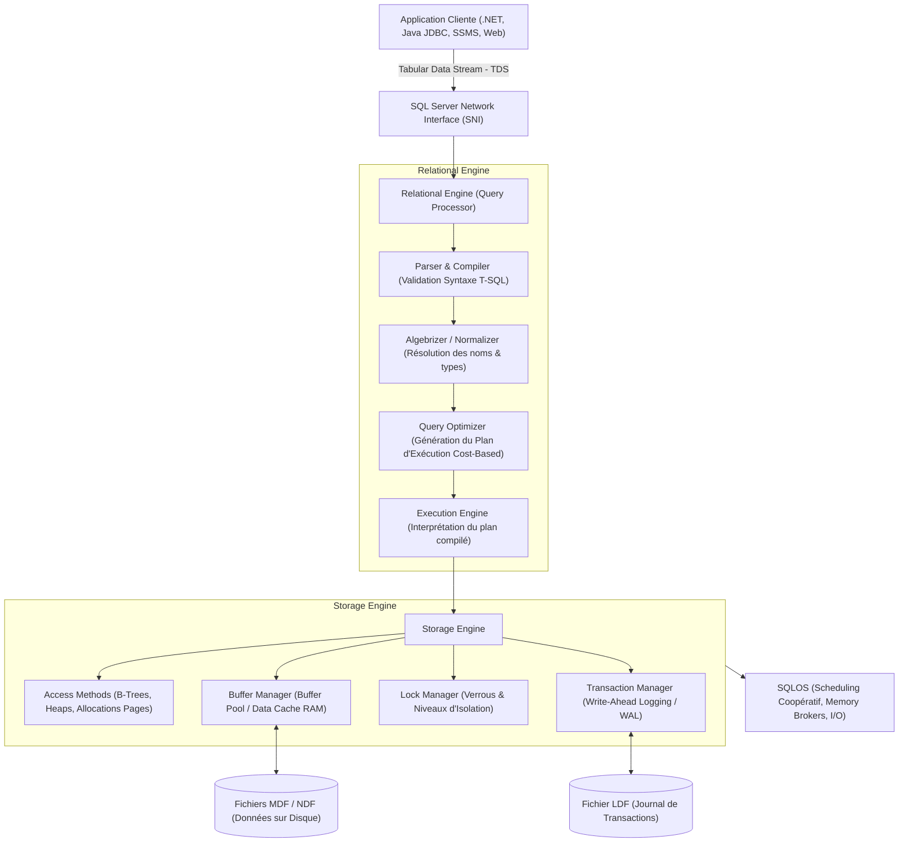
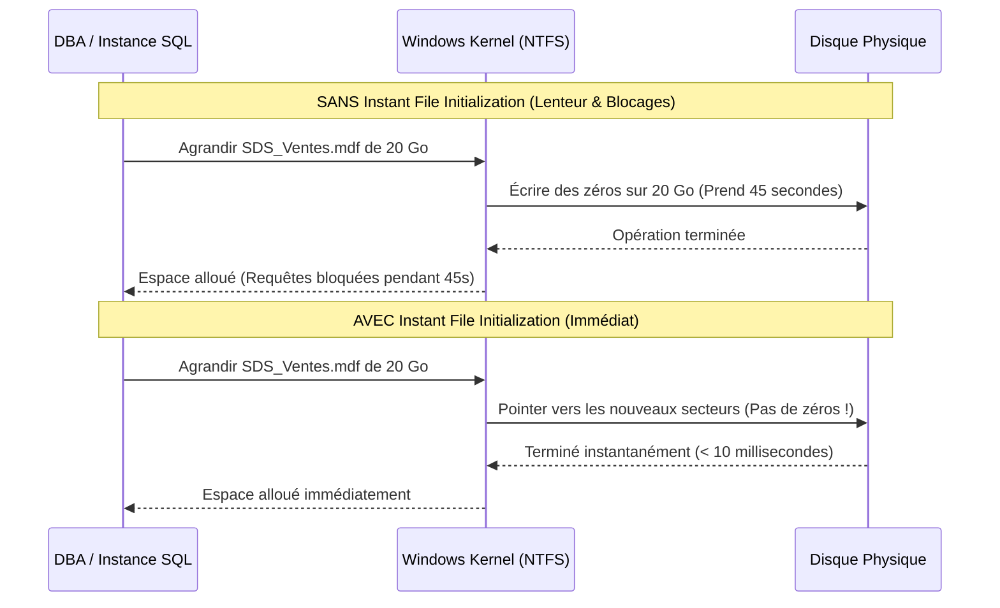

# 1. Fil Conducteur Métier : Dimensionnement du Serveur SQLPROD01

Dans le cadre du plan de modernisation de **SENEGAL DISTRIBUTION SA (SDS)**, la direction générale et la DSI ont acquis un nouveau serveur physique d'entreprise destiné à héberger l'instance de production principale **`SQLPROD01`** au siège de Dakar.

### Les Données de Cadrage du Projet (TP 1.1)
- **Matériel disponible** : Serveur rack biprocesseur doté de **8 cœurs physiques** et de **32 Go de mémoire RAM DDR4 ECC**.
- **Volumétrie cible** : Base de données commerciale et financière d'environ **200 Go**, avec un taux d'accroissement estimé à 15 Go par an.
- **Population utilisatrice** : **50 utilisateurs simultanés** (commerciaux, comptables, logisticiens aux entrepôts et caissiers des comptoirs régionaux).
- **Profil de charge** : Transactionnel intensif (OLTP) aux heures ouvrées (lundi au samedi, 07h00 à 21h00).

En tant que DBA Senior, vous devez arbitrer sur le choix de l'édition SQL Server, valider les prérequis d'infrastructure et comprendre comment le moteur de base de données exploitera physiquement ces 8 cœurs et ces 32 Go de RAM.

---

# 2. Architecture Interne du Database Engine

Microsoft SQL Server est un système de gestion de bases de données relationnelles de classe entreprise conçu pour gérer de gigantesques volumes de données tout en garantissant les propriétés **ACID** (Atomicité, Cohérence, Isolation, Durabilité).

Le moteur se décompose en deux moteurs principaux fonctionnant en synergie au-dessus d'une couche d'abstraction matérielle dédiée, le **SQLOS** (*SQL Server Operating System*) :



### 2.1 Le Relational Engine (Query Processor)
Le moteur relationnel est chargé de la réception, de l'interprétation et de l'optimisation des requêtes T-SQL :
1. **Parser & Compiler** : Contrôle la syntaxe du code T-SQL et génère un arbre syntaxique (*parse tree*).
2. **Algebrizer (Normalizer)** : Vérifie dans les catalogues système que les tables, vues, colonnes et types existent réellement et que l'utilisateur dispose du droit d'y accéder. Il produit un arbre d'algèbre relationnelle normalisé (*processor tree*).
3. **Query Optimizer (CBO)** : Le composant le plus sophistiqué de SQL Server. Basé sur les coûts (*Cost-Based Optimizer*), il consulte les **statistiques d'échantillonnage** pour estimer la cardinalité (nombre de lignes) et compare des centaines d'alternatives (Index Seek vs Index Scan, Nested Loops vs Hash Match vs Merge Join) afin de choisir le plan le moins coûteux en temps CPU et entrées/sorties.
4. **Plan Cache** : Le plan d'exécution retenu est stocké en mémoire cache afin d'éviter une recompilation pénalisante lors des requêtes identiques ultérieures.

### 2.2 Le Storage Engine
Le moteur de stockage est responsable de la persistance, du verrouillage et de l'intégrité des données physiques :
- **Access Methods** : Pilote le parcours des arbres B-Tree des index clusterisés et la lecture des extents.
- **Buffer Pool (Data Cache)** : Espace de mémoire RAM où résident les pages de 8 Ko. **Le processeur n'écrit et ne lit jamais directement sur le disque dur**. Toute lecture charge la page en RAM ; toute modification altère la page en mémoire vive (marquée alors comme *page sale / dirty page*).
- **Transaction Manager & WAL (*Write-Ahead Logging*)** : Garantit la durabilité. Toute transaction doit impérativement inscrire ses modifications dans le journal de transactions (`.ldf`) sur disque **avant** que la page modifiée (`.mdf`) ne soit déversée sur le disque physique lors du processus de *Checkpoint*.

### 2.3 Le SQLOS (SQL Server Operating System)
Couche logicielle d'abstraction intercalée entre le moteur SQL Server et le noyau Windows :
- **Non-Preemptive Scheduling** : Gère ses propres threads (schedulers) en mode coopératif pour minimiser le coût exorbitant des bascules de contexte du noyau OS.
- **Memory Brokers** : Arbitre dynamiquement les allocations de mémoire RAM entre le cache de données (*Buffer Pool*), le cache de plans de requêtes (*Plan Cache*) et l'espace de tri et hachage (*Workspace Memory*).

---

# 3. Panorama des Éditions et Décision Technique (TP 1.1)

SQL Server se décline en plusieurs éditions répondant à des besoins techniques et budgétaires très contrastés :

| Édition | Limites CPU / Cœurs | Limite RAM Buffer Pool | Fonctionnalités Clés & Cible |
| :--- | :--- | :--- | :--- |
| **Express** | 1 socket ou 4 cœurs | **1,4 Go de RAM** (Taille max base : 10 Go) | Gratuite. Petites applications locales, sites vitrines, apprentissage. Pas de SQL Agent. |
| **Standard** | Jusqu'à 4 sockets ou **24 cœurs** | **128 Go de RAM** | L'édition reine d'entreprise. Haute disponibilité de base, SQL Agent complet, TDE, sauvegarde chiffrée. |
| **Enterprise** | Maximum du système d'exploitation | Maximum de l'OS (plusieurs To) | Haute disponibilité illimitée Always On Availability Groups, partitionnement illimité, gouvernance mémoire totale. Coût très élevé. |
| **Developer** | Identique à Enterprise | Identique à Enterprise | Gratuite mais strictement réservée au développement et aux tests (interdite en production). |

### La Justification du Choix pour SENEGAL DISTRIBUTION SA
Dans le contexte de SDS (32 Go de RAM, 8 cœurs, base de 200 Go, 50 utilisateurs) :
> **Recommandation : L'édition SQL Server Standard convient parfaitement.**
> 
> **Justifications techniques et financières :**
> 1. Les 8 cœurs du serveur sont très largement inférieurs à la limite des 24 cœurs imposée par l'édition Standard.
> 2. Les 32 Go de RAM sont en deçà du plafond de 128 Go de l'édition Standard.
> 3. La volumétrie de 200 Go et les 50 utilisateurs simultanés représentent une charge OLTP classique ne nécessitant aucunement les fonctionnalités exclusives d'Enterprise (telles que les groupes de disponibilité Always On avec plusieurs réplicas de lecture synchrones).
> 4. Payer une licence Enterprise (dont le prix dépasse souvent 14 000 $ par cœur physique) pour ce profil de charge représenterait un gaspillage budgétaire majeur sans aucun gain de performance mesurable.

---

# 4. Prérequis Système et Architecture Disque

En environnement d'administration d'entreprise, il est formellement interdit de déposer l'ensemble des fichiers sur une unique partition `C:`.

### 4.1 Séparation Physique des Disques et Volumes
Pour éviter les goulets d'étranglement sur les contrôleurs I/O et protéger le serveur contre les pannes en cascade :

```
[Disque C:] -> Système d'exploitation Windows Server + Binaires SQL Server
[Disque D:] -> Fichiers de données utilisateur (.mdf, .ndf) [RAID 5 ou RAID 10]
[Disque L:] -> Journal de transactions (.ldf) [RAID 10 dédié impératif]
[Disque T:] -> Base de données temporaire TempDB [Disque SSD NVMe ultra-rapide]
[Disque B:] -> Répertoire local de transit des sauvegardes (.bak, .trn)
```

### 4.2 Taille des Blocs d'Allocation (Allocation Unit Size)
Lors du formatage des volumes NTFS ou ReFS destinés à héberger les fichiers de données (`D:`), les journaux (`L:`) et `TempDB` (`T:`), sélectionnez impérativement une taille d'unité d'allocation de **64 Ko (64 KB)** au lieu des 4 Ko par défaut de Windows.
- *Justification* : L'unité d'extension de base de SQL Server est l'**Extent de 64 Ko** (8 pages de 8 Ko). Aligner la taille des clusters du système de fichiers sur celle des extents élimine la fragmentation au niveau du contrôleur de stockage et divise par 16 le nombre d'appels I/O système.

---

# 5. L'Instant File Initialization (IFI)

Sans IFI, chaque fois qu'un fichier de données s'agrandit (via l'accroissement automatique *Autogrowth* ou lors de la création d'une nouvelle base), le système d'exploitation Windows écrit des zéros dans chaque bloc du disque pour effacer les traces d'anciens fichiers.
- *Conséquence désastreuse* : Une allocation de 20 Go fige l'instance et bloque toutes les requêtes transactionnelles pendant plusieurs minutes !

Avec l'**Instant File Initialization**, l'espace disque est alloué instantanément sans remise à zéro préalable.



### Activation de l'IFI
Pour activer l'IFI, il suffit d'accorder le privilège de sécurité local Windows **`SE_MANAGE_VOLUME_NAME`** (*Perform volume maintenance tasks* / Effectuer les tâches de maintenance de volume) au compte de service qui exécute l'instance SQL Server (`NT Service\MSSQLSERVER`).

---

# 6. Scripts T-SQL de Diagnostic Post-Installation

Après le déploiement de SQL Server sur le serveur `SQLPROD01`, exécutez ces requêtes dans SQL Server Management Studio pour valider la configuration :

```sql
-- 1. Audit complet de la version, de l'édition et de l'architecture
SELECT 
    SERVERPROPERTY('MachineName') AS [NomMachine],
    SERVERPROPERTY('ServerName') AS [Instance],
    SERVERPROPERTY('Edition') AS [Edition],
    SERVERPROPERTY('ProductVersion') AS [VersionBuild],
    SERVERPROPERTY('ProductLevel') AS [PatchLevel_CU],
    SERVERPROPERTY('Collation') AS [CollationParDefaut];
GO

-- 2. Contrôle de l'activation effective de l'Instant File Initialization (IFI)
SELECT 
    servicename, 
    instant_file_initialization_enabled AS [IFI_Active]
FROM sys.dm_server_services
WHERE servicename LIKE 'SQL Server (%';
GO

-- 3. Diagnostic des processeurs logiques et de la mémoire vus par SQLOS
SELECT 
    cpu_count AS [NombreCoeursLogiques],
    hyperthread_ratio AS [RatioHyperthreading],
    physical_memory_kb / 1024 AS [RAM_Physique_Mo],
    committed_kb / 1024 AS [RAM_Allouee_Moteur_Mo]
FROM sys.dm_os_sys_info;
GO
```

> 📘 **[Complément d'architecture & Bonnes pratiques]**
> Si `instant_file_initialization_enabled` renvoie `N` (Non activé), ouvrez la console des stratégies de sécurité locales de Windows (`secpol.msc`) :
> `Security Settings` > `Local Policies` > `User Rights Assignment` > Double-cliquez sur `Perform volume maintenance tasks`, ajoutez le compte de service SQL Server, puis redémarrez le service MSSQLSERVER.

---

# 7. Exercices Pratiques et Questions d'Entraînement

### Questions de Validation
1. **Pourquoi l'Instant File Initialization ne s'applique-t-elle jamais aux fichiers de journal de transactions (`.ldf`) ?**
   *(Indice : pensez au mécanisme Write-Ahead Logging et à la détection de la fin du journal).*
2. **Quels sont les deux composants principaux du Database Engine et quel est le rôle respectif de chacun ?**
3. **Dans quel cas précis l'édition Enterprise de SQL Server deviendrait-elle indispensable pour Sénégal Distribution SA ?**
