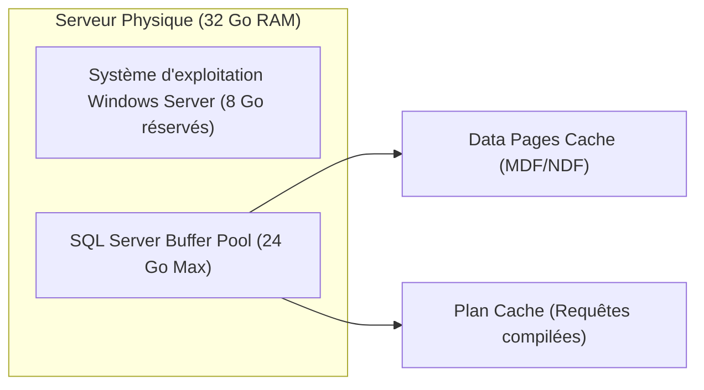

# 1. Fil Conducteur : Le Déploiement Multi-Agences de SDS

Après avoir validé l'architecture du serveur central `SQLPROD01` au siège de Dakar, la direction technique de **SENEGAL DISTRIBUTION SA (SDS)** engage le déploiement de l'infrastructure de gestion des stocks et de caisse dans ses **5 agences régionales** :
- Agence de Dakar-Port ;
- Agence de Thiès ;
- Agence de Saint-Louis ;
- Agence de Kaolack ;
- Agence de Ziguinchor.

L'objectif de cette leçon est d'industrialiser l'installation pour garantir une uniformité absolue sur le parc, puis de paramétrer les réglages d'exploitation vitaux pour la stabilité et la performance du moteur.

---

# 2. Déploiement Automatisé par Fichier INI (TP 1.1 - Question 3)

### 2.1 Pourquoi Proscrire l'Installation Manuelle ?
Installer SQL Server manuellement via l'assistant graphique sur 5 serveurs distincts introduit inévitablement des dérives humaines :
- Oubli d'un composant obligatoire ;
- Choix divergent de la **Collation** (sensibilité aux accents et à la casse : `French_CI_AS` vs `SQL_Latin1_General_CP1_CI_AS`), ce qui rendra les restaurations croisées et les requêtes distribuées impossibles ;
- Comptes de service ou chemins de disques incohérents d'un site à l'autre.

### 2.2 Le Fichier `ConfigurationFile.ini`
L'utilisation d'un fichier de configuration exécuté en ligne de commande silencieuse garantit un déploiement strictement identique, reproductible, auditable et traçable sous Git (*Infrastructure as Code*).

```ini
; ==============================================================================
; SENEGAL DISTRIBUTION SA - Gabarit d'installation silencieuse SQL Server 2022
; ==============================================================================
[OPTIONS]
ACTION="Install"
QUIET="True"
IACCEPTSQLSERVERLICENSETERMS="True"
FEATURES=SQLENGINE
INSTANCENAME="MSSQLSERVER"
INSTANCEID="MSSQLSERVER"
UPDATEENABLED="False"

; Comptes de service dédiés
SQLSVCACCOUNT="NT SERVICE\MSSQLSERVER"
SQLSYSADMINACCOUNTS="SDS\DBA_Admins" "BUILTIN\Administrators"

; Sécurité et Authentification (Mode Mixte activé pour les applications régionales)
SECURITYMODE="SQL"
SAPWD="Complex#MasterP@ssw0rd2026!"

; Collation unifiée pour l'ensemble du groupe SDS
SQLCOLLATION="French_CI_AS"

; Séparation stricte des répertoires d'installation
INSTALLSHAREDDIR="C:\Program Files\Microsoft SQL Server"
INSTALLSQLDATADIR="D:\SQLData"
INSTANCEDIR="C:\Program Files\Microsoft SQL Server"
SQLUSERDBDIR="D:\Data"
SQLUSERDBLOGDIR="L:\Log"
SQLBACKUPDIR="B:\Backups"

; Configuration native de TempDB lors de l'installation
SQLTEMPDBDIR="T:\TempDB"
SQLTEMPDBLOGDIR="T:\TempDB"
SQLTEMPDBFILECOUNT="4"
SQLTEMPDBFILESIZE="256"
SQLTEMPDBFILEGROWTH="64"
```

### Exécution du Déploiement en PowerShell Silencieux
```powershell
# Déploiement silencieux standardisé sur chaque serveur d'agence
Setup.exe /ConfigurationFile="C:\Install\ConfigurationFile.ini" /IAcceptSqlserverLicenseTerms
```

---

# 3. Réglages Post-Installation Critiques (TP 1.2)

Une fois l'instance déployée, les réglages par défaut du moteur ne sont **absolument pas adaptés** à un environnement de production d'entreprise. Deux paramètres doivent être configurés sans attendre :



### 3.1 Limitation de la Mémoire Vive (`max server memory`)
Par défaut, SQL Server alloue dynamiquement jusqu'à **2 147 483 647 Mo** (soit plus de 2 Pétaoctets de RAM) ! 
- *Le Piège Mortel* : Le moteur relationnel va progressivement absorber l'intégralité des 32 Go de RAM du serveur pour gonfler son *Buffer Pool*. Le système d'exploitation Windows n'ayant plus de mémoire vive disponible va basculer en mode de pagination intensive sur disque dur (*paging/swapping*). Les performances globales de la machine s'effondrent et le serveur peut devenir totalement injoignable.

```sql
-- Affichage des options avancées
EXEC sp_configure 'show advanced options', 1;
RECONFIGURE;
GO

-- Limitation de la mémoire SQL Server à 24 Go (24 576 Mo), réservant 8 Go pour Windows
EXEC sp_configure 'max server memory (MB)', 24576;
RECONFIGURE;
GO
```

### 3.2 Contrôle du Parallélisme (`MAXDOP` & `Cost Threshold`)
Le moteur d'optimisation de SQL Server est capable de découper une requête complexe entre plusieurs cœurs processeurs pour l'exécuter en parallèle.
- Par défaut, `max degree of parallelism` est à `0` (le moteur peut mobiliser tous les cœurs disponibles pour une seule requête). Sur notre serveur à 8 cœurs, une requête mal écrite de rapport commercial pourrait monopoliser les 8 cœurs, saturant le CPU à 100% et bloquant les 49 autres utilisateurs de caisse !
- De plus, le seuil de coût par défaut (`cost threshold for parallelism`) est historiquement fixé à `5` (une valeur obsolète conçue pour les processeurs des années 1990).

```sql
-- 1. Limiter le parallélisme à 4 cœurs maximum par requête
EXEC sp_configure 'max degree of parallelism', 4;
RECONFIGURE;
GO

-- 2. Augmenter le seuil de coût à 25 (seules les requêtes lourdes déclenchent le parallélisme)
EXEC sp_configure 'cost threshold for parallelism', 25;
RECONFIGURE;
GO
```

---

# 4. Éradication de la Contention TempDB (TP 1.2)

La base système **`tempdb`** est la colonne vertébrale partagée de toute l'instance SQL Server. Elle stocke :
- Les tables temporaires locales et globales (`#TableTemp`, `##GlobalTemp`) ;
- Les tables variables (`@TableVariable`) ;
- Les espaces de travail pour les tris volumineux (`ORDER BY`, `GROUP BY`) n'ayant pas tenu en RAM ;
- Les versions de lignes pour l'isolation Snapshot et les déclencheurs (*Row Version Store*).

### 4.1 Le Problème d'Allocation PFS / GAM / SGAM
Chaque fichier de données possède des pages système spéciales en tête de fichier pour gérer les allocations d'extents :
- **PFS (*Page Free Space*)** : Enregistre l'espace libre sur chaque page de 8 Ko.
- **GAM (*Global Allocation Map*)** : Enregistre les extents uniformes alloués.
- **SGAM (*Shared Global Allocation Map*)** : Enregistre les extents mixtes partagés.

Quand 50 utilisateurs créent simultanément des tables temporaires, des dizaines de threads tentent d'écrire en même temps sur **la même unique page PFS du premier fichier de TempDB** ! Cela provoque un phénomène de contention sévère (*PAGELATCH_UP* dans `sys.dm_os_wait_stats`), gelant le serveur.

### 4.2 La Solution : Plusieurs Fichiers de Données Égaux
En créant plusieurs fichiers de données de taille identique, SQL Server utilise un algorithme d'allocation circulaire équilibré (*round-robin*), répartissant instantanément la charge entre plusieurs pages PFS distinctes.

```sql
USE master;
GO

-- 1. Redimensionner le fichier primaire tempdev existant à 256 Mo
ALTER DATABASE tempdb MODIFY FILE (
    NAME = tempdev, 
    SIZE = 256MB, 
    FILEGROWTH = 64MB
);
GO

-- 2. Ajouter 3 fichiers de données secondaires identiques pour atteindre 4 fichiers
ALTER DATABASE tempdb ADD FILE (
    NAME = tempdev2, 
    FILENAME = 'D:\TempDB\tempdev2.ndf', 
    SIZE = 256MB, 
    FILEGROWTH = 64MB
);
GO

ALTER DATABASE tempdb ADD FILE (
    NAME = tempdev3, 
    FILENAME = 'D:\TempDB\tempdev3.ndf', 
    SIZE = 256MB, 
    FILEGROWTH = 64MB
);
GO

ALTER DATABASE tempdb ADD FILE (
    NAME = tempdev4, 
    FILENAME = 'D:\TempDB\tempdev4.ndf', 
    SIZE = 256MB, 
    FILEGROWTH = 64MB
);
GO
```

> ⚠️ **[Règle d'or Microsoft pour TempDB]**
> Tous les fichiers de données de TempDB doivent **impérativement avoir la même taille initiale et le même paramètre d'accroissement**. Si l'un des fichiers grandit plus qu'un autre, l'algorithme d'écriture proportionnelle de SQL Server va surcharger ce fichier, recréant la contention d'allocation.

---

# 5. Configuration Réseau avec SQL Server Configuration Manager (SSCM)

SQL Server Configuration Manager (`SQLServerManager16.msc`) est la seule console habilitée à modifier les protocoles réseau sans corrompre les clés de registre Windows.

```
+------------------------------------------------------------------------+
| SQL Server Configuration Manager                                       |
+------------------------------------------------------------------------+
| > SQL Server Services                                                  |
|    - SQL Server (MSSQLSERVER)         [En cours]  [Démarrage Automatique] |
|    - SQL Server Agent (MSSQLSERVER)   [En cours]  [Démarrage Automatique] |
|    - SQL Server Browser               [En cours]  [Démarrage Automatique] |
| > Configuration du réseau SQL Server                                   |
|    - Protocoles pour MSSQLSERVER                                       |
|        - Mémoire partagée (Shared Memory) [Activé]                     |
|        - TCP/IP                           [Activé]  -> Port fixe 1433   |
|        - Canaux nommés (Named Pipes)      [Désactivé]                  |
+------------------------------------------------------------------------+
```

### 5.1 Procédure d'Activation du Protocole TCP/IP
1. Ouvrir **SQL Server Configuration Manager**.
2. Dérouler **Configuration du réseau SQL Server** > **Protocoles pour MSSQLSERVER** (ou nom d'instance).
3. Clic droit sur **TCP/IP** > Sélectionner **Activer**.
4. Double-cliquer sur **TCP/IP** > Onglet **Adresses IP** :
   - Dérouler jusqu'à la section tout en bas intitulée **IPAll** ;
   - Effacer toute valeur présente dans *Ports dynamiques TCP* ;
   - Renseigner le port standard **`1433`** dans *Port TCP*.
5. Clic sur **Appliquer**, puis redémarrer le service Windows **SQL Server (MSSQLSERVER)** pour appliquer la configuration.

### 5.2 Ouverture du Pare-feu Windows Defender en Ligne de Commande
Pour que les postes de caisse et les applications clientes des agences régionales puissent joindre l'instance :

```powershell
# Règle autorisant le flux entrant sur le port standard SQL Server TCP 1433
New-NetFirewallRule -Name "SQLServer_Inbound_1433" `
    -DisplayName "Microsoft SQL Server Database Engine (Port TCP 1433)" `
    -Direction Inbound `
    -Protocol TCP `
    -LocalPort 1433 `
    -Action Allow

# Si une instance nommée secondaire existe, autoriser le service SQL Server Browser sur UDP 1434
New-NetFirewallRule -Name "SQLBrowser_Inbound_1434" `
    -DisplayName "Microsoft SQL Server Browser (Port UDP 1434)" `
    -Direction Inbound `
    -Protocol UDP `
    -LocalPort 1434 `
    -Action Allow
```

---

# 6. Rôle des Quatre Bases Système

Toute instance SQL Server s'appuie sur quatre bases de données système indispensables :

| Base Système | Rôle Fondamental et Architecture | Conséquence en cas de Corruption |
| :--- | :--- | :--- |
| **`master`** | Cœur de l'instance. Enregistre la configuration du serveur, l'emplacement physique de tous les fichiers de toutes les bases, les logins et les clés de chiffrement. | L'instance ne démarre plus du tout. |
| **`model`** | Gabarit appliqué à chaque création d'une nouvelle base (`CREATE DATABASE`). Si vous y modifiez une option ou y ajoutez une table, toute base future en héritera. | Impossible de créer la moindre base. |
| **`msdb`** | Moteur de gestion de SQL Server Agent : planification des tâches récurrentes, historique des sauvegardes (`backupset`), alertes et Database Mail. | Perte des plannings de sauvegarde et des alertes. |
| **`tempdb`** | Espace de stockage temporaire mondial partagé. **Recréée à zéro à chaque démarrage du service SQL Server**. | Crash immédiat de toutes les requêtes utilisateur. |

---

# 7. Exercices d'Auto-Évaluation

1. **Pourquoi une instance par défaut écoute-t-elle sur le port 1433 alors qu'une instance nommée utilise des ports dynamiques par défaut ?**
2. **Quelle est la différence fondamentale entre la base `master` et la base `model` ?**
3. **Pourquoi TempDB est-elle entièrement réinitialisée à chaque redémarrage de la machine hôte ?**
