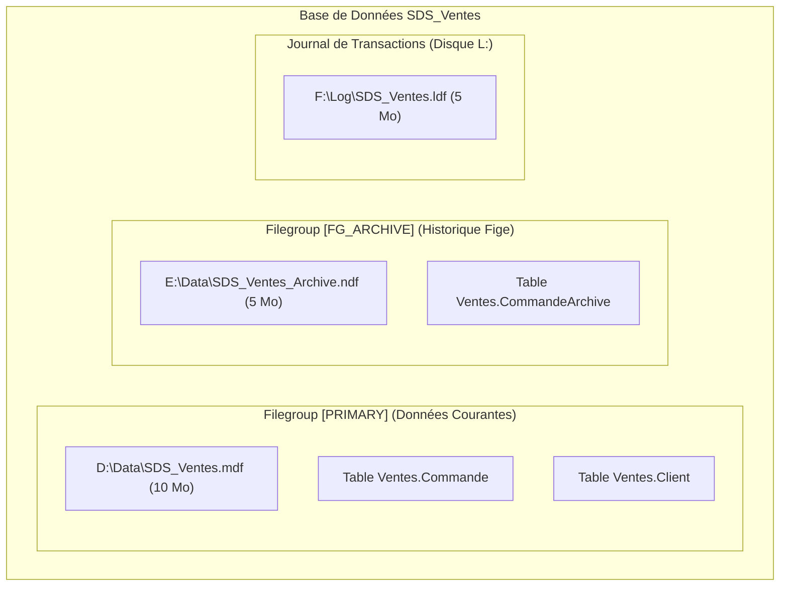

# 1. Fil Conducteur : Structuration du Stockage de SDS_Ventes (TP 2.1)

Dans l'environnement de production de **SENEGAL DISTRIBUTION SA (SDS)**, la base commerciale **`SDS_Ventes`** enregistre un flux ininterrompu de commandes quotidiennes. Au bout de quelques années, l'accumulation de millions de factures et de mouvements d'entrepôt alourdit considérablement les requêtes de gestion courante et allonge démesurément la durée des sauvegardes.

Pour répondre à cette problématique, la direction technique mandate le DBA pour structurer la base de données autour d'une **stratégie multi-groupes de fichiers (*Filegroups*)** :
- Isoler les données actives et transactionnelles dans le groupe de fichiers primaire **`PRIMARY`** ;
- Isoler les commandes des années antérieures dans un groupe de fichiers dédié **`FG_ARCHIVE`** ;
- Placer le journal des transactions sur un volume physique autonome pour éliminer toute interférence I/O.

---

# 2. La Structure Bas Niveau : Pages et Extents

Dans Microsoft SQL Server, l'unité fondamentale de stockage sur disque et de mise en cache en mémoire vive est la **Page** :

```
+-----------------------------------------------------------+
| Page Header (96 octets)                                   |
| - Page ID, File ID, Type de page (Data, Index, PFS)       |
| - Espace libre disponible, Pointeurs vers pages suiv/préc |
+-----------------------------------------------------------+
| Ligne 1 : [ID=1, RaisonSoc='Boutique Ndiaye', Ville=...]   |
| Ligne 2 : [ID=2, RaisonSoc='Alimentation Fall', Ville=...] |
| Ligne 3 : [ID=3, RaisonSoc='Superette Diop', Ville=...]   |
|                                                           |
|                     < Espace Libre >                      |
|                                                           |
+-----------------------------------------------------------+
| Slot Offset Array (Offset Ligne 3, Offset Ligne 2, Ligne 1)|
+-----------------------------------------------------------+
```

### 2.1 La Page de Données (8 192 Octets / 8 Ko)
Chaque page fait rigoureusement **8 Ko** et se décompose en trois segments :
1. **Le Page Header (96 octets)** : Métadonnées indispensables au moteur de stockage (type de page, identifiant de l'objet propriétaire, adresse de la page précédente et suivante dans la chaîne doublement chaînée).
2. **L'Espace Utile (8 060 octets)** : La zone où sont enregistrées les lignes de données physiques.
3. **Le Slot Array (Row Offset Table)** : Un tableau d'octets situé à la toute fin de la page qui indique le décalage physique précis en octets de chaque ligne dans la page.

> ⚠️ **[Contrainte de taille maximale d'une ligne physique]**
> Une ligne de données standard ne peut **jamais dépasser 8 060 octets**. Si vous tentez de créer une table comportant `col1 VARCHAR(5000)` et `col2 VARCHAR(5000)`, SQL Server acceptera la création mais bloquera tout `INSERT` dès que la somme des données réelles de la ligne dépassera 8 060 octets (hors types volumineux déportés LOB `VARCHAR(MAX)` / `VARBINARY(MAX)` stockés hors ligne dans des pages *Row-Overflow*).

### 2.2 L'Extent (64 Ko)
Un groupe de **8 pages contiguës de 8 Ko** constitue un **Extent** (soit 64 Ko) :
- **Uniform Extent (Étendue uniforme)** : Les 8 pages appartiennent au même objet (même table ou même index). C'est le comportement standard en production depuis SQL Server 2016 (`AUTOGROW_ALL_FILES`).
- **Mixed Extent (Étendue mixte)** : Les 8 pages sont partagées entre plusieurs petits objets différents pour éviter de gaspiller 64 Ko pour des tables de seulement quelques lignes.

---

# 3. Typologie des Fichiers de Base de Données

Une base de données SQL Server repose sur deux ou trois types de fichiers physiques :

| Extension | Type de Fichier | Rôle dans l'Architecture | Règle de Présence |
| :--- | :--- | :--- | :--- |
| **`.mdf`** | **Primary Data File** | Contient le dictionnaire système de la base (catalogues, métadonnées) et pointe vers tous les autres fichiers de données. | **Exactement un seul** fichier `.mdf` par base de données. |
| **`.ndf`** | **Secondary Data File** | Héberge les données utilisateur et index supplémentaires. Permet d'étaler la charge sur plusieurs disques. | **Zéro, un ou plusieurs** fichiers `.ndf`. |
| **`.ldf`** | **Transaction Log File** | Journal de transactions séquentiel organisé en VLFs. Indispensable aux mécanismes ACID, au rollback et au recovery. | **Au minimum un** fichier `.ldf` (ne pas créer plusieurs `.ldf` pour la performance). |

---

# 4. Stratégie des Groupes de Fichiers (TP 2.1)

Un groupe de fichiers (*Filegroup*) est un conteneur logique qui rassemble un ou plusieurs fichiers de données (`.mdf`, `.ndf`). Le groupe par défaut créé avec la base est le groupe **`PRIMARY`**.



### 4.1 Script Complet : Création de la Base et des Tables Ciblées (TP 2.1)

```sql
USE master;
GO

IF DB_ID('SDS_Ventes') IS NOT NULL
BEGIN
    ALTER DATABASE SDS_Ventes SET SINGLE_USER WITH ROLLBACK IMMEDIATE;
    DROP DATABASE SDS_Ventes;
END;
GO

-- Création de SDS_Ventes avec PRIMARY, FG_ARCHIVE et journal sur 3 disques séparés
CREATE DATABASE SDS_Ventes
ON PRIMARY
(
    NAME = N'SDS_Ventes_Data',
    FILENAME = N'D:\Data\SDS_Ventes.mdf',
    SIZE = 10MB,
    FILEGROWTH = 5MB
),
FILEGROUP [FG_ARCHIVE]
(
    NAME = N'SDS_Ventes_Archive',
    FILENAME = N'E:\Data\SDS_Ventes_Archive.ndf',
    SIZE = 5MB,
    FILEGROWTH = 5MB
)
LOG ON
(
    NAME = N'SDS_Ventes_Log',
    FILENAME = N'F:\Log\SDS_Ventes.ldf',
    SIZE = 5MB,
    FILEGROWTH = 5MB
);
GO

USE SDS_Ventes;
GO

-- Table Commande placée explicitement dans le groupe primaire
CREATE TABLE dbo.Commande (
    idCommande INT IDENTITY(1,1) NOT NULL,
    dateCommande DATE NOT NULL,
    montant DECIMAL(10, 2) NOT NULL,
    CONSTRAINT PK_Commande PRIMARY KEY CLUSTERED (idCommande)
) ON [PRIMARY];
GO

-- Table CommandeArchive placée explicitement dans le groupe secondaire FG_ARCHIVE
CREATE TABLE dbo.CommandeArchive (
    idCommande INT NOT NULL,
    dateCommande DATE NOT NULL,
    montant DECIMAL(10, 2) NOT NULL,
    CONSTRAINT PK_CommandeArchive PRIMARY KEY CLUSTERED (idCommande)
) ON [FG_ARCHIVE];
GO
```

### 4.2 Les Quatre Bénéfices Majeurs de Séparer les Données dans `FG_ARCHIVE`
1. **Protection par Bascule en Lecture Seule** :
   Une fois l'exercice comptable clôturé, le DBA peut passer le groupe en lecture seule :
   ```sql
   ALTER DATABASE SDS_Ventes MODIFY FILEGROUP [FG_ARCHIVE] READ_ONLY;
   ```
   Dès lors, les données historiques sont protégées physiquement contre toute suppression accidentelle, altération ou attaque par ransomware.
2. **Allègement Drastique des Sauvegardes** :
   Le groupe `PRIMARY` (données vivantes) est sauvegardé fréquemment ; le groupe `FG_ARCHIVE` (données immuables) n'a besoin d'être sauvegardé qu'une seule fois après sa clôture. Cela réduit massivement la fenêtre de sauvegarde de nuit.
3. **Répartition des Entrées/Sorties (I/O Striping)** :
   Placer `PRIMARY` sur du stockage SSD rapide (`D:`) et `FG_ARCHIVE` sur du disque magnétique plus capacitif et moins onéreux (`E:`) optimise le ratio coût/performance de l'entreprise.
4. **Restauration Progressive d'Urgence (*Piecemeal Restore*)** :
   En cas de sinistre matériel, le DBA restaure en priorité le groupe `PRIMARY` pour remettre l'application en ligne en quelques minutes. Les tables d'archives de `FG_ARCHIVE` sont restaurées en tâche de fond sans interrompre les ventes !

---

# 5. Configuration des Options de Base de Données (TP 2.2)

Une base de données fraîchement créée hérite des options de la base système `model`. Sur un système de production, ces paramètres doivent être ajustés impérativement :

```sql
USE master;
GO

-- 1. Passage en mode de récupération COMPLET (Full Recovery Model)
ALTER DATABASE SDS_Ventes SET RECOVERY FULL;
GO

-- 2. Désactivation FORMELLE de l'option AUTO_SHRINK
ALTER DATABASE SDS_Ventes SET AUTO_SHRINK OFF;
GO

-- 3. Activation des statistiques automatiques pour l'optimiseur
ALTER DATABASE SDS_Ventes SET AUTO_CREATE_STATISTICS ON;
ALTER DATABASE SDS_Ventes SET AUTO_UPDATE_STATISTICS ON;
ALTER DATABASE SDS_Ventes SET AUTO_UPDATE_STATISTICS_ASYNC ON;
GO

-- 4. Contrôle d'intégrité strict des pages sur disque
ALTER DATABASE SDS_Ventes SET PAGE_VERIFY CHECKSUM;
GO
```

### 5.1 Pourquoi Faut-il Bannir Absolument `AUTO_SHRINK` ?
L'option `AUTO_SHRINK = ON` est considérée par l'ensemble des architectes SQL Server comme la pire hérésie d'administration :
- **Le cycle mortifère** : Dès qu'une table est nettoyée ou qu'une archive est purgée, l'arrière-plan de SQL Server réduit le fichier de données en déplaçant les pages depuis la fin du fichier vers le début. Cette opération réorganise les pages sans respecter l'ordre logique des index, provoquant une **fragmentation immédiate de 99%** de tous les index de la base !
- Quelques heures plus tard, lors des nouvelles commandes de caisse, le fichier est obligé de se ré-agrandir (*Autogrowth*), ce qui fige les écritures.
- Le serveur s'enferme dans une boucle permanente : Réduction $\rightarrow$ Fragmentation $\rightarrow$ Ralentissement $\rightarrow$ Ré-agrandissement $\rightarrow$ Réduction.

---

# 6. Exercices d'Auto-Évaluation

1. **Que se passe-t-il si vous créez une table avec l'instruction `CREATE TABLE ...` sans préciser la clause `ON [NomFilegroup]` ?**
2. **Quelle est la taille maximale d'une ligne de données standard dans une page SQL Server et comment contourne-t-on cette limite ?**
3. **Expliquez pourquoi l'option `PAGE_VERIFY CHECKSUM` est supérieure à l'ancienne option `TORN_PAGE_DETECTION`.**
