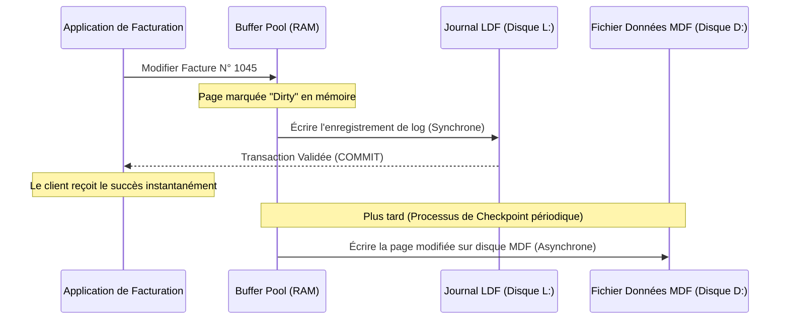

# 1. Fil Conducteur : Crise d'Engorgement du Journal sur SDS_Ventes (TP 2.3)

Un matin à 08h30, les caissiers de l'agence de Dakar et les logisticiens de Thiès reçoivent l'erreur fatale SQL Server suivante :
> `Msg 9002, Level 17, State 4, Line 1 : The transaction log for database 'SDS_Ventes' is full due to 'LOG_BACKUP'.`

Le disque `L:\` hébergeant le journal de transactions est saturé à 100%. L'ensemble de la chaîne de facturation de **SENEGAL DISTRIBUTION SA (SDS)** est immédiatement paralysé.

En tant qu'administrateur de bases de données, vous devez diagnostiquer en temps réel la cause profonde de cette saturation, mesurer l'espace consommé, purger le journal sans perte de données, et comprendre la structure interne des **Virtual Log Files (VLF)** pour empêcher qu'un tel incident ne se reproduise.

---

# 2. Architecture Interne du Journal : Le Mécanisme WAL et les VLFs

Le journal des transactions (`.ldf`) n'est pas un fichier texte ou un simple historique d'événements : c'est un registre séquentiel binaire garantissant les propriétés d'Atomicité et de Durabilité du moteur.

### 2.1 Le Write-Ahead Logging (WAL)
SQL Server applique rigoureusement la règle du **Write-Ahead Logging** :
1. Une transaction modifie des lignes dans la mémoire vive (*Buffer Pool*). La page est dite *dirty* (sale).
2. L'empreinte de la modification (image avant/après) est écrite de façon synchrone dans le journal `.ldf` sur le disque `L:`.
3. La transaction peut alors être validée (`COMMIT`).
4. Ce n'est que plus tard, lors d'un processus asynchrone nommé **Checkpoint**, que les pages modifiées en mémoire sont réellement écrites dans le fichier de données `.mdf` sur le disque `D:`.



### 2.2 Les Fichiers Journaux Virtuels (VLFs - *Virtual Log Files*)
Physiquement, le fichier `.ldf` est découpé en segments circulaires consécutifs appelés **VLFs** :
- **VLF Actif** : Contient des enregistrements de transactions nécessaires au rollback ou au rétablissement de la base.
- **VLF Inactif** : Contient des transactions terminées et déjà sauvegardées. L'espace de ce VLF peut être réutilisé (*tronqué*).

```
+------------------------------------------------------------------------+
| Fichier Journal .ldf (Circulaire)                                      |
| +-----------+ +-----------+ +-----------+ +-----------+ +------------+ |
| | VLF 1     | | VLF 2     | | VLF 3     | | VLF 4     | | VLF 5      | |
| | (Inactif) | | (Inactif) | | (ACTIF)   | | (ACTIF)   | | (Tronqué)  | |
| +-----------+ +-----------+ +-----------+ +-----------+ +------------+ |
+------------------------------------------------------------------------+
```

### 2.3 Le Piège de la Prolifération des VLFs
Quand le fichier journal s'agrandit par de trop petits incréments (ex: `FILEGROWTH = 16MB` ou `10%`), SQL Server génère 4 à 16 nouveaux VLFs à chaque extension.
- Une base de 200 Go qui grandit de 16 Mo en 16 Mo accumule rapidement **plus de 20 000 VLFs** !
- *Impacts majeurs* : Ralentissement massif des requêtes d'insertion, temps de démarrage de SQL Server pouvant atteindre plusieurs heures, et dégradation sévère des restaurations de reprise sur sinistre.
- *Règle d'or DBA* : Dimensionner le journal à sa taille d'exploitation réelle (ex: 30 Go) dès sa création, et régler un accroissement fixe maîtrisé (ex: `FILEGROWTH = 256MB` ou `512MB`).

---

# 3. Diagnostic et Résolution de l'Engorgement du Journal (TP 2.3)

Lors d'une crise d'espace, le premier réflexe de l'administrateur est d'exécuter les requêtes de diagnostic basées sur les Vues de Gestion Dynamique (DMV) :

### 3.1 Mesurer l'Espace Utilisé du Journal
```sql
-- Diagnostic précis de l'occupation du journal pour SDS_Ventes
SELECT 
    DB_NAME(database_id) AS [BaseDeDonnees],
    total_log_size_in_bytes / 1024 / 1024 AS [TailleTotale_Mo],
    used_log_space_in_bytes / 1024 / 1024 AS [EspaceUtilise_Mo],
    used_log_space_in_percent AS [PourcentageUtilise],
    log_space_in_bytes_since_last_backup / 1024 / 1024 AS [EspaceDepuisDernierBackup_Mo]
FROM sys.dm_db_log_space_usage
WHERE database_id = DB_ID('SDS_Ventes');
GO
```

### 3.2 Identifier la Cause du Blocage (`log_reuse_wait_desc`)
Pourquoi SQL Server ne peut-il pas libérer d'espace ? La colonne `log_reuse_wait_desc` de `sys.databases` livre le diagnostic immédiat :

```sql
SELECT 
    name AS [Base],
    recovery_model_desc AS [ModeRecuperation],
    log_reuse_wait_desc AS [CauseBlocageTroncature]
FROM sys.databases
WHERE name = 'SDS_Ventes';
GO
```

| Valeur de `log_reuse_wait_desc` | Cause Racine | Action Corrective Immédiate |
| :--- | :--- | :--- |
| **`NOTHING`** | Tout est normal. Il existe des VLFs libres pour réutilisation. | Aucune action requise. |
| **`LOG_BACKUP`** | La base est en mode COMPLET mais **aucune sauvegarde du journal n'a été exécutée**. Le journal grossira jusqu'à saturation du disque. | **Exécuter un `BACKUP LOG` immédiatement**. |
| **`ACTIVE_TRANSACTION`** | Une transaction longue (ou oubliée par un développeur sans `COMMIT`) bloque la troncature. | Identifier la session via `DBCC OPENTRAN` et contacter l'utilisateur ou exécuter `KILL <spid>`. |
| **`CHECKPOINT`** | Un checkpoint est en attente (courant en mode SIMPLE). | Forcer un `CHECKPOINT;` manuel. |

### 3.3 Détecter la Transaction Bloquante
```sql
USE SDS_Ventes;
GO

-- Affiche la plus ancienne transaction active empêchant la troncature
DBCC OPENTRAN;
GO
```

### 3.4 Purge et Libération Immédiate par Sauvegarde
En mode de récupération COMPLET, le seul moyen légitime et intègre de tronquer l'espace inactif du journal est de le sauvegarder :

```sql
-- Sauvegarde du journal : tronque automatiquement les VLFs inactifs
BACKUP LOG SDS_Ventes 
TO DISK = N'B:\Backups\SDS_Ventes_LOG_Urgence.trn'
WITH COMPRESSION, CHECKSUM;
GO
```

---

# 4. Les Instantanés de Base de Données (*Database Snapshots*)

Un instantané de base de données fige une vue en lecture seule d'une base source à un instant $T$ précis, sans dupliquer immédiatement les données physiques.

### 4.1 Le Fonctionnement en *Copy-on-Write*
À la création, le fichier de l'instané ne pèse que quelques mégaoctets (un fichier creux sparse NTFS).
- Lorsqu'une requête lit des données inchangées, SQL Server lit directement les pages de la base source.
- Dès qu'une modification survient sur la base source, la page originale est copiée dans le fichier snapshot **avant** que la modification ne soit appliquée sur la base source (*Copy-on-Write*).

```mermaid
graph TD
    User["Utilisateur / Requête"] -->|Lit Facture Inchangée| BaseProd["Base Source SDS_Ventes (D:)"]
    BaseProd -->|UPDATE Facture N° 12| SparseFile["Fichier Creux Snapshot (Sparse NTFS)"]
    Note over SparseFile: L'ancienne page originale est copiée ici AVANT l'écriture
```

### 4.2 Cas d'Usage en Entreprise
1. **Filet de sécurité avant mise en production risquée** : Créer un snapshot juste avant le déploiement d'une nouvelle version de l'ERP. Si le script corrompt les tables, on restaure la base en 3 secondes via le snapshot sans passer par les bandes de sauvegarde.
2. **Rapports de fin de mois** : Permettre au service comptable d'extraire des balances sur une image figée sans poser le moindre verrou bloquant sur la base de production.

### 4.3 Script T-SQL de Création et de Rétablissement (*Revert*)

```sql
USE master;
GO

-- 1. Création de l'instantané juste avant la mise à jour annuelle des tarifs
CREATE DATABASE SDS_Ventes_Snapshot_AvantTarifs
ON
(
    NAME = N'SDS_Ventes_Data',
    FILENAME = N'D:\Data\SDS_Ventes_Snapshot_Data.ss'
),
(
    NAME = N'SDS_Ventes_Archive',
    FILENAME = N'E:\Data\SDS_Ventes_Snapshot_Archive.ss'
)
AS SNAPSHOT OF [SDS_Ventes];
GO

-- 2. Scénario catastrophe : Une erreur dans le script détruit des tarifs !
-- Rétablissement instantané de toute la base à l'état du snapshot
ALTER DATABASE SDS_Ventes SET SINGLE_USER WITH ROLLBACK IMMEDIATE;
GO

RESTORE DATABASE SDS_Ventes 
FROM DATABASE_SNAPSHOT = 'SDS_Ventes_Snapshot_AvantTarifs';
GO

ALTER DATABASE SDS_Ventes SET MULTI_USER;
GO

-- 3. Suppression du snapshot une fois l'opération sécurisée
DROP DATABASE SDS_Ventes_Snapshot_AvantTarifs;
GO
```

---

# 5. Principes du Partitionnement de Tables et d'Index

Pour les tables atteignant des dizaines de millions de lignes, le partitionnement découpe une table unique en plusieurs segments logiques transparents pour les applications, tout en répartissant physiquement chaque partition sur un groupe de fichiers dédié :

1. **La Fonction de Partitionnement (*Partition Function*)** : Définit les bornes de découpage (ex: par année de facturation : `<= 2024`, `2025`, `2026`).
2. **Le Schéma de Partitionnement (*Partition Scheme*)** : Associe chaque tranche de valeurs définie par la fonction à un Filegroup physique (`FG_2024`, `FG_2025`, `PRIMARY`).
3. **Le *Partition Switching*** : Permet d'archiver instantanément une année entière de données en déplaçant une partition vers une table d'archive en moins d'une seconde, sans aucun déplacement physique de données (simple échange de métadonnées au niveau des pointeurs de pages).

---

# 6. Exercices d'Auto-Évaluation

1. **Pourquoi la commande `DBCC SHRINKFILE` sur le journal de transactions est-elle inefficace si `log_reuse_wait_desc` affiche `LOG_BACKUP` ?**
2. **Expliquez la différence de comportement du journal entre une opération exécutée sous le modèle SIMPLE et sous le modèle COMPLET.**
3. **Pourquoi un Database Snapshot ne peut-il pas servir de stratégie de sauvegarde de substitution en cas de crash du disque dur contenant la base source ?**
