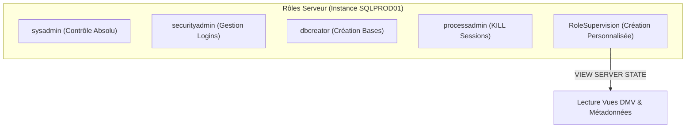
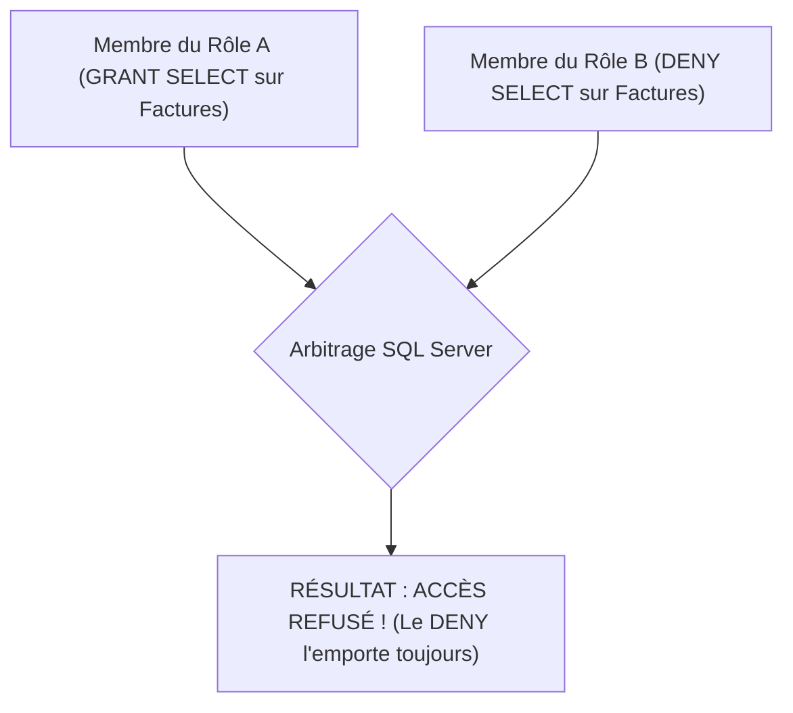

# 1. Fil Conducteur : Sécurisation Opérationnelle de SDS_Ventes (TP 3.1 & Atelier 2)

Au sein de **SENEGAL DISTRIBUTION SA (SDS)**, trois profils collaborent quotidiennement sur la base de données de production **`SDS_Ventes`** :
1. **Aziz (Responsable Comptable)** : Doit pouvoir consulter l'historique des commandes et émettre les factures, mais **ne doit en aucun cas** modifier les prix ni accéder aux données salariales du schéma `RH.Employe`.
2. **Fatou (Chargée Commerciale)** : Doit créer et mettre à jour les fiches clients et enregistrer les commandes, sans accès aux écritures comptables d'annulation ni aux salaires.
3. **Le Compte Applicatif `app_sds`** : Utilisé par le portail web de gestion.
4. **Ousmane Fall (Administrateur Système)** : Doit pouvoir analyser la performance et les verrous (DMVs, sessions) sans être administrateur de base de données ni pouvoir créer ou détruire des bases.

Dans cette leçon, nous allons structurer ces habilitations grâce au mécanisme des **Rôles** et appliquer le **Principe du Moindre Privilège**.

---

# 2. Pourquoi Gérer par Rôles plutôt que par Individus ?

Accorder des droits directement à des utilisateurs individuels (`GRANT SELECT ON ... TO aziz_comptable`) est la cause première de la dérive des habilitations en entreprise :
- Si SDS recrute deux nouveaux assistants comptables, l'administrateur doit réécrire des dizaines de commandes `GRANT` en risquant des omissions.
- Lorsqu'un collaborateur quitte l'entreprise, auditer les droits résiduels disséminés devient impossible.
- **La Règle d'Or d'Architecture** : Les permissions sont accordées à des **Rôles Métier** stables. L'arrivée ou le départ d'un collaborateur se résume alors à une simple commande d'ajout ou de retrait du rôle (`ADD MEMBER` / `DROP MEMBER`).

---

# 3. Les Rôles Serveur Fixes et Personnalisés

Les rôles serveur gèrent les prérogatives d'administration globale de l'instance SQL Server (`SQLPROD01`).

### 3.1 Les Neuf Rôles Serveur Fixes prédéfinis
- **`sysadmin`** : Le superutilisateur absolu (équivalent de `root` sous Linux). Possède tous les droits sur l'instance entière et sur toutes les bases. **Ne doit être réservé qu'aux DBAs seniors**.
- **`securityadmin`** : Peut créer, modifier et supprimer des logins, et réinitialiser leurs mots de passe.
- **`serveradmin`** : Peut modifier la configuration du serveur (`sp_configure`) et arrêter le service SQL Server.
- **`setupadmin`** : Configure les serveurs liés (*Linked Servers*) et les processus de démarrage.
- **`processadmin`** : Autorisé à interrompre les sessions bloquantes (`KILL <session_id>`).
- **`diskadmin`** : Gère les fichiers physiques et les disques.
- **`dbcreator`** : Peut exécuter `CREATE DATABASE`, `ALTER DATABASE` et `RESTORE DATABASE`.
- **`bulkadmin`** : Peut exécuter les instructions d'import massif de données `BULK INSERT`.
- **`public`** : Tout login d'instance en est membre de manière irrévocable (porte les droits de connexion de base).



### 3.2 Création d'un Rôle Serveur Personnalisé : `RoleSupervision` (Atelier 2.1)
Pour Ousmane Fall (administrateur système), nous voulons lui donner accès aux statistiques de performance sans lui accorder de droits destructeurs :

```sql
USE master;
GO

-- 1. Création du rôle serveur personnalisé (Fonctionnalité disponible depuis SQL Server 2012)
IF NOT EXISTS (SELECT * FROM sys.server_principals WHERE name = N'RoleSupervision' AND type = 'R')
BEGIN
    CREATE SERVER ROLE [RoleSupervision];
END;
GO

-- 2. Attribution exclusive des droits de surveillance dynamique
GRANT VIEW SERVER STATE TO [RoleSupervision];
GRANT VIEW ANY DEFINITION TO [RoleSupervision];
GO

-- 3. Affectation du compte système d'Ousmane Fall au rôle
ALTER SERVER ROLE [RoleSupervision] ADD MEMBER [SDS\ousmane.fall];
GO

-- Test de validation sous l'identité d'Ousmane :
-- SELECT * FROM sys.dm_exec_sessions; -> SUCCÈS (Lecture DMV autorisée)
-- CREATE DATABASE Test_Ousmane;       -> ÉCHEC (Refusé : Ousmane n'est pas dbcreator ni sysadmin !)
```

---

# 4. Les Rôles de Base de Données Fixes et Personnalisés

À l'intérieur de la base **`SDS_Ventes`**, les autorisations doivent être compartimentées par domaine.

### 4.1 Pourquoi Éviter Absolument `db_owner` et `db_datareader` ? (Atelier 2.2)
- **`db_owner`** : Donne le contrôle total de la base (modification du schéma, suppression de tables, modification des droits, accès à toutes les données). Accorder `db_owner` à un développeur ou à un utilisateur de gestion viole toutes les normes de conformité financière.
- **`db_datareader`** : Autorise la lecture (`SELECT`) de **toutes les tables et vues utilisateur de la base sans exception**.
  - *Le Cas Réel SDS (Atelier 2.2)* : Si vous ajoutez Aziz le comptable à `db_datareader`, il pourra immédiatement exécuter `SELECT * FROM RH.Employe` et découvrir les salaires et primes de la direction générale !

### 4.2 Création des Rôles Métier : `RoleComptable` et `RoleCommercial` (TP 3.1 & Atelier 2.2)

```sql
USE SDS_Ventes;
GO

-- 1. Création des rôles de base personnalisés
CREATE ROLE [RoleComptable];
CREATE ROLE [RoleCommercial];
GO

-- 2. Attribution des droits stricts au rôle Comptable (Lecture seule sur Commandes)
GRANT SELECT ON dbo.Commande TO [RoleComptable];
GRANT SELECT, INSERT ON SCHEMA::Finance TO [RoleComptable];

-- 3. Attribution des droits stricts au rôle Commercial (Clients et Commandes)
GRANT SELECT, INSERT, UPDATE ON dbo.Client TO [RoleCommercial];
GRANT SELECT, INSERT, UPDATE ON dbo.Commande TO [RoleCommercial];

-- 4. Affectation des utilisateurs dans leurs rôles respectifs
ALTER ROLE [RoleComptable] ADD MEMBER aziz_comptable;
ALTER ROLE [RoleCommercial] ADD MEMBER fatou_commercial;
GO

-- 5. Protection formelle des données confidentielles du personnel
-- Même si un utilisateur recevait par mégarde un droit de lecture élargi, le DENY prime toujours !
DENY SELECT, INSERT, UPDATE, DELETE ON SCHEMA::RH TO [RoleComptable];
DENY SELECT, INSERT, UPDATE, DELETE ON SCHEMA::RH TO [RoleCommercial];
GO
```

---

# 5. La Hiérarchie des Permissions : GRANT, DENY et REVOKE

Toute permission sous SQL Server se trouve dans l'un de ces trois états :
1. **`GRANT`** : Accorde explicitement la permission à un utilisateur ou à un rôle.
2. **`DENY`** : **Interdit explicitement** la permission. **Règle absolue : Le `DENY` est toujours prioritaire sur tout `GRANT`, qu'il soit direct ou hérité via un groupe ou un rôle.**
3. **`REVOKE`** : Supprime l'entrée `GRANT` ou `DENY` existante. L'état de la permission redevient **neutre** (non accordée).



### 5.1 Exemple Illustratif de Priorité
Si Aziz est membre du groupe de base `db_datareader` (qui accorde `GRANT SELECT` sur toute la base), mais qu'il est également membre d'un rôle contenant `DENY SELECT ON RH.Employe`, la tentative d'Aziz de lire `RH.Employe` sera **systématiquement rejetée avec une erreur de permission refusée**.

### 5.2 Délégation avec `WITH GRANT OPTION`
L'option `WITH GRANT OPTION` permet au bénéficiaire d'un droit de transmettre ce droit à d'autres utilisateurs :
```sql
GRANT SELECT ON dbo.Client TO fatou_commercial WITH GRANT OPTION;
```
*Mise en garde* : Si vous révoquez ultérieurement le droit de Fatou avec `CASCADE` (`REVOKE SELECT ON dbo.Client FROM fatou_commercial CASCADE;`), SQL Server révoquera en cascade tous les droits que Fatou avait elle-même accordés à des tiers !

---

# 6. Le Principe du Moindre Privilège Appliqué au Compte Applicatif (TP 3.1)

Le point culminant de notre stratégie de sécurisation réside dans la configuration du compte de service applicatif **`app_sds`** :

```sql
USE SDS_Ventes;
GO

-- L'instruction déterminante de sécurité d'entreprise :
GRANT EXECUTE ON SCHEMA::dbo TO app_sds;
GRANT EXECUTE ON SCHEMA::Finance TO app_sds;
GO
```

### Pourquoi ce Modèle est-il Inviolable ?
Contrairement aux profils humains qui consultent les données via des interfaces de requête, le portail web de SDS n'a **aucun droit direct sur les tables physiques** (aucun `GRANT SELECT`, ni `INSERT`, ni `UPDATE` sur `Client`, `Commande` ou `Facture`).

- Le compte `app_sds` ne dispose que du droit d'exécuter des procédures stockées validées (`GRANT EXECUTE`).
- *Conséquence déterminante* : Même si des pirates découvrent les identifiants de connexion de l'application web ou exploitent une injection SQL dans le code web, **ils ne pourront jamais extraire la table Client ni exécuter un `DROP TABLE`**, car le moteur SQL Server rejettera immédiatement toute commande DDL ou DML arbitraire non encapsulée dans une procédure stockée !

---

# 7. Exercices Pratiques et Auto-Évaluation (Ateliers 2 & 3)

### QCM de Contrôle
1. **Un utilisateur possède un `GRANT SELECT` sur `dbo.Client` via son rôle commercial et un `DENY SELECT` sur la même table via son rôle d'intérimaire. Que se passe-t-il lorsqu'il exécute `SELECT * FROM dbo.Client` ?**
   - A. Il lit les données car le GRANT a été accordé en premier.
   - B. L'accès est refusé car le DENY est toujours prioritaire.
   - C. Il lit les colonnes non chiffrées uniquement.

2. **Quelle est la commande exacte pour supprimer un GRANT ou un DENY existant et remettre la permission à l'état neutre ?**
   - A. `DELETE PERMISSION`
   - B. `DROP GRANT`
   - C. `REVOKE`

3. **Quelle instruction T-SQL permet d'accorder à un utilisateur le droit de créer des bases sans en faire un superadministrateur `sysadmin` ?**
   - A. `ALTER SERVER ROLE dbcreator ADD MEMBER [NomLogin];`
   - B. `GRANT CREATE ANY DATABASE TO [NomLogin];`
   - C. `ALTER ROLE db_owner ADD MEMBER [NomLogin];`
