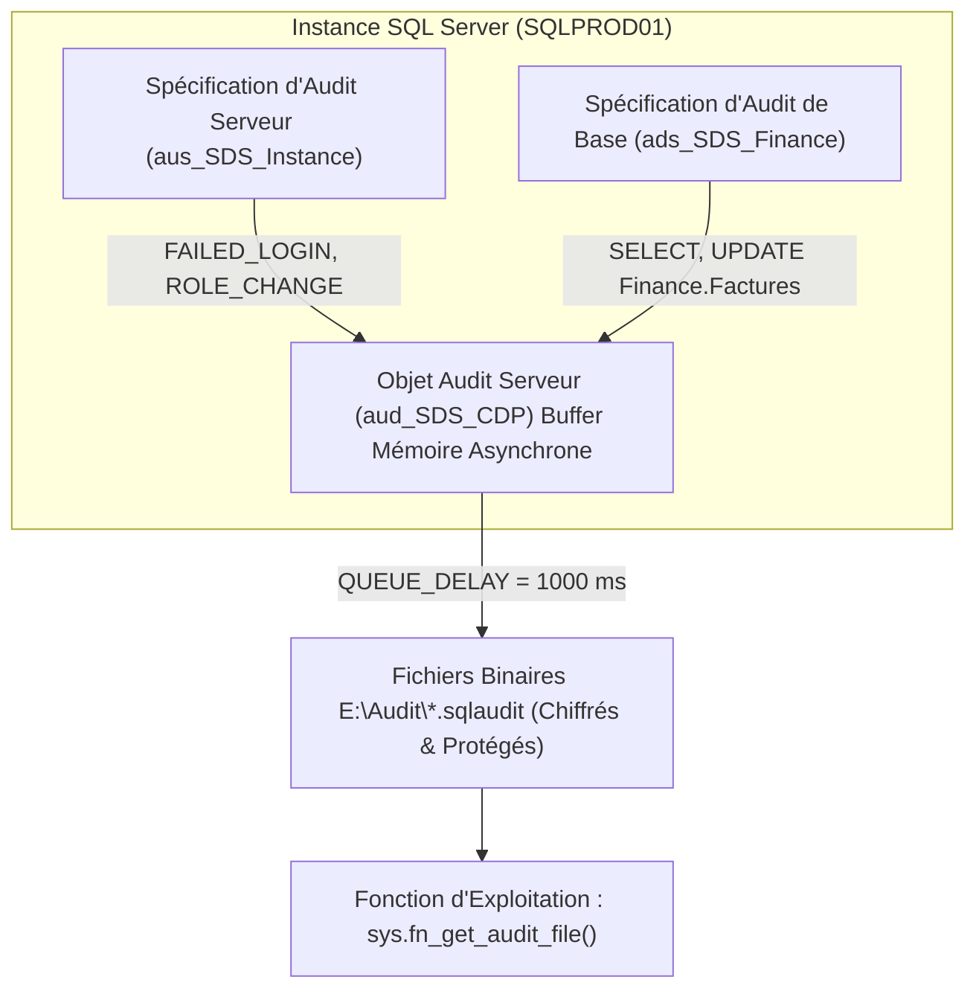

# 1. Fil Conducteur : Le Contrôle Imminent de la CDP du Sénégal

La **Commission de Protection des Données Personnelles (CDP)** du Sénégal a officiellement notifié la direction générale de **SENEGAL DISTRIBUTION SA (SDS)** d'un contrôle de conformité réglementaire programmé dans trois mois.

### Le Cahier des Charges de Conformité Légale
Pour éviter de lourdes sanctions administratives et préserver la réputation de l'entreprise, l'infrastructure de données doit apporter la preuve irréfutable de trois exigences :
1. **Traçabilité des connexions** : Enregistrer de façon infalsifiable tous les échecs d'authentification (tentatives d'intrusion par force brute).
2. **Surveillance des privilèges élevés** : Tracer toute modification apportée aux membres des rôles administrateurs et tout changement de permission (`GRANT`, `REVOKE`).
3. **Surveillance stricte des écritures financières** : Tracer chaque lecture (`SELECT`) et chaque modification (`UPDATE`, `DELETE`) opérée sur le schéma sensible **`Finance`** (contenant les factures et montants de TVA).

En tant que DBA Senior, vous devez concevoir et déployer une solution d'audit sans dégrader les performances de l'instance de production **`SQLPROD01`**.

---

# 2. Architecture de SQL Server Audit

Avant SQL Server 2008, les administrateurs utilisaient SQL Server Profiler ou des déclencheurs DML pour tracer l'activité, ce qui provoquait d'importants ralentissements CPU.

La fonctionnalité moderne **SQL Server Audit** repose sur le moteur des **Extended Events (XEvents)** : elle capture les événements au cœur du noyau SQLOS avec une empreinte processeur quasi-nulle.



L'architecture se décompose en trois composants modulaires :
1. **L'Objet Audit Serveur (`Server Audit`)** : Définit la cible de stockage (fichier binaire `.sqlaudit`, journal des événements Windows Application ou Sécurité), la taille des fichiers, la politique de rotation et la résilience en cas de panne de disque.
2. **La Spécification d'Audit Serveur (`Server Audit Specification`)** : Collecte les événements survenus à l'échelle de l'instance (connexions, modifications de logins, altération des audits).
3. **La Spécification d'Audit de Base de Données (`Database Audit Specification`)** : Collecte les événements survenus au sein d'une base spécifique (accès aux tables, schémas, exécution de procédures stockées).

---

# 3. Implémentation Pas-à-Pas de la Solution d'Audit (Atelier Pratique)

### 3.1 Étape 1 : Créer l'Audit Serveur Asynchrone (A1)
L'audit est configuré pour enregistrer les événements dans le répertoire dédié `E:\Audit\`. L'écriture est asynchrone avec un délai tampon d'une seconde pour ne jamais ralentir les transactions de caisse :

```sql
USE master;
GO

-- Création de l'audit serveur avec rotation automatique sur 10 fichiers de 100 Mo
CREATE SERVER AUDIT [aud_SDS_CDP]
TO FILE 
(
    FILEPATH = N'E:\Audit\',
    MAXSIZE = 100 MB,
    MAX_ROLLOVER_FILES = 10,
    RESERVE_DISK_SPACE = OFF
)
WITH 
(
    QUEUE_DELAY = 1000,             -- Tampon asynchrone de 1 seconde en RAM
    ON_FAILURE = CONTINUE            -- Si le disque est plein, la production ne s'arrête pas
)
WHERE ([server_principal_name] <> 'NT SERVICE\MSSQLSERVER'); -- Exclut le bruit du compte de service
GO

-- Activation obligatoire de l'audit
ALTER SERVER AUDIT [aud_SDS_CDP] WITH (STATE = ON);
GO

-- Contrôle du démarrage dans la vue de gestion dynamique
SELECT name, status_desc 
FROM sys.dm_server_audit_status 
WHERE name = 'aud_SDS_CDP';
GO
```

### 3.2 Étape 2 : Créer la Spécification d'Audit Serveur (A2)
Cette spécification rattachée à `aud_SDS_CDP` capture les tentatives d'intrusion et les élévations de privilèges :

```sql
USE master;
GO

CREATE SERVER AUDIT SPECIFICATION [aus_SDS_Instance]
FOR SERVER AUDIT [aud_SDS_CDP]
    ADD (FAILED_LOGIN_GROUP),                   -- Trace les mots de passe erronés
    ADD (SERVER_ROLE_MEMBER_CHANGE_GROUP),      -- Trace l'ajout d'utilisateurs à sysadmin
    ADD (AUDIT_CHANGE_GROUP)                    -- Trace toute modification ou désactivation de l'audit !
WITH (STATE = ON);
GO
```

### 3.3 Étape 3 : Créer la Spécification d'Audit de Base dans SDS_Ventes (A3)
Pour satisfaire les exigences de la CDP concernant les données financières, nous auditons l'ensemble des opérations DML et DCL sur le schéma `Finance` :

```sql
USE SDS_Ventes;
GO

CREATE DATABASE AUDIT SPECIFICATION [ads_SDS_Finance]
FOR SERVER AUDIT [aud_SDS_CDP]
    -- Trace tous les SELECT, INSERT, UPDATE, DELETE sur le schéma Finance par n'importe quel compte
    ADD (SELECT ON SCHEMA::Finance BY [public]),
    ADD (INSERT ON SCHEMA::Finance BY [public]),
    ADD (UPDATE ON SCHEMA::Finance BY [public]),
    ADD (DELETE ON SCHEMA::Finance BY [public]),
    -- Trace toute modification de permissions dans la base
    ADD (SCHEMA_OBJECT_PERMISSION_CHANGE_GROUP)
WITH (STATE = ON);
GO
```

---

# 4. Simulation d'Activité et Génération d'Événements de Test (A4)

Pour tester la robustesse de notre dispositif avant le passage des inspecteurs de la CDP, nous exécutons une séquence d'opérations représentatives :

```sql
-- 1. Simulation d'une attaque par force brute : 
-- Tentatives de connexion répétées du login stagiaire_sds avec mot de passe faux
-- (Génère des événements LGIF - Login Failed)

-- 2. Consultation légitime des factures par le contrôleur de conformité
-- Connexion sous cdp_controleur
USE SDS_Ventes;
SELECT TOP (10) FactureID, MontantTTC, Statut FROM Finance.Factures;

-- 3. Tentative d'accès non autorisé par un stagiaire
-- Connexion sous stagiaire_sds
SELECT * FROM SDS_Ventes.Finance.Factures;
-- RÉSULTAT : Msg 229, Permission SELECT refusée sur l'objet 'Factures'

-- 4. Altération financière par un administrateur sysadmin
UPDATE SDS_Ventes.Finance.Factures
SET Statut = N'ANNULEE'
WHERE FactureID = 1;

-- 5. Modification de droits suspecte
USE SDS_Ventes;
GRANT SELECT ON Finance.Factures TO stagiaire_sds;
REVOKE SELECT ON Finance.Factures FROM stagiaire_sds;
GO
```

---

# 5. Exploitation Forensique avec `sys.fn_get_audit_file` (A5)

Pour produire le rapport d'expertise exigé lors du contrôle, nous utilisons la fonction système `sys.fn_get_audit_file` qui décode les fichiers binaires `.sqlaudit` en temps réel :

```sql
USE master;
GO

SELECT 
    DATEADD(HOUR, 0, event_time) AS [DateHeure_UTC],
    action_id AS [CodeAction],
    succeeded AS [Succes],
    session_server_principal_name AS [LoginUtilisateur],
    server_instance_name AS [Instance],
    database_name AS [BaseDeDonnees],
    schema_name AS [SchemaConcerne],
    target_object_name AS [ObjetCible],
    statement AS [RequeteExecutee],
    client_ip AS [AdresseIP_Client]
FROM sys.fn_get_audit_file(N'E:\Audit\aud_SDS_CDP_*.sqlaudit', DEFAULT, DEFAULT)
WHERE event_time >= DATEADD(HOUR, -1, SYSDATETIME()) -- Filtre sur la dernière heure
ORDER BY event_time DESC;
GO
```

### Grille d'Analyse des Événements Collectés
- **`action_id = 'LGIF'`** : Tentative d'intrusion (Login Failed) avec mot de passe incorrect.
- **`action_id = 'SL'`** : Requête de lecture `SELECT`.
- **`action_id = 'UP'`** : Requête de modification `UPDATE` (identifie précisément la machine et le login qui a annulé la facture N° 1).
- **`action_id = 'G'` et `'R'`** : Commandes administratives `GRANT` et `REVOKE`.

---

# 6. Question de Réflexion de Sécurité Avancée (A6)

> **Problématique soulevée lors de l'audit de certification :**
> *« Un administrateur malveillant membre de sysadmin peut-il désactiver temporairement l'audit (`STATE = OFF`), modifier frauduleusement une facture financière, puis réactiver l'audit pour masquer son forfait ? »*

### Analyse Technique et Parades
1. **L'opération ne reste PAS invisible** :
   Grâce au groupe d'action **`AUDIT_CHANGE_GROUP`** configuré dans notre spécification d'audit serveur `aus_SDS_Instance`, la commande `ALTER SERVER AUDIT ... WITH (STATE = OFF)` est **immédiatement consignée dans le fichier d'audit avant que le service ne se coupe**. De même, la commande de réactivation est consignée à la reprise. L'horodatage précis du "trou noir" prouve formellement la manipulation frauduleuse.
2. **Mesures de Protection Complémentaires Recommandées** :
   - **Stockage sur Partage WORM / Immuable** : Écrire les fichiers d'audit sur un stockage réseau dédié (`\\NAS01\Audit`) configuré en mode **WORM (*Write Once, Read Many*)**, où le compte de service SQL Server ne possède que les droits de création et d'écriture, mais **aucun droit de modification ni de suppression**.
   - **Séparation des Pouvoirs (*Separation of Duties*)** : Retirer le privilège de gestion d'audit aux DBAs pour le confier exclusivement au Responsable de la Sécurité des Systèmes d'Information (RSSI) via le rôle serveur `securityadmin`.

---

# 7. Exercices d'Auto-Évaluation

1. **Pourquoi l'option `ON_FAILURE = CONTINUE` a-t-elle été privilégiée par rapport à `ON_FAILURE = SHUTDOWN` sur l'instance de production de SDS ?**
2. **Dans quel cas précis choisirait-on la cible `APPLICATION_LOG` de Windows plutôt que la cible fichier binaire `FILE` pour un audit SQL Server ?**
3. **Quelle DMV permet de vérifier en temps réel si un audit est actuellement actif et combien d'enregistrements ont été écrits ?**
