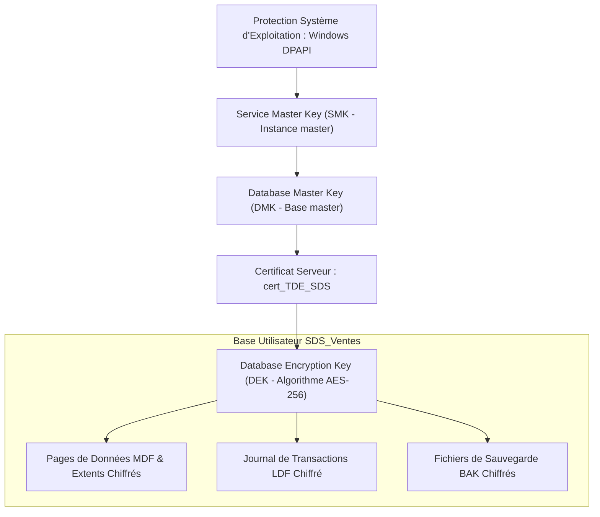

# 1. Fil Conducteur : Le Risque de Vol de Données chez SDS (Atelier Pratique - Partie B)

Dans le cadre des exigences de la **Commission de Protection des Données Personnelles (CDP)**, **SENEGAL DISTRIBUTION SA (SDS)** doit garantir que les données nominatives, bancaires et fiscales de ses clients et partenaires sont rigoureusement inviolables, y compris en cas de vol physique d'un disque dur ou d'un fichier de sauvegarde dérobé par un employé indélicat.

Dans cette leçon, nous allons constater par la pratique la vulnérabilité d'une sauvegarde standard, implémenter le **Chiffrement Transparent des Données (*Transparent Data Encryption - TDE*)**, orchestrer la hiérarchie des clés cryptographiques, et valider la restauration sur le site de secours de **Thiès (`SRV-SQL02\SDSREPORT`)**.

---

# 2. Constater le Risque : L'Extraction en Clair d'une Sauvegarde Non Chiffrée (B1)

Avant d'activer le chiffrement, réalisons une sauvegarde complète standard de `SDS_Ventes` sans compression :

```sql
BACKUP DATABASE [SDS_Ventes]
TO DISK = N'F:\Bak\SDS_avant_TDE.bak'
WITH FORMAT, INIT, NO_COMPRESSION;
GO
```

### Le Test d'Intrusion en PowerShell
Un attaquant qui subtilise le fichier `SDS_avant_TDE.bak` n'a même pas besoin d'une instance SQL Server pour lire son contenu. Puisque SQL Server stocke les colonnes `NVARCHAR` au format Unicode **UTF-16**, une simple commande PowerShell permet de scanner le fichier :

```powershell
# Recherche forensique de données clients dans le fichier binaire de sauvegarde
Select-String -Path "F:\Bak\SDS_avant_TDE.bak" -Pattern "Ndiaye" -Encoding Unicode
```

**Constat alarmant :** Les noms de clients (`Boutique Ndiaye et Fils`), leurs adresses, leurs numéros de téléphone et le montant de leurs factures apparaissent **en clair** dans le flux binaire ! Le risque de fuite de données massives est total.

---

# 3. La Hiérarchie de Chiffrement sous SQL Server

Pour protéger les fichiers de données (`.mdf`, `.ndf`), les journaux (`.ldf`) et toutes les sauvegardes associées (`.bak`, `.trn`), SQL Server propose le mécanisme **TDE** (*Transparent Data Encryption*).

Le chiffrement est dit *transparent* car les applications clientes n'ont pas besoin d'être modifiées : le moteur chiffre les blocs de 8 Ko à la volée avant de les écrire sur le disque, et les déchiffre automatiquement lors de leur chargement dans le cache mémoire (*Buffer Pool*).



### La Chaîne de Confiance Cryptographique
1. **Service Master Key (SMK)** : Générée automatiquement lors de l'installation de SQL Server, protégée par l'API de protection de données de Windows (DPAPI).
2. **Database Master Key (DMK)** : Clé maîtresse créée dans la base système `master`, protégée par un mot de passe complexe d'administration.
3. **Certificat Serveur (`cert_TDE_SDS`)** : Certificat numérique créé dans `master`, protégé par la DMK.
4. **Database Encryption Key (DEK)** : Clé symétrique générée au sein de la base `SDS_Ventes`, chiffrant les données en **AES-256**, protégée par le certificat serveur.

---

# 4. Implémentation Pas-à-Pas de TDE sur SRV-SQL01 (B2 & B3)

### 4.1 Construction de la Hiérarchie de Clés dans `master` (B2)
```sql
USE master;
GO

-- 1. Création de la clé maîtresse dans master
IF NOT EXISTS (SELECT * FROM sys.symmetric_keys WHERE name = '##MS_DatabaseMasterKey##')
BEGIN
    CREATE MASTER KEY ENCRYPTION BY PASSWORD = N'DMK#MasterP@ssw0rd2026!SDS';
END;
GO

-- 2. Création du certificat de chiffrement valable jusqu'en 2030
CREATE CERTIFICATE [cert_TDE_SDS]
WITH SUBJECT = N'Certificat de chiffrement TDE pour SENEGAL DISTRIBUTION SA',
     EXPIRY_DATE = '2030-12-31';
GO

-- 3. SAUVEGARDE VITALE IMMÉDIATE DU CERTIFICAT ET DE SA CLÉ PRIVÉE
-- Cette étape DOIT PRÉCÉDER l'activation de TDE !
BACKUP CERTIFICATE [cert_TDE_SDS]
TO FILE = N'\\NAS01\Cles\cert_TDE_SDS.cer'
WITH PRIVATE KEY 
(
    FILE = N'\\NAS01\Cles\cert_TDE_SDS_PrivateKey.pvk',
    ENCRYPTION BY PASSWORD = N'Pvk#SecretCertKey2026!Thiès'
);
GO
```

> [!CAUTION]
> **Pourquoi la sauvegarde du certificat doit-elle OBLIGATOIREMENT précéder l'activation de TDE ?**
> Dès que TDE est activé sur `SDS_Ventes`, la base ne peut être ouverte, attachée ou restaurée **qu'en présence formelle de ce certificat précis**.
> Si le serveur physique venait à subir une panne de carte mère ou si la base `master` était corrompue sans que le certificat n'ait été préalablement exporté sur le NAS, **la base de données de production et l'ensemble de ses sauvegardes seraient irrémédiablement perdues, sans aucun moyen mathématique de récupération !**

### 4.2 Activation de TDE dans `SDS_Ventes` (B3)
```sql
USE SDS_Ventes;
GO

-- Création de la DEK en AES 256 protégée par le certificat de master
CREATE DATABASE ENCRYPTION KEY
WITH ALGORITHM = AES_256
ENCRYPTION BY SERVER CERTIFICATE [cert_TDE_SDS];
GO

-- Déclenchement de l'analyse et du chiffrement en tâche de fond
ALTER DATABASE SDS_Ventes SET ENCRYPTION ON;
GO
```

### 4.3 Suivi de l'État de Chiffrement et l'Impact sur `TempDB`
SQL Server initialise un thread d'arrière-plan pour chiffrer l'ensemble des pages existantes sur disque :

```sql
SELECT 
    db.name AS [BaseDeDonnees],
    dek.encryption_state,
    CASE dek.encryption_state
        WHEN 0 THEN N'Pas de clé'
        WHEN 1 THEN N'Non chiffré'
        WHEN 2 THEN N'Chiffrement en cours...'
        WHEN 3 THEN N'CHIFFRÉ (Actif)'
        WHEN 4 THEN N'Déchiffrement en cours...'
    END AS [StatutChiffrement],
    dek.key_algorithm AS [Algorithme],
    dek.key_length AS [TailleCle],
    dek.percent_complete AS [ProgressionPourcentage]
FROM sys.dm_database_encryption_keys dek
JOIN sys.databases db ON dek.database_id = db.database_id;
GO
```

> ⚠️ **[Phénomène collatéral majeur : TempDB est automatiquement chiffrée !]**
> Dans la requête précédente, vous constaterez que **`tempdb`** est automatiquement passée à l'état `encryption_state = 3`.
> *Pourquoi ?* Pour garantir une étanchéité absolue de sécurité. Lorsqu'une requête transactionnelle sur `SDS_Ventes` exécute un tri volumineux ou instancie une table temporaire `#Factures`, les pages de données résident temporairement dans `tempdb`. Si `tempdb` n'était pas chiffrée, un pirate pourrait lire les données confidentielles dans les fichiers de TempDB sur le disque `T:`.

---

# 5. Validation de l'Efficacité et Simulation de Vol (B4 & B5)

Exécutons une nouvelle sauvegarde complète vers le partage réseau :

```sql
BACKUP DATABASE [SDS_Ventes]
TO DISK = N'\\NAS01\SQLBackup\SDS_apres_TDE.bak'
WITH FORMAT, INIT, NO_COMPRESSION;
GO
```

Si nous relançons la commande PowerShell forensique :
```powershell
Select-String -Path "\\NAS01\SQLBackup\SDS_apres_TDE.bak" -Pattern "Ndiaye" -Encoding Unicode
```
**Résultat : Aucune occurrence trouvée !** L'ensemble du fichier binaire est un flux chiffré indéchiffrable en AES-256.

### Simulation de Vol sur le Serveur de Secours de Thiès (B5)
Sur l'instance secondaire de secours `SRV-SQL02\SDSREPORT`, un administrateur tente de restaurer ce fichier sans posséder le certificat :

```sql
RESTORE DATABASE [SDS_Ventes_Secours]
FROM DISK = N'\\NAS01\SQLBackup\SDS_apres_TDE.bak'
WITH MOVE N'SDS_Ventes' TO N'D:\Data\SDS_Ventes_Secours.mdf',
     MOVE N'SDS_Ventes_log' TO N'L:\Log\SDS_Ventes_Secours.ldf';
GO
```

**Blocage immédiat du moteur :**
> `Msg 33111, Level 16, State 3 : Cannot find server certificate with thumbprint '0x89B72F4...'.`
> `Msg 3013, Level 16, State 1 : RESTORE DATABASE is terminating abnormally.`
La tentative de vol échoue.

---

# 6. Rétablissement du Plan de Reprise d'Activité à Thiès (B6)

Pour que notre site de secours de **Thiès (`SRV-SQL02\SDSREPORT`)** puisse prendre le relais en cas de sinistre majeur sur Dakar, nous y déployons le certificat sauvegardé :

```sql
-- Exécution sur le serveur secondaire SRV-SQL02 (Thiès)
USE master;
GO

-- 1. Créer la clé maîtresse locale
IF NOT EXISTS (SELECT * FROM sys.symmetric_keys WHERE name = '##MS_DatabaseMasterKey##')
BEGIN
    CREATE MASTER KEY ENCRYPTION BY PASSWORD = N'DMK#MasterP@ssw0rd2026!Thiès';
END;
GO

-- 2. Recréer le certificat officiel à partir des fichiers du NAS
CREATE CERTIFICATE [cert_TDE_SDS]
FROM FILE = N'\\NAS01\Cles\cert_TDE_SDS.cer'
WITH PRIVATE KEY 
(
    FILE = N'\\NAS01\Cles\cert_TDE_SDS_PrivateKey.pvk',
    DECRYPTION BY PASSWORD = N'Pvk#SecretCertKey2026!Thiès'
);
GO

-- 3. La restauration réussit désormais parfaitement !
RESTORE DATABASE [SDS_Ventes_Secours]
FROM DISK = N'\\NAS01\SQLBackup\SDS_apres_TDE.bak'
WITH MOVE N'SDS_Ventes' TO N'D:\Data\SDS_Ventes_Secours.mdf',
     MOVE N'SDS_Ventes_log' TO N'L:\Log\SDS_Ventes_Secours.ldf',
     REPLACE;
GO

-- Contrôle : Les 50 000 factures sont immédiatement accessibles
SELECT COUNT(*) FROM SDS_Ventes_Secours.Finance.Factures;
GO
```

---

# 7. Chiffrement Autonome des Sauvegardes sans TDE (B7)

Pour certaines bases auxiliaires non critiques qui n'utilisent pas TDE (ex: `SDS_Reporting`), mais dont les fichiers de sauvegarde doivent voyager hors site sur un cloud public ou un support amovible, SQL Server permet de **chiffrer la sauvegarde au moment de son écriture** :

```sql
USE master;
GO

CREATE CERTIFICATE [cert_Backup_SDS]
WITH SUBJECT = N'Certificat dédié aux sauvegardes chiffrées hors-site';
GO

-- Sauvegarde chiffrée nativement en AES-256 avec compression
BACKUP DATABASE [SDS_Reporting]
TO DISK = N'\\NAS01\SQLBackup\SDS_Reporting_Encrypted.bak'
WITH FORMAT, 
     INIT, 
     COMPRESSION,
     ENCRYPTION 
     (
         ALGORITHM = AES_256, 
         SERVER CERTIFICATE = [cert_Backup_SDS]
     );
GO
```

Dans `msdb.dbo.backupset`, les colonnes `is_encrypted = 1` et `key_algorithm = 'AES_256'` attestent du chiffrement.

---

# 8. Réflexion d'Architecture : TDE vs Always Encrypted (B8)

> **Exigence exprimée par la Direction Financière de SDS :**
> *« Nous exigeons que même les administrateurs DBA membres de sysadmin ne puissent jamais visualiser les numéros d'identification fiscale (NINEA) ni les coordonnées bancaires des clients VIP. TDE répond-il à ce besoin ? »*

### Réponse d'Architecture et Justification
**Non, TDE ne répond absolument pas à cette exigence.**
- TDE protège les données **au repos** (*Data at Rest*) contre le vol physique de fichiers sur le disque.
- En revanche, pour tout utilisateur ou DBA connecté à l'instance avec des privilèges de lecture, le déchiffrement est transparent : un membre de `sysadmin` qui tape `SELECT * FROM Finance.Factures` voit toutes les valeurs en clair.

### La Solution : Always Encrypted
Pour protéger les données contre le DBA lui-même, il faut implémenter **Always Encrypted** (*Data in Use*) :
- La colonne sensible est chiffrée directement par le pilote applicatif sur le poste client avant d'être envoyée sur le réseau.
- La clé de déchiffrement (*Column Master Key - CMK*) réside exclusivement dans le magasin de certificats local du poste client ou dans un coffre-fort cloud (Azure Key Vault).
- Dans la base SQL Server, le DBA ne voit qu'une suite incompréhensible d'octets hexadécimaux binaires, sans aucune capacité technique de déchiffrement.

---

# 9. Exercices d'Auto-Évaluation

1. **Quelles sont les quatre étapes obligatoires de la hiérarchie de clés pour activer TDE ?**
2. **Pourquoi l'Instant File Initialization (IFI) reste-t-elle compatible avec les bases utilisant TDE ?**
3. **Que se produit-il lors d'une tentative de restauration d'une sauvegarde TDE sur un serveur tiers si le mot de passe de la clé privée du certificat est erroné ?**
