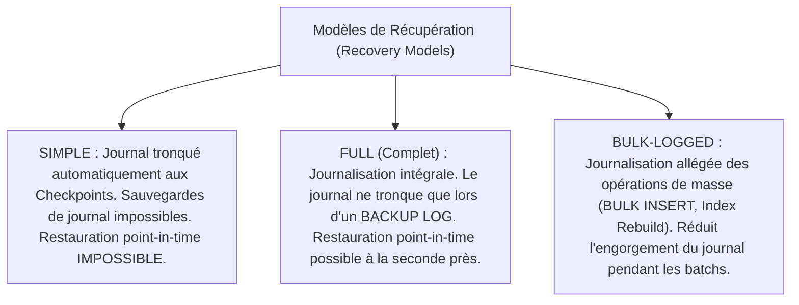

# 1. Fil Conducteur : Les Engagements de Service de SDS (Atelier Pratique - Partie D)

Dans le contrat d'exploitation liant la DSI de **SENEGAL DISTRIBUTION SA (SDS)** aux directions métiers et à la **Commission de Protection des Données Personnelles (CDP)**, deux objectifs de résilience stricts ont été gravés dans le marbre :

```
+------------------------------------------------------------------------+
| 1. RPO (Recovery Point Objective - Perte Maximale Tolérée)             |
|    Valeur cible : 15 MINUTES                                           |
|    En cas de destruction du serveur, l'entreprise ne doit pas perdre    |
|    plus de 15 minutes de transactions commerciales et financières.     |
+------------------------------------------------------------------------+
| 2. RTO (Recovery Time Objective - Temps Maximal de Rétablissement)     |
|    Valeur cible : 1 HEURE                                              |
|    Entre l'instant de la panne et la remise en ligne effective de la   |
|    base SDS_Ventes accessible aux utilisateurs, il doit s'écouler      |
|    moins de 60 minutes chrono.                                         |
+------------------------------------------------------------------------+
```

Dans cette leçon, nous allons maîtriser les **Recovery Models**, modéliser mathématiquement notre stratégie face aux contraintes de volumétrie et de débit, et développer la procédure stockée de sauvegarde automatisée d'entreprise **`dbo.usp_SauvegardeSDS`**.

---

# 2. Les Modèles de Récupération (*Recovery Models*)

Le modèle de récupération est une propriété de la base de données qui conditionne la façon dont SQL Server gère le journal de transactions (`.ldf`) et détermine la granularité de restauration possible :



### 2.1 Le Modèle SIMPLE
- Les transactions terminées sont purgées de façon autonome à chaque **Checkpoint**.
- *Interdiction stricte* : Tenter d'exécuter `BACKUP LOG SDS_Ventes` en mode SIMPLE déclenche immédiatement l'erreur :
  > `Msg 4214, Level 16, State 1 : BACKUP LOG cannot be performed because there is no current database backup.`
- *Usage* : Recommandé exclusivement pour les environnements de développement, de test ou les bases de staging BI reconstituables par ré-import nocturne. Inenvisageable pour la production de SDS.

### 2.2 Le Modèle COMPLET (*FULL Recovery Model*)
- Toute modification est consignée sans exception dans le journal.
- Le journal conserve l'historique jusqu'à ce qu'une sauvegarde explicite du journal (`BACKUP LOG`) soit achevée.
- **Obligatoire pour SDS** afin de respecter le RPO de 15 minutes.

### 2.3 Le Piège Crucial du « Pseudo-Simple » (Atelier Pratique - C3)
> [!WARNING]
> **Le piège classique du DBA débutant :**
> Vous venez d'exécuter `ALTER DATABASE SDS_Ventes SET RECOVERY FULL;`.
> Si vous insérez 50 000 factures sans avoir préalablement exécuté une première **Sauvegarde Complète (Full Backup)**, la base se comporte en réalité **comme si elle était toujours en mode SIMPLE** !
> SQL Server continue de tronquer le journal à chaque checkpoint. La chaîne de journalisation n'est véritablement initialisée qu'à l'instant exact où la première sauvegarde complète `BACKUP DATABASE` se termine avec succès.

---

# 3. Données de Production et Modélisation Mathématique (D1, D2, D3)

Les mesures réelles de l'infrastructure de production de `SDS_Ventes` sont les suivantes :

| Métrique de Production | Valeur Mesurée |
| :--- | :--- |
| **Volumétrie des données** | **180 Go** |
| **Taux de compression natif des sauvegardes** | **35 %** (La sauvegarde compressée pèse 35% de la taille d'origine) |
| **Débit d'écriture vers le stockage réseau `\\NAS01`** | **300 Mo/s** |
| **Débit de lecture depuis le stockage réseau `\\NAS01`** | **250 Mo/s** |
| **Données modifiées par jour d'activité** | **6 Go par jour** (s'accumulent dans la différentielle) |
| **Volume de journal produit aux heures de pointe** | **1,2 Go par heure** |
| **Durée de rétention réglementaire exigée par la CDP** | **35 jours** |

### 3.1 Élaboration du Planning Hebdomadaire (D1)
Pour garantir que nous ne perdrons jamais plus de 15 minutes de facturation (RPO) :
1. **Sauvegarde Complète (FULL)** : Chaque **dimanche à 01h00 du matin** (période de fermeture des entrepôts).
2. **Sauvegarde Différentielle (DIFF)** : Chaque nuit du **lundi au samedi à 02h00 du matin** (capture les modifications depuis dimanche).
3. **Sauvegardes du Journal de Transactions (LOG)** : **Toutes les 15 minutes**, 7 jours sur 7, de 06h00 à 22h00 (heures d'activité commerciale).
- *Démonstration du respect du RPO* : En cas de crash foudroyant à n'importe quel moment de la journée, le dernier backup de journal date au maximum de 15 minutes. Si le disque du journal survit, le Tail-Log ramènera même la perte à **0 seconde** !

### 3.2 Vérification Mathématique du RTO par le Calcul (D2)
Le pire scénario de panne survient le **samedi à 20h55**, juste avant la différentielle de la nuit :
- La sauvegarde complète de dimanche pèse : $180\text{ Go} \times 0.35 = 63\text{ Go}$.
- La sauvegarde différentielle de samedi a accumulé 6 jours de modifications : $6 \times 6\text{ Go} = 36\text{ Go}$. Compressée, elle pèse : $36\text{ Go} \times 0.35 = 12,6\text{ Go}$.
- Il reste à rejouer les sauvegardes de journaux de la journée du samedi (de 02h00 à 20h45) plus le Tail-Log : environ $22\text{ Go}$ de logs bruts, compressés à environ $4\text{ Go}$.

**Calcul du temps de restauration depuis le NAS (Débit : 250 Mo/s) :**
- Restauration de la Complète : $\frac{63 \times 1024\text{ Mo}}{250\text{ Mo/s}} \approx 258\text{ secondes}$ (4 min 18 s).
- Restauration de la Différentielle : $\frac{12,6 \times 1024\text{ Mo}}{250\text{ Mo/s}} \approx 52\text{ secondes}$.
- Restauration de la chaîne de logs : $\frac{4 \times 1024\text{ Mo}}{250\text{ Mo/s}} \approx 16\text{ secondes}$.
- Phase finale de *Recovery* (Rollforward/Rollback du moteur) : environ $180\text{ secondes}$.
- **Temps total estimé de rétablissement : 506 secondes, soit environ 8 minutes et 26 secondes.**
- **Conclusion formelle : Le RTO d'une heure (60 minutes) est très largement respecté et tenu avec une marge de sécurité de plus de 80% !**

### 3.3 Dimensionnement du Stockage sur le Partage `\\NAS01` (D3)
Pour garantir 35 jours de rétention (5 semaines) :
- 5 Sauvegardes Complètes : $5 \times 63\text{ Go} = 315\text{ Go}$.
- 30 Sauvegardes Différentielles (taille moyenne 7 Go) : $30 \times 7\text{ Go} = 210\text{ Go}$.
- Fichiers journaux sur 35 jours : $35 \times 16\text{ h/j} \times 4\text{ logs/h} \times 75\text{ Mo} \approx 168\text{ Go}$.
- **Espace de stockage net requis : environ 700 Go.** En prévoyant une marge de sécurité d'entreprise de 30%, allouer un volume de **1 To** sur le NAS est la recommandation optimale.

---

# 4. Procédure Automatisée d'Entreprise : `dbo.usp_SauvegardeSDS` (D4)

Pour éviter les erreurs manuelles et standardiser les options de conformité (compression, détection de corruption par checksum et chiffrement AES-256), nous écrivons la procédure industrielle dans la base `master` :

```sql
USE master;
GO

CREATE OR ALTER PROCEDURE dbo.usp_SauvegardeSDS
    @Type VARCHAR(4) -- 'FULL', 'DIFF' ou 'LOG'
AS
BEGIN
    SET NOCOUNT ON;

    -- Validation du type de sauvegarde
    IF @Type NOT IN ('FULL', 'DIFF', 'LOG')
    BEGIN
        RAISERROR(N'Erreur critique : Type de sauvegarde inconnu ''%s''. Valeurs valides : FULL, DIFF, LOG.', 16, 1, @Type);
        RETURN -1;
    END;

    DECLARE @Horodatage VARCHAR(20) = REPLACE(REPLACE(REPLACE(CONVERT(VARCHAR(19), SYSDATETIME(), 120), '-', ''), ' ', '_'), ':', '');
    DECLARE @NomFichier NVARCHAR(512);
    DECLARE @CheminPartage NVARCHAR(256) = N'\\NAS01\SQLBackup\';
    DECLARE @RequeteTSQL NVARCHAR(MAX);

    IF @Type = 'FULL'
    BEGIN
        SET @NomFichier = @CheminPartage + N'SDS_Ventes_FULL_' + @Horodatage + N'.bak';
        SET @RequeteTSQL = N'BACKUP DATABASE [SDS_Ventes] TO DISK = @Fichier ' +
                           N'WITH FORMAT, INIT, COMPRESSION, CHECKSUM, STATS = 10, ' +
                           N'ENCRYPTION (ALGORITHM = AES_256, SERVER CERTIFICATE = [cert_Backup_SDS]);';
    END
    ELSE IF @Type = 'DIFF'
    BEGIN
        SET @NomFichier = @CheminPartage + N'SDS_Ventes_DIFF_' + @Horodatage + N'.bak';
        SET @RequeteTSQL = N'BACKUP DATABASE [SDS_Ventes] TO DISK = @Fichier ' +
                           N'WITH DIFFERENTIAL, INIT, COMPRESSION, CHECKSUM, STATS = 10, ' +
                           N'ENCRYPTION (ALGORITHM = AES_256, SERVER CERTIFICATE = [cert_Backup_SDS]);';
    END
    ELSE IF @Type = 'LOG'
    BEGIN
        SET @NomFichier = @CheminPartage + N'SDS_Ventes_LOG_' + @Horodatage + N'.trn';
        SET @RequeteTSQL = N'BACKUP LOG [SDS_Ventes] TO DISK = @Fichier ' +
                           N'WITH INIT, COMPRESSION, CHECKSUM, ' +
                           N'ENCRYPTION (ALGORITHM = AES_256, SERVER CERTIFICATE = [cert_Backup_SDS]);';
    END;

    -- Exécution dynamique sécurisée
    EXEC sp_executesql @RequeteTSQL, N'@Fichier NVARCHAR(512)', @Fichier = @NomFichier;
    PRINT CONCAT(N'Sauvegarde [', @Type, N'] exécutée avec succès dans : ', @NomFichier);
END;
GO
```

---

# 5. Exercices Pratiques et Auto-Évaluation

1. **Pourquoi l'option `CHECKSUM` est-elle indispensable lors de chaque instruction de sauvegarde ?**
2. **Quelle est la différence fondamentale entre une sauvegarde différentielle et une sauvegarde du journal de transactions en termes de point de départ ?**
3. **Si une base de données de 500 Go n'a subi aucune modification depuis la dernière sauvegarde complète du dimanche, quelle sera la taille de la sauvegarde différentielle du lundi ?**
