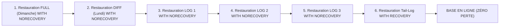

# 1. Fil Conducteur : Crash du Disque de Données de SDS (Atelier Pratique - D5)

Un mardi après-midi à 16h42, le volume de stockage `D:\` du serveur central de **SENEGAL DISTRIBUTION SA (SDS)** subit une défaillance matérielle subite : les têtes de lecture se bloquent, rendant le fichier de données principal **`SDS_Ventes.mdf`** totalement inaccessible.

L'instance SQL Server passe immédiatement la base `SDS_Ventes` dans l'état critique **`RECOVERY PENDING`** (Récupération en attente). Les 50 utilisateurs de caisse et les agences régionales sont déconnectés.

Au moment précis du crash, **25 nouvelles commandes de gros clients venaient d'être enregistrées en caisse**. Ces 25 transactions n'ont pas encore fait l'objet de la sauvegarde de journal du quart d'heure planifiée !

Votre mission de DBA est d'exécuter la procédure de reprise sur incident (*Disaster Recovery*) pour rétablir la base de données sans perdre la moindre commande, en respectant le RTO d'une heure.

---

# 2. Simulation Contrôlée du Sinistre Matériel (D5)

Pour entraîner les administrateurs à réagir sous pression sans paniquer, l'atelier reproduit fidèlement la cinématique d'une journée de production suivie d'une rupture physique :

```sql
-- 1. Exécution de la sauvegarde complète dominicale
EXEC dbo.usp_SauvegardeSDS @Type = 'FULL';

-- 2. Activité du lundi : 100 commandes insérées, suivies de la différentielle
-- [Insertion de 100 commandes...]
EXEC dbo.usp_SauvegardeSDS @Type = 'DIFF';

-- 3. Activité du mardi : 3 cycles de 50 commandes avec sauvegardes de log
-- [Cycle 1 : 50 commandes] -> EXEC dbo.usp_SauvegardeSDS @Type = 'LOG';
-- [Cycle 2 : 50 commandes] -> EXEC dbo.usp_SauvegardeSDS @Type = 'LOG';
-- [Cycle 3 : 50 commandes] -> EXEC dbo.usp_SauvegardeSDS @Type = 'LOG';

-- 4. Les 25 commandes fatidiques insérées juste avant la panne
;WITH n AS (SELECT TOP (25) ROW_NUMBER() OVER (ORDER BY (SELECT NULL)) AS i 
            FROM sys.all_objects a CROSS JOIN sys.all_objects b)
INSERT INTO Ventes.Commandes (ClientID, DateCommande, MontantTotalFCFA, Statut)
SELECT 1 + i % 5, SYSDATETIME(), 75000 + (i * 1200), N'ENREGISTREE'
FROM n;
GO
```

### Le Déclenchement de la Panne
L'administrateur arrête le service SQL Server, renomme le fichier physique `D:\Data\SDS_Ventes.mdf` en `SDS_Ventes.mdf.panne` (pour simuler la perte irréversible du disque de données), puis redémarre le service.
- Dans SSMS, la base apparaît grisée avec la mention **`En attente de récupération (Recovery Pending)`**.

---

# 3. L'Étape Cardinal : La Sauvegarde de Queue de Journal (*Tail-Log Backup*)

Face à un tel sinistre, l'erreur fatale commise par les administrateurs non certifiés consiste à se précipiter pour restaurer immédiatement la dernière sauvegarde complète.
- *Conséquence désastreuse* : En écrasant la base, ils détruisent le journal actif et **perdent définitivement les 25 dernières commandes** !

Puisque le contrôleur du disque `L:\` (journal `.ldf`) est sain, les 25 commandes y sont intactes grâce au mécanisme Write-Ahead Logging. Il faut impérativement réaliser une **Sauvegarde de Fin de Journal (*Tail-Log Backup*)** avec l'option critique **`WITH NORECOVERY`** :

```sql
USE master;
GO

-- Sauvegarde d'urgence de la queue active du journal
BACKUP LOG [SDS_Ventes]
TO DISK = N'\\NAS01\SQLBackup\SDS_Ventes_TailLog.trn'
WITH FORMAT, 
     INIT, 
     COMPRESSION, 
     CHECKSUM, 
     NORECOVERY; -- Fige la base en état RESTORING et empêche toute nouvelle écriture
GO
```

> 📘 **[Complément d'architecture & Bonnes pratiques]**
> Si le fichier de données `.mdf` est totalement détruit et que SQL Server refuse la sauvegarde standard du journal, utilisez l'option de force :
> `BACKUP LOG SDS_Ventes TO DISK = '...' WITH NORECOVERY, CONTINUE_AFTER_ERROR;`

---

# 4. Séquence de Restauration Ordonnée et Chronométrée (D6)

La restauration d'une chaîne complète obéit à un protocole mathématique strict : chaque étape intermédiaire doit être exécutée avec l'option **`WITH NORECOVERY`** afin que la base reste en attente des fichiers suivants. Seul le dernier fichier est restauré avec **`WITH RECOVERY`** pour rouvrir la base aux utilisateurs.



### Le Script de Reprise après Sinistre
```sql
USE master;
GO

-- Étape 1 : Restauration de la sauvegarde complète dominicale sur un nouveau volume sain
RESTORE DATABASE [SDS_Ventes]
FROM DISK = N'\\NAS01\SQLBackup\SDS_Ventes_FULL.bak'
WITH MOVE N'SDS_Ventes_Data' TO N'D:\Data\SDS_Ventes.mdf',
     MOVE N'SDS_Ventes_Archive' TO N'E:\Data\SDS_Ventes_Archive.ndf',
     MOVE N'SDS_Ventes_Log' TO N'L:\Log\SDS_Ventes.ldf',
     NORECOVERY, 
     REPLACE;
GO

-- Étape 2 : Restauration de la sauvegarde différentielle du lundi
RESTORE DATABASE [SDS_Ventes]
FROM DISK = N'\\NAS01\SQLBackup\SDS_Ventes_DIFF.bak'
WITH NORECOVERY;
GO

-- Étape 3 : Restauration ordonnée des trois sauvegardes de log successives du mardi
RESTORE LOG [SDS_Ventes]
FROM DISK = N'\\NAS01\SQLBackup\SDS_Ventes_LOG_Cycle1.trn'
WITH NORECOVERY;
GO

RESTORE LOG [SDS_Ventes]
FROM DISK = N'\\NAS01\SQLBackup\SDS_Ventes_LOG_Cycle2.trn'
WITH NORECOVERY;
GO

RESTORE LOG [SDS_Ventes]
FROM DISK = N'\\NAS01\SQLBackup\SDS_Ventes_LOG_Cycle3.trn'
WITH NORECOVERY;
GO

-- Étape 4 : Restauration du Tail-Log et remise en ligne de la production
RESTORE LOG [SDS_Ventes]
FROM DISK = N'\\NAS01\SQLBackup\SDS_Ventes_TailLog.trn'
WITH RECOVERY; -- Clôture la phase de Rollforward et remet la base en état ONLINE !
GO
```

### Vérification du Succès et Zéro Perte
```sql
USE SDS_Ventes;
GO

-- Contrôle du nombre de commandes
SELECT COUNT(*) AS [NombreTotalCommandesApresSinistre] 
FROM Ventes.Commandes;
GO
```
**Résultat :** Le nombre de commandes après incident est rigoureusement identique au nombre de commandes avant le crash. **Les 25 commandes sont intégralement récupérées. Le RPO effectif est de 0 seconde.**

---

# 5. Restauration Ciblée à la Seconde Près (*Point-in-Time Recovery*)

Supposons qu'un incident humain survienne : un stagiaire exécute à **14h25m12s** la requête non filtrée :
`DELETE FROM Finance.Factures;` (sans clause `WHERE`).

Grâce à notre chaîne de journalisation, nous pouvons remonter le temps et arrêter la restauration exactement à **14h25m11s**, une fraction de seconde avant la faute :

```sql
RESTORE LOG [SDS_Ventes]
FROM DISK = N'\\NAS01\SQLBackup\SDS_Ventes_TailLog.trn'
WITH STOPAT = '2026-11-02 14:25:11', -- Ciblage précis à la seconde
     RECOVERY;
GO
```

---

# 6. Audit de la Continuité de la Chaîne des LSN (D7)

Chaque enregistrement du journal possède un identifiant séquentiel unique monotone croissant : le **LSN (*Log Sequence Number*)**.
Pour qu'une restauration réussisse, **la chaîne des LSN ne doit présenter aucune rupture**.

Exécutons cette requête sur la base système `msdb` pour auditer l'enchaînement de notre chaîne :

```sql
SELECT 
    backup_set_id,
    database_name,
    type AS [TypeBackup],
    CASE type
        WHEN 'D' THEN 'Complete (Full)'
        WHEN 'I' THEN 'Differentielle'
        WHEN 'L' THEN 'Journal (Log)'
    END AS [LibelleType],
    first_lsn AS [Premier_LSN],
    last_lsn AS [Dernier_LSN],
    checkpoint_lsn AS [Checkpoint_LSN],
    database_backup_lsn AS [Base_LSN_Attache],
    backup_start_date,
    backup_finish_date
FROM msdb.dbo.backupset
WHERE database_name = 'SDS_Ventes'
ORDER BY backup_set_id ASC;
GO
```

```
+--------------------------------------------------------------------------------------------------------+
| Analyse de la Chaîne des LSN dans backupset                                                            |
| SetID  Type   Premier_LSN               Dernier_LSN               database_backup_lsn                  |
| 101    D      00000024:00000150:0001    00000024:00000190:0001    00000000:00000000:0000               |
| 102    I      00000024:00000200:0001    00000024:00000240:0001    00000024:00000150:0001  <-- Pointeur  |
| 103    L      00000024:00000190:0001    00000024:00000300:0001    00000024:00000150:0001  <-- Continu  |
| 104    L      00000024:00000300:0001    00000024:00000450:0001    00000024:00000150:0001  <-- Continu  |
+--------------------------------------------------------------------------------------------------------+
```

### La Règle Mathématique d'Intégrité
Remarquez que le **`Premier_LSN`** du fichier de log N° 104 est rigoureusement égal au **`Dernier_LSN`** du fichier de log N° 103. S'il manque ne serait-ce qu'un seul fichier de log dans la séquence, la chaîne est rompue et SQL Server refusera formellement d'appliquer les logs ultérieurs.

---

# 7. Exercices d'Auto-Évaluation

1. **Pourquoi l'option `WITH NORECOVERY` est-elle obligatoire sur toutes les restaurations intermédiaires ? Que se passerait-il si vous oubliiez cette option lors de la première étape ?**
2. **Quelle commande T-SQL permet de remettre une base en ligne si vous avez terminé d'appliquer tous les logs avec `NORECOVERY` et qu'aucun fichier supplémentaire n'est requis ?**
   *(Indice : `RESTORE DATABASE ... WITH RECOVERY`).*
3. **Qu'est-ce qu'une restauration partielle (*Piecemeal Restore*) et dans quel contexte d'entreprise l'utilise-t-on ?**
