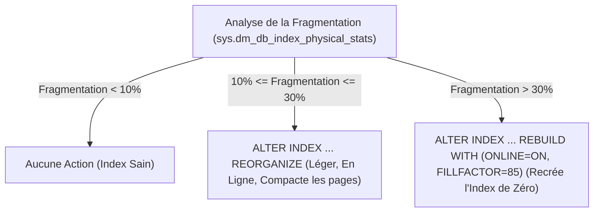

# 1. Fil Conducteur : Plan de Maintenance Préventif de SDS_Ventes

Un serveur de bases de données livré à lui-même sans maintenance proactive se dégrade inexorablement :
- Les insertions et suppressions continues fragmentent les index et provoquent des éclatements de pages (*Page Splits*), multipliant les lectures disque par trois ;
- Les statistiques de distribution deviennent obsolètes, trompant l'optimiseur de requêtes qui choisit de mauvais plans d'exécution ;
- La corruption physique silencieuse de blocs de stockage peut s'étendre en arrière-plan sans déclencher d'alerte immédiate jusqu'au jour où une table critique devient illisible.

Au siège de **SENEGAL DISTRIBUTION SA (SDS)**, le DBA doit orchestrer l'automatisation intégrale de la santé du moteur via le service **SQL Server Agent**.

---

# 2. Architecture de SQL Server Agent

Le service SQL Server Agent s'exécute comme un processus Windows indépendant (`SQLServerAgent`). Il est piloté par la base de données système **`msdb`** :

```
+------------------------------------------------------------------------+
| SQL SERVER AGENT (Service Windows MSSQLSERVER)                         |
|                                                                        |
|   1. Jobs (Tâches multi-étapes séquentielles : T-SQL, PowerShell, SSIS)|
|   2. Schedules (Planificateurs récurrents : Quotidien, Hebdo, Au boot) |
|   3. Alerts (Déclencheurs sur gravité d'erreur 17 à 25 ou seuils WMI)   |
|   4. Operators (Comptes d'astreinte DBA : dba-alertes@entreprise.com)  |
|   5. Database Mail (Sous-système d'envoi SMTP asynchrone sécurisé)     |
+------------------------------------------------------------------------+
```

---

# 3. Les Trois Piliers d'une Maintenance d'Entreprise

### 3.1 La Vérification d'Intégrité Physique et Logique (`DBCC CHECKDB`)
`DBCC CHECKDB` est le stéthoscope du DBA : il valide l'intégrité structurelle de toutes les allocations d'extents (GAM, SGAM, PFS), la cohérence des arbres B-Tree des index et la conformité des tables système.
- *Fonctionnement sans interruption de service* : Pour ne poser aucun verrou bloquant sur les tables actives des caissiers de SDS, `DBCC CHECKDB` génère automatiquement un **instantané interne invisible (*hidden database snapshot*)** dans TempDB et exécute ses contrôles sur cet instantané !

```sql
-- Exécution hebdomadaire recommandée (Dimanche à 02h00)
DBCC CHECKDB ([SDS_Ventes]) WITH NO_INFOMSGS, ALL_ERRORMSGS;
GO
```

### 3.2 La Défragmentation des Index : REORGANIZE vs REBUILD
Au fur et à mesure que les commandes s'accumulent dans `SDS_Ventes`, les pages de 8 Ko se remplissent. Lorsqu'une nouvelle ligne doit être insérée au milieu d'une page pleine, SQL Server doit allouer une nouvelle page et déplacer 50% des données : c'est l'**éclatement de page (*Page Split*)**.

L'ordre logique des clés d'index ne correspond plus à l'ordre physique des pages sur le disque dur.



1. **Fragmentation modérée (entre 10 % et 30 %)** :
   - Action : **`REORGANIZE`**.
   - C'est une opération en ligne ultra-légère qui compacte l'espace libre des pages existantes sans bloquer les lectures ni les écritures.
2. **Fragmentation sévère (supérieure à 30 %)** :
   - Action : **`REBUILD`**.
   - L'index est entièrement détruit et reconstruit à neuf.
   - On applique un **`FILLFACTOR = 85`** (laisse 15% d'espace libre dans chaque page pour absorber les futures insertions sans provoquer de Page Splits).

```sql
-- Défragmentation ciblée d'un index clusterisé en production sans coupure de service
ALTER INDEX [PK_Commandes] ON Ventes.Commandes 
REBUILD WITH (ONLINE = ON, FILLFACTOR = 85);
GO
```

### 3.3 La Mise à Jour des Statistiques (`UPDATE STATISTICS`)
Le compilateur de requêtes (*Cost-Based Optimizer*) utilise des histogrammes de répartition des valeurs pour décider d'utiliser un `Index Seek` ou un `Table Scan`. Si 50 000 factures ont été créées au cours de la semaine, les statistiques sont faussées et l'optimiseur peut choisir des plans catastrophiques.

```sql
-- Mise à jour globale optimisée de l'ensemble de la base
EXEC sp_updatestats;
GO

-- Mise à jour exhaustive avec échantillonnage intégral (Full Scan) sur les tables volumineuses
UPDATE STATISTICS Ventes.Commandes WITH FULLSCAN;
GO
```

---

# 4. Script T-SQL Complet : Création du Job SQL Server Agent

Plutôt que d'utiliser l'assistant graphique dont les choix sont figés, nous programmons le travail récurrent en T-SQL d'infrastructure dans la base `msdb` :

```sql
USE [msdb];
GO

-- 1. Configuration de l'Opérateur d'astreinte DBA
IF NOT EXISTS (SELECT name FROM msdb.dbo.sysoperators WHERE name = N'DBA_Astreinte_SDS')
BEGIN
    EXEC msdb.dbo.sp_add_operator 
        @name = N'DBA_Astreinte_SDS', 
        @enabled = 1, 
        @email_address = N'dba-alertes@senegal-distribution.sn';
END;
GO

-- 2. Création du Job de Maintenance Quotidienne
DECLARE @JobID BINARY(16);

EXEC msdb.dbo.sp_add_job 
    @job_name = N'SDS_Maintenance_Nocturne_Quotidienne', 
    @enabled = 1, 
    @description = N'Vérification DBCC CHECKDB, défragmentation des index et mise à jour des statistiques pour SDS_Ventes.',
    @owner_login_name = N'sa',
    @job_id = @JobID OUTPUT;

-- Étape 1 : Vérification d'intégrité physique DBCC CHECKDB
EXEC msdb.dbo.sp_add_jobstep 
    @job_id = @JobID, 
    @step_name = N'Contrôle Intégrité DBCC CHECKDB', 
    @subsystem = N'TSQL', 
    @command = N'DBCC CHECKDB ([SDS_Ventes]) WITH NO_INFOMSGS, ALL_ERRORMSGS;', 
    @database_name = N'master',
    @on_success_action = 3; -- Passer à l'étape suivante

-- Étape 2 : Défragmentation intelligente et mise à jour des statistiques
EXEC msdb.dbo.sp_add_jobstep 
    @job_id = @JobID, 
    @step_name = N'Défragmentation & Statistiques', 
    @subsystem = N'TSQL', 
    @command = N'USE [SDS_Ventes]; EXEC sp_updatestats;', 
    @database_name = N'SDS_Ventes',
    @on_success_action = 1; -- Quitter avec succès

-- 3. Planification d'exécution : Tous les jours à 02h30 du matin
EXEC msdb.dbo.sp_add_jobschedule 
    @job_id = @JobID, 
    @name = N'Planification_Nuit_02h30', 
    @freq_type = 4,              -- Fréquence quotidienne
    @freq_interval = 1,          -- Tous les 1 jour
    @active_start_time = 023000; -- 02h30:00

-- 4. Notification par e-mail en cas d'incident
EXEC msdb.dbo.sp_update_job 
    @job_id = @JobID, 
    @notify_level_email = 2,     -- Notifier si échec (Failure)
    @notify_email_operator_name = N'DBA_Astreinte_SDS';

-- 5. Rattachage de la tâche au serveur local
EXEC msdb.dbo.sp_add_jobserver 
    @job_id = @JobID, 
    @server_name = N'(local)';
GO
```

---

# 5. Exercices Pratiques et Auto-Évaluation

1. **Pourquoi l'option `ONLINE = ON` est-elle déterminante lors de la reconstruction d'un index en environnement de production ?**
2. **Quelle est la différence fondamentale entre la commande `ALTER INDEX ... REORGANIZE` et `ALTER INDEX ... REBUILD` en termes de réallocation d'espace et de statistiques ?**
3. **Que fait SQL Server si `DBCC CHECKDB` détecte une corruption de page de données sur une base protégée par le mode CHECKSUM ?**
