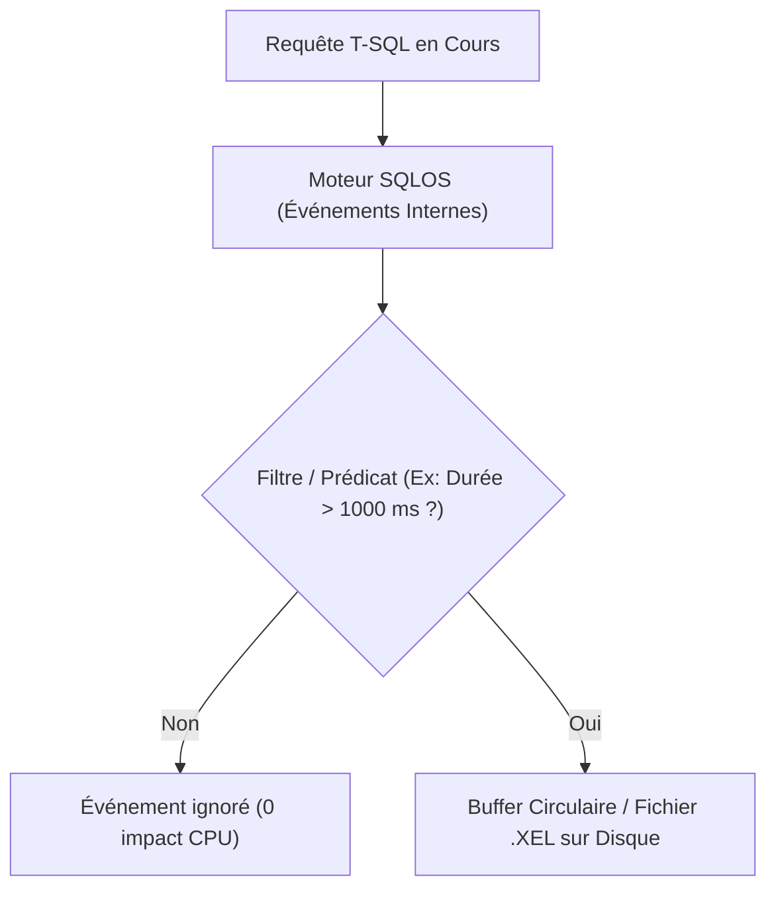
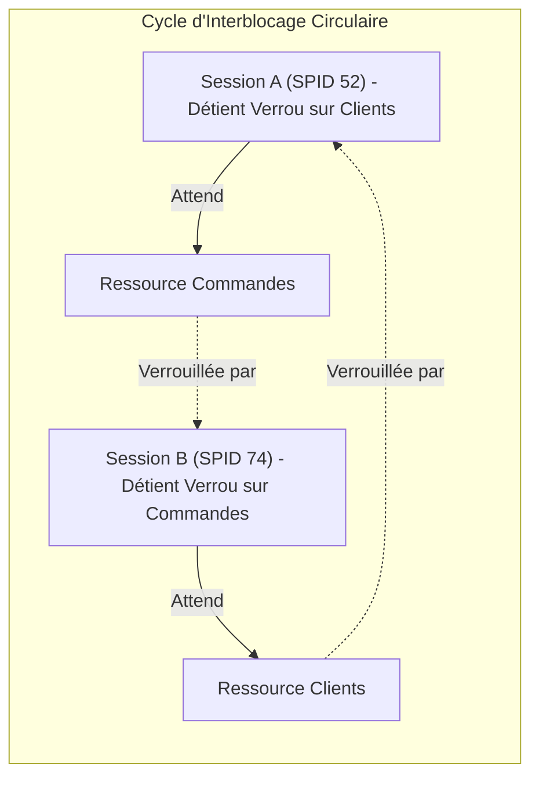

# 1. Fil Conducteur : Crise de Performance et Blocages chez SDS

Un vendredi matin de forte affluence commerciale, l'application de facturation de **SENEGAL DISTRIBUTION SA (SDS)** commence à ralentir dangereusement. Plusieurs caissières de Dakar signalent des fenêtres figées affichant :
> `« En attente du serveur SQLPROD01... »`

Quelques instants plus tard, l'ERP lève une exception critique :
> `Msg 1205, Level 13, State 51 : Transaction (Process ID 72) was deadlocked on lock resources with another process and has been chosen as the deadlock victim. Rerun the transaction.`

En tant que DBA Senior, vous devez ausculter le moteur en direct sans redémarrer le serveur : identifier la session coupable via les **Vues de Gestion Dynamique (DMV)**, capturer le graphe d'interblocage avec les **Extended Events**, arbitrer les conflits de verrous et maîtriser les niveaux d'isolation transactionnelle.

---

# 2. De SQL Profiler aux Extended Events (XEvents)

Pendant des décennies, le *SQL Server Profiler* a été l'outil de traçage emblématique des administrateurs. Pourtant, **Profiler est aujourd'hui déprécié** pour les architectures modernes :
- Profiler intercepte chaque événement de manière synchrone, ce qui peut consommer jusqu'à 30% des ressources CPU d'un serveur sous forte charge.
- Le système moderne **eXtended Events (XEvents)** est directement intégré dans le noyau de `SQLOS`. Il utilise des tampons circulaires en mémoire (*Ring Buffers*) avec une empreinte processeur inférieure à 1%.



### Session XEvents de Détection des Requêtes Lentes et des Deadlocks
Ce script crée une session de supervision permanente pour capturer toute requête excédant 1 seconde (1 000 000 microsecondes) ainsi que tous les graphes de deadlocks :

```sql
USE master;
GO

IF EXISTS (SELECT * FROM sys.server_event_sessions WHERE name = 'SDS_Supervision_Performance')
BEGIN
    DROP EVENT SESSION [SDS_Supervision_Performance] ON SERVER;
END;
GO

CREATE EVENT SESSION [SDS_Supervision_Performance] ON SERVER
    -- 1. Capture des requêtes T-SQL lentes
    ADD EVENT sqlserver.sql_statement_completed
    (
        ACTION (sqlserver.session_id, sqlserver.sql_text, sqlserver.database_name, sqlserver.client_app_name)
        WHERE (duration >= 1000000) -- Durée supérieure à 1 seconde
    ),
    -- 2. Capture automatique du rapport XML complet de deadlock
    ADD EVENT sqlserver.xml_deadlock_report
    ADD TARGET package0.event_file
    (
        SET filename = N'E:\Audit\SDS_XEvents_Trace.xel',
        max_file_size = 50, -- 50 Mo par fichier
        max_rollover_files = 5
    )
WITH (MAX_MEMORY = 4096 KB, EVENT_RETENTION_MODE = ALLOW_SINGLE_EVENT_LOSS);
GO

-- Démarrage de la session
ALTER EVENT SESSION [SDS_Supervision_Performance] ON SERVER STATE = START;
GO
```

---

# 3. Les Vues de Gestion Dynamique (DMV) Indispensables

Les DMVs exposent l'état interne de la mémoire et des threads sans nécessiter d'outils externes.

### 3.1 Détecter les Requêtes en Cours et les Blocages en Temps Réel
Cette requête est le réflexe numéro un du DBA pour repérer instantanément qui bloque qui :

```sql
SELECT 
    r.session_id AS [SPID_Bloque],
    r.blocking_session_id AS [SPID_Bloqueur],
    r.status AS [Statut],
    r.wait_type AS [TypeAttente],
    r.wait_time / 1000.0 AS [DureeAttente_Sec],
    s.login_name AS [Utilisateur],
    s.host_name AS [PosteClient],
    s.program_name AS [Application],
    SUBSTRING(t.text, (r.statement_start_offset/2) + 1,
        ((CASE r.statement_end_offset 
            WHEN -1 THEN DATALENGTH(t.text)
            ELSE r.statement_end_offset 
          END - r.statement_start_offset)/2) + 1) AS [InstructionExecutee]
FROM sys.dm_exec_requests r
JOIN sys.dm_exec_sessions s ON r.session_id = s.session_id
CROSS APPLY sys.dm_exec_sql_text(r.sql_handle) t
WHERE r.blocking_session_id <> 0;
GO
```

### 3.2 Analyser les Attentes Globales du Serveur (`sys.dm_os_wait_stats`)
SQL Server consigne chaque microseconde où un thread doit patienter :

| Type d'Attente (*Wait Type*) | Symptôme & Cause Racine | Action Corrective DBA |
| :--- | :--- | :--- |
| **`PAGEIOLATCH_SH` / `PAGEIOLATCH_EX`** | Attente de lecture/écriture de pages depuis le disque vers la RAM. Disques lents ou Buffer Pool insuffisant. | Vérifier la mémoire allouée, analyser les index manquants pour supprimer les Scans de table. |
| **`CXPACKET`** | Threads travaillant en parallèle qui attendent les plus lents. | Ajuster `cost threshold for parallelism` à 25 et `MAXDOP` à 4. |
| **`LCK_M_...` (LCK_M_X, LCK_M_S)** | Blocages transactionnels sévères dus à des verrous incompatibles. | Optimiser les transactions, réduire la durée des verrous ou passer en mode Snapshot. |

---

# 4. Verrouillage, Concurrence et Niveaux d'Isolation

Pour garantir la cohérence des données tout en autorisant des dizaines d'accès simultanés, le moteur de stockage utilise le verrouillage à granularité multiple : ligne (*Key*), page (*PAG*) et table (*TAB*).

### 4.1 Les Modes de Verrous Majeurs
- **Verrou Partagé (Shared - `S`)** : Posé lors des opérations de lecture (`SELECT`). Plusieurs utilisateurs peuvent détenir un verrou `S` simultanément sur la même ressource.
- **Verrou Exclusif (Exclusive - `X`)** : Posé lors des modifications (`INSERT`, `UPDATE`, `DELETE`). **Incompatible avec tout autre verrou**. Tant qu'une transaction détient un verrou `X`, personne ne peut lire ni modifier la ressource.
- **Verrou de Mise à Jour (Update - `U`)** : Posé lors de la phase préliminaire de recherche d'un `UPDATE` pour éviter les blocages croisés.

### 4.2 Les Cinq Niveaux d'Isolation Transactionnelle
SQL Server permet d'arbitrer entre stricte cohérence et fluidité des accès :

1. **`READ UNCOMMITTED`** : Ne pose aucun verrou de lecture. Permet de lire des données en cours de modification par une autre transaction : c'est la **lecture sale (*Dirty Read*)**. À proscrire formellement en comptabilité.
2. **`READ COMMITTED` (Niveau par défaut)** : Empêche les lectures sales en posant un verrou `S` qui est relâché dès que la page est lue.
3. **`REPEATABLE READ`** : Conserve les verrous `S` jusqu'à la fin de la transaction (`COMMIT`). Garantit que si l'on relit la même ligne, sa valeur sera identique.
4. **`SERIALIZABLE`** : Le niveau le plus strict. Pose des verrous d'intervalles de clés (*Key-Range Locks*). Empêche toute insertion de nouvelles lignes fantômes (*Phantom Reads*).
5. **`SNAPSHOT ISOLATION` (Isolation par versioning de lignes)** :
   Les lecteurs ne posent plus aucun verrou bloquant sur les rédacteurs, et les rédacteurs ne bloquent plus les lecteurs ! Lorsqu'une transaction modifie une ligne, l'ancienne version est copiée dans **TempDB**. Les lecteurs consultent l'image figée dans TempDB sans jamais être bloqués.

```sql
-- Activation de l'isolation Snapshot sur SDS_Ventes
ALTER DATABASE SDS_Ventes SET READ_COMMITTED_SNAPSHOT ON;
GO
```

---

# 5. Diagnostic et Résolution des Interblocages (*Deadlocks*)

Un **Interblocage (Deadlock)** survient lorsque deux transactions détiennent chacune un verrou sur une ressource et tentent d'acquérir un verrou exclusif sur la ressource détenue par l'autre :

```
Session A (SPID 52)                    Session B (SPID 74)
-------------------                    -------------------
BEGIN TRANSACTION                      BEGIN TRANSACTION
UPDATE Ventes.Clients                  UPDATE Ventes.Commandes
SET Ville = 'Dakar'                    SET Statut = 'LIVREE'
WHERE ClientID = 10;                   WHERE CommandeID = 500;
  (Verrou X sur Clients)                 (Verrou X sur Commandes)

Tente d'accéder à Commandes:           Tente d'accéder à Clients:
UPDATE Ventes.Commandes                UPDATE Ventes.Clients
SET Statut = 'BLOQUE'                  SET Ville = 'Thies'
WHERE CommandeID = 500;                WHERE ClientID = 10;
  --> En attente du SPID 74              --> En attente du SPID 52
```



### 5.1 La Détection Automatique par SQL Server
Le moteur possède un thread de fond appelé **Deadlock Monitor** qui s'éveille toutes les 5 secondes. Dès qu'il détecte un cycle d'attente circulaire :
1. Il choisit automatiquement une transaction comme **victime du deadlock (*Deadlock Victim*)** (celle dont le coût de rollback est le plus faible, ou selon `SET DEADLOCK_PRIORITY LOW`).
2. Il annule immédiatement la transaction de la victime avec l'erreur `1205`.
3. L'autre transaction peut immédiatement se terminer avec succès.

### 5.2 Commande de Secours d'Urgence du DBA
Si une session orpheline paralyse des dizaines d'autres utilisateurs sans être dans un cycle de deadlock formel, le DBA peut l'interrompre manuellement :
```sql
-- Interruption immédiate et rollback forcé de la session bloquante N° 52
KILL 52;
GO
```

---

# 6. Les Déclencheurs DDL d'Audit de Structure

Pour empêcher qu'un administrateur ou un script non homologué ne supprime une table en production (`DROP TABLE`), SQL Server prend en charge les **déclencheurs DDL** qui s'exécutent sur les commandes de structure :

```sql
USE SDS_Ventes;
GO

-- Table d'historique des modifications de schéma
CREATE TABLE dbo.AuditModificationsDDL (
    AuditID INT IDENTITY(1,1) PRIMARY KEY,
    DateEvenement DATETIME2(0) DEFAULT SYSDATETIME(),
    Operateur NVARCHAR(128) DEFAULT SUSER_SNAME(),
    TypeCommande NVARCHAR(64),
    ObjetConcerne NVARCHAR(128),
    CodeTSQL NVARCHAR(MAX)
);
GO

-- Déclencheur DDL interceptant tout DROP ou ALTER sur la base
CREATE OR ALTER TRIGGER trg_AuditStructure_DDL
ON DATABASE
FOR DDL_TABLE_VIEW_EVENTS, DDL_PROCEDURE_EVENTS
AS
BEGIN
    SET NOCOUNT ON;
    DECLARE @EventData XML = EVENTDATA();

    INSERT INTO dbo.AuditModificationsDDL (TypeCommande, ObjetConcerne, CodeTSQL)
    VALUES (
        @EventData.value('(/EVENT_INSTANCE/EventType)[1]', 'NVARCHAR(64)'),
        @EventData.value('(/EVENT_INSTANCE/ObjectName)[1]', 'NVARCHAR(128)'),
        @EventData.value('(/EVENT_INSTANCE/TSQLCommand/CommandText)[1]', 'NVARCHAR(MAX)')
    );
END;
GO
```

---

# 7. Exercices Pratiques et Auto-Évaluation

1. **Quelle est la différence fondamentale entre un blocage standard (*Blocking*) et un interblocage (*Deadlock*) ?**
2. **Comment l'activation de `READ_COMMITTED_SNAPSHOT` parvient-elle à éliminer les blocages entre les lecteurs et les rédacteurs ?**
3. **Quelle DMV permet d'examiner le plan d'exécution XML complet d'une requête identifiée par son `plan_handle` ?**
