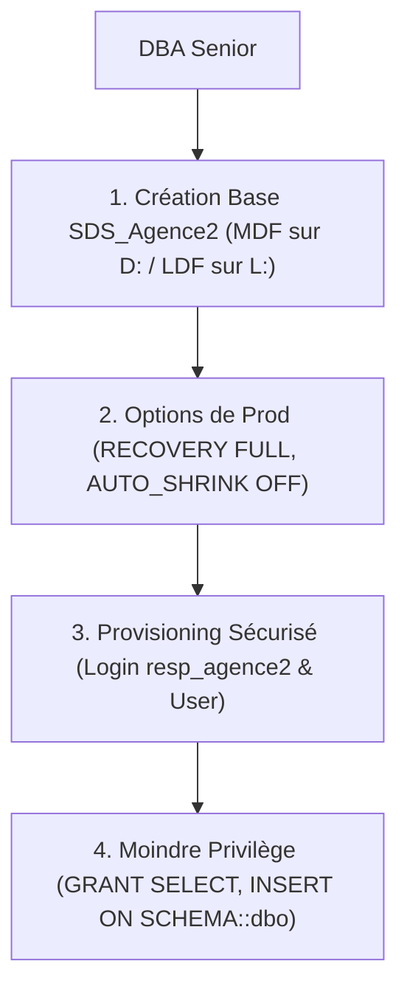

# 1. Présentation de l'Épreuve de Synthèse et de Certification

Ce dernier module constitue l'aboutissement de notre cursus d'ingénierie et d'administration sous **Microsoft SQL Server**. Élaboré en partenariat avec le **Centre de Formation en Entreprise (CFE) de l'Institut Supérieur d'Informatique (ISI) de Dakar**, ce document valide la maîtrise opérationnelle complète des concepts d'architecture, de sécurité, de résilience et de gouvernance de données.

L'évaluation s'articule autour de trois volets complémentaires :
1. **Partie 1 : Le Grand QCM de Mise en Situation (10 Questions de Décision DBA)** ;
2. **Partie 2 : Questions Ouvertes d'Arbitrage et d'Architecture Technique** ;
3. **Partie 3 : Cas Pratique Réel d'Intégration d'Entreprise : Le Déploiement de l'Agence Régionale `SDS_Agence2`**.

---

# 2. Partie 1 — QCM Certifiant d'Administration SQL Server

*Consigne : Pour chaque question, une seule réponse est rigoureusement exacte. Lisez attentivement les mises en situation et la justification technique détaillée de chaque correction.*

---

### Question 1 : Choix d'Édition et Dimensionnement
**Une entreprise doit héberger une base de données de vente d'environ 200 Go pour 50 utilisateurs simultanés, sans besoin de haute disponibilité multi-sites Always On ni de fonctionnalités exclusives d'entreprise. Quelle édition de SQL Server recommandez-vous ?**
- ☐ a. Express
- ☒ **b. Standard** *(Bonne réponse)*
- ☐ c. Enterprise
- ☐ d. Web

> 💡 **Justification Technique DBA :**
> L'édition **Standard** prend en charge jusqu'à 24 cœurs processeurs et 128 Go de mémoire RAM pour le Buffer Pool, ce qui est très largement supérieur aux besoins des 50 utilisateurs et des 200 Go de données. L'édition Express est inadaptée (limitée à 1,4 Go de RAM et 10 Go par base, sans SQL Server Agent). L'édition Enterprise coûterait plusieurs dizaines de milliers de dollars supplémentaires en licences pour des fonctionnalités qui ne seraient pas utilisées.

---

### Question 2 : Industrialisation du Déploiement
**Quel est l'intérêt principal d'un fichier de configuration (`ConfigurationFile.ini`) exécuté en ligne de commande pour installer SQL Server sur 5 agences régionales ?**
- ☐ a. Il permet de supprimer une instance existante sans mot de passe
- ☒ **b. Il garantit un déploiement strictement identique et reproductible** *(Bonne réponse)*
- ☐ c. Il remplace la nécessité de créer des comptes de service Windows
- ☐ d. Il évite d'avoir à choisir une édition logicielle

> 💡 **Justification Technique DBA :**
> L'installation automatisée par fichier `.ini` élimine nativement tout risque d'erreur humaine (comme le choix involontaire d'une mauvaise collation, l'oubli d'un compte de service ou un chemin de disque divergent), garantissant l'homogénéité stricte de l'ensemble du parc informatique.

---

### Question 3 : Rôle de la Base Système TempDB
**Quel est le rôle principal de la base de données système `tempdb` ?**
- ☐ a. Stocker les tâches planifiées et les alertes de l'agent SQL Server
- ☐ b. Servir de gabarit pour chaque nouvelle base de données créée
- ☒ **c. Fournir un espace de travail temporaire partagé par toutes les bases (tris, tables temporaires, versions de lignes)** *(Bonne réponse)*
- ☐ d. Enregistrer les logins et la configuration de l'instance

> 💡 **Justification Technique DBA :**
> `tempdb` est la ressource partagée globale de l'instance pour les tables temporaires (`#`), les tris qui débordent de la RAM (`ORDER BY`, `GROUP BY`) et le magasin de versions de lignes (*Row Versioning*). Elle est réinitialisée à chaque démarrage du service.

---

### Question 4 : Gabarit de Création
**Quelle base de données système sert de modèle (gabarit) appliqué à chaque nouvelle base créée sur une instance ?**
- ☐ a. master
- ☒ **b. model** *(Bonne réponse)*
- ☐ c. msdb
- ☐ d. tempdb

> 💡 **Justification Technique DBA :**
> Lors de l'exécution de `CREATE DATABASE`, SQL Server duplique physiquement la base **`model`**. Toute option de configuration, fonction ou table créée dans `model` sera automatiquement héritée par toutes les futures bases de données de l'instance.

---

### Question 5 : Restauration à la Seconde Près
**Quel mode de récupération (*Recovery Model*) faut-il obligatoirement utiliser pour pouvoir restaurer une base à un instant précis dans le temps (*Point-in-Time Recovery*) ?**
- ☐ a. Simple
- ☐ b. Journalisé en bloc (Bulk-logged)
- ☒ **c. Complet (Full)** *(Bonne réponse)*
- ☐ d. Aucun mode ne le permet

> 💡 **Justification Technique DBA :**
> Seul le mode de récupération **Complet (`FULL`)** conserve l'intégralité des enregistrements dans le journal de transactions jusqu'à leur sauvegarde explicite, permettant une restauration à la seconde près via la clause `STOPAT`.

---

### Question 6 : Anatomie du Journal
**Que désigne le terme VLF dans l'architecture d'une base de données SQL Server ?**
- ☒ **a. Un fichier journal virtuel (*Virtual Log File*), subdivision interne du fichier `.ldf`** *(Bonne réponse)*
- ☐ b. Une vue logique construite sur plusieurs tables
- ☐ c. Un type particulier de groupe de fichiers
- ☐ d. Un format spécifique de fichier de sauvegarde

> 💡 **Justification Technique DBA :**
> Le fichier de journal `.ldf` est physiquement découpé en segments séquentiels circulaires appelés **VLFs**. Une prolifération excessive de VLFs (due à des autogrowths trop faibles) dégrade drastiquement le temps de boot et de restauration de la base.

---

### Question 7 : Proscription de l'Option AUTO_SHRINK
**Pourquoi désactive-t-on formellement l'option `AUTO_SHRINK` sur une base de données de production ?**
- ☐ a. Elle empêche la création de nouveaux index
- ☐ b. Elle bloque les connexions des utilisateurs
- ☒ **c. Elle provoque un cycle continu et coûteux de fragmentation sévère puis de ré-agrandissement du fichier** *(Bonne réponse)*
- ☐ d. Elle désactive automatiquement le mode de récupération complet

> 💡 **Justification Technique DBA :**
> `AUTO_SHRINK` déplace les pages en vrac pour récupérer de l'espace disque, ce qui fragmente immédiatement les index à plus de 90%. Quelques heures plus tard, les écritures obligent le fichier à s'agrandir de nouveau, ruinant les performances I/O du serveur.

---

### Question 8 : Login vs Utilisateur
**Quelle affirmation décrit rigoureusement la différence entre un Login et un Utilisateur (*User*) ?**
- ☐ a. Il n'existe aucune différence entre les deux termes
- ☒ **b. Le Login existe au niveau de l'instance, l'Utilisateur existe au niveau d'une base de données précise** *(Bonne réponse)*
- ☐ c. Le Login est réservé aux comptes applicatifs, jamais aux humains
- ☐ d. L'Utilisateur permet de se connecter à l'instance, le Login permet d'agir dans une base

> 💡 **Justification Technique DBA :**
> Le Login (connexion) permet de franchir le réseau et d'entrer dans l'instance SQL Server. L'Utilisateur est créé à l'intérieur d'une base donnée et relié au login via son identifiant de sécurité (**SID**).

---

### Question 9 : Chiffrement Transparent TDE
**Dans la mise en place du chiffrement transparent des données (TDE), quel est le rôle du certificat créé dans la base `master` ?**
- ☐ a. Il chiffre directement chaque ligne de données de la table
- ☒ **b. Il sert de racine de confiance protégeant la clé de chiffrement de base (DEK) de la base utilisateur** *(Bonne réponse)*
- ☐ c. Il remplace entièrement la clé maîtresse du serveur (SMK)
- ☐ d. Il n'intervient que dans la mise en place d'un audit

> 💡 **Justification Technique DBA :**
> Le certificat serveur protège la clé symétrique **DEK (AES-256)** résidant dans la base utilisateur. Sans ce certificat, la clé DEK ne peut être déchiffrée et la base reste inaccessible.

---

### Question 10 : Sécurité Applicative
**Un compte applicatif ne reçoit que le droit `GRANT EXECUTE ON SCHEMA::dbo TO app_sds`. Quel principe fondamental de cybersécurité cela illustre-t-il ?**
- ☐ a. Le principe de délégation d'administration
- ☒ **b. Le principe du moindre privilège** *(Bonne réponse)*
- ☐ c. Le principe de séparation des tâches uniquement
- ☐ d. Le principe de chiffrement au repos

> 💡 **Justification Technique DBA :**
> C'est l'incarnation parfaite du **Principe du Moindre Privilège** (*Principle of Least Privilege*) : l'application n'a aucun accès direct aux tables (empêchant les injections SQL destructrices), mais uniquement le droit d'exécuter les procédures stockées homologuées.

---

# 3. Partie 2 — Questions Ouvertes d'Architecture et de Soutenance

### 1. Pourquoi sépare-t-on physiquement les fichiers de données, le journal de transactions et TempDB sur des volumes distincts ?
> **Réponse de soutenance DBA :**
> Cette séparation élimine la contention mécanique et les goulets d'étranglement sur les bus d'entrées/sorties (I/O). Le journal de transactions (`.ldf`) effectue des écritures purement séquentielles et synchrones (optimisées par du RAID 10), tandis que les fichiers de données (`.mdf`) subissent des lectures et écritures aléatoires. Isoler `TempDB` sur du stockage ultra-rapide NVMe empêche les tris temporaires d'engorger les disques de production transactionnels.

### 2. Expliquez la différence entre le groupe de fichiers primaire (`PRIMARY`) et un groupe de fichiers secondaire comme `FG_ARCHIVE`.
> **Réponse de soutenance DBA :**
> Le groupe `PRIMARY` héberge le dictionnaire système et les tables transactionnelles actives de l'entreprise. Un groupe secondaire comme `FG_ARCHIVE` permet d'isoler les données historiques des années closes. Ses atouts opérationnels majeurs sont : la possibilité de le basculer en lecture seule (`READ_ONLY`), l'allègement de la fenêtre des sauvegardes hebdomadaires, et la capacité de réaliser des restaurations progressives d'urgence (*Piecemeal Restore*).

### 3. Pourquoi le mode de récupération COMPLET impose-t-il la planification régulière de sauvegardes de journal (`BACKUP LOG`) ?
> **Réponse de soutenance DBA :**
> En mode COMPLET, SQL Server a l'obligation contractuelle de conserver l'ensemble des transactions pour permettre une restauration à la seconde près. Contrairement au mode SIMPLE, le moteur **ne tronque jamais le journal lors des Checkpoints**. Si aucune sauvegarde du journal (`BACKUP LOG`) n'est planifiée, l'espace inactif n'est jamais libéré, et le fichier `.ldf` gonflera sans fin jusqu'à saturer le disque dur et bloquer l'ensemble de la base de données (erreur 9002).

---

# 4. Partie 3 — Cas Pratique : Déploiement de la Nouvelle Agence SDS_Agence2

### Le Contexte Opérationnel
**SENEGAL DISTRIBUTION SA (SDS)** poursuit son expansion territoriale et ouvre une nouvelle agence régionale à Touba. La direction générale demande à l'équipe DBA de provisionner une base de données dédiée, nommée **`SDS_Agence2`**, sur l'instance de production **`SQLPROD01`**.

Le responsable régional de cette filiale, **M. Mamadou Diop**, aura pour login de connexion **`resp_agence2`**.



---

### Solution T-SQL Complète et Homologuée

```sql
USE master;
GO

-- ==============================================================================
-- ÉTAPE 1 : Création de la base SDS_Agence2 avec fichiers sur chemins distincts
-- ==============================================================================
IF DB_ID(N'SDS_Agence2') IS NOT NULL
BEGIN
    ALTER DATABASE SDS_Agence2 SET SINGLE_USER WITH ROLLBACK IMMEDIATE;
    DROP DATABASE SDS_Agence2;
END;
GO

CREATE DATABASE [SDS_Agence2]
ON PRIMARY 
(
    NAME = N'SDS_Agence2_Data',
    FILENAME = N'D:\Data\SDS_Agence2.mdf',
    SIZE = 8MB,
    FILEGROWTH = 4MB
)
LOG ON 
(
    NAME = N'SDS_Agence2_Log',
    FILENAME = N'L:\Log\SDS_Agence2.ldf',
    SIZE = 4MB,
    FILEGROWTH = 2MB
);
GO

-- ==============================================================================
-- ÉTAPE 2 : Configuration des options d'exploitation de production
-- ==============================================================================
-- Passage en mode de récupération complet pour permettre la restauration point-in-time
ALTER DATABASE [SDS_Agence2] SET RECOVERY FULL;

-- Désactivation formelle de l'option AUTO_SHRINK pour protéger les index
ALTER DATABASE [SDS_Agence2] SET AUTO_SHRINK OFF;

-- Activation du calcul des statistiques et de la détection de corruption
ALTER DATABASE [SDS_Agence2] SET AUTO_CREATE_STATISTICS ON;
ALTER DATABASE [SDS_Agence2] SET AUTO_UPDATE_STATISTICS ON;
ALTER DATABASE [SDS_Agence2] SET PAGE_VERIFY CHECKSUM;
GO

-- ==============================================================================
-- ÉTAPE 3 : Provisioning du Login et de l'Utilisateur de base
-- ==============================================================================
-- Création du login au niveau de l'instance avec politique de mot de passe Windows active
IF NOT EXISTS (SELECT * FROM sys.server_principals WHERE name = N'resp_agence2')
BEGIN
    CREATE LOGIN [resp_agence2] 
    WITH PASSWORD = N'Resp#Touba2026!SDS',
         CHECK_POLICY = ON,
         CHECK_EXPIRATION = ON,
         DEFAULT_DATABASE = [SDS_Agence2];
END;
GO

USE [SDS_Agence2];
GO

-- Création du compte utilisateur dans la base SDS_Agence2 mappé au login
IF NOT EXISTS (SELECT * FROM sys.database_principals WHERE name = N'resp_agence2')
BEGIN
    CREATE USER [resp_agence2] FOR LOGIN [resp_agence2];
END;
GO

-- Neutralisation préventive du compte guest
REVOKE CONNECT FROM guest;
GO

-- ==============================================================================
-- ÉTAPE 4 : Attribution stricte des permissions (Principe du Moindre Privilège)
-- ==============================================================================
-- Le responsable peut consulter et saisir les données opérationnelles du schéma dbo,
-- mais ne peut ni modifier la structure des tables ni supprimer d'enregistrements !
GRANT SELECT, INSERT ON SCHEMA::dbo TO [resp_agence2];
GO

-- Initialisation immédiate de la chaîne de sauvegarde pour activer le mode FULL réel
BACKUP DATABASE [SDS_Agence2]
TO DISK = N'\\NAS01\SQLBackup\SDS_Agence2_Init_FULL.bak'
WITH FORMAT, INIT, COMPRESSION, CHECKSUM;
GO
```

---

# 5. Référentiel des Compétences Validées

À l'issue de l'assimilation de ces 9 modules d'ingénierie et d'administration sous Microsoft SQL Server, vous maîtrisez l'intégralité du socle exigé pour les certifications d'entreprise :

1. **Architecture & Moteur** : Compréhension intime du Relational Engine, du Storage Engine, du Buffer Pool et du SQLOS.
2. **Dimensionnement & Stockage** : Structuration bas niveau en pages, extents, fichiers `.mdf`, `.ndf`, `.ldf` et isolation par `Filegroups`.
3. **Sécurité & Conformité Réglementaire** : Gestion fine des Logins, Users, Rôles, matrices de permissions, bases partiellement contenues, chiffrement TDE et audit complet conforme aux exigences de la **CDP**.
4. **Continuité d'Activité & PRA** : Traduction opérationnelle d'engagements de service **RPO (15 min)** et **RTO (1 h)**, procédures de restauration chronométrées avec *Tail-Log*, contrôle de continuité des LSN et détection de pannes.
5. **Supervision & Maintenance** : Automatisation par l'Agent SQL Server, détection de corruption physique avec `DBCC CHECKDB`, optimisation proactive des index et des statistiques, et analyse en direct des blocages et deadlocks via les Vues de Gestion Dynamique (DMV) et les Extended Events.
