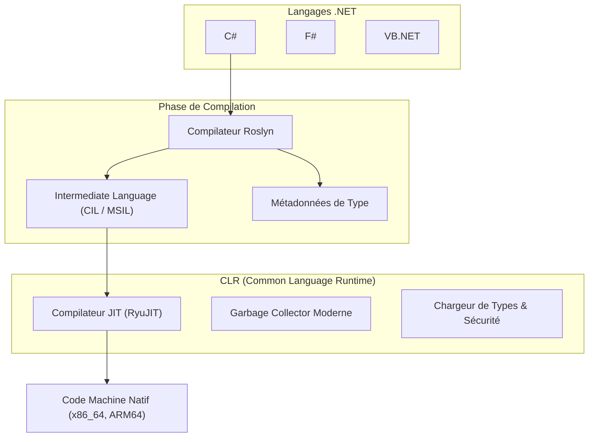

# Plateforme .NET, Runtime CLR et Fondamentaux C# Moderne

C# est un langage élégant, moderne, sécurisé et orienté objet développé par Microsoft sous la direction d'Anders Hejlsberg. Avec la version moderne de **.NET (.NET 8 LTS)**, la plateforme est devenue totalement open source, multiplateforme (Windows, Linux, macOS) et parmi les plus rapides au monde.

---

## 1. Architecture de la Plateforme .NET



- **CIL (Common Intermediate Language)** : Code intermédiaire indépendant de l'architecture processeur généré par le compilateur.
- **CLR (Common Language Runtime)** : Machine virtuelle .NET chargée de convertir le CIL en instructions machines réelles via **RyuJIT**, de gérer la mémoire (Garbage Collection) et la sécurité d'exécution.
- **BCL (Base Class Library)** : Ensemble colossal de bibliothèques fournies en standard (E/S, collections, réseaux, cryptographie).

---

## 2. Le Modèle de Types : Value Types vs Reference Types

C# distingue rigoureusement deux catégories fondamentales de types :

| Caractéristique | Value Types (`struct`, `enum`, `int`, `double`) | Reference Types (`class`, `interface`, `string`, `delegate`) |
| :--- | :--- | :--- |
| **Emplacement mémoire** | Alloué directement sur la **Stack** (pile) ou inline dans l'objet parent. | L'objet vit sur le **Heap** (tas) ; seule la référence pointeur est sur la stack. |
| **Comportement d'assignation** | Copie intégrale de la valeur (`a = b` crée un clone indépendant). | Copie de l'adresse de référence (`a = b` partagent le même objet sur le heap). |
| **Impact sur le GC** | Zéro pression sur le Garbage Collector (désalloué en sortie de bloc). | Détecté et nettoyé par le Garbage Collector lors des cycles de ramasse-miettes. |
| **Valeur `null` possible ?** | Non par défaut (sauf si `Nullable<T>`, noté `int?`). | Oui par défaut (sujet aux vérifications NRT - *Nullable Reference Types*). |

---

## 3. Top-Level Statements et Syntaxe C# 12 Moderne

À partir de C# 9 et consolidé en C# 12, les cérémonies inutiles (`namespace`, `class Program`, `static void Main`) peuvent être omises pour les points d'entrée d'applications en ligne de commande :

```csharp
// Program.cs : Top-Level Statements
using System;

Console.WriteLine("=== Bienvenue dans le Monde .NET 8 / C# 12 ===");

// 1. Déclaration de variables avec inférence forte de type (var)
var nomEtudiant = "Ousmane Diallo";
int codeFormation = 402;
decimal fraisInscription = 750.50m; // 'm' pour le type décimal précis (haute précision financière)
DateTime dateEntree = DateTime.UtcNow;

// 2. String Interpolation moderne et typée
Console.WriteLine($"Étudiant : {nomEtudiant} | Formation #{codeFormation} | Inscription : {fraisInscription:C2}");

// 3. Pattern Matching Switch Expression (C# moderne puissant)
string cycle = codeFormation switch
{
    >= 100 and <= 199 => "Licence 1 - Tronc Commun",
    >= 200 and <= 299 => "Licence 2 - Spécialisation",
    >= 300 and <= 399 => "Licence 3 - Projet de Fin d'Études",
    >= 400 and <= 499 => "Master 1 - Ingénierie Logicielle",
    >= 500 and <= 599 => "Master 2 - Architecte Système & Cloud",
    _ => "Formation Continue Non Référencée"
};

Console.WriteLine($"Niveau académique identifié : {cycle}");

// 4. Tuples et déconstruction
var (statut, estBoursier) = DeterminerEligibiliteBourse(fraisInscription, moyenneBac: 16.5);
Console.WriteLine($"Statut Bourse : {statut} (Eligible : {estBoursier})");

// Fonction locale avec tuple de retour
(string, bool) DeterminerEligibiliteBourse(decimal frais, double moyenneBac)
{
    if (moyenneBac >= 16.0 && frais > 500m)
    {
        return ("Bourse d'Excellence Accordée", true);
    }
    return ("Tarif Standard Appliqué", false);
}
```

---

## 4. Les Outils en Ligne de Commande (.NET CLI)

La chaîne d'outils universelle `dotnet` permet de piloter l'intégralité du cycle de vie sans dépendre d'un environnement lourd :

```bash
# Créer une nouvelle application console .NET 8
dotnet new console -n BrainX.Fundamentals -f net8.0

# Se déplacer dans le dossier
cd BrainX.Fundamentals

# Compiler et exécuter l'application
dotnet run

# Publier une version autonome optimisée (Self-contained, ReadyToRun)
dotnet publish -c Release -r win-x64 --self-contained true
```
