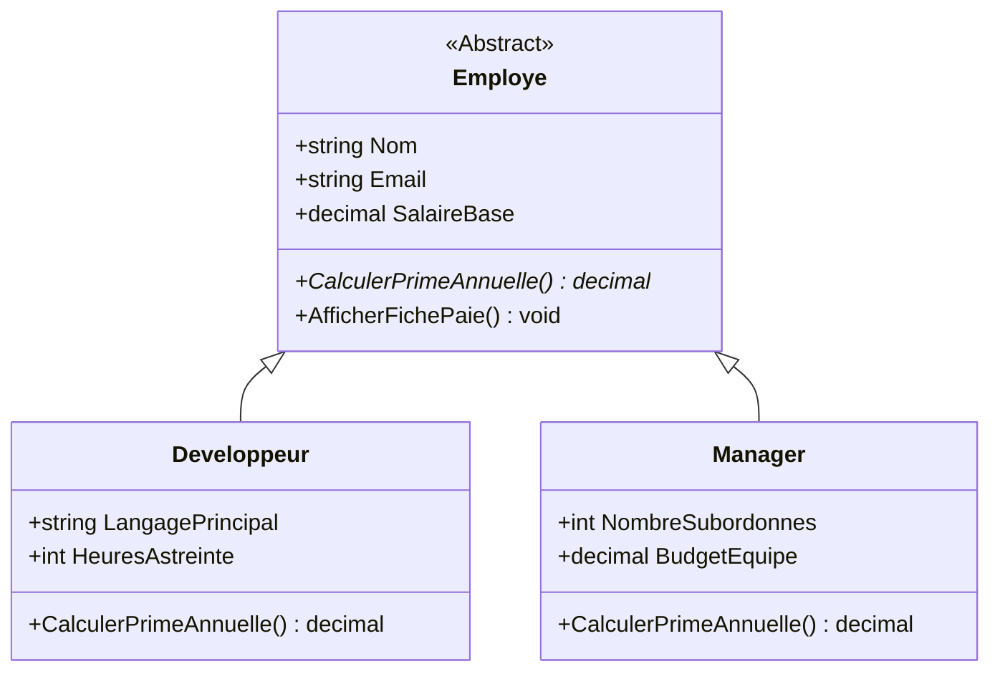

# Programmation Orientée Objet en C# : Classes, Propriétés, Héritage et Types Records

C# sublime les concepts de la Programmation Orientée Objet classique grâce à des constructions expressives telles que les **propriétés avec accesseurs automatiques**, les **constructeurs primaires**, l'immutabilité native des **Records** et le polymorphisme explicite via les mots-clés `virtual` et `override`.

---

## 1. Propriétés Modernes et Encapsulation

Contrairement à d'autres langages qui obligent à écrire manuellement des méthodes `getNom()` et `setNom()`, C# intègre les propriétés comme citoyens de premier ordre :

```csharp
public class Collaborateur
{
    // Auto-property avec getter public et setter privé
    public Guid Id { get; private set; } = Guid.NewGuid();

    // Propriété avec initialisation obligatoire à l'instanciation (init-only)
    public required string Matricule { get; init; }

    // Propriété avec backing field explicite et validation métier
    private decimal _salaireMensuel;
    public decimal SalaireMensuel
    {
        get => _salaireMensuel;
        set
        {
            if (value < 0)
                throw new ArgumentException("Le salaire mensuel ne peut être négatif.");
            _salaireMensuel = value;
        }
    }

    // Propriété calculée en lecture seule (Expression-bodied property)
    public decimal SalaireAnnuelBrut => _salaireMensuel * 12;
}
```

---

## 2. Héritage et Polymorphisme Explicite

En C#, le polymorphisme est **explicite par design**. Une méthode de classe de base ne peut être redéfinie que si elle porte le mot-clé **`virtual`**, et la classe fille doit obligatoirement utiliser **`override`** pour formaliser son intention :



### Implémentation du Modèle

```csharp
namespace BrainX.Model;

public abstract class Employe
{
    public string Nom { get; }
    public string Email { get; }
    public decimal SalaireBase { get; }

    // Constructeur protégé
    protected Employe(string nom, string email, decimal salaireBase)
    {
        Nom = nom ?? throw new ArgumentNullException(nameof(nom));
        Email = email ?? throw new ArgumentNullException(nameof(email));
        SalaireBase = salaireBase > 0 ? salaireBase : throw new ArgumentException("Salaire invalide");
    }

    // Méthode abstraite que chaque spécialité doit obligatoirement implémenter
    public abstract decimal CalculerPrimeAnnuelle();

    // Méthode virtuelle qu'une sous-classe peut au choix conserver ou surcharger
    public virtual void AfficherFichePaie()
    {
        Console.WriteLine($"Employé : {Nom} ({Email}) | Salaire Fixe : {SalaireBase:C} | Prime : {CalculerPrimeAnnuelle():C}");
    }
}

public class Developpeur : Employe
{
    public string LangagePrincipal { get; }
    public int HeuresAstreinte { get; set; }

    public Developpeur(string nom, string email, decimal salaireBase, string langagePrincipal)
        : base(nom, email, salaireBase)
    {
        LangagePrincipal = langagePrincipal;
    }

    public override decimal CalculerPrimeAnnuelle()
    {
        // 5% du salaire de base + prime forfaitaire par heure d'astreinte
        return (SalaireBase * 0.05m) + (HeuresAstreinte * 45m);
    }
}

public class Manager : Employe
{
    public int NombreSubordonnes { get; }

    public Manager(string nom, string email, decimal salaireBase, int nombreSubordonnes)
        : base(nom, email, salaireBase)
    {
        NombreSubordonnes = nombreSubordonnes;
    }

    public override decimal CalculerPrimeAnnuelle()
    {
        // 12% du salaire de base + bonus par membre d'équipe
        return (SalaireBase * 0.12m) + (NombreSubordonnes * 250m);
    }

    public override void AfficherFichePaie()
    {
        base.AfficherFichePaie();
        Console.WriteLine($"   -> Équipe sous supervision : {NombreSubordonnes} collaborateurs");
    }
}
```

---

## 3. Les Records C# : Modélisation Immuable des Données Métier (DTO)

Pour représenter des objets de transfert de données (*Data Transfer Objects* ou DTO) sans logique de comportement, les **`record`** génèrent automatiquement pour vous :
- L'égalité par valeur (*value-based equality*) au lieu de l'égalité par référence.
- Le clonage non-destructif avec le mot-clé **`with`**.
- La méthode `ToString()` affichant toutes les propriétés.
- Les constructeurs primaires déconstructibles.

```csharp
// Définition d'un Record en une seule ligne élégante
public record FactureDto(Guid FactureId, string Client, decimal MontantTTC, DateTime DateEmission);

// Utilisation :
var facture1 = new FactureDto(Guid.NewGuid(), "Société Générale", 12500m, DateTime.UtcNow);
Console.WriteLine(facture1); 
// Sortie : FactureDto { FactureId = ..., Client = Société Générale, MontantTTC = 12500, ... }

// Clonage immuable avec modification ponctuelle (expression 'with')
var factureRectifiee = facture1 with { MontantTTC = 11900m };
Console.WriteLine($"Facture rectifiée : {factureRectifiee.MontantTTC:C}");
```
