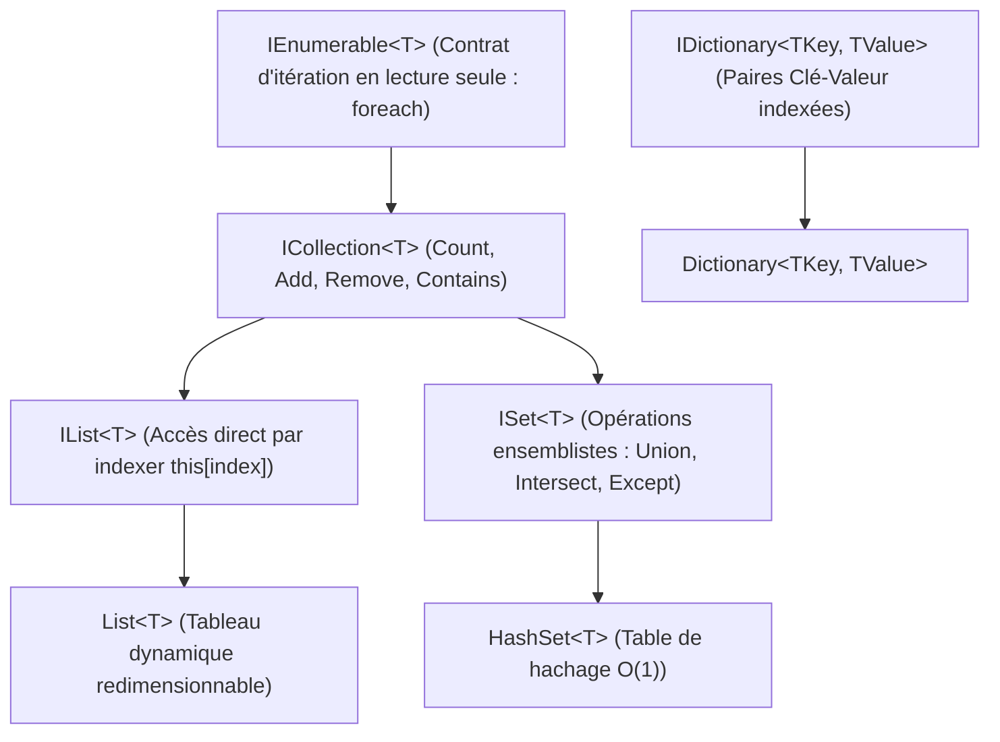

# Collections Génériques et Interfaces Fondamentales en C#

La gestion des collections d'objets en C# repose sur une hiérarchie d'interfaces génériques hautement optimisées garantissant sécurité de type et performance mémoire.

---

## 1. La Hiérarchie des Interfaces de Collection



---

## 2. Table de Synthèse des Performances

| Collection | Recherche par Clé/Index | Recherche par Valeur | Insertion Fin | Insertion Début |
| :--- | :--- | :--- | :--- | :--- |
| **`List<T>`** | $O(1)$ par index | $O(n)$ | $O(1)$ amorti | $O(n)$ (décalage des éléments) |
| **`Dictionary<TKey, TValue>`** | $O(1)$ par clé | $O(n)$ | $O(1)$ | Non applicable |
| **`HashSet<T>`** | $O(1)$ (`Contains`) | $O(1)$ | $O(1)$ | Non applicable |
| **`Queue<T>` (FIFO)** | Non applicable | $O(n)$ | $O(1)$ (`Enqueue`) | $O(1)$ (`Dequeue`) |

---

## 3. Pratique Avancée : Gestionnaire d'Inscriptions Étudiantes

Voici un exemple d'implémentation industrielle combinant `List<T>`, `Dictionary<TKey, TValue>` et `HashSet<T>` :

```csharp
using System;
using System.Collections.Generic;

namespace BrainX.Collections;

public record Etudiant(int Id, string Matricule, string Nom, string Promotion);

public class GestionnaireInscriptions
{
    // Dictionnaire pour recherche instantanée O(1) par matricule
    private readonly Dictionary<string, Etudiant> _etudiantsParMatricule = new(StringComparer.OrdinalIgnoreCase);

    // HashSet pour garantir l'unicité stricte des promotions existantes
    private readonly HashSet<string> _promotionsActives = new(StringComparer.OrdinalIgnoreCase);

    // Liste pour conserver l'ordre chronologique exact d'inscription
    private readonly List<Etudiant> _journalInscriptions = new();

    public void InscrireEtudiant(int id, string matricule, string nom, string promotion)
    {
        if (_etudiantsParMatricule.ContainsKey(matricule))
        {
            throw new InvalidOperationException($"L'étudiant avec le matricule {matricule} est déjà inscrit.");
        }

        var etudiant = new Etudiant(id, matricule, nom, promotion);

        // Ajout synchronisé dans les structures
        _etudiantsParMatricule.Add(matricule, etudiant);
        _promotionsActives.Add(promotion);
        _journalInscriptions.Add(etudiant);

        Console.WriteLine($"[Inscription Réussie] {nom} ({matricule}) enregistré dans la promo {promotion}.");
    }

    public Etudiant? RechercherParMatricule(string matricule)
    {
        // TryGetValue est la méthode la plus performante (évite un double lookup ContainsKey + indexer)
        if (_etudiantsParMatricule.TryGetValue(matricule, out var etudiant))
        {
            return etudiant;
        }
        return null;
    }

    public IReadOnlyCollection<string> ObtenirPromotions() => _promotionsActives;

    public IReadOnlyList<Etudiant> ObtenirJournalInscriptions() => _journalInscriptions.AsReadOnly();
}

public class Program
{
    public static void Main()
    {
        var gestionnaire = new GestionnaireInscriptions();

        gestionnaire.InscrireEtudiant(1, "ETU-2026-001", "Fatou Sow", "Master Cloud 2026");
        gestionnaire.InscrireEtudiant(2, "ETU-2026-002", "Marc Leblanc", "Licence Informatique");
        gestionnaire.InscrireEtudiant(3, "ETU-2026-003", "Khadija Ba", "Master Cloud 2026");

        Console.WriteLine("
--- Liste des promotions distinctes en cours ---");
        foreach (var promo in gestionnaire.ObtenirPromotions())
        {
            Console.WriteLine($" * {promo}");
        }

        Console.WriteLine("
--- Recherche par matricule 'ETU-2026-002' ---");
        var trouve = gestionnaire.RechercherParMatricule("ETU-2026-002");
        if (trouve != null)
        {
            Console.WriteLine($"Étudiant localisé : {trouve.Nom} - Promo : {trouve.Promotion}");
        }
    }
}
```
