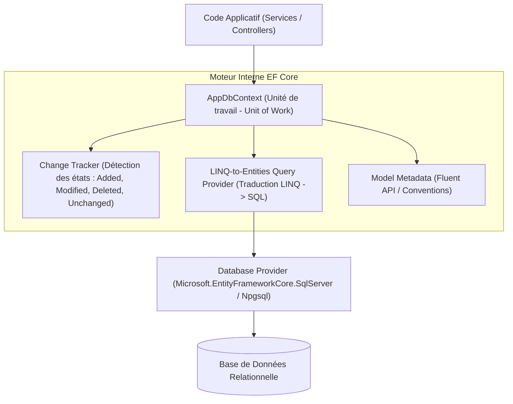

# Persistance et ORM avec Entity Framework Core : DbContext, Code-First et Migrations

**Entity Framework Core (EF Core)** est l'ORM (*Object-Relational Mapper*) officiel, moderne et ultra-performant de l'écosystème .NET. Il permet aux développeurs d'interagir avec des bases de données relationnelles (SQL Server, PostgreSQL, SQLite) en manipulant directement des objets C# fortement typés.

---

## 1. Architecture d'EF Core



---

## 2. Modélisation Code-First et Configuration Fluent API

Dans l'approche **Code-First**, vous écrivez d'abord vos classes de modèles métiers en C#, puis EF Core dérive et gère automatiquement le schéma de base de données à travers des fichiers de migration.

### 2.1 Les Entités Métiers
```csharp
namespace BrainX.Domain.Entities;

public class Cours
{
    public Guid Id { get; set; } = Guid.NewGuid();
    public string Titre { get; set; } = string.Empty;
    public string Description { get; set; } = string.Empty;
    public bool EstPublie { get; set; }
    public DateTime DateCreation { get; set; } = DateTime.UtcNow;

    // Propriété de navigation (Relation 1 à plusieurs)
    public List<Lecon> Lecons { get; set; } = new();
}

public class Lecon
{
    public Guid Id { get; set; } = Guid.NewGuid();
    public string Titre { get; set; } = string.Empty;
    public string ContenuMarkdown { get; set; } = string.Empty;
    public int DureeMinutes { get; set; }
    public int Ordre { get; set; }

    // Clé étrangère et navigation vers le cours parent
    public Guid CoursId { get; set; }
    public Cours Cours { get; set; } = null!;
}
```

### 2.2 Le DbContext et la Fluent API
Le `DbContext` est la pièce maîtresse. C'est ici que l'on configure les contraintes, les index et les clés étrangères avec la Fluent API :

```csharp
using Microsoft.EntityFrameworkCore;
using BrainX.Domain.Entities;

namespace BrainX.Infrastructure.Persistence;

public class BrainXDbContext : DbContext
{
    public BrainXDbContext(DbContextOptions<BrainXDbContext> options) : base(options) { }

    public DbSet<Cours> Cours => Set<Cours>();
    public DbSet<Lecon> Lecons => Set<Lecon>();

    protected override void OnModelCreating(ModelBuilder modelBuilder)
    {
        base.OnModelCreating(modelBuilder);

        // Configuration de l'entité Cours
        modelBuilder.Entity<Cours>(entity =>
        {
            entity.HasKey(c => c.Id);
            entity.Property(c => c.Titre).IsRequired().HasMaxLength(200);
            entity.HasIndex(c => c.Titre); // Index pour accélérer les recherches

            // Configuration relation 1 - N
            entity.HasMany(c => c.Lecons)
                  .WithOne(l => l.Cours)
                  .HasForeignKey(l => l.CoursId)
                  .OnDelete(DeleteBehavior.Cascade); // Suppression en cascade
        });

        // Configuration de l'entité Lecon
        modelBuilder.Entity<Lecon>(entity =>
        {
            entity.HasKey(l => l.Id);
            entity.Property(l => l.Titre).IsRequired().HasMaxLength(250);
            entity.Property(l => l.ContenuMarkdown).IsRequired().HasColumnType("nvarchar(max)");
            entity.HasIndex(l => new { l.CoursId, l.Ordre }).IsUnique(); // Unicité de position
        });
    }
}
```

---

## 3. Gestion des Migrations avec la CLI .NET

Les migrations versionnent l'évolution du schéma de la base de données :

```bash
# 1. Installer l'outil global dotnet-ef si nécessaire
dotnet tool install --global dotnet-ef

# 2. Créer une nouvelle migration après modification des classes
dotnet ef migrations add InitialisationSchemaCurriculum

# 3. Appliquer la migration à la base de données réelle
dotnet ef database update

# 4. Générer le script SQL équivalent pour revue par le DBA
dotnet ef migrations script -o schema_migration.sql
```

---

## 4. Requêtes Asynchrones et Suivi des Modifications

Dans une API ASP.NET Core moderne, toutes les opérations de persistance doivent être **asynchrones** (`async`/`await`) pour ne pas bloquer les threads du serveur web sous forte charge :

```csharp
using Microsoft.EntityFrameworkCore;
using BrainX.Infrastructure.Persistence;
using BrainX.Domain.Entities;

public class CurriculumService
{
    private readonly BrainXDbContext _context;

    public CurriculumService(BrainXDbContext context)
    {
        _context = context;
    }

    // CREATE : Ajout asynchrone
    public async Task<Cours> CreerNouveauCoursAsync(string titre, string description)
    {
        var nouveauCours = new Cours
        {
            Titre = titre,
            Description = description,
            EstPublie = true
        };

        _context.Cours.Add(nouveauCours);
        await _context.SaveChangesAsync(); // Transaction ACID exécutée en BDD
        return nouveauCours;
    }

    // READ : Lecture optimisée en lecture seule (AsNoTracking)
    // AsNoTracking désactive l'enregistrement dans le ChangeTracker, doublant la vitesse de lecture
    public async Task<List<Cours>> ListerCoursPubliesAsync()
    {
        return await _context.Cours
            .AsNoTracking()
            .Where(c => c.EstPublie)
            .Include(c => c.Lecons) // Eager Loading des leçons (jointure SQL générée)
            .OrderBy(c => c.Titre)
            .ToListAsync();
    }

    // UPDATE : Modification avec détection d'état automatique
    public async Task MettreAJourTitreCoursAsync(Guid coursId, string nouveauTitre)
    {
        var cours = await _context.Cours.FindAsync(coursId);
        if (cours == null) throw new KeyNotFoundException("Cours non trouvé.");

        cours.Titre = nouveauTitre;
        // Le ChangeTracker détecte automatiquement que la propriété Titre a changé
        await _context.SaveChangesAsync();
    }
}
```
