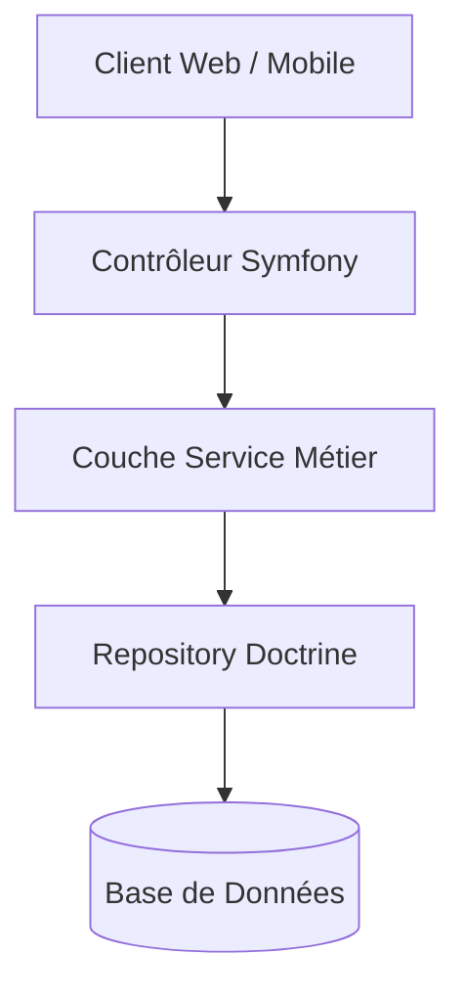

# Guide de Conception et d'Ingestion de Cours pour Agents IA — BrainX

Ce document constitue la **spécification de référence** destinée aux agents d'intelligence artificielle (et aux développeurs/rédacteurs) travaillant sur le projet **BrainX**. Il décrit précisément la méthodologie, les conventions de structure, les règles pédagogiques et les procédures techniques pour créer, enrichir et importer des cours complets à partir de sources hétérogènes.

---

## 1. Vision et Rôle de l'Agent IA

BrainX est une plateforme d'apprentissage centralisant les cours, ressources, codes sources, diagrammes et vidéos d'écoles d'ingénieurs et d'universités.

Le rôle de l'IA lors d'une tâche de création de cours est d'agir en tant qu'**Ingénieur Pédagogique Senior & Architecte Technique** :
1. **Assimiler les sources brutes** fournies par le formateur (documents Office, PDFs, dépôts Git, notes Notion, scripts SQL, cours magistraux).
2. **Dégager un fil conducteur métier cohérent** (*Pedagogical Narrative*) reliant théorie, modélisation et code réel.
3. **Produire des leçons Markdown complètes et exhaustives**, prêtes pour la production, sans jamais recourir à des placeholders, résumés tronqués ou stubs (« TODO »).
4. **Ingérer proprement les cours** dans le backend Django (`apps.content`) via la commande de gestion dédiée.
5. **Vérifier l'intégrité de l'affichage frontend** (table des matières, blocs de code, pièces jointes, diagrammes).

---

## 2. Cartographie des Sources (`docs/`, Repos Git, Liens Web)

Les sources pédagogiques peuvent provenir de plusieurs canaux et sont généralement déposées dans le répertoire `docs/` ou renseignées par l'utilisateur.

### 2.1 Organisation du dossier `docs/`
```text
docs/
├── JAVA/                     # Supports de cours (PDF, DOCX) & notes de séance
├── SYMFONY/                  # Guides de démarrage, slides, architecture
├── SQLSERVER/                # Présentations (PPTX), ateliers pratiques (DOCX, PDF)
├── DB_ADMIN_FILES/           # Scripts T-SQL réels, schémas de BDD (.sql)
├── C#/                       # Supports de formation .NET / C# (PDF)
├── GUIDE_CONCEPTION_COURS_IA.md # Le présent guide
└── testing-guidelines.md     # Bonnes pratiques de test DRF
```

### 2.2 Extraction du Contenu des Sources par l'IA
Pour analyser les fichiers volumineux déposés dans `docs/` sans dépendre d'un environnement externe, l'agent IA peut utiliser des scripts Python temporaires dans `scratch/` :

- **Pour les fichiers `.sql`, `.txt`, `.md`, `.json`** : Lecture directe UTF-8 via l'outil `read_file` ou script Python standard.
- **Pour les dépôts Git distants (ex: GitHub)** :
  ```bash
  git clone <URL_REPO>.git <scratch_dir>/<nom_projet>
  ```
  L'IA inspecte ensuite l'arborescence (`src/`, `Entity/`, `Controller/`, `Service/`, `config/`), l'historique des commits pour suivre l'évolution séance par séance, et les fichiers de configuration réels (`composer.json`, `services.yaml`, `.env.example`).
- **Pour les pages et notes Notion** :
  L'IA utilise l'API publique de Notion (`https://api.notion.com/v1/blocks/<block_id>/children`) ou le parsing direct pour extraire les blocs de texte, listes, code et pièces jointes des séances.
- **Pour les fichiers PDF / DOCX / PPTX** :
  Si nécessaire, installer rapidement les utilitaires d'extraction dans l'environnement virtuel :
  ```powershell
  D:\MY_PROEJCT\BrainX\brainx-api\.venv\Scripts\python.exe -m pip install pypdf python-docx python-pptx
  ```
  Puis extraire le texte brut pour analyse pédagogique.

---

## 3. Principes Pédagogiques Fondamentaux

### 3.1 Le Fil Conducteur Métier (*The Backbone Project*)
Un cours technique ne doit jamais être une simple suite de définitions abstraites ou d'exemples de type `Foo / Bar`.
- **Exemple Symfony** : Le cours s'articule autour de l'application de tontine et d'épargne solidaire **« Avec Les Femmes »**, dispensée par le professeur **Baila Wane**. Chaque séance enrichit le même domaine métier (Adhérentes, Comptes, Prêts, Exercices, Cotisations).
- **Exemple SQL Server** : Le cours s'articule autour de la base transactionnelle d'un système bancaire d'entreprise (`EntrepriseDB` / `BrainX_Production`), de sa volumétrie et de son Plan de Reprise d'Activité (PRA).
- **Exemple Linux SysAdmin** : Le cours compare systématiquement deux serveurs d'entreprise réels déployés en miroir : un serveur **Debian/Ubuntu** (`apt`, `systemd`, `ufw`, `apparmor`) et un serveur **RHEL/Rocky Linux** (`dnf`, `systemd`, `firewalld`, `SELinux`).

### 3.2 Respect Chronologique du Formateur
Quand le formateur découpe son enseignement en séances datées ou en ateliers numérotés :
1. Respecter scrupuleusement la progression pédagogique de l'enseignant.
2. Faire correspondre chaque séance ou atelier à un chapitre ou une leçon dédiée.
3. Conserver les choix architecturaux formulés par le formateur lors de ladite séance.

### 3.3 Utilisation du Code Réel
Tous les blocs de code (`php`, `java`, `csharp`, `sql`, `bash`) doivent provenir directement du dépôt Git de référence ou de scripts testés.
- Mentionner les chemins relatifs réels des classes (ex: `src/Entity/Adherente.php`, `src/Service/DateService.php`).
- Mettre en évidence les commits ou refactorings clés (ex: suppression des requêtes N+1 avec `createQueryBuilder` et `leftJoin`).

### 3.4 Bannières et Callouts Pédagogiques Standards BrainX
Si l'IA enrichit le cours avec des éléments complémentaires (documentation officielle, standards RFC, retours d'expérience d'ingénierie), elle doit utiliser **exclusivement la syntaxe de callouts standards BrainX**, supportée de manière homogène par le frontend React et les parseurs Markdown :

- `> ℹ️ **Information & Contexte d'Ingénierie :**`
- `> 📘 **Fondement Théorique & Architecture :**`
- `> ⚠️ **Mise en Garde & Pièges Fréquents :**`
- `> 💡 **Bonnes Pratiques & Astuces Métier :**`

```markdown
> ℹ️ **[Documentation Officielle - Symfony 7 / Java 17+]**
> Précision sur le fonctionnement interne de l'EventListener ou du ClassLoader...

> 📘 **[Architecture & Décisions de Design]**
> En environnement de production, découpler le service métier de la persistance...

> ⚠️ **[Mise en Garde & Pièges Fréquents]**
> Ne jamais laisser l'accroissement automatique en pourcentage ou fermer System.in prématurément...

> 💡 **[Bonne Pratique d'Ingénierie]**
> Privilégier la composition à l'héritage et recourir aux DTOs composites...
```

> [!CAUTION]
> **Proscription des balises GitHub brutes :**  
> Ne JAMAIS utiliser les balises brutes du type `> [!NOTE]`, `> [!WARNING]`, `> [!TIP]`, `> [!IMPORTANT]` dans les leçons du curriculum. Celles-ci ne sont pas interprétées de façon standard par tous les clients web et créent un affichage dégradé ou inesthétique.

### 3.5 Règle d'Or de l'Immersion Étudiante (Zéro Méta-Discours & Zéro Référence Interne)
Le cours publié sur BrainX est un produit pédagogique d'excellence destiné aux étudiants et apprenants. Il doit respecter les règles strictes d'immersion suivantes :

1. **Aucune référence aux fichiers ou coulisses internes de travail** :
   - Il est formellement interdit de mentionner des noms de fichiers de capture ou de travail internes (`parole01.txt`, `parole05.txt`, `coursdirect`, `Excalidraw`, `transcription brute`, `fichiers scratch/`, `dépôt cloné localement`).
   - L'étudiant ne sait pas et ne doit pas savoir comment les données ont été collectées ou transcrites.
2. **Traitement pédagogique des erreurs ou raccourcis d'enregistrement** :
   - Si une source orale comportait un raccourci verbal ou une coquille phonétique, l'IA ne doit JAMAIS écrire *"dans la transcription parole01, le professeur s'est trompé..."*.
   - L'IA formule la règle de manière universelle et bienveillante : *"Attention à une confusion fréquente chez les développeurs débutants entre le compilateur javac et la JVM java..."*, ou *"Revue de code : analyse de deux pièges classiques en interface console..."*.
3. **Posture d'auteur académique** :
   - Le cours doit être rédigé avec l'autorité naturelle du professeur référent (ex: Baila Wane, Modou Kara Samb) et la rigueur d'un cours magistral d'école d'ingénieurs.

---

## 4. Architecture Technique du Répertoire `curriculum/`

Le dossier racine `curriculum/` obéit à une hiérarchie stricte à **4 niveaux** imposée par le mécanisme d'ingestion et les modèles relationnels Django :

```text
curriculum/
├── <01-NomDuCours>/                             # [Niveau 1] Course
│   ├── <01-NomDuModule>/                        # [Niveau 2] Module
│   │   ├── <01-NomDuChapitre>/                  # [Niveau 3] Chapter
│   │   │   ├── <01-TitreDeLaLecon>.md           # [Niveau 4] Lesson (Markdown)
│   │   │   └── attachments/                     # Pièces jointes liées au chapitre (Optionnel)
│   │   │       ├── architecture.mdj
│   │   │       ├── schema-reseau.png
│   │   │       └── script-creation.sql
```

### 4.1 Conventions de Nommage des Répertoires
- Toujours préfixer par un numéro d'ordre à deux chiffres suivi d'un tiret : `01-`, `02-`, `03-`...
- Utiliser des tirets pour séparer les mots (kebab-case avec majuscules initiales pour la lisibilité).
- Ne jamais mettre de caractères accentués ou spéciaux dans les noms de dossiers pour assurer une portabilité parfaite entre Windows, Linux et macOS.

### 4.2 Dossier `attachments/`
- Si une leçon référence un fichier téléchargeable (modèle StarUML `.mdj`, document PDF, script `.sql`, image SVG/PNG), ce fichier doit être déposé dans un sous-dossier nommé `attachments/` situé au même niveau que le fichier `.md` de la leçon.
- La commande d'importation associera automatiquement ces fichiers en tant qu'objets `Resource` attachés à la leçon correspondante.

---

## 5. Structure Obligatoire d'un Fichier Leçon (`.md`)

Chaque fichier leçon Markdown doit respecter la structure suivante :

### 5.1 En-tête YAML Frontmatter
Le fichier **doit impérativement commencer** par un bloc YAML délimité par `---` :

```yaml
---
title: "Séance 4 : Cycle MVC, Refactoring DTO/Service et Résolution du N+1 Query"
description: "Compréhension approfondie du cycle de vie d'une requête HTTP dans Symfony, refactoring de la logique métier vers une couche Service et optimisation Doctrine."
order: 1
duration: 90
level: "Intermediate"
---
```

### 5.2 Règle Vitale du Corps de Leçon (Markdown Body)
> [!IMPORTANT]
> **Fonctionnement interne de BrainX :**
> Lors de l'ingestion (`import_curriculum.py`), le corps Markdown complet (tout le texte situé après le second `---`) est stocké dans la colonne `description` du modèle `Lesson`.
> Sur le frontend React (`lesson-detail-page.tsx`), cette chaîne Markdown est directement parsée par le moteur de rendu et analysée par `extractHeadings()` pour construire dynamiquement la **Table des Matières latérale (TOC)** à partir des balises `#`, `##` et `###`.
> 
> **Conséquence directe :**
> - Ne JAMAIS laisser un fichier avec seulement 3 lignes de texte ou un résumé succinct.
> - Structurer impérativement le texte avec des titres de niveau 1 (`#`), niveau 2 (`##`) et niveau 3 (`###`).
> - Une leçon complète de qualité professionnelle doit généralement comporter entre **4 000 et 12 000 caractères**.

### 5.3 Modèle Type d'une Leçon Réussie

```markdown
---
title: "Titre Concis et Explicite"
description: "Résumé en une ou deux phrases de l'objectif opérationnel de la leçon."
order: 1
duration: 90
level: "Intermediate"
---

# Titre Principal de la Leçon

Introduction contextualisée rappelant où nous en sommes dans le fil conducteur métier...

---

## 1. Concepts Théoriques & Schéma d'Architecture

Explication des principes fondamentaux sous-jacents.



---

## 2. Démonstration Pratique par le Code

Explication des choix d'implémentation et mise en garde sur les pièges fréquents.

```php
namespace App\Service;

use App\Repository\AdherenteRepository;

class TontineService
{
    public function __construct(
        private readonly AdherenteRepository $adherenteRepository
    ) {}

    public function calculerSoldeGlobal(): float
    {
        // Implémentation réelle issue du projet
    }
}
```

> 📘 **[Complément d'architecture & Bonnes pratiques]**
> Détail sur l'injection de dépendances et l'immutabilité PHP 8.2...

---

## 3. Procédure Pas-à-Pas et Commandes de Validation

```bash
# Vérification du conteneur de services
php bin/console debug:autowiring TontineService
```

---

## 4. Exercices d'Application ou Questions d'Auto-évaluation

1. Quelle est la différence entre une entité et un DTO ?
2. Pourquoi ne doit-on jamais placer de requêtes SQL directement dans un template Twig ?
```

---

## 6. Procédure Technique d'Ingestion & Validation

Toute opération de création ou mise à jour de cours doit être validée par les étapes techniques suivantes sous Windows PowerShell :

### 6.1 Exécution de la Commande d'Ingestion
Exécuter la commande Django depuis le dossier `brainx-api` en utilisant le virtualenv local :

```powershell
D:\MY_PROEJCT\BrainX\brainx-api\.venv\Scripts\python.exe D:\MY_PROEJCT\BrainX\brainx-api\manage.py import_curriculum --path curriculum
```

La sortie console doit afficher :
- La détection de chaque cours (`[Course +]`), module (`[Module +]`), chapitre (`[Chapter +]`) et leçon (`[Lesson +]`).
- Le récapitulatif final (ex: `Courses: 5, Modules: 20, Chapters: 31, Lessons: 31, Resources: 19`).

### 6.2 Résolution des Conflits de Contrainte d'Unicité
La base de données BrainX applique des contraintes strictes :
- `unique_module_position_per_course`
- `unique_chapter_position_per_module`
- `unique_lesson_position_per_chapter`

Si des titres de dossiers ou de fichiers sont renommés sur le disque, `import_curriculum.py` met à jour les enregistrements existants à la même position. Si une désynchronisation majeure survient lors de tests exploratoires, réinitialiser proprement les cours avec un script Python :

```python
import os, sys, django
sys.path.insert(0, r"D:\MY_PROEJCT\BrainX\brainx-api")
os.environ.setdefault('DJANGO_SETTINGS_MODULE', 'config.settings.development')
django.setup()
from apps.content.models import Course
Course.objects.all().delete()
```
Puis relancer `import_curriculum --path curriculum`.

### 6.3 Script d'Audit Post-Ingestion Obligatoire
Après tout import, exécuter ce script d'audit pour vérifier qu'aucune leçon n'a été tronquée et que les descriptions sont complètes :

```python
import os, sys, django
sys.path.insert(0, r"D:\MY_PROEJCT\BrainX\brainx-api")
os.environ.setdefault('DJANGO_SETTINGS_MODULE', 'config.settings.development')
django.setup()
from apps.content.models import Course, Lesson

courses = Course.objects.all().order_by('position', 'name')
for c in courses:
    lessons = Lesson.objects.filter(chapter__module__course=c).order_by('position')
    print(f"\n[Cours] {c.name} ({lessons.count()} leçons):")
    for l in lessons:
        desc_len = len(l.description) if l.description else 0
        has_headings = '#' in (l.description or '')
        status = "OK" if desc_len > 2000 and has_headings else "ERREUR/TROP_COURT"
        print(f"  - {l.title[:50]:50} | {desc_len:5} car. | {status}")
```

### 6.4 Vérification des Tests Unitaires
Exécuter la suite de tests pour certifier que la commande d'importation et les modèles n'ont pas subi de régression :

```powershell
D:\MY_PROEJCT\BrainX\brainx-api\.venv\Scripts\python.exe D:\MY_PROEJCT\BrainX\brainx-api\manage.py test apps.content.tests.test_import_curriculum --keepdb
```

---

## 7. Checklist de Fin de Tâche pour l'Agent IA

Avant de notifier l'utilisateur de l'achèvement d'une tâche de cours :

- [ ] Toutes les sources fournies (`docs/`, Notion, dépôts Git) ont été lues et exploitées.
- [ ] Le fil conducteur métier est clairement identifiable à travers les leçons.
- [ ] Les apports externes (doc officielle, standards) sont systématiquement taggés avec la syntaxe standard BrainX (`> ℹ️`, `> 📘`, `> ⚠️`, `> 💡`).
- [ ] **Zéro méta-discours** : aucune référence à des fichiers locaux de travail (pas de `parole01`, de `transcription`, d'`Excalidraw`, ni de mention de scripts de dev).
- [ ] **Proscription des balises brutes GitHub** : aucun `[!NOTE]`, `[!WARNING]`, `[!TIP]` n'apparaît dans le curriculum.
- [ ] Les 4 niveaux de répertoires (`Cours / Module / Chapitre / Leçon.md`) sont scrupuleusement respectés.
- [ ] Les en-têtes YAML contiennent `title`, `description`, `teacher`, `order`, `reading_time`, `tags`, `resources`.
- [ ] Chaque leçon fait plus de 3 000 caractères et comporte des titres `#`, `##` et `###` pour alimenter le TOC frontend.
- [ ] Les pièces jointes sont placées dans `attachments/` au niveau chapitre avec `type: document` déclaré dans le frontmatter.
- [ ] La commande `import_curriculum` a été exécutée avec succès sans collision.
- [ ] Le script d'audit valide que toutes les leçons sont en statut `OK` (caractères > 3 000, teacher exact, headings `#`).
- [ ] Les liens de fichiers Markdown fournis dans la réponse à l'utilisateur utilisent le format standard `[nom](file:///D:/chemin/vers/fichier)`.
